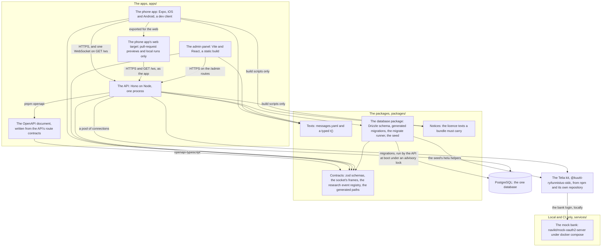
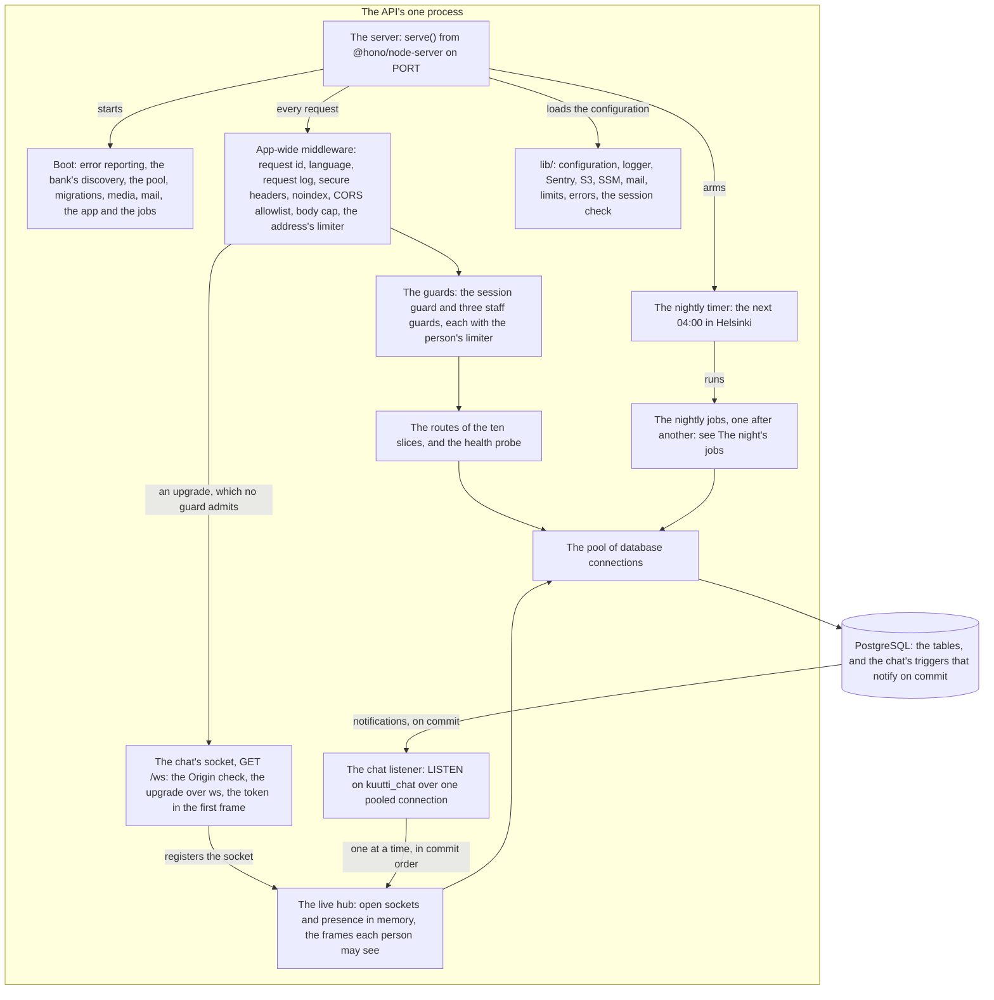
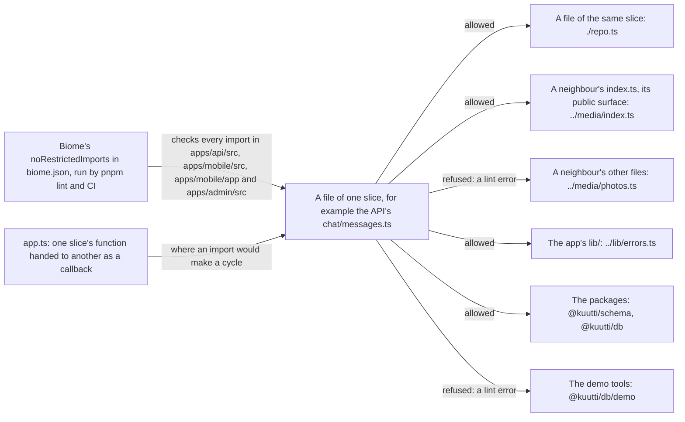

# Components

<!-- draws
apps/api/src/index.ts
apps/api/src/jobs/nightly.ts
apps/api/src/chat/ws.ts
apps/api/src/chat/listen.ts
apps/api/scripts/openapi.ts
apps/mobile/src/lib/api.ts
apps/admin/src/lib/api.ts
packages/db/src/migrate.ts
biome.json
docker-compose.yml
.claude/rules/layout.md
-->

What Kuutti is made of, as the repository holds it: the three apps, the four packages, the Telia kit from npm and the mock bank; what is inside the API's one process; the ten slices and which app holds which; and the import boundary between slices. It is written for a contributor or a reviewer who wants the whole before reading the code. Where each part runs is the deployment view, and the outside services are the context view. This view draws ADR-003 (the generated client), ADR-017 §6 (the kit in its own repository), ADR-031 §9 (the socket in the same process) and the layout rules of `.claude/rules/layout.md`.

## Part 1: the workspace

### Steps

1. **The phone app** (`apps/mobile`): Expo with a dev client, for iOS and Android. It calls the API over HTTPS through `openapi-fetch`, typed by the generated paths (6), and holds one WebSocket to `GET /ws` while it is signed in and in front (see Chat). It imports the contracts (6) and the texts (7). Its build script for the licences screen uses the notices package (9). It is exported for the web as its web target (2).
2. **The web target** is the same code, exported with `expo export --platform web`. It exists for pull-request previews (EAS Hosting, alias `pr-<n>`) and for local runs, never as a product web surface (rule 8). It talks to the API as the phone app does; it cannot set a header on a WebSocket, which is why the socket takes its token in the first frame.
3. **The admin panel** (`apps/admin`): Vite and React, built to static files. It calls the API's `/admin` routes over HTTPS through `openapi-fetch`, typed by the same generated paths, and imports the contracts (6) and the texts (7).
4. **The API** (`apps/api`): Hono on Node in one process, which serves HTTP, the chat's WebSocket and the nightly jobs (part 2). It imports the contracts (6), the texts (7), the database package (8) and the Telia kit (10), and keeps its data in PostgreSQL (12) through a pool. Its route contracts are written out as the OpenAPI document (5). Its build script for the image's third-party notices uses the notices package (9).
5. **The OpenAPI document** (`apps/api/openapi.json`) is written by `pnpm openapi` from the routes the API declares with `createRoute`, and the same command turns it into the generated paths in the contracts package with `openapi-typescript` (ADR-003). CI runs the command and fails on a difference. The running API serves the document at `/openapi.json` everywhere except production.
6. **Contracts** (`packages/schema`, `@kuutti/schema`): the zod schemas that validate every request at the API's boundary and type its answers, the socket's frames both ways, the research event registry, and the generated paths both clients are typed by. It is the only place a feature's code is shared between the apps (layout rules).
7. **Texts** (`packages/i18n`, `@kuutti/i18n`): `messages.yaml`, a typed `t()`, i18next and ICU, for the phone app, the API and the admin panel. Horizontal: every slice uses it and none owns it.
8. **The database package** (`packages/db`, `@kuutti/db`): the Drizzle schema, the migrations drizzle-kit generated, the runner that applies them under an advisory lock (rule 10), and the seed. Its demo tools (`@kuutti/db/demo`) are for command lines and tests only; the linter keeps them out of the apps (part 4). It depends on the contracts (6), and its seed uses the kit's hetu helpers (10) to write the personas.
9. **Notices** (`packages/notices`, `@kuutti/notices`): reads the licence files and NOTICE files of what a bundle ships. Two build scripts use it: the phone app's licences screen and the API image's `THIRD_PARTY_NOTICES`. No app imports it at run time.
10. **The Telia kit** (`@kuutti-ry/tunnistus-oidc`): the OIDC client in Telia's dialect, discovery, key helpers, the hetu format and the broker's test double. It comes from npm and lives in its own repository, kuutti-ry/tunnistus-oidc, MIT (ADR-017 §6); it is not a workspace package. The API's identity slice holds the adapter that keeps Kuutti's part of a login. Deployed, the kit talks to Telia's broker (the context view); on a developer's machine, to the mock bank (11).
11. **The mock bank** (`services/mock-idp`): navikt/mock-oauth2-server with one issuer, `ftn`, started by `docker compose` beside PostgreSQL and the S3 stand-in. Its login page names the demo personas (ADR-014). It runs on a developer's machine and on CI's runners (`ci.yml`'s compose job and `e2e.yml`'s jobs) only; no mock bank is deployed beside a preview.
12. **PostgreSQL**: the one database. The API reaches it through one pool; the migrations reach it through the database package's runner, which the API calls at boot before it listens.

## Part 2: inside the API's one process

### Steps

13. **The server.** `index.ts` loads the configuration through `lib/` (23), boots (14), arms the nightly timer (21), and serves the app on `PORT` with `serve()` from `@hono/node-server`, whose own WebSocket upgrade runs over `ws` on the same server (ADR-031 §9). Every request goes to the app-wide middleware (15). On SIGTERM it tells every socket `restarting`, drains the requests in flight within ten seconds, then stops the listener and the pool.
14. **Boot** (`boot.ts`) turns error reporting on where a DSN is configured, reads the bank's discovery document through the kit, creates a preview's own database on its first boot, opens the pool, runs the migrations under their advisory lock, makes the research events' partitions, builds media (S3 and the photo check), makes the live hub, builds mail, builds the app, and lists the nightly jobs. A deployed box with half a bank configuration fails here rather than serving a login that answers 503.
15. **The app-wide middleware**, in order: the request id, the request's language, the request log, secure headers, `X-Robots-Tag: noindex`, the CORS allowlist, the body cap (the two photo uploads have their own 10 MB cap on their routes), and the limiter keyed by the client address (ADR-026). A request goes on to a guard (16), or straight to its route when the route answers without a session (the health probe, the sign-in's own routes, the public waitlist); the socket's upgrade goes to the socket (18).
16. **The guards.** One session guard for every route that reads a person's data (rule 6), and three staff guards: any member of staff (moderator, admin or researcher), moderators and admins, and admins alone. Each hands the request it admits to one limiter keyed by the person, and the address gets its count back. The routes that answer without a session are listed in `PUBLIC_ROUTES`; a test checks that no other route lacks a guard.
17. **The routes** of the ten slices (part 3) and the health probe. They reach PostgreSQL through the pool (24), and the outside services (S3, Rekognition, SES, Telia) through what boot handed them. Where two slices must not import each other, `app.ts` hands one slice's function to the other as a callback (part 4).
18. **The chat's socket**, `GET /ws`. The upgrade passes the app-wide middleware (15), so the address's limiter counts it, but no guard: the token comes in the first frame and is checked by the session guard's own code. A browser's Origin must be the API's own host or on the allowlist. A frame is at most 256 KiB, bounded before it is read. The socket only tells; writing stays on the HTTP routes. The socket registers with the hub (19). The Chat view has the steps.
19. **The live hub** (`chat/live.ts`, `chat/presence.ts`): which accounts have a socket open, in the process's memory and never in a table, and the frames each person may see, read through that person's own participant row. It reads PostgreSQL through the pool (24).
20. **The chat listener** (`chat/listen.ts`) holds one connection of the pool for `LISTEN kuutti_chat`. The triggers of migrations 0055, 0059 and 0063 notify on that channel when a transaction commits, with ids and numbers only (25). The listener hands each notification to the hub, one at a time, in the order Postgres delivers them (19).
21. **The nightly timer** (`jobs/nightly.ts`): one timer to the next 04:00 in Helsinki, armed again after each run. It runs the jobs (22).
22. **The nightly jobs**, listed in `boot.ts` and run one after another; a failure is logged and the next job runs. They reach PostgreSQL through the pool (24). The Night's jobs view has the order and the steps.
23. **`lib/`**: horizontal code every slice uses and none owns. The configuration is validated with zod at start; on AWS its values come from SSM through the instance role. Also the logger, Sentry, the S3 client, mail, the rate limits, the error envelope and the session check the guard and the socket share.
24. **The pool**: `DB_POOL_MAX` connections, one of them held by the chat listener (20).
25. **PostgreSQL**: the tables, and the chat's triggers, which send a notification when their transaction commits and none when it rolls back. Its notifications go to the listener (20).

## Part 3: the slices, and which app holds which

Code inside each app is organised by slice, never by layer (`.claude/rules/layout.md`). A matrix reads better as a table than as a drawing. "Yes" means the app has the slice's directory with code in it, as on `main`; the last column is what the layout rules' matrix says (API, phone app, admin panel).

| Slice | API, `apps/api/src/` | Phone app, `apps/mobile/src/features/` | Admin panel, `apps/admin/src/features/` | Spec, `features/` | The layout rules' matrix |
|---|---|---|---|---|---|
| identity | yes | yes | yes: staff sign-in | yes | heavy, thin, auth only |
| profile | yes | yes | no directory | no | medium, heavy, read |
| media | yes | yes | yes: the photo queue | yes | heavy, medium, queue |
| pond | yes | yes | no directory | yes | medium, thin, read |
| matching | yes | yes | no directory | yes | heavy, heavy, none |
| chat | yes | yes | no directory | yes | heavy, heavy, snapshots |
| safety | yes | yes | yes: the overview, reports, accounts, sanctions, automatic bans, feedback, staff, the audit log, matching_config | yes | medium, thin, heavy |
| research | yes | a README only | no directory | no | medium, none, read |
| rewards | yes | yes | no directory | no | light, light, none |
| notifications | yes | yes | no directory | no | light, light, none |

Besides the slices, the API has `health/`, `jobs/` (the nightly timer and the jobs that read across slices: the waitlist count, the pond gate, the invitation count, the round builder), `lib/` and `test/`; the phone app has `home/` and `settings/` among its features, and `src/lib/`; the admin panel has `src/lib/`.

1. **identity**: the bank login, accounts, sessions, re-registration, taking a break, staff sessions. In all three apps; specs in `features/identity`.
2. **profile**: onboarding, profile fields and prompts, completeness. API and phone app.
3. **media**: the photo pipeline, signed URLs, the automatic check and the human queue. In all three apps (the admin panel's photo queue); spec in `features/media`.
4. **pond**: ponds, the waitlist counter and the gate's answer. API and phone app; specs in `features/pond`.
5. **matching**: rounds, deal-breakers, likes, the fish, the match. API and phone app; specs in `features/matching`.
6. **chat**: conversations, messages, the socket, contacts shared, the archive. API and phone app; specs in `features/chat`.
7. **safety**: reports, blocks, sanctions, the audit log, the automatic shadow bans, velocity. In all three apps; the admin panel's screens are all in this slice. Specs in `features/safety`.
8. **research**: the event registry's one door (`track`), the `research_id` mapping, the partitions and the research copy. The API alone has code; the phone app's directory holds a README only.
9. **rewards**: invitations and the reward ledger. API and phone app.
10. **notifications**: the notification choices and the notices in the app. API and phone app; no push is sent yet (#102).

## Part 4: the import boundary

### Steps

26. **A file of one slice.** The example is the API's `chat/messages.ts`, which imports its own slice's `./repo.ts` and `./conversations.ts` (27), the media, profile and research slices through their `index.ts` (28), `../lib/errors.ts` (30), and `@kuutti/db` and `@kuutti/schema` (31).
27. **Its own slice's files**: allowed, by relative path inside the slice.
28. **A neighbour's `index.ts`**: allowed. It is the neighbour's public surface; anything another slice needs is exported there, or moves down into `lib/`.
29. **A neighbour's other files**: refused. `pnpm lint` fails with "Slices import from a neighbour only through its index.ts, never its internals".
30. **The app's `lib/`**: allowed.
31. **The packages** `@kuutti/schema` and `@kuutti/db`: allowed.
32. **The demo tools**, `@kuutti/db/demo`: refused in the apps' code, so the API's image and the clients' bundles carry nothing of the personas or the synthetic population (ADR-014). Command lines under `scripts/` and tests may import them.
33. **The check**: Biome's `noRestrictedImports`, in the overrides of `biome.json`, for `apps/api/src`, `apps/mobile/src`, `apps/mobile/app` and `apps/admin/src`, and again for `apps/api/scripts` without the demo rule. It is part of `pnpm lint`, which CI runs on every pull request (#2).
34. **The callbacks in `app.ts`.** Two slices that would import each other in a cycle meet in `app.ts` instead: the safety slice's check of a conversation's first message is handed to the chat's routes, so the chat never imports safety; the chat's opening of a conversation is handed to the round's routes, since the chat imports the profile, which imports matching.

## Where it lives

- Apps: `apps/mobile` (`app.json`, `src/lib/api.ts`, `src/features/`), `apps/admin` (`src/lib/api.ts`, `src/features/`), `apps/api` (`src/index.ts`, `src/boot.ts`, `src/app.ts`, `src/jobs/nightly.ts`, `src/chat/ws.ts`, `src/chat/live.ts`, `src/chat/listen.ts`, `src/lib/`)
- Packages: `packages/schema` (`src/index.ts`, `src/chat-frames.ts`, `src/api.generated.ts`), `packages/i18n`, `packages/db` (`src/migrate.ts`, `drizzle/`), `packages/notices`; the kit: `@kuutti-ry/tunnistus-oidc` in `apps/api/package.json` and `packages/db/package.json`
- Local services: `services/mock-idp`, `docker-compose.yml`
- The boundary: `biome.json` (overrides), `.claude/rules/layout.md`, `package.json` (`lint`)
- The generated client: `apps/api/scripts/openapi.ts`, `apps/api/openapi.json`, `.github/workflows/ci.yml` (the drift check)
- The web target: `.github/workflows/preview.yml` (the export and the EAS Hosting alias)
- Specs: `features/identity`, `features/media`, `features/pond`, `features/matching`, `features/chat`, `features/safety`
- ADRs: [ADR-003](../adr/003-types-across-the-client-server-boundary.md) (the generated client), [ADR-014](../adr/014-demo-mode.md) (the mock bank and the demo tools), [ADR-017](../adr/017-tunnistus-oidc-package.md) §6 (the kit's own repository), [ADR-021](../adr/021-tests-at-every-level.md) (the levels the packages carry), [ADR-026](../adr/026-limits-per-person-and-sign-in-doors.md) (the limiters), [ADR-031](../adr/031-chat.md) §9 (the socket in the process)
- Issues: #1 and #2 (the slices and their boundary), #44 (the kit to npm), #349 (the socket), #416 (the notices package)

## Open

- **The admin panel's slices.** The layout rules' matrix gives the admin panel profile "read", pond "read", chat "snapshots" and research "read", but `apps/admin/src/features` holds identity, media and safety only. What exists of the others is in safety's screens (the account page shows the pond, the report page shows a conversation's frozen copy), and a researcher has no screen (`apps/admin/src/app.tsx`, "until #194"). Part 3 draws the directories; whether the matrix or the panel's layout changes is the maintainer's.
- **The RPC style.** `.claude/rules/api.md` still calls the style across the boundary an open decision; ADR-003 is accepted and CLAUDE.md lists it as settled. Drawn as ADR-003.
- **The web preview's bank.** `.claude/rules/mobile.md` says the web preview runs against the mock IdP and seed data; `apps/api/src/lib/config.ts` says no mock bank is deployed beside a preview and its login answers `auth_unavailable`. Drawn neither way: the web target's box says previews only.
- **An eleventh name in the boundary.** `biome.json`'s patterns also guard a slice named `smoke`, and no directory of that name exists. Not drawn.
