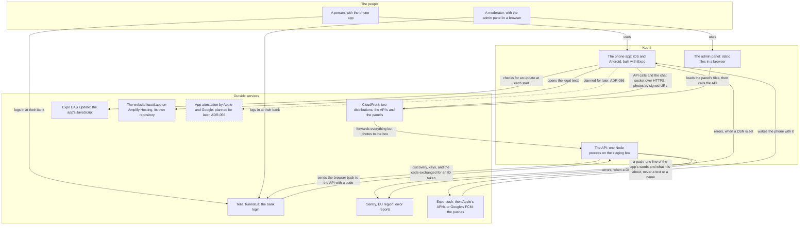
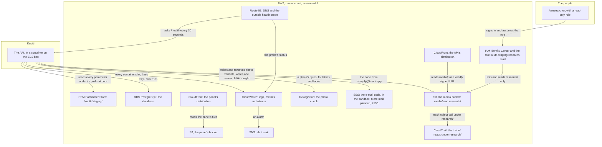

# Context

<!-- draws
apps/api/src/lib/ssm.ts
apps/api/src/lib/s3.ts
apps/api/src/lib/mail.ts
apps/api/src/lib/push.ts
apps/api/src/lib/sentry.ts
apps/api/src/identity/oidc-broker.ts
apps/api/src/media/wiring.ts
apps/api/src/research/copy-store.ts
apps/mobile/app.json
apps/mobile/eas.json
apps/mobile/src/lib/api-url.ts
apps/mobile/src/lib/sentry.ts
packages/i18n/src/legal.ts
infra/bootstrap/
-->

Who uses Kuutti, and which outside services it depends on: the direction of every call and what travels on it. It is for a contributor or a reviewer who wants the whole picture before reading the code or `infra/`. It draws staging, the one environment that runs today; production, applied on 2026-10-24 without bank identification (ADR-049), composes the same services less a few ([Deployment](deployment.md), part 5). Outside AWS, Kuutti has four vendors: Expo, GitHub, Telia and Sentry. This view draws ADR-001, ADR-004, ADR-005, ADR-006, ADR-014, ADR-016, ADR-017, ADR-018, ADR-025, ADR-029, ADR-031, ADR-032, ADR-041, ADR-043, ADR-052, ADR-055 and ADR-056.

## Part 1: the people and what their devices reach

### Steps

1. A person: an adult whom the bank has verified. They use the phone app and nothing else; there is no web surface for the product (rule 8).
2. A moderator: a member of staff whose bank identity holds a role. They use the admin panel in a browser and sign in through the bank, as the app does; the panel's login starts at the API and returns to the panel.
3. The phone app: Expo SDK 57 for iOS and Android. A release build talks to the API over HTTPS only, at the address its EAS profile or its preview gives it.
4. The admin panel: a Vite and React build, served as static files from S3 behind CloudFront at `admin.staging.kuutti.app`. It talks to the staging API and to nothing else: its content security policy names that one origin.
5. The API: Hono on Node, one process that serves HTTP, the WebSocket and the nightly jobs. It runs in a container on the staging box ([Deployment](deployment.md), part 2).
6. CloudFront: two distributions. The API's, on `api.staging.kuutti.app`, sends every request to the box except `/media/*`, which it serves from the private media bucket only for a URL the API signed (fifteen minutes, or up to twenty for a photo sent in a conversation). The panel's, on `admin.staging.kuutti.app`, serves the panel's files from its own bucket. Dokploy's control plane and a pull request's preview do not pass through CloudFront: they reach the box directly.
7. Telia Tunnistus: the broker of Finnish bank IDs; staging uses Telia's pre-production bed and its test persons. The API reads Telia's discovery document and keys at boot. A sign-in sends the browser to Telia, the person logs in at their bank every time, and Telia sends the browser back to the API's callback with a code. The API exchanges the code with a signed client assertion and decrypts the ID token. A pull request's preview has no bank login; a developer's machine uses the mock bank ([Deployment](deployment.md), part 1).
8. Expo EAS Update: the app's JavaScript bundle. The app checks for an update at each start, on the channel its build names: `staging` for the development and preview builds, `production` for the store build. Updates are not code-signed (ADR-004).
9. Sentry, in its EU data region: error reports from the API and the app, with every category of data the SDK would collect by itself switched off in the API. Each is on only where a DSN is set: the parameter `sentry-dsn` for the API, `EXPO_PUBLIC_SENTRY_DSN` for the app.
10. The website `kuutti.app`, on AWS Amplify Hosting, built from its own repository `kuutti-ry/kuutti-app-site`. The app opens the full legal texts there. No arrow joins the website and the API: the API's browser allowlist on staging names the panel's origin alone.
11. Push through Expo (#102, ADR-055): the API sends each push to Expo's push service over HTTPS, at most a hundred a request, and Expo hands it to Apple's APNs or Google's FCM, which wake the phone. A push carries the device's token, one line of the app's own words in the device's language (a new message, a new match, today's round) and its kind, never a message's text, a name, an account or the conversation, whose id would pair the two phones for the vendors. The app registers its token with the API (`PUT /push-token`) once the phone lets Kuutti notify; the API sends where the parameter `push` says `expo`, as on staging, and reads receipts back once, fifteen minutes later, to forget tokens Apple or Google no longer know. What Expo receives and keeps: `docs/vendors/expo.md`.
12. App attestation by Apple and Google: planned for later, not built. It may come back when one of ADR-056 §1's triggers holds, the maintainer's call. Screenshots are never noticed, so no service stands for them (ADR-056 §4).

## Part 2: the API and the AWS services it calls

### Steps

13. The API, in a container on the staging box, an EC2 instance. Its credentials are the instance role's, through the instance metadata; no static AWS key exists anywhere.
14. SSM Parameter Store: at boot the API reads every parameter under `/kuutti/staging/`, decrypted, and turns each into an environment variable. The non-secret ones (the database's address, `moderation`, `mail`, `push`, the bank's issuer and client) are written by `infra/envs/staging`; the secrets (the hetu HMAC key, the two Telia keys, the CloudFront signing key, the database passwords, and Expo's access token once EAS's enhanced push security is on) are made by hand and never appear in code or state. The instance role reaches its own prefix and is explicitly denied every other. A pull request's preview reads the same prefix under the same role; the API's own code drops the secrets a preview must not use, which is no boundary ([Trust](trust.md), step 8).
15. RDS PostgreSQL: the API connects over TLS with full verification, as its own role `kuutti_app`. Only the box's security group reaches port 5432.
16. S3, the private media bucket: the API writes each photo's variants under `media/` and removes them on erasure; versioning is off, so an erased photo is gone. The night's job writes one Parquet file a day under `research/`, once, never replaced or removed.
17. CloudFront, the API's distribution: it reads `media/` through origin access control, and only for a URL whose signature checks out against the key group. The API signs each URL itself with the private key from SSM; it never calls CloudFront.
18. S3, the panel's private bucket: `main`'s build at its root and each open pull request's under `pr-<n>/`, written by CI ([Delivery](delivery.md)); Saiga's faces under `fonts/`, which the maintainer uploads by hand (41).
19. CloudFront, the panel's distribution: the only reader of the panel's bucket. It adds the panel's security headers to every answer and answers a page's path with `index.html`.
20. Rekognition: three detect calls (moderation labels, faces, labels), on when the parameter `moderation` says `rekognition`, as it does on staging. The photo's bytes travel in the request and nothing is stored on Rekognition's side. Without the parameter every photo waits for a person in the moderation queue.
21. SES: the code that confirms the optional e-mail address, from `noreply@kuutti.app`, an alias at the association's Google Workspace (#385, ADR-043). The domain's identity lives in `infra/bootstrap`, which only the maintainer applies; he applied it on 2026-10-25, SES verified the domain, its DKIM and the MAIL FROM `mail.kuutti.app`, and staging's parameter `mail` says `ses`. SES is in its sandbox until the maintainer asks AWS for production access, so it delivers only to verified identities, the addresses of `kuutti.app` among them, and staging's role may mail only what the repository variable `MAIL_TESTERS` matches, `*@kuutti.app` since 2026-10-25. Further mail is planned, #196.
22. CloudWatch: Docker on the box sends every container's log lines to `/kuutti/staging/api`, Dokploy's own included. Metric filters count the API's 5xx answers, photo refusals, Rekognition calls and failed nightly jobs. Alarms watch each of those counts but the Rekognition one, the instance's status check, the instance's and the database's CPU credits, the database's free storage, and the box's free memory, which the box itself pushes every minute (#77).
23. SNS: the topic `kuutti-staging-alerts` mails the address of the repository variable `ALERT_EMAIL`. The probe's alarm has a topic of its own in us-east-1 with the same address, and the bootstrap's billing alarm and budget a third.
24. Route 53: the zone `kuutti.app`, adopted from the domain's registration, holds every record. Its health check asks `https://api.staging.kuutti.app/health` every 30 seconds from three regions and wants the body to say the API is up; it is the one alarm that sees a stopped container.
25. IAM Identity Center and the role `kuutti-staging-research-read`: the researcher is an Identity Center user assigned the permission set `KuuttiResearchStaging`, whose one right is assuming the role (the trust's wildcard suffix would also admit a set named `KuuttiResearchStaging_<anything>`; only the maintainer creates sets). The role may list and read `research/` of the media bucket and nothing else, for an hour at a time.
26. CloudTrail: the trail `kuutti-staging-research-access` records every object call under `research/` (the researcher's reads, the API's nightly write and census reads) into a versioned bucket of its own, with log-file validation.
27. A researcher: the research partner, reading the daily research copy with the AWS command line. Only staging has the copy; production writes none until the maintainer has answered ADR-029's open points.

## Part 3: how code reaches the services

```mermaid
flowchart TB
  accTitle: Context, part 3: how code reaches the services
  accDescr: A contributor pushes to the repository on GitHub, which starts GitHub Actions. The workflows push the API image to GHCR, deploy it through Dokploy on the staging box, which pulls it, and exchange their OIDC token for an AWS role to plan and apply the infrastructure. They start native builds on EAS Build, publish JavaScript to EAS Update, put a pull request's web export on EAS Hosting and upload source maps to Sentry. EAS Build, and the website's Amplify, fetch the typeface from the association's private fonts repository with a token of their own, which no workflow holds; the maintainer uploads the panel's copy by hand. The website deploys from its own repository through Amplify.
  subgraph people3["The people"]
    n28["A contributor or the maintainer"]
  end
  subgraph github["GitHub"]
    n29["The repository kuutti-ry/kuutti-app"]
    n30["GitHub Actions: the workflows"]
    n31["GHCR: the API image, a public package"]
    n40["kuutti-ry/kuutti-app-fonts, private: Saiga"]
  end
  subgraph aws3["AWS"]
    n32["STS: kuutti-ci-plan and kuutti-ci-apply, by OIDC"]
    n33["The staging box: Dokploy (current; Kamal open)"]
    n41["S3, the panel's bucket: fonts/"]
  end
  subgraph expo["Expo"]
    n34["EAS Build: the native apps"]
    n35["EAS Update: the JavaScript"]
    n36["EAS Hosting: a pull request's web export"]
  end
  n37["Sentry: the update's source maps"]
  subgraph site["The website"]
    n38["kuutti-ry/kuutti-app-site, its own repository"]
    n39["Amplify Hosting: kuutti.app"]
  end
  n28 -->|"pushes a branch, opens a pull request"| n29
  n29 -->|"every push and pull request"| n30
  n30 -->|"pushes the image, GITHUB_TOKEN"| n31
  n30 -->|"deploys through Dokploy's API, DOKPLOY_TOKEN"| n33
  n33 -->|"pulls the image, no credential"| n31
  n30 -->|"exchanges its OIDC token for a role"| n32
  n30 -->|"starts native builds, EXPO_TOKEN"| n34
  n30 -->|"publishes updates, EXPO_TOKEN"| n35
  n30 -->|"deploys a web export, EXPO_TOKEN"| n36
  n30 -->|"uploads source maps, SENTRY_AUTH_TOKEN"| n37
  n38 -->|"a push to its main deploys"| n39
  n30 -->|"reads /legal/versions.json"| n39
  n34 -->|"fetches Saiga before the install, FONTS_TOKEN, an EAS secret"| n40
  n39 -->|"fetches Saiga at build, FONTS_TOKEN, the site's own"| n40
  n28 -->|"the maintainer uploads Saiga by hand, pnpm fonts"| n41
```

### Steps

28. A contributor or the maintainer: anyone with write access to the repository, which is staging-level trust (ADR-004 §3).
29. The repository `kuutti-ry/kuutti-app` on GitHub: `main` changes only through a reviewed pull request, squash-merged.
30. GitHub Actions: the workflows of [Delivery](delivery.md). No AWS credential exists in any secret: AWS is reached by OIDC, the other vendors by tokens kept in GitHub environments.
31. GHCR: `ghcr.io/kuutti-ry/kuutti-api`, one image per commit, built for arm64. The package is public, so the box pulls it without a credential.
32. AWS STS: a job exchanges its GitHub OIDC token for `kuutti-ci-plan` (read-only, without data; trusts pull requests and `main`) or `kuutti-ci-apply` (trusts the GitHub environments `staging` and `prod` only). Both roles are made by `infra/bootstrap`, which only the maintainer applies.
33. The staging box: Dokploy (current; Kamal open) deploys the image `deploy.yml` names and the previews `preview.yml` creates, through its API on `dokploy.staging.kuutti.app`.
34. EAS Build: the native apps, built on Expo's servers when the app's fingerprint has changed on `main`, when a release is tagged, or by hand, while the repository variable `EAS_ENABLED` is on. Before the install it fetches Saiga (40), which the build embeds; without it the app is in the system font.
35. EAS Update: the JavaScript, published after each staging deploy to the `staging` channel and after a production deploy to `production`, while `EAS_ENABLED` is on; and, for a pull request whose native side, sign-in, notification or photo code changed, to the branch `pr-<n>`.
36. EAS Hosting: a pull request's web export of the app at the alias `pr-<n>`, a developer's preview against that pull request's API only.
37. Sentry: `deploy.yml` uploads the published update's source maps, so that Sentry can read the app's stack traces.
38. `kuutti-ry/kuutti-app-site`: the website's own repository, with its build spec and its headers.
39. Amplify Hosting: a push to the site's `main` deploys `kuutti.app`. CI here reads the deployed site's `/legal/versions.json` to hold the app's consent versions to the site's.
40. `kuutti-ry/kuutti-app-fonts`: the association's private repository of Saiga, Kuutti's typeface, which Spoke Type licensed to Kuutti ry for Kuutti only and which is never public as a file (ADR-052). EAS Build and the website's Amplify read it at a pinned commit, each with a read-only token of its own, and hold every file to its SHA-256. No GitHub workflow reads it or holds a token for it, and a member's laptop reads it with the member's own login (`pnpm fonts`).
41. The panel's bucket, `fonts/saiga-<version>/`: Saiga's faces, which the maintainer uploads from a laptop, since the panel is built on GitHub's runners, which never have them. The deploy leaves the folder alone, and the panel's CSP allows fonts from its own origin.

## Where it lives

- The API's outside calls: [lib/ssm.ts](../../apps/api/src/lib/ssm.ts), [lib/config.ts](../../apps/api/src/lib/config.ts) (`loadConfig`, `ssmPrefix`, what a preview drops), [lib/s3.ts](../../apps/api/src/lib/s3.ts), [media/urls.ts](../../apps/api/src/media/urls.ts) (signed URLs), [media/wiring.ts](../../apps/api/src/media/wiring.ts) (Rekognition), [lib/mail.ts](../../apps/api/src/lib/mail.ts) (SES), [lib/sentry.ts](../../apps/api/src/lib/sentry.ts), [identity/oidc-broker.ts](../../apps/api/src/identity/oidc-broker.ts) (Telia, through `@kuutti-ry/tunnistus-oidc`), [research/copy-store.ts](../../apps/api/src/research/copy-store.ts)
- The clients: [apps/mobile/app.json](../../apps/mobile/app.json) (`updates`, Sentry), [apps/mobile/eas.json](../../apps/mobile/eas.json) (channels), [apps/mobile/src/lib/api-url.ts](../../apps/mobile/src/lib/api-url.ts), [apps/mobile/src/lib/sentry.ts](../../apps/mobile/src/lib/sentry.ts), [apps/admin/src/lib/api.ts](../../apps/admin/src/lib/api.ts), [packages/i18n/src/legal.ts](../../packages/i18n/src/legal.ts) (the website's legal pages)
- AWS: [infra/modules](../../infra/modules) (`compute`, `media`, `admin`, `research`, `observability`), [infra/envs/staging](../../infra/envs/staging), [infra/bootstrap](../../infra/bootstrap) (OIDC roles, the zone, the SES identity, billing); [infra/README.md](../../infra/README.md), Media, Mail, Admin panel, Research copy, Observability, The website
- Vendors: [docs/vendors/telia.md](../vendors/telia.md)
- Workflows: [.github/workflows](../../.github/workflows), drawn in [Delivery](delivery.md)
- ADRs: [ADR-001](../adr/001-infrastructure-as-code.md) (one AWS account, OpenTofu), [ADR-004](../adr/004-eas-update-integrity.md) (updates not signed), [ADR-005](../adr/005-media-pipeline-and-delivery.md) (photos through CloudFront), [ADR-006](../adr/006-photo-moderation.md) (Rekognition), [ADR-014](../adr/014-demo-mode.md) §1 (no real bank on a preview), [ADR-016](../adr/016-fresh-bank-login.md) and [ADR-017](../adr/017-tunnistus-oidc-package.md) (the bank login and the Telia kit), [ADR-018](../adr/018-staging-is-the-demo.md) (staging holds test persons only), [ADR-025](../adr/025-admin-host.md) (the panel's host), [ADR-029](../adr/029-the-research-copy.md) (the research copy and the researcher's role), [ADR-031](../adr/031-chat.md) and [ADR-032](../adr/032-notification-choices-and-notices.md) (no push yet), [ADR-041](../adr/041-velocity.md) (velocity), [ADR-056](../adr/056-attestation-later-no-screenshot-notice.md) (attestation later), [ADR-043](../adr/043-email-confirmation.md) (SES)
- Issues: #102 (push), #86 (anti-scraping: attestation later), #385 and #196 (mail), #25 (production)

## Open

- SES: in its sandbox until the maintainer asks AWS for production access (ADR-043 Open 5, followed in #196); until then it delivers only to verified identities. The identity is in `infra/bootstrap`, which CI never applies; the maintainer applied it on 2026-10-25.
- Sentry: whether `/kuutti/staging/sentry-dsn` and `EXPO_PUBLIC_SENTRY_DSN` are set is not in the repository. The Sentry organisation's slug is `kuutti-ry` (`kuutti-fi` until October 2026), which `deploy.yml` and the plugin block of `apps/mobile/app.json` name; this view names neither.
- App attestation waits for one of ADR-056 §1's three triggers; nothing in the repository watches for them.
- Dokploy versus Kamal is open (CLAUDE.md, Decisions); the box is drawn with the tool it runs today.
