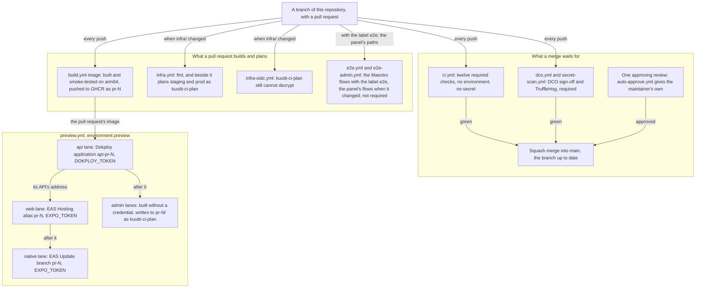
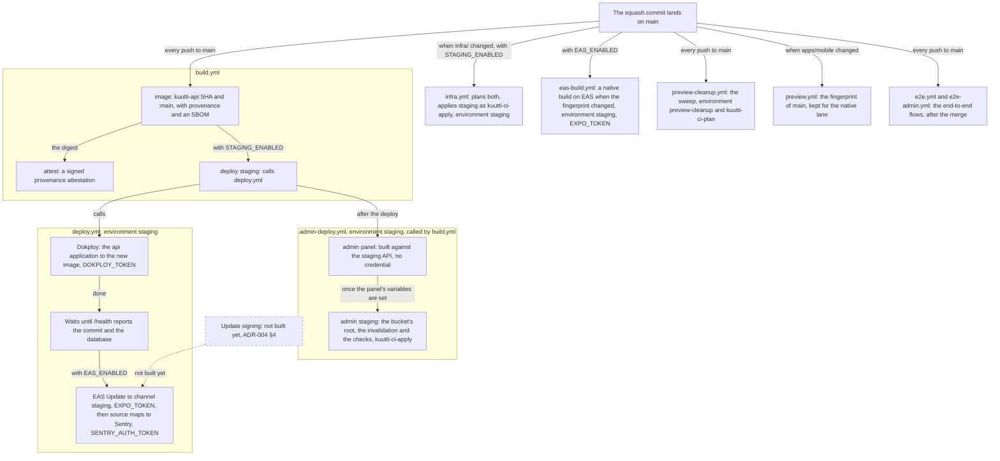
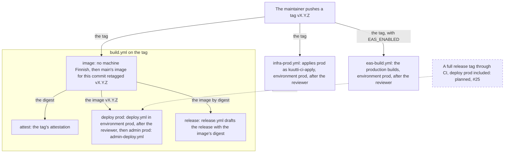
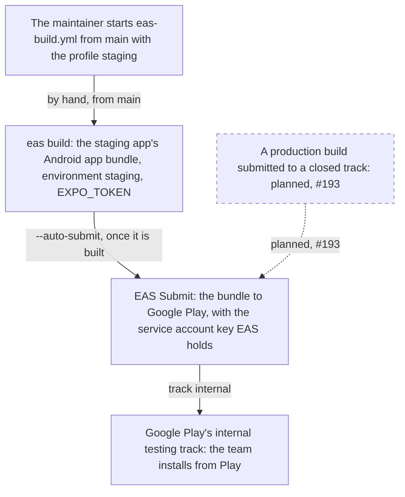

# Delivery

<!-- draws
.github/workflows/build.yml
.github/workflows/deploy.yml
.github/workflows/admin-deploy.yml
.github/workflows/release.yml
.github/workflows/preview.yml
.github/workflows/preview-cleanup.yml
.github/workflows/infra.yml
.github/workflows/infra-prod.yml
.github/workflows/infra-oidc.yml
.github/workflows/eas-build.yml
.github/workflows/ci.yml
.github/workflows/dco.yml
.github/workflows/secret-scan.yml
.github/workflows/e2e.yml
.github/workflows/e2e-admin.yml
.github/workflows/auto-approve.yml
.github/scripts/
apps/mobile/eas.json
infra/bootstrap/main.tf
-->

How a change travels from a pull request to the staging box, the phones and, at a release, production: which workflow does what, in which order, and what each step may touch, by its GitHub environment, its AWS role and its secrets, named and never shown. It is for a contributor who wants to know what their pull request sets off, and for a reviewer of `.github/workflows`. The checks of `ci.yml`, `e2e.yml` and `e2e-admin.yml` appear only as far as they gate delivery. The view draws ADR-001, ADR-004, ADR-012, ADR-020, ADR-025, ADR-028, ADR-051 and ADR-057.

Three roles reach AWS, all made by `infra/bootstrap` and assumed by a job's GitHub OIDC token (the third, `kuutti-ci-export`, is the weekly export's, delivers nothing and is not drawn); no AWS credential exists in any secret. `kuutti-ci-plan` is AWS's read-only access less every data read and decryption, and trusts any pull request of this repository and `main`. `kuutti-ci-apply` is power-user access with scoped IAM, and trusts only a job in the GitHub environment `staging` or `prod`. The four GitHub environments: `staging` takes deployments from `main` alone, with no reviewer; `prod` takes `v*` tags alone, behind the maintainer as reviewer; `preview` takes any branch of this repository, with no reviewer since 2026-10-08 (ADR-004 §3); `preview-cleanup` takes `main` alone, with no reviewer (ADR-012 §9).

## Part 1: a pull request

### Steps

1. A branch of this repository with a pull request. Every push starts the workflows below. A pull request from a fork, or from Dependabot, gets no secret, no image push and no preview.
2. `ci.yml`: `typecheck`, `lint`, `test-api-packages`, `test-mobile`, `i18n`, `licenses`, `audit`, `scenarios`, `schema-drift`, `compose`, `issue-link` and `workflows`, each a required check. None has an environment, a role or a secret. `i18n` also reads the deployed website's `/legal/versions.json`, and `workflows` holds every workflow to its permission rules.
3. `dco.yml` and `secret-scan.yml`: the checks `DCO sign-off` (every commit signed off) and `TruffleHog` (no secret in the range), the last two of the fourteen the `main` ruleset requires. Beside TruffleHog, `No font in any commit` reads every commit of the range for a font file (ADR-052); it is not required, and no later push cancels it.
4. One approving review, and a second for changes no person is attributed to; a new push dismisses an approval. Repository admins may bypass the rule. `auto-approve.yml`, from `main` every five minutes, approves the maintainer's own pull requests from this repository, except one whose diff adds a native review record, which needs a person.
5. The merge: a squash, and only with the fourteen checks green on a branch that is up to date with `main` (strict checks).
6. `build.yml`, job `image`: the API's image, built natively on an arm64 runner, never under emulation, then started against a Postgres 17 service until `/health` says the database is reachable and the migrations current, and checked for its licence and third-party notices. For a pull request from this repository it is pushed to GHCR as `kuutti-api:pr-<n>-<sha7>` and `:pr-<n>`, with the job's `GITHUB_TOKEN` and `packages: write`, without provenance: nothing ships from it.
7. `infra.yml`, when `infra/`, the workflow or `.github/scripts` changed: `tofu fmt` for everything, with no credential, and in parallel `init`, `validate` and `plan` for `envs/staging` and `envs/prod` as `kuutti-ci-plan`, each plan a sticky comment on the pull request. The bootstrap is never planned or applied by CI.
8. `infra-oidc.yml`, when `infra/` or its own workflow changed, or by hand: proves that `kuutti-ci-plan` can still be assumed from a pull request and still cannot decrypt a SecureString parameter.
9. `e2e.yml`: the Maestro flows on Android emulators against a local stack on the runner (ADR-020 §6 and §7), on a pull request only with the label `e2e`, and on every push to `main`. `e2e-admin.yml`: the moderation panel's flows in Chromium against the same stack and the panel's production build under its host's headers (ADR-051), on a pull request that changes what they exercise (the panel, the API, the packages, the mock bank, the panel's host module, or the stack's and the workspace's files: `docker-compose.yml`, `env.example`, the manifests, the lockfile, `tsconfig.base.json` and the pnpm action), and on every push to `main`. Neither has an environment or a secret, and neither is a required check: they gate no deploy.
10. `preview.yml`, lane `api`, while `PREVIEWS_ENABLED` is on: it waits for the image of step 6, then creates or updates the Dokploy application `api-pr-<n>` with `DOKPLOY_TOKEN`, a member's token that reaches the `previews` project only. It waits until the preview's `/health` reports the commit and checks that the preview answers its own web origin and refuses every other. At most three pull requests hold previews ([Deployment](deployment.md), part 4).
11. Lane `web`: `expo export --platform web` against the preview's API, then `eas deploy --alias pr-<n>` with `EXPO_TOKEN`, and a check that the page's bundle names that API.
12. The panel's lanes: one job in the environment `preview`, for its variables only, builds the panel under `/pr-<n>/` against the staging API, holding no credential, since the pull request's own install and Vite configuration run there. A second job, with no environment and no install, writes the build to `pr-<n>/` of the panel's bucket as `kuutti-ci-plan`, whose only write there is `pr-*` (ADR-025 §6 and §7).
13. Lane `native`, when the native side, the sign-in, notification or photo code, or the app's fingerprint changed against `main`: the bundle is made in a step without the token, then `eas update --branch pr-<n>` publishes it with `EXPO_TOKEN`. Before writing, every lane asks again whether the pull request is still open (ADR-012 §7).

## Part 2: a merge to main

### Steps

14. The squash commit lands on `main`. Nothing below waits for `ci.yml` or `e2e.yml` on `main`: the ruleset held the pull request to the checks before the merge.
15. `build.yml`, job `image`: the same build and smoke test, then the push of `ghcr.io/kuutti-ry/kuutti-api` under the full commit hash and `main`, with BuildKit's provenance and an SBOM. The API reports its version as the root `package.json`'s with the short commit, `0.y.z-<sha7>` (ADR-028).
16. Job `attest`: a provenance attestation of the pushed digest, signed through Sigstore and kept by GitHub and beside the image (`id-token: write` and `attestations: write`, no AWS role). `gh attestation verify` checks it before any deploy by hand (`infra/README.md`, Build provenance).
17. Job `deploy staging`, while the repository variable `STAGING_ENABLED` is `true`: it calls `deploy.yml` with the environment `staging`, the image by its commit and the short commit `/health` must report. It hands its secrets on with `inherit`, since environment secrets reach only the called job.
18. `admin-deploy.yml`, which `build.yml` calls after the deploy, job `admin panel`: in the environment `staging` for its variables only, with no role and no secret, it builds the panel with `VITE_API_URL` set to the staging API. Until `ADMIN_URL`, `ADMIN_BUCKET` and `ADMIN_DISTRIBUTION_ID` are set it stops green and the next job is skipped.
19. Job `admin staging`: in the environment `staging` as `kuutti-ci-apply`, installing nothing, it writes the build to the root of the panel's bucket (the hashed files first, then `index.html` without caching, never under `pr-` nor `fonts/`, where the maintainer puts Saiga by hand, ADR-052), invalidates `/*` and waits, then reads the served pages' headers back, `font-src 'self'` among them, and checks that the API's CORS admits the panel's origin and refuses another (ADR-025 §5).
20. `deploy.yml` in the environment `staging`: with `DOKPLOY_TOKEN`, Dokploy's API points the `api` application at the image and deploys it; the step waits up to ten minutes for Dokploy to finish. The box pulls the image without a credential. While the environment has no `DOKPLOY_URL` the job stops green and deploys nothing.
21. It polls `API_URL/health` for up to five minutes until it reports this commit with the database reachable: the deploy is done when the running bytes are the built ones.
22. While the repository variable `EAS_ENABLED` is `true`: `eas update` publishes the same commit's JavaScript to the channel `staging`, pointed at the staging API, with `EXPO_TOKEN`; then the update's source maps go to Sentry with `SENTRY_AUTH_TOKEN`, or are skipped while the environment has none. A native change is a build, not an update.
23. `infra.yml` on `main`, when `infra/` changed: both plans again, then, while `STAGING_ENABLED` is `true`, `apply staging` in the environment `staging` as `kuutti-ci-apply` (plan and apply in one job). The repository variables `ALERT_EMAIL` and `MAIL_TESTERS` reach OpenTofu as inputs. It runs beside `build.yml`; nothing orders the two.
24. `eas-build.yml`, while `EAS_ENABLED` is `true`, in the environment `staging` with `EXPO_TOKEN`: for each platform of `EAS_PLATFORMS` (Android unless set), it compares the project's fingerprint with the newest development build's, and starts a build on EAS only when they differ, cancelling older builds of the same profile still queued. On the builder, before the install, the `eas-build-pre-install` hook fetches Saiga, the typeface, with `FONTS_TOKEN`, an EAS secret and no GitHub one (ADR-052); without it the build is in the system font. A job that reads nothing secret first checks, on a production build only, that no Finnish text is still machine-translated. Build links go to the issue named by `EAS_BUILDS_ISSUE`, when set, with `issues: write`.
25. `preview-cleanup.yml`, the sweep, on every push to `main` and on a schedule: it selects closed, merged and week-old previews with `DOKPLOY_TOKEN` in the environment `preview-cleanup`, drops their databases as `kuutti-ci-plan` through the one Run Command document it may send, removes the EAS alias and branch with `EXPO_TOKEN`, then the Dokploy application, and removes the panel's `pr-<n>/` as `kuutti-ci-plan`. A job of its own, holding the only `actions: write` in the repository and no secret, cancels preview runs still waiting for a pull request that is not open (ADR-012).
26. `preview.yml`, job `fingerprint of main`: it computes the app's fingerprint and caches it under the commit, for the native lane of later pull requests. No environment, no secret.
27. `e2e.yml` and `e2e-admin.yml`: every push to `main` runs the Maestro flows in four parallel jobs and the panel's flows in one. A failure here says something is broken on `main`; it does not hold the deploy, which has already run.
28. Update signing: not built yet. Expo signs updates only on its paid plans, so whatever holds `EXPO_TOKEN`, in any of the four environments that have it, can publish to any branch, the ones behind `staging` and `production` included. ADR-004 §4 reopens this before a production build reaches anyone outside the team.

## Part 3: a release tag

### Steps

29. The maintainer pushes a tag `vX.Y.Z`. The tag ruleset in `infra/README.md` lets only repository admins create, move or delete a `v*` tag, since a tag deploys production. Before it, the version was bumped in the pull request that carried the change (ADR-028).
30. `build.yml`, job `image`: first `pnpm i18n:check --release`, so that no image is tagged while a Finnish text is still machine-translated. Then, if `main` already built this commit, its image is retagged `vX.Y.Z` and not rebuilt, so production runs the bytes staging ran; a tag off `main`, such as a hotfix, is built and pushed as on `main`.
31. Job `attest`: the attestation again, under the tag's ref, so that a recovery can verify the release's image by its tag.
32. Job `deploy prod`: `deploy.yml` in the environment `prod`, which waits for the maintainer's approval, then Dokploy, `/health`, and the EAS Update to the channel `production` with production's EAS environment, and its source maps, with the `prod` environment's own `DOKPLOY_TOKEN`, `EXPO_TOKEN` and `SENTRY_AUTH_TOKEN`. Production's Dokploy and its four values (`DOKPLOY_URL`, `DOKPLOY_APPLICATION_ID`, `API_URL`, `DOKPLOY_TOKEN`) exist since 2026-10-24 (ADR-049). `prod` holds no `SENTRY_AUTH_TOKEN` yet (#201), so production's source maps are not uploaded until it does. After it, job `admin prod` calls `admin-deploy.yml` in the environment `prod`, against production's API: steps 18 and 19, each of the two jobs behind the maintainer's approval. Until `prod` holds `ADMIN_URL`, `ADMIN_BUCKET` and `ADMIN_DISTRIBUTION_ID` it stops green.
33. Job `release`: `release.yml`, with `contents: write`, drafts a GitHub release with notes generated from the commits since the last tag and the image's digest. The maintainer reads the draft and publishes it.
34. `infra-prod.yml`: plan and apply of `envs/prod` as `kuutti-ci-apply` in the environment `prod`, after the reviewer. It has its own concurrency group and shares no cache with pull-request runs.
35. `eas-build.yml` on the tag: its release check of the Finnish texts first, in a job without an environment, so that it answers before the reviewer is asked; then the `production` profile for both platforms in the environment `prod`, with `prod`'s `EXPO_TOKEN`.
36. Production was first applied on 2026-10-24 by the rehearsal tag `v0.64.8-rehearsal.1` (ADR-049): step 34 ran, while the release gate stopped steps 30 to 33 and 35, as it stops any tag while Finnish texts wait for review. The API was then deployed to production by hand, pinned to a verified commit. From the next tag on, the maintainer starts `admin-deploy.yml` by hand from a rehearsal tag for production's panel, since the gate stops `deploy prod` before it (ADR-049 §2). Planned, #25: steps 29 to 35 in full, CI's deploy of production among them, at the first release.

## Part 4: a store build by hand

### Steps

37. The maintainer starts `eas-build.yml` by hand from `main` with the profile `staging`. The job builds it for Android alone, whatever the platform input says, until the association's Apple account can take the staging app to TestFlight (#193).
38. `eas build` in the environment `staging` with `EXPO_TOKEN`: the staging app, with the preview build's channel and EAS environment, as an Android app bundle whose version code EAS counts up (`autoIncrement`, with `appVersionSource: remote`). The release gate does not run: the bundle reaches the team only, never the public.
39. EAS Submit, on Expo's servers: `--auto-submit` hands the finished bundle to the submit profile `staging` of `eas.json`, which uploads it to Google Play with the key of a Google service account that EAS holds (ADR-057). The key never reaches GitHub. EAS uses it for any holder of `EXPO_TOKEN`, and the service account may release the app on its testing tracks and upload to internal app sharing, never to production (ADR-057 §3). Without the key on EAS the job fails after the build is queued, and the bundle reaches nobody until it is submitted by hand. A failed submission shows on expo.dev, never in the job, which ended when the build was queued.
40. Google Play's internal testing track: the release rolls out to the testers' list, without Google's review while the app's setup is incomplete, and the list holds the team alone, since the app runs the unsigned updates of the `staging` channel (ADR-004 §3). Play signs what it delivers with the keys Google holds; testers install and update the app from Play.
41. Planned, #193: a production build on a release tag, submitted to a closed track for the beta, once ADR-004 §4 is settled, the release gate passes and production has bank identification (ADR-049).

## What each job may touch

| Workflow, job | When | GitHub environment | AWS role | Secrets | Switches and variables |
|---|---|---|---|---|---|
| `ci.yml`, all twelve jobs; `dco.yml`; `secret-scan.yml` | every pull request and push to `main` | none | none | none | none |
| `build.yml`, `image` | every push and pull request | none | none | `GITHUB_TOKEN`, `packages: write` | none |
| `build.yml`, `attest` | `main`, `v*` tags | none | none (its OIDC token goes to Sigstore) | `GITHUB_TOKEN`, `attestations: write` | none |
| `build.yml`, `deploy staging` → `deploy.yml` | `main` | `staging` | none | `DOKPLOY_TOKEN`, `EXPO_TOKEN`, `SENTRY_AUTH_TOKEN` | `STAGING_ENABLED`, `EAS_ENABLED`; `DOKPLOY_URL`, `DOKPLOY_APPLICATION_ID`, `API_URL` |
| `admin-deploy.yml`, `admin panel` | after each deploy of `build.yml`; by hand from `main` or a `v*` tag | `staging`, or `prod` behind its reviewer, variables only | none | none | `ADMIN_URL`, `ADMIN_BUCKET`, `ADMIN_DISTRIBUTION_ID`, `API_URL` |
| `admin-deploy.yml`, `admin staging`, `admin prod` | the same | `staging`, or `prod` behind its reviewer | `kuutti-ci-apply` | none | the same, `AWS_APPLY_ROLE_ARN` |
| `build.yml`, `deploy prod` → `deploy.yml` | `v*` tags | `prod`, reviewer | none | `DOKPLOY_TOKEN`, `EXPO_TOKEN`, `SENTRY_AUTH_TOKEN` (prod's) | `EAS_ENABLED`; prod's `DOKPLOY_URL`, `DOKPLOY_APPLICATION_ID`, `API_URL` |
| `build.yml`, `release` → `release.yml` | `v*` tags | none | none | `GITHUB_TOKEN`, `contents: write` | `EAS_BUILDS_ISSUE` |
| `preview.yml`, `api` | pull requests from this repository | `preview` | none | `DOKPLOY_TOKEN`; `GITHUB_TOKEN`, `packages: read`, `pull-requests: write` | `PREVIEWS_ENABLED`; `DOKPLOY_URL`, `DOKPLOY_ENVIRONMENT_ID`, `PREVIEW_API_DOMAIN`, `EAS_HOSTING_SUBDOMAIN` |
| `preview.yml`, `web`, `native` | the same | `preview` | none | `EXPO_TOKEN`; `GITHUB_TOKEN`, `pull-requests: write` | none (the api lane's outputs) |
| `preview.yml`, `admin` | the same | `preview`, variables only | none | none | `ADMIN_URL`, `ADMIN_BUCKET`, `ADMIN_API_URL` |
| `preview.yml`, `admin preview publish` | the same | none | `kuutti-ci-plan`, as the pull request | `GITHUB_TOKEN`, `pull-requests: write` | `AWS_PLAN_ROLE_ARN` |
| `preview.yml`, `fingerprint of main` | `main`, when `apps/mobile` changed | none | none | none | none |
| `preview-cleanup.yml`, `select`, `remove previews` | `main`: every push, a schedule, by hand | `preview-cleanup` | none | `DOKPLOY_TOKEN` (both), `EXPO_TOKEN` (`remove previews`); `GITHUB_TOKEN`, `pull-requests: write` (`select`) | `PREVIEWS_ENABLED`; the preview variables, `ADMIN_BUCKET` |
| `preview-cleanup.yml`, `drop kuutti_pr_<n>`, `remove admin pr-<n>/` | the same | none | `kuutti-ci-plan`, as `main` | none | `AWS_PLAN_ROLE_ARN` |
| `preview-cleanup.yml`, `withdraw waiting runs` | the same | none | none | `GITHUB_TOKEN`, `actions: write` | none |
| `infra.yml`, `fmt` | changes under `infra/` | none | none | none | none |
| `infra.yml`, `plan` | the same, pull requests and `main` | none | `kuutti-ci-plan` | `GITHUB_TOKEN`, `pull-requests: write` | `ALERT_EMAIL`, `MAIL_TESTERS`, `AWS_PLAN_ROLE_ARN` |
| `infra.yml`, `apply staging` | `main` | `staging` | `kuutti-ci-apply` | none | `STAGING_ENABLED`, `ALERT_EMAIL`, `MAIL_TESTERS` |
| `infra-prod.yml`, `apply prod` | `v*` tags | `prod`, reviewer | `kuutti-ci-apply` | none | `ALERT_EMAIL` |
| `infra-oidc.yml`, `plan role cannot read secrets` | changes under `infra/` | none | `kuutti-ci-plan` | none | `AWS_PLAN_ROLE_ARN` |
| `eas-build.yml`, `i18n release gate` | `main`, `v*` tags, by hand | none | none | none | none |
| `eas-build.yml`, `eas build` | the same | `staging`, or `prod` for a production build | none | `EXPO_TOKEN`; `GITHUB_TOKEN`, `issues: write` | `EAS_ENABLED`, `EAS_PLATFORMS`, `EAS_BUILDS_ISSUE` |
| `e2e.yml` | `main`; a pull request with the label `e2e` | none | none | none | none |
| `e2e-admin.yml` | `main`; a pull request that changes what the panel's flows exercise | none | none | none | none |
| `auto-approve.yml` | every five minutes, from `main` | none | none | `GITHUB_TOKEN`, `pull-requests: write` | none |

The workflows read `EXPO_TOKEN` and `DOKPLOY_TOKEN` from the environments `staging`, `prod`, `preview` and `preview-cleanup` alone, never at repository level; the `DOKPLOY_TOKEN` of `preview` and `preview-cleanup` is a member's token for the `previews` project only. `SENTRY_AUTH_TOKEN` is read from `staging` and `prod` only. No workflow holds a Google credential: EAS submits the staging app to Google Play with the service account key it holds (part 4, ADR-057). The role ARNs, the region and the switches are repository variables, not secrets. No workflow fetches Saiga, holds its token or names its cache, since a runner's caches, artifacts and logs are public (ADR-052): `check-workflow-permissions.py` refuses one that does, in the `workflows` check, and `secret-scan.yml` reads every commit of a push or a pull request for a font file.

## Where it lives

- Workflows: [build.yml](../../.github/workflows/build.yml), [deploy.yml](../../.github/workflows/deploy.yml), [release.yml](../../.github/workflows/release.yml), [preview.yml](../../.github/workflows/preview.yml), [preview-cleanup.yml](../../.github/workflows/preview-cleanup.yml), [infra.yml](../../.github/workflows/infra.yml), [infra-prod.yml](../../.github/workflows/infra-prod.yml), [infra-oidc.yml](../../.github/workflows/infra-oidc.yml), [eas-build.yml](../../.github/workflows/eas-build.yml), [ci.yml](../../.github/workflows/ci.yml), [dco.yml](../../.github/workflows/dco.yml), [secret-scan.yml](../../.github/workflows/secret-scan.yml), [e2e.yml](../../.github/workflows/e2e.yml), [e2e-admin.yml](../../.github/workflows/e2e-admin.yml), [auto-approve.yml](../../.github/workflows/auto-approve.yml)
- Scripts: [.github/scripts](../../.github/scripts) (`aws-oidc.sh`, the OIDC exchange with no third-party action; `dokploy-deploy.sh`; `dokploy-preview.sh`; `wait-healthy.sh`; `check-workflow-permissions.py`)
- The roles and their trust: [infra/bootstrap/main.tf](../../infra/bootstrap/main.tf); the environments, the rulesets and the variables: [infra/README.md](../../infra/README.md) (After bootstrap: GitHub; Environments, CI; Previews; Admin panel)
- The app's channels and profiles: [apps/mobile/eas.json](../../apps/mobile/eas.json), [apps/mobile/app.json](../../apps/mobile/app.json)
- ADRs: [ADR-001](../adr/001-infrastructure-as-code.md) (plans on pull requests, applies behind environments), [ADR-004](../adr/004-eas-update-integrity.md) (updates not signed; who can publish), [ADR-012](../adr/012-unattended-preview-cleanup.md) (the sweep), [ADR-020](../adr/020-end-to-end-flows-with-maestro.md) §6 and §7 (the flows in CI), [ADR-025](../adr/025-admin-host.md) §5 to §8 (the panel's deploy and previews), [ADR-028](../adr/028-versioning-and-the-bump.md) (the version), [ADR-049](../adr/049-production-before-the-first-release.md) (production's first apply from a rehearsal tag), [ADR-057](../adr/057-google-play-internal-testing.md) (the staging app on Google Play's internal testing track)
- Not drawn, since they deliver nothing: `audit.yml`, `dead-code.yml`, `dependency-review.yml`, `scorecard.yml`, and `export.yml`, the weekly copy of what exists only on GitHub, under its own role `kuutti-ci-export`.
- Issues: #25 (production), #77 (the box's memory, which a deploy and three previews at once have exhausted before)

## Open

- Which profiles a push to `main` builds. `infra/README.md` (CI) and the header of `eas-build.yml` say `development` and `preview`; the job's code builds `development` alone on a push and leaves `preview` to a start by hand. The view says "a native build" and names neither.
- The switches `STAGING_ENABLED`, `EAS_ENABLED`, `PREVIEWS_ENABLED`, `EAS_PLATFORMS` and the environments' variables are set on GitHub, not in the repository; the view draws what runs when they are on.
- Production (#25): applied on 2026-10-24 by a rehearsal tag and set up by hand (ADR-049). The first tag that passes the release gate is the first whose `deploy prod` deploys it.
- Update signing (ADR-004 §4) is not built: an `EXPO_TOKEN` from any of four environments can publish to the `production` channel, and the `preview` environment has no reviewer, so write access to the repository is the trust of the update path. Through EAS the same token uses the Play key and the upload key on the app's testing tracks (ADR-057 §3).
- A pull request's `image` job holds `packages: write` and could push any tag of the API image; a later release would retag only a commit `main` built, and the attestation's source ref tells a pull request's image apart (`infra/README.md`, Build provenance and Previews).
- `auto-approve.yml` needs the repository's setting that lets Actions approve pull requests; whether it is on is not in the repository.
- Dokploy versus Kamal is open (CLAUDE.md, Decisions); the deploy steps call Dokploy's API, which a change of tool would replace.
