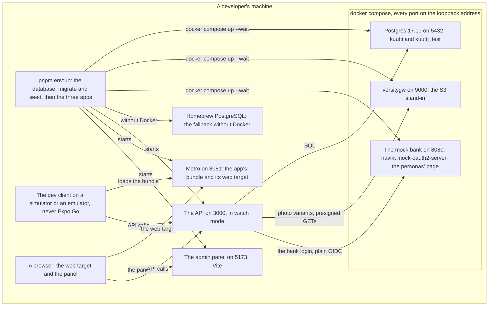
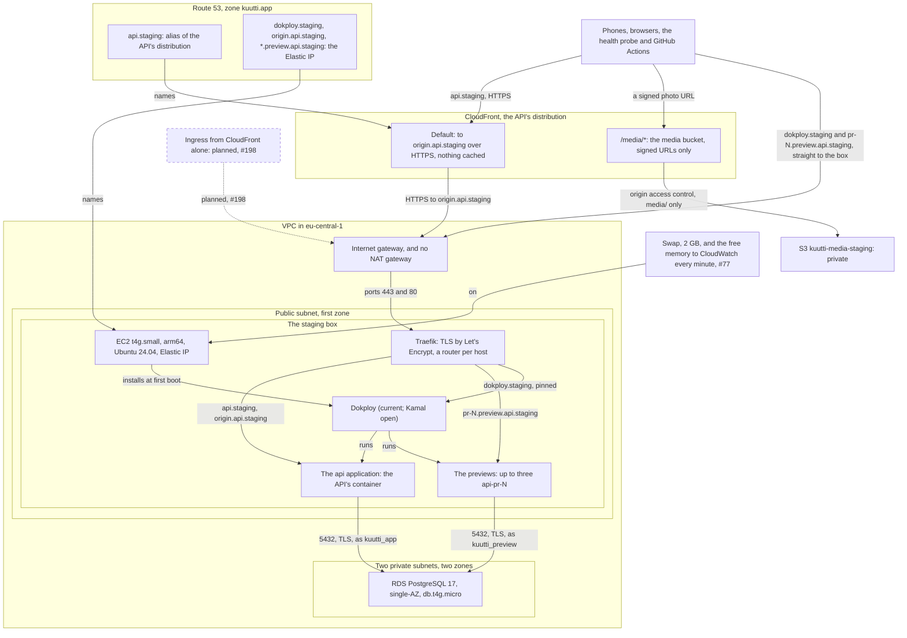
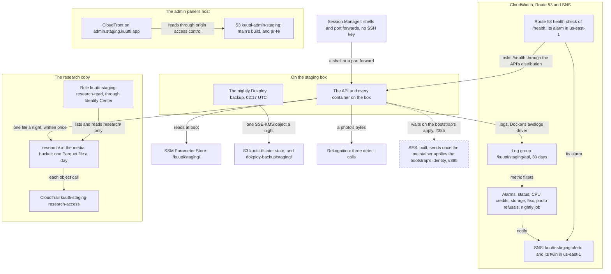
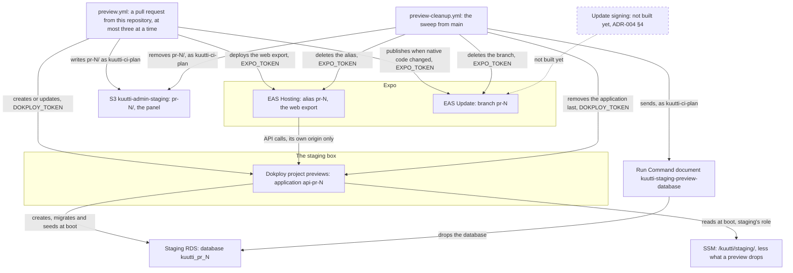
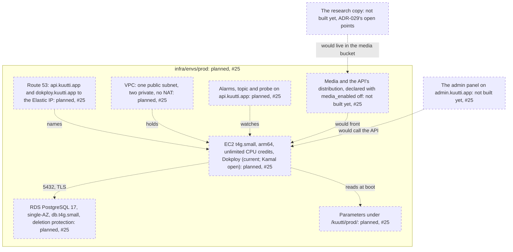
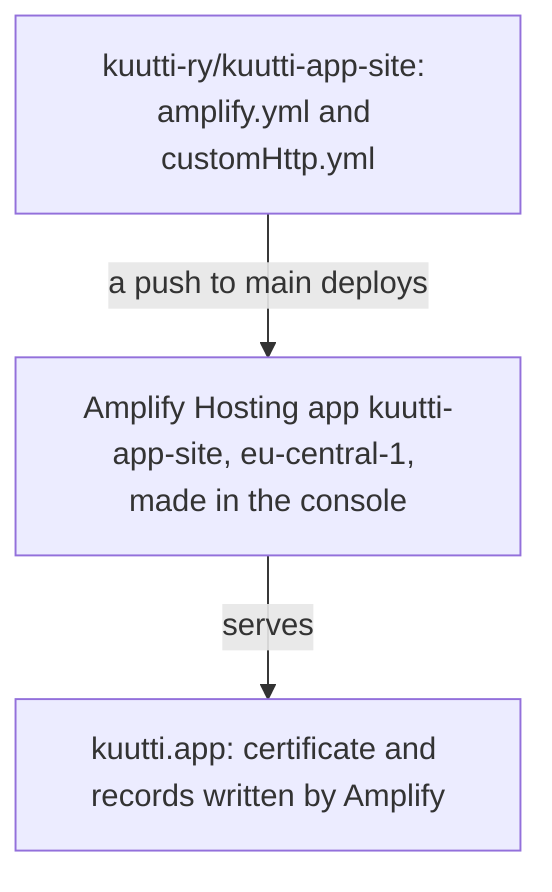

# Deployment

<!-- draws
docker-compose.yml
scripts/dev-env.ts
infra/envs/
infra/modules/
infra/bootstrap/
infra/scripts/dokploy-setup.sh
infra/scripts/db-app-role.sh
.github/workflows/preview.yml
.github/workflows/preview-cleanup.yml
.github/scripts/dokploy-preview.sh
apps/api/src/lib/preview-database.ts
-->

Where each part of Kuutti runs, environment by environment: a developer's machine, staging and the services around its box, a pull request's previews, production as the code composes it, and the website. It is for a contributor who wants to know what a change will land on, and for a reviewer of `infra/`. Everything here is read from `infra/`, the workflows and the compose file on `main`; what is planned is dashed and names its issue. The deploy tool is drawn as it runs today, Dokploy, while Dokploy versus Kamal stays open. The view draws ADR-001, ADR-005, ADR-008, ADR-012, ADR-014, ADR-018, ADR-025, ADR-029 and ADR-043.

## Part 1: a developer's machine

### Steps

1. `pnpm env:up` starts the whole local environment. It brings up the database with `docker compose up -d --wait` when Docker is there, and Homebrew PostgreSQL otherwise. It frees a port held by a stale copy of one of our own processes and stops at anything else, migrates and seeds the database for development, then starts the API, Metro and the panel and waits until each answers. `pnpm env:down` also stops the database.
2. Postgres 17.10 in compose, published on port 5432 of the loopback address only, with the databases `kuutti` and `kuutti_test` (the second made once, when the volume is new).
3. versitygw, the S3 stand-in, on port 9000 of the loopback address, with the media bucket as a directory. Locally the API presigns its own GETs on it, where a deployed API signs CloudFront URLs.
4. The mock bank, `navikt/mock-oauth2-server`, on port 8080 of the loopback address, with the issuer `/ftn`. Its login page is ours: a button for each persona and a form for arbitrary claims shaped like Telia's (ADR-014).
5. Homebrew PostgreSQL: the fallback when docker compose is not available. The S3 stand-in and the mock bank stay down then.
6. The API on port 3000, run by Node in watch mode from source. In development it reads no parameter store, sends no mail (the message, code included, is written to its log), and with no `MODERATION` set it never calls Rekognition.
7. Metro on port 8081: the app's bundle for the dev client and the web target of the same app.
8. The admin panel on port 5173, served by Vite. With no `VITE_API_URL` it talks to `http://localhost:3000`, and the API's development allowlist admits it and the web target.
9. The dev client: a development build of the app on an iOS simulator or an Android emulator, never Expo Go. The Maestro flows drive it against this same environment (ADR-020).
10. A browser: the app's web target, which runs against seed data and the mock bank and is not a product surface, and the admin panel.

## Part 2: staging, its network and its box

### Steps

11. Who reaches staging from outside: phones and browsers, Route 53's health checkers, and GitHub Actions, which deploys through Dokploy's API.
12. Route 53: `api.staging.kuutti.app` is an alias (A and AAAA) of the API's distribution, since staging's `media_enabled` is on.
13. Route 53: `dokploy.staging`, `origin.api.staging` and `*.preview.api.staging` are A records to the box's Elastic IP, with a TTL of five minutes. With media off, `api.staging` would be such a record in place of `origin.api.staging`.
14. CloudFront's default behaviour: every method, nothing cached, every viewer header and cookie forwarded with the ones CloudFront adds (the viewer's address, the WebSocket's headers), sent over HTTPS (TLS 1.2) to `origin.api.staging`. TLS for viewers ends here, with an ACM certificate from us-east-1. Price class 100 (Europe and North America), HTTP/2 and HTTP/3, IPv6.
15. CloudFront's `/media/*` behaviour: GET and HEAD only, HTTPS only, and only with a URL signed by a key of the trusted key group. A variant is cached once however many URLs were signed for it: the query string is not part of the key.
16. The media bucket `kuutti-media-staging-<account>`: private, public access blocked, SSE-S3, versioning off so an erased photo is gone. Its policy admits only the distribution to `media/`; the instance role also writes, reads and removes variants there. Unfinished uploads go after a day; `research/` is part 3.
17. The VPC: one /16 for the environment, an internet gateway for the public subnet's one route out, and no NAT gateway: the box is public and RDS makes no outbound connection, so the private subnets have only the local route. Its security group admits 443 and 80 from anywhere (80 for the ACME challenge and the redirect) and port 22 only from a list that is empty by default; Session Manager is the way in.
18. The box: EC2 `t4g.small`, arm64, Ubuntu 24.04 from Canonical's current image at the time it was built, an Elastic IP, IMDSv2 only with a hop limit of 2 so that containers reach the instance role, a 30 GB encrypted gp3 root volume, and standard CPU credits (it slows down rather than costs more). Its role is `kuutti-api-staging`, under the bootstrap's permissions boundary. A newer image or an edited first-boot script never replaces it; a rebuild is an explicit `-replace`.
19. Traefik, installed with Dokploy: it terminates TLS for the hosts the box serves, each with its own Let's Encrypt certificate, and routes by host. Two routers with a high priority, written by the first boot and `dokploy-setup.sh`, pin `dokploy.staging` to Dokploy and `api.staging` to the API, so a token that may add domains cannot take either. `origin.api.staging` is a second domain of the API's application, given by hand at the media cutover, so that CloudFront can reach the box by that name.
20. Dokploy (current; Kamal open): version v0.30.6, from an installer vendored in `infra/modules/compute` and checked by its hash at first boot. It runs a one-node Docker Swarm with its own Postgres and Traefik. Port 3000 is never opened. Traefik serves Dokploy's UI and its API, which CI calls, on 443 at `dokploy.staging.kuutti.app`, reachable by anyone until the ingress switch, behind Dokploy's own login with two-factor authentication; the Session Manager port forward is how the admin account was first made. Its own configuration is outside code, the one manual island of ADR-001, backed up every night (part 3). Docker logs every container to CloudWatch.
21. The `api` application: the API's image from GHCR, with the environment `NODE_ENV=production`, `APP_ENV=staging` and `PORT=3000`; everything else comes from the parameter store through the instance role. Staging holds no real person: Telia's test persons and the synthetic population only (ADR-018).
22. The previews: at most three applications `api-pr-<n>` in the Dokploy project `previews`, each a pull request's image (part 4).
23. RDS PostgreSQL 17 (the major pinned, minor versions applied automatically), single-AZ, `db.t4g.micro`: gp3 storage from 20 GB growing to 100, encrypted, 35 days of point-in-time recovery, TLS forced, Extended Support declined, not publicly reachable, no deletion protection on staging. Its subnet group spans the two private subnets in the region's first two zones, as RDS requires even for one instance. Its security group admits 5432 from the box's security group alone. The master password is held by AWS; the API connects as `kuutti_app`, a preview as `kuutti_preview`.
24. Planned, #198: ingress from CloudFront alone. The switch `cloudfront_only_ingress` replaces the open 443 rule with CloudFront's origin-facing prefix list. It stays off until Dokploy's control plane and the previews are behind the distribution too (ADR-005 §7), and the rate limiter's `trusted-proxy` turns to `cloudfront` in the same apply, never before (ADR-008 §5); a precondition in the composition refuses the one without the other.
25. Swap and the free memory (#77, ADR-046): a 2 GB `/swapfile` with `vm.swappiness = 10`, and `MemAvailable` pushed every minute to `Kuutti/staging/box` by a cron line, which the alarm `kuutti-staging-memory-low` reads (part 3). First boot runs the script; the running box got it from the Run Command document `kuutti-staging-headroom` on 2026-10-24. Dokploy runs without a memory limit (ADR-046 §2).

## Part 3: staging, the services around the box

### Steps

26. The API and every other container on the box: Docker's default log driver is `awslogs`, set before Dokploy's installer starts a single container.
27. The nightly backup: a cron job at 02:17 UTC packs `/etc/dokploy` (Traefik's configuration and certificates, the applications) with a dump of Dokploy's database and puts it, encrypted with SSE-KMS, under `dokploy-backup/staging/` of the state bucket. The box may write and read its own prefix and never delete; the plan role, denied `kms:Decrypt`, cannot read it.
28. Session Manager: the way onto the box, as `ssm-user`, and the port forward to Dokploy's UI. Staging declares the account's session preferences: every session is streamed to the log group `/kuutti/ssm-sessions`, kept 90 days, so nothing secret is ever printed in one.
29. SSM Parameter Store, `/kuutti/staging/`: the non-secret parameters `infra/envs/staging` writes (`app-env`, `log-level`, the database's `db-*`, `db-preview-user`, `moderation`, `mail`, `admin-app-url`, `cors-allowed-origins`, `trusted-proxy`, the media's three, and the bank's four: Telia's pre-production issuer, its client id, the callback and the level), and the secrets made by hand, never resources (the hetu HMAC key, the two Telia keys, the CloudFront signing key, the two database passwords), with Sentry's public DSN, also put by hand. The box's role reads this prefix only and is denied every other, `/kuutti/prod/` included.
30. CloudWatch Logs: `/kuutti/staging/api`, one stream per container name, kept 30 days, with three saved Logs Insights queries (errors by route, latency by route, boot).
31. The alarms: `kuutti-staging-instance-status-check-failed`, `-instance-cpu-credits-low`, `-db-cpu-credits-low`, `-db-free-storage-low`, `-api-5xx`, `-photo-budget-refusals`, `-nightly-job-failed` and `-memory-low`: three on metric filters over the API's log, the last on the box's own push to `Kuutti/staging/box`.
32. The outside probe: a Route 53 health check of `https://api.staging.kuutti.app/health` every 30 seconds from eu-west-1, us-east-1 and ap-southeast-1, wanting `"status":"ok"` in the body; three failures in a row fire `kuutti-staging-api-unreachable`, whose metric and alarm live in us-east-1.
33. SNS: `kuutti-staging-alerts` in eu-central-1 for the alarms, and a topic in us-east-1 for the probe's alarm, both mailing the repository variable `ALERT_EMAIL` once its subscription is confirmed by hand.
34. The panel's distribution on `admin.staging.kuutti.app`: an ACM certificate from us-east-1, the managed `CachingOptimized` policy, the panel's response headers on every answer (a CSP whose only connection is the staging API, HSTS, `X-Frame-Options: DENY`, `X-Robots-Tag: noindex, nofollow` and the rest of ADR-025 §3), the function `kuutti-staging-admin-previews` on `pr-*` paths only, and 403 and 404 answered by `/index.html` so that a page's path loads the panel. It keeps no access log.
35. The panel's bucket `kuutti-admin-staging-<account>`: private, SSE-S3, no versioning, read by the distribution alone. CI writes `main`'s build at its root and a pull request's under `pr-<n>/`; `pr-` objects expire after 14 days whatever the sweep does.
36. `research/` in the media bucket: `research/YYYY/MM/YYYY-MM-DD.parquet`, written by the API's nightly job only with `If-None-Match: *`, so a day that has its file keeps it; the API may read and list but never delete. A file of 128 KB or more moves to Glacier Instant Retrieval after a year; nothing expires.
37. The role `kuutti-staging-research-read`: it may list and read `research/` and nothing else, for an hour at a time. Its trust admits the role that Identity Center provisions for the permission set `KuuttiResearchStaging`, which the maintainer assigns to the researcher; its wildcard suffix would also admit a set named `KuuttiResearchStaging_<anything>`, and only the maintainer creates sets.
38. The trail `kuutti-staging-research-access`: S3 data events for objects under `research/` alone, no management events, one region, with log-file validation, into the private, versioned bucket `kuutti-research-access-staging-<account>`, whose files are kept five years (the maintainer's to confirm, ADR-029).
39. The state bucket `kuutti-tfstate-<account>`, made by the bootstrap: OpenTofu's state for the bootstrap, staging and production, the Dokploy backups and the weekly GitHub export. Versioned, encrypted, public access blocked.
40. Rekognition: `DetectModerationLabels`, `DetectFaces` and `DetectLabels`, on because staging's `moderation` parameter says `rekognition`.
41. SES: the role may send as `noreply@kuutti.app` through the domain's identity, on staging only to the addresses of `MAIL_TESTERS` (nobody while it is unset), and the parameter `mail` is `ses`. The identity is in `infra/bootstrap`, which only the maintainer applies; until he has and SES has verified the domain, a code request is answered 503 (#385, ADR-043). SES is in its sandbox until production access is requested.

## Part 4: a pull request's previews

### Steps

42. `preview.yml`: every push to a pull request from this repository, while the repository variable `PREVIEWS_ENABLED` is on. Forks and Dependabot get no secrets and no preview. Its jobs take the environment `preview`, which has had no required reviewer since 2026-10-08, so write access to the repository is the trust of a preview (ADR-004 §3). At most three pull requests hold previews at a time; a fourth gets a comment and nothing else. One sticky comment carries every lane's address.
43. The application `api-pr-<n>` in Dokploy's `previews` project: the image `build.yml` pushed as `:pr-<n>-<sha7>`, at `https://pr-<n>.preview.api.staging.kuutti.app` with its own Let's Encrypt certificate. Its environment is `NODE_ENV=production`, `APP_ENV=preview`, `PORT=3000`, `PR_NUMBER`, a pool of three connections, and as its only browser origin its own web preview. It runs with 30 requests a minute and `X-Robots-Tag: noindex`. The Dokploy token is a member's that reaches the `previews` project only.
44. `kuutti_pr_<n>` on staging's RDS instance: the preview creates it at boot, migrates and seeds it, never copies anything into it. It is owned by `kuutti_preview`, which cannot open `kuutti`.
45. A preview reads all of `/kuutti/staging/` through the staging box's role, then drops from its own memory the staging database password, the media settings and signing key, the bank's settings and keys and the HMAC key. So it has no photos and no bank login (ADR-014 §1), and sends mail through SES as staging does.
46. EAS Hosting: `expo export --platform web` of the same commit, pointed at that preview's API, at the alias `pr-<n>` (`https://<EAS_HOSTING_SUBDOMAIN>--pr-<n>.expo.app`).
47. EAS Update on the branch `pr-<n>`, when the pull request changed the app's native side, its sign-in, notification or photo code, or the app's fingerprint against `main`. The bundle is made in a step without the token and published after it; a person opens it from the dev client with the comment's QR code. No channel points at a `pr-` branch.
48. The panel of the same commit, built with the base `/pr-<n>/` against the staging API, since a preview API has no bank and staff sign in at staging. A job without an environment writes it as `kuutti-ci-plan`, whose only right in that bucket is to put and delete `pr-*` objects.
49. `preview-cleanup.yml`, the sweep (ADR-012): it runs from `main` only, on every push to `main`, on a ten-minute schedule that GitHub starts when it has room, and by hand for one pull request. It removes the previews of every closed or merged pull request and retires any older than seven days. The order: drop the database, remove the EAS alias and branch, then the Dokploy application last, since the application list is the sweep's work list and a failed drop is retried by the next sweep. The panel's prefix goes beside them. Its environment `preview-cleanup` takes deployments from `main` alone and has no reviewer.
50. The Run Command document `kuutti-staging-preview-database`: the plan role may send exactly this document to exactly the staging box. It reads the preview role's password from SSM on the box and runs `DROP DATABASE IF EXISTS kuutti_pr_<n> WITH (FORCE)` as `kuutti_preview`.
51. Update signing: not built yet. Expo signs updates only on its paid plans, so whatever holds `EXPO_TOKEN` can publish to any branch, `staging` and `production` included. ADR-004 §4 reopens this before a production build reaches anyone outside the team.

## Part 5: production, composed and not applied

### Steps

52. Route 53: `api.kuutti.app` and `dokploy.kuutti.app` as A records to production's Elastic IP; `origin.api` takes `api`'s place once media is on. No preview records: production has no previews.
53. The same network module as staging, with its own /16: one public subnet, two private, no NAT, 443 open to the world while `cloudfront_only_ingress` is off.
54. The same compute module: `t4g.small`, arm64, with unlimited CPU credits (the module's default, where staging asks for standard). No preview databases and no Session Manager preferences, which staging owns for the account. Its role `kuutti-api-prod` reads `/kuutti/prod/` alone and may mail any address. Dokploy (current; Kamal open) as on staging.
55. RDS PostgreSQL 17, single-AZ, `db.t4g.small`, with deletion protection and a final snapshot.
56. The parameters: `app-env` `production`, `moderation` `rekognition`, `mail` `ses`, `admin-app-url` and `cors-allowed-origins` `https://admin.kuutti.app`, `trusted-proxy` `traefik`. The bank's production issuer and its level are written only together with Telia's production client id, which is null today.
57. The same observability module: the alarms, the topic and the outside probe, on `api.kuutti.app`.
58. The media module is declared, but `media_enabled` is off: no bucket, no distribution, until production's own cutover.
59. Production composes no host for the panel; it comes with #25, at `admin.kuutti.app`, the address production's parameters already name.
60. The research copy: production composes neither the module nor the copy until the maintainer has answered ADR-029's ninety days and its other open points.

Production is applied by `infra-prod.yml` on a release tag, behind the `prod` environment's reviewer ([Delivery](delivery.md), part 3). Staging was applied first. Production is applied before the first release, as a rehearsal of #25 without bank identification, from a tag `v<version>-rehearsal.<n>`, and this part is redrawn as built in the change after that apply (ADR-049; `infra/README.md`, Cost).

## Part 6: the website

### Steps

61. The website's own repository, `kuutti-ry/kuutti-app-site`: its `amplify.yml` is the build spec and its `customHttp.yml` the headers.
62. The Amplify Hosting app `kuutti-app-site` in eu-central-1, connected to that repository through the Amplify GitHub App: the console-made exception of ADR-001, since the connection is a browser consent no provider performs. A push to the site's `main` deploys it.
63. `kuutti.app`: Amplify issued the certificate and wrote the validation and alias records into the zone itself, outside OpenTofu. The redirect from `www` and the cost tag are commands in `infra/README.md`, run after the console.

## Where it lives

- Local: [docker-compose.yml](../../docker-compose.yml), [scripts/dev-env.ts](../../scripts/dev-env.ts), [services/mock-idp](../../services/mock-idp), [apps/admin/src/lib/api.ts](../../apps/admin/src/lib/api.ts)
- Staging and production: [infra/envs/staging](../../infra/envs/staging) and [infra/envs/prod](../../infra/envs/prod) (`main.tf`, `dns.tf`, `variables.tf`); the modules [network](../../infra/modules/network), [compute](../../infra/modules/compute) (with its first-boot script and the vendored Dokploy installer), [data](../../infra/modules/data), [media](../../infra/modules/media), [admin](../../infra/modules/admin), [research](../../infra/modules/research), [observability](../../infra/modules/observability); [infra/bootstrap](../../infra/bootstrap) (the state bucket, the zone, the SES identity, the CI roles); [infra/scripts/dokploy-setup.sh](../../infra/scripts/dokploy-setup.sh), [db-app-role.sh](../../infra/scripts/db-app-role.sh)
- Previews: [.github/workflows/preview.yml](../../.github/workflows/preview.yml), [preview-cleanup.yml](../../.github/workflows/preview-cleanup.yml), [.github/scripts/dokploy-preview.sh](../../.github/scripts/dokploy-preview.sh), [apps/api/src/lib/preview-database.ts](../../apps/api/src/lib/preview-database.ts), [apps/api/src/lib/config.ts](../../apps/api/src/lib/config.ts) (what a preview drops)
- The manual: [infra/README.md](../../infra/README.md) (Environments, Media, Mail, Admin panel, Research copy, Observability, Previews, Backups and rebuilding the box, Secrets, The website), [docs/runbooks/incident.md](../runbooks/incident.md)
- ADRs: [ADR-001](../adr/001-infrastructure-as-code.md) (OpenTofu; Dokploy's configuration as the manual island), [ADR-005](../adr/005-media-pipeline-and-delivery.md) (the distribution, §7 the ingress switch), [ADR-008](../adr/008-exposure-budget-and-client-address.md) §5 (the trusted proxy), [ADR-012](../adr/012-unattended-preview-cleanup.md) (the sweep), [ADR-014](../adr/014-demo-mode.md) (the mock bank; no real bank on a preview), [ADR-018](../adr/018-staging-is-the-demo.md) (staging holds no real person), [ADR-020](../adr/020-end-to-end-flows-with-maestro.md) (the flows on the local environment), [ADR-025](../adr/025-admin-host.md) (the panel's host and its previews), [ADR-029](../adr/029-the-research-copy.md) (the research copy), [ADR-043](../adr/043-email-confirmation.md) §5 and §6 (SES and staging's testers)
- Issues: #198 (ingress from CloudFront alone), #77 (swap and the memory alarm, ADR-046), #25 (production), #385 (SES)

## Open

- Ingress from CloudFront alone (#198). Until it is on, staging's rate limiter keys on the CloudFront edge that forwarded a request, and people behind one edge share a bucket; the team accepts that on staging, and production keeps the order of ADR-008 §5 (`infra/README.md`, Media).
- Production (#25) is composed and not applied. Its `admin-app-url` already names `https://admin.kuutti.app`, a host production does not compose yet.
- SES (#385): whether the maintainer has applied the bootstrap's identity, and SES verified the domain, is not recorded in the repository.
- A preview runs a pull request's code on the staging box with the staging role, which can read every `/kuutti/staging/` parameter; the preview drops the secrets from its memory in code, and write access is that trust (ADR-004 §3; `infra/README.md`, Previews, Trust).
- `infra/modules/network/variables.tf` says the VPC's "four subnets are carved from it"; the module makes three, as `infra/README.md` says. The view draws the module's three.
- `infra/README.md` (Previews) still calls the native lane "dormant until `expo-updates` is configured"; `apps/mobile/app.json` has configured it, and `preview.yml` publishes when the lane's check passes.
- Dokploy versus Kamal is open (CLAUDE.md, Decisions); Dokploy's configuration is the one part of the box outside code.
