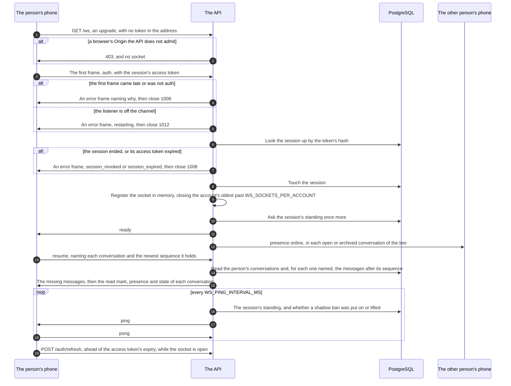
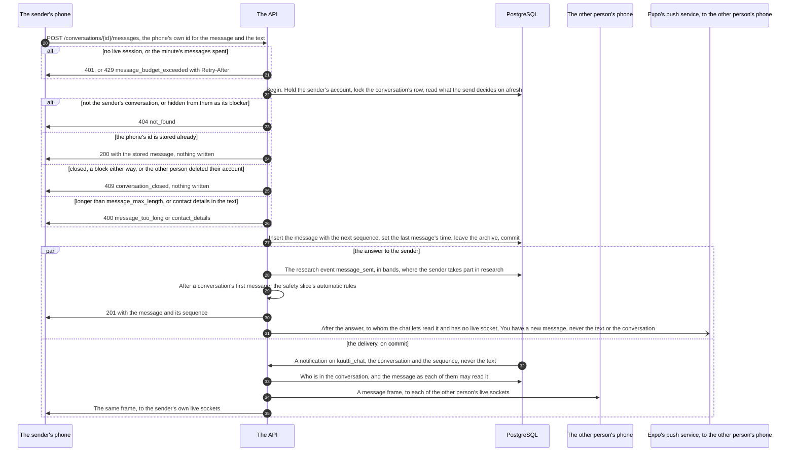
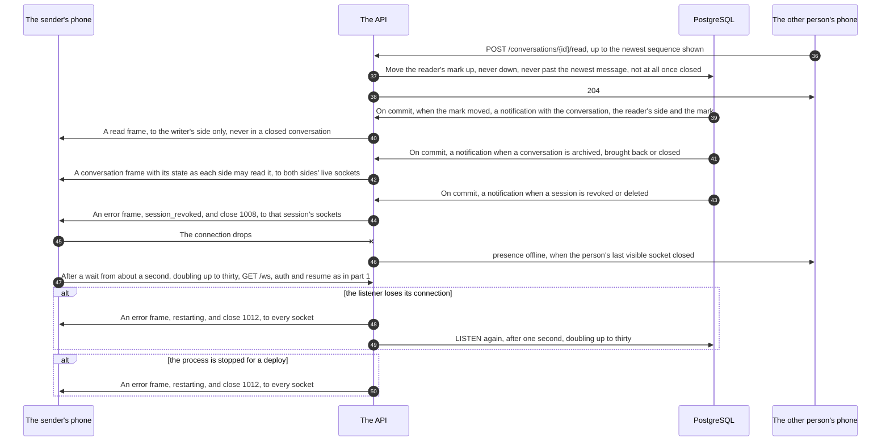

# Chat, step by step

<!-- draws
apps/api/src/chat/ws.ts
apps/api/src/chat/live.ts
apps/api/src/chat/presence.ts
apps/api/src/chat/listen.ts
apps/api/src/chat/messages.ts
apps/api/src/notifications/push.ts
apps/api/src/lib/auth-middleware.ts
packages/schema/src/chat-frames.ts
apps/mobile/src/features/chat/socket.ts
apps/mobile/src/features/chat/store.tsx
-->

How a message gets from one phone to the other, from the system's side: the phone opening its socket and catching up, a message sent over HTTP and stored under the conversation's lock, its delivery through Postgres's `LISTEN/NOTIFY` on the channel `kuutti_chat` to the other person's live sockets, read marks, presence, ends, and a lost connection. It is written for a contributor or a reviewer who works on the chat, the socket or anything that writes to a conversation. A match opens the conversation (ADR-038); this view starts after that. It draws ADR-031 §3, §8 and §9, ADR-030 §6 and §12, ADR-026 and ADR-055 §4.

In these diagrams every arrow is built. Mermaid's sequence diagrams take a message's words as they are, so the labels are not in quotes, and an issue's `#` is written `#35;` there, which draws as `#`, since a bare `#` ends a label (`README.md`, How a view is drawn).

## Part 1: opening the socket and catching up

### Steps

1. The phone opens its socket while it is signed in and the app is in front: `GET /ws` on the API's own server, `ws` underneath, with no token in the address. The upgrade passes the app-wide middleware, so the address's limiter counts it and never gives it back, since no guard admits it (ADR-026).
2. A browser's Origin must be the API's own host or on the CORS allowlist; anything else is refused with 403 and no socket (rule 8). A native app sends no Origin. A plain `GET /ws` without an upgrade is answered 426.
3. The first frame is `auth` with the session's access token, so the token never sits in an address and the web target, which cannot set a header on a WebSocket, runs the same code. Every frame both ways is the contract's (`chat-frames.ts`), at most 256 KiB, bounded before it is read.
4. No `auth` within `WS_AUTH_TIMEOUT_MS`, another frame first, a frame outside the contract or a second `auth`: the API sends an `error` frame naming why (`auth_timeout`, `bad_frame`) and closes with 1008.
5. While the chat listener is off its channel, an `auth` is told `restarting` and closed with 1012 before its token is looked up: a socket admitted then would miss what is committed until the listener is back.
6. The API looks the session up by the token's hash, with the session guard's own code: not revoked, the account in a live state, the identity in good standing, the access token not expired.
7. An ended session is told `session_revoked`, an expired token `session_expired`, and the socket closes with 1008. The phone refreshes its session once and tries again.
8. The API touches the session, as the guard does for a request. The listener is asked once more here, and a lost one is step 5 again.
9. The socket is registered in the process's memory (`chat/presence.ts`), never in a table. Past `WS_SOCKETS_PER_ACCOUNT` sockets, the account's oldest is closed with `too_many_sockets`, and that phone waits until it is next brought to the front.
10. The API asks the session's standing once more, now that a session ended meanwhile would find the socket; an ended one is step 7.
11. The API answers `ready`. The log line names the account and the request, never a frame or a token.
12. If this is the account's first visible socket, each counterpart of its open and archived conversations is told `presence` online. A shadow-banned account is never online to anybody (ADR-024 §6), and nothing is told across a close or a block.
13. The phone answers `ready` with `resume`, naming each conversation it holds and the newest sequence it has of each.
14. The hub reads the person's conversations through their own participant rows (rule 6) and, for each one named, at most one page of the messages after its sequence. A phone further behind reads the rest over HTTP (`?after=`) when it opens the conversation: a `shortcut:` in `chat/live.ts`.
15. The phone gets the presence of every conversation it did not name first, since it resumes before its list has loaded; then, for each one named, the missing messages in order, the counterpart's read mark, presence and the conversation's state, or `gone` for one it may not see.
16. Every `WS_PING_INTERVAL_MS` the socket asks the session by its id: an ended session or an expired access token closes it as in step 7. A shadow ban put on or lifted since hides or shows the account, and the counterparts are told.
17. The API sends `ping`.
18. The phone answers `pong`. None within `WS_PONG_TIMEOUT_MS` closes the socket with 1001, `pong_timeout`.
19. While the socket is open, the phone refreshes its session a minute before the access token expires, through the app's one refresh (ADR-027), so the next ping finds a live token.

## Part 2: sending a message

### Steps

20. The phone sends the message over HTTP, `POST /conversations/{id}/messages`, with an id it made for the message and the text. The socket only tells; writing stays on the HTTP routes. A photo goes the same way through `POST /conversations/{id}/photos`, after the photo pipeline and the check (ADR-031 §10).
21. The session guard answers 401 without a live session. The person's limiter answers 429 past `RATE_LIMIT_PER_MINUTE`, and the send's own limiter answers 429 `message_budget_exceeded` with `Retry-After` past `matching_config messages_per_minute` (ADR-026).
22. One transaction (ADR-031 §3): the sender's account row held `FOR SHARE`, only in a state the guard admits and with the identity in good standing, so an erasure or a sanction finishes first or the send writes nothing; then the conversation's row locked `FOR UPDATE` through the sender's own participant row; then what the send decides on, read in a statement of its own, so a block, a close or an erasure that committed while it waited is seen. Every statement names the sender's account (rule 6).
23. A conversation that is not the sender's, or one the sender blocked the other person in, is 404 `not_found`, never 403.
24. A message whose phone id is stored already is answered 200 with that message, and nothing is written, so a resend after a lost answer doubles nothing. An id the other side used is 400.
25. A closed conversation, a block either way, or a counterpart who deleted their account: 409 `conversation_closed`, and nothing is written.
26. Over `matching_config message_max_length` after trimming: 400 `message_too_long`. An e-mail address, a link, a phone number or a handle in the text: 400 `contact_details`, which names the kind found and never the text.
27. The message is inserted with the conversation's next sequence, in the statement that moves the conversation on: the next sequence, the last message's time, and out of the archive. Two sends at once take consecutive sequences with no gap. The transaction commits.
28. After the commit, the research event `message_sent` with the kind, the length's band and the waits' bands, never the text (rule 5). It is written only for a person whose research consent stands, keyed by `research_id` (ADR-011).
29. After a conversation's first message, the safety slice's automatic rules check the sender (ADR-033). The chat hands over counts and times only, and the check changes no answer.
30. The sender's phone gets 201 with the stored message and its sequence.
31. The push (#102, ADR-055 §4), after the answer: the route hands the conversation and the sequence to the notifications slice, which asks the chat whom it lets read the message (`messageReaders`: the other participant, through their own participant row, in a conversation still open for them, so nothing crosses a block or a close and a shadow-banned sender's withheld message tells nobody). It leaves out whoever has a live socket (the hub's `online`), whose message switch is off (ADR-032), or who was pushed of this conversation within `matching_config message_push_min_interval_minutes`, and sends nothing in the quiet hours (`push_quiet_from_hour` to `push_quiet_to_hour`, Helsinki). Each live device of whoever is left gets one push through Expo: "You have a new message" in the device's language and the kind, never the text, a name or the conversation, and it lives no longer than the quiet hours' start or the day's end; Apple or Google wakes the phone with it. The push runs after the answer, which never waits for it, so the answer's time says nothing of whether anybody was pushed; a failure is logged. A photo's send does the same.
32. Meanwhile Postgres delivers the message trigger's notification to the chat listener on `kuutti_chat` when the transaction commits, and drops it if the transaction rolls back. It carries the conversation and the sequence, never the text.
33. The hub takes one notification at a time, in commit order. It reads who is in the conversation, then the message through each person's own participant row, with every rule of the reads: nothing crosses a block, and a shadow-banned sender's message reaches only the sender while the ban stays open.
34. Each live socket of the other person gets a `message` frame. A photo's frame carries no URL; the phone reads that one message again over HTTP for its signed URLs (ADR-031 §10).
35. The sender's own live sockets get the same frame, so the sender's other phones show it too.

## Part 3: read marks, ends, and a lost connection

### Steps

36. The reader's phone sends its read mark over HTTP, `POST /conversations/{id}/read`, up to the newest sequence it has shown.
37. The mark moves up only, never past the newest message, and not at all in a closed conversation: a close stops both marks where it found them, so a mark moving after an end cannot tell an end from a block (ADR-030 §12).
38. The reader's phone gets 204, in a closed conversation too.
39. On commit, and only when the mark moved, the read trigger notifies with the conversation, the reader's side and the new mark.
40. The other side's live sockets, the writer's, get a `read` frame with the mark. A closed conversation delivers none.
41. On commit, the conversation trigger notifies when a conversation is archived (the night's archive, see The night's jobs), brought back by a new message, or closed (an end, a block, a report, a ban, an erasure). Since migration 0063 it does not fire when only the close's kind or side is rewritten.
42. Each side's live sockets get a `conversation` frame with its state as that side may read it: open, archived, closed as one of the two endings a person reads, or `gone` for its blocker. A block has a notification of its own, which reaches the blocker's side alone; the other person hears only the close's frame, as for any end, so no frame tells a block or a report from an end (ADR-030 §6 and §12).
43. On commit, the session trigger notifies when a session is revoked or deleted: a logout, a break, a sanction, an erasure, the night's sweep.
44. That session's sockets get `session_revoked` and close with 1008 at once, whatever ended the session.
45. The phone's connection drops: a lost network, the app sent to the background, or a sign-out, which close the socket on the phone's side too.
46. When the person's last visible socket closes, the counterparts of their open and archived conversations get `presence` offline.
47. The phone reconnects after a wait spread over the second half of a backoff that starts at a second and doubles up to thirty, refreshing its session first when the access token is stale, then steps 1 to 15. Postgres holds every message, so a reconnect loses nothing and the resume doubles nothing. After `too_many_sockets` it waits until the app is next brought to the front.
48. When the listener's connection is lost, the notifications in the gap are lost with it, so every socket is told `restarting` and closed with 1012, and the phones resume from Postgres as in step 47.
49. The listener connects and listens again after a second, doubling up to thirty seconds. Until it does, a new socket is refused as in step 5.
50. On SIGTERM, before a deploy replaces the container, every socket is told `restarting` and closed with 1012; one that does not finish its closing handshake within a second is cut. The phones reconnect to the next process and resume. The registry is the process's memory, so a restart costs only presence.

## Where it lives

- API: `apps/api/src/chat/ws.ts` (the socket), `live.ts` (the hub and the resume), `presence.ts` (the registry), `listen.ts` (the listener), `routes.ts` (the HTTP routes and the send's limiter), `messages.ts` (the send, and `messageReaders` for the push), `repo.ts` (`lockConversation`, `readSendState`, `insertMessage`, `markRead`, `participantsOf`, `messageFor`, `blockerSidesBetween`); `apps/api/src/lib/auth-middleware.ts` (`authenticate`); `apps/api/src/index.ts` (the server and the shutdown); `apps/api/src/app.ts` (`GET /ws` among the public routes, the first message's check and the push handed to the chat); `apps/api/src/notifications/push.ts` (whom a message's push tells); `apps/api/src/lib/config.ts` (`WS_SOCKETS_PER_ACCOUNT`, `WS_AUTH_TIMEOUT_MS`, `WS_PING_INTERVAL_MS`, `WS_PONG_TIMEOUT_MS`)
- Contracts: `packages/schema/src/chat-frames.ts` (every frame both ways, `FRAME_BYTES_MAX`), `packages/schema/src/chat.ts`
- Database: `packages/db/drizzle/0053_chat.sql` (the tables), `0055_chat_notify.sql` (the triggers on `kuutti_chat`), `0059_contact_share_notify.sql` (shared contacts), `0063_conversation_notify_close_only.sql` (the conversation's trigger narrowed)
- Phone app: `apps/mobile/src/features/chat/socket.ts` (connect, auth, resume, ping, backoff, refresh ahead), `store.tsx` (the socket while signed in and in front), `client.ts` (the HTTP routes), `ConversationScreen.tsx` (the rest over `?after=`, a photo's message read again)
- Specs: `features/chat/live.feature`, `features/chat/conversations.feature`, `features/chat/closing.feature`
- ADRs: [ADR-031](../adr/031-chat.md) §3 (the send), §4 (what each side reads), §8 (the archive), §9 (the socket, delivery on commit, presence and resume), §10 (a photo); [ADR-030](../adr/030-reports-and-blocks.md) §6 and §12 (no frame tells a block from an end); [ADR-024](../adr/024-sanctions.md) §6 (a shadow ban is never online); [ADR-026](../adr/026-limits-per-person-and-sign-in-doors.md) (the limiters); [ADR-027](../adr/027-sign-in-code-bound-to-the-device.md) (the one refresh); [ADR-033](../adr/033-automatic-shadow-bans.md) (the first message's check); [ADR-011](../adr/011-research-events.md) (the event); [ADR-032](../adr/032-notification-choices-and-notices.md) (the choices the push reads); [ADR-055](../adr/055-push.md) §4 (the message's push); [ADR-038](../adr/038-the-match.md) (the match opens the conversation)
- Issues: #348 (conversations and messages), #349 (the socket), #350 (photos), #351 (ends), #103 (contacts shared), #105 (the automatic rules), #102 (the push)

## Open

- **The socket's numbers and the refresh ahead are the maintainer's to confirm** (ADR-031, Open 11 and 12): the sockets per account, the first frame's time, the ping and the pong, and that a socket lives while its session's access token does. The view names them by their configuration keys.
- **Which section of ADR-031 is the socket.** The code and the spec cite ADR-031 §5 for the socket (`chat/ws.ts`, `chat/live.ts`, `chat/listen.ts`, `chat/presence.ts`, `app.ts`, migration 0055's header, `features/chat/live.feature`, the phone's `socket.ts`); in the ADR the socket is §9, and §5 is the retention of messages. This view cites §9.
- **The resume in ADR-031 §3.** §3 says the socket reuses `?after=` at every connect. The code, and §9, answer a `resume` frame with at most one page per conversation, and the phone reads the rest over `?after=` when it opens the conversation. Drawn as the code and §9.
