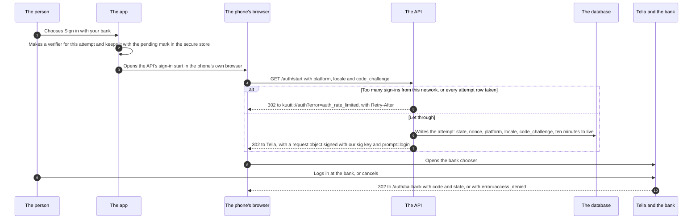
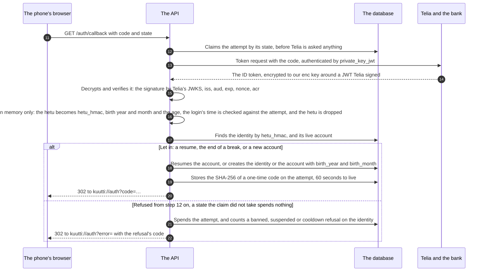
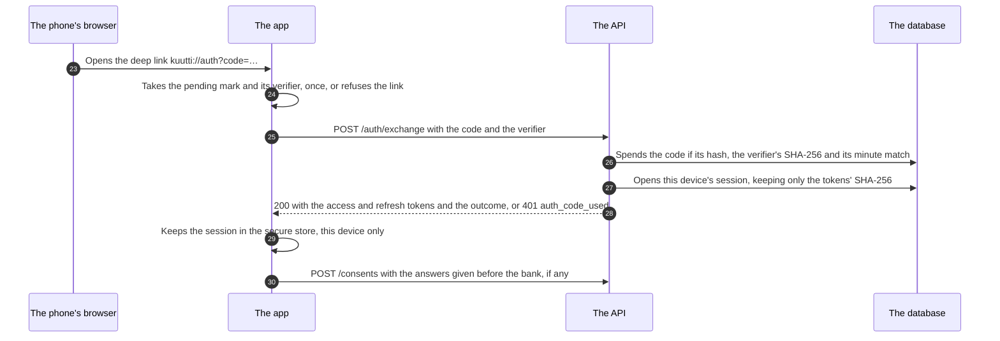
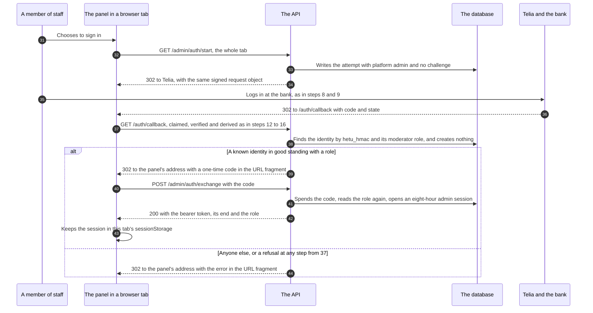

# The bank login

<!-- draws
apps/api/src/identity/routes.ts
apps/api/src/identity/login.ts
apps/api/src/identity/hetu.ts
apps/api/src/identity/oidc-broker.ts
apps/api/src/identity/broker.ts
apps/api/src/identity/registration.ts
apps/api/src/identity/codes.ts
apps/api/src/identity/sessions.ts
apps/api/src/identity/admin-session.ts
apps/mobile/src/features/identity/verifier.ts
apps/mobile/src/features/identity/session.tsx
apps/mobile/src/lib/session.ts
apps/mobile/app/auth.tsx
apps/admin/src/features/identity/session.tsx
-->

How the system signs a person in: the app, the phone's browser, the API, the database and Telia's broker, from the tap on "Sign in with your bank" to a session on the phone, and the staff's sign-in to the admin panel, which takes the same callback. It is written for a contributor or a reviewer who is about to touch the identity slice, the Telia kit or the sign-in screens, and wants the whole exchange before reading `login.ts`. The person's side of the same flow, with every screen and refusal text, is drawn in #395 (`docs/flows/sign-in.md` once it lands). It draws TD-1 and TD-7, ADR-016 (the bank every time), ADR-017 (the Telia kit), ADR-026 §4, §6 and §8 (the sign-in doors, the attempts table, a callback answered once), ADR-027 (the code bound to the phone), ADR-006 §5 (staff are identities with a role) and ADR-025 (the panel's host). What is drawn is staging's: production has run since 2026-10-24 with bank identification off (ADR-049).

In the sequences a solid arrow is a request or an action and a dotted arrow is an answer or a redirect. The numbers on the arrows are the steps under each part, and they run on from one part to the next.

## Part 1: to the bank

### Steps

1. The person chooses "Sign in with your bank". The button stands only once this phone has recorded the terms and the privacy summary, or holds the answers to them for this attempt (ADR-010 §15).
2. The app makes a new verifier for this attempt alone, 64 lowercase hex characters, and keeps it with the pending mark in the phone's secure store, readable on this device only. A second tap writes a new verifier, so a code that belongs to the first tap is refused later (ADR-027 §1). The verifier is two native UUIDs until #184 brings `expo-crypto`, a `shortcut:` (ADR-027 §5).
3. The app opens the API's sign-in start in the phone's own browser, never a WebView, so the bank's cookies stay out of the app.
4. The browser asks `GET /auth/start` with the platform (`ios` or `android`), the bank chooser's language (`fi`, `sv` or `en`) and `code_challenge`, the verifier's SHA-256 as lowercase hex. Without a well-formed challenge the API answers 400 before anything is written (ADR-027 §2). A pull-request preview has no bank and sends the browser straight back to the app with `auth_unavailable` (ADR-014 §1).
5. The sign-in doors run first. Too many starts from this network within the minute (an IPv6 client is counted by its /56), or an attempts table whose every row the bank has answered: the browser goes back to the app with `auth_rate_limited` and `Retry-After`, nothing is written and nothing is signed (ADR-026 §4, §6). The app says the refusal.
6. Otherwise the API writes the attempt: a random state and nonce, the platform, the language, the challenge, and ten minutes to live. At the table's ceiling the expired attempts go first, then the two oldest the bank has not answered yet.
7. The API sends the browser to Telia's authorization endpoint with a request object signed with our `sig` key (RS256): the client id, the registered redirect URI, `scope=openid`, the state, the nonce, `acr_values`, `ui_locales` and `prompt=login`, so the bank is asked every time and a web session left in the browser is never reused (ADR-016 §1). Nothing of Telia's PKCE is sent (ADR-027 §6).
8. The browser opens Telia's bank chooser.
9. The person logs in at their bank, or cancels.
10. Telia sends the browser to the registered redirect URI, `/auth/callback`, with `code` and `state`, or with `error=access_denied` when the person cancelled.

## Part 2: the callback

### Steps

11. The browser brings the code and the state to `GET /auth/callback`. The app never calls this route itself.
12. The API claims the attempt by its state in the statement that finds it, before Telia is asked anything, so a return is answered once, at once or later (ADR-026 §8). An unknown, used, under-way or expired state is refused at once with `auth_state_mismatch` and no call reaches Telia: 22. `error=access_denied` is refused as `auth_cancelled`, any other error from Telia as `auth_provider_error`: 21.
13. The API asks Telia's token endpoint for the tokens, authenticated by a `private_key_jwt` client assertion signed with our `sig` key (`iss` and `sub` the client id, `aud` the token endpoint, a single-use `jti`).
14. Telia answers with the ID token: a JWE encrypted to our `enc` key (RSA-OAEP, with A128CBC-HS256 or A128GCM) around a JWT Telia signed with RS256. The token travels from Telia to the API, server to server; the phone never holds it.
15. The kit, `@kuutti-ry/tunnistus-oidc`, decrypts it with the `enc` key and verifies the signature against Telia's JWKS, then `iss`, `aud`, `exp`, `nonce`, the state and the `acr` asked for. A token that arrives unencrypted, or carries no personal identity code, is refused as `auth_provider_error`. Telia's endpoints come from discovery at boot and its keys from the JWKS by URL, fetched again for an unknown `kid`: nothing is pinned.
16. In the callback's memory, and nowhere else, the hetu becomes what is kept: `hetu_hmac`, the HMAC-SHA256 under the key read from SSM at boot; the year and month of birth; and whether the person is 18. The names and the date of birth stay inside the adapter, and the hetu goes with the callback's frame (rules 1 to 3). The broker's `auth_time` is compared with the attempt's start: a bank login more than two minutes older than the attempt is refused as `auth_provider_error` (ADR-016 §2). An invalid code is refused the same way, and anyone under 18 as `auth_under_18`, with nothing stored. A staff attempt leaves here for part 4, step 38.
17. The API looks up the identity by `hetu_hmac`, and its live account. The re-registration rule decides (TD-7): a banned identity, a suspended one (with the day it ends, if it has one) and one inside the 30 days after deleting an account (the cooldown, with its date) are refused: 21.
18. A known identity with a live account resumes it, and an account on a break comes off it (ADR-022). A known identity without one gets a new account, with nothing restored, and a person never seen gets an identity and then an account, with `birth_year` and `birth_month`. The identity's latest bank login is rewritten: `sub`, the session index, the token id, `auth_time`, `acr` and `amr`. Two logins of one person at once are settled by applying the rule again.
19. The API stores the SHA-256 of a new one-time code, 32 random bytes, on the attempt, with 60 seconds to live, and logs one line: the level, the method and the outcome, nothing of the person.
20. The browser is sent to `kuutti://auth?code=…`: part 3.
21. A refusal after the claim spends the attempt, so a replay is refused too, and a banned, suspended or cooldown refusal is counted on the identity.
22. The browser is sent to `kuutti://auth?error=` with the refusal's code (`auth_state_mismatch`, `auth_cancelled`, `auth_provider_error`, `auth_under_18`, `auth_banned`, `auth_suspended`, `auth_cooldown`), and `&until=` for a cooldown and for a suspension with an end day. The app has a text for each.

## Part 3: back in the app

### Steps

23. The phone opens the deep link `kuutti://auth?code=…` in the app.
24. The app takes the pending mark and its verifier, once: reading the mark spends it. No mark, a mark older than ten minutes, or a phone already signed in: the link is refused as `unexpected_link`, and nothing is sent. A code somebody else sent as a link stops here.
25. The app posts the code and the verifier to `POST /auth/exchange`. The verifier travels only in this body.
26. One statement spends the code, and only when all hold: its hash matches, the attempt's `code_challenge` is the SHA-256 of the verifier, the attempt belongs to an account, the code is unused and within its minute. Anything else is 401 `auth_code_used`, and a wrong verifier leaves the code unspent (ADR-027 §3). The exchange is no sign-in door, but the address's own limit can answer 429.
27. The API opens this device's session: a new access token (15 minutes) and refresh token (90 days), 256 random bits each, of which the database keeps only the SHA-256.
28. The app receives both tokens and the outcome: `created`, `resumed` or `unpaused`. A failure is said on the sign-in screen.
29. The app keeps the session in the phone's secure store, readable while the phone is unlocked and on this device only.
30. If the person answered the screens before the bank for this attempt, the app records the answers with `POST /consents` before anything else. The app then asks whether onboarding is finished (#395's sign-in flow).

## Part 4: staff, to the admin panel

### Steps

31. A member of staff opens the admin panel, on its own host, and chooses to sign in.
32. The panel sends its whole tab to `GET /admin/auth/start`. The same sign-in doors count it (ADR-026 §4); a refusal goes to the panel's page, not to the app.
33. The API writes the attempt with the platform `admin` and no challenge. The panel's code returns to its own https origin in the same tab, so it is not bound to a verifier (ADR-027 §4).
34. The tab is sent to Telia with the same signed request object as step 7, `prompt=login` included.
35. The member of staff logs in at their bank, as in steps 8 and 9.
36. Telia sends the tab to the same `/auth/callback`.
37. The callback claims the attempt, exchanges the code, verifies the token, derives the HMAC and the age and drops the hetu, as in steps 12 to 16. Under 18 is refused here too.
38. The staff half: the API finds the identity by `hetu_hmac`; if its standing is good, its latest bank login is recorded, role or not; then it reads the identity's row in `moderator_roles`. Nothing is ever created: a person the database has never seen gets no identity (ADR-006 §5).
39. A known identity in good standing with a role: the API stores a one-time code's hash on the attempt, 60 seconds to live, and sends the tab to the panel's address (`admin-app-url`) with the code in the URL fragment, which reaches no server and no log.
40. The panel reads the fragment, clears it from the address bar, and posts the code to `POST /admin/auth/exchange`.
41. The API spends the code within its minute, reads the role again and opens an admin session of eight hours: one bearer token, kept as a hash, and no refresh. A role taken away meanwhile, or a ban or a suspension that landed after the bank, is 403 `admin_not_allowed`.
42. The panel receives the token, when it ends and the role.
43. The panel keeps the session in this tab's `sessionStorage`, so closing the tab ends it. Every later request reads the role again (ADR-006 §5).
44. Anyone else, a person without a role or not in good standing, gets `error=admin_not_allowed` in the panel's fragment, and the attempt is spent. A refusal at an earlier step (a used state, a cancel, a stale or failed bank login, under 18) lands on the panel's page the same way.

## Where it lives

- App: [SignInScreen.tsx](../../apps/mobile/src/features/identity/SignInScreen.tsx) (the start and the return), [verifier.ts](../../apps/mobile/src/features/identity/verifier.ts), [lib/session.ts](../../apps/mobile/src/lib/session.ts) (the pending mark, the stored session), [session.tsx](../../apps/mobile/src/features/identity/session.tsx) (the exchange), [app/auth.tsx](../../apps/mobile/app/auth.tsx) (the deep link's route); the rule in `.claude/rules/mobile.md`, Auth and network
- API: `GET /auth/start`, `GET /auth/callback`, `POST /auth/exchange`, `GET /admin/auth/start`, `POST /admin/auth/exchange` in [routes.ts](../../apps/api/src/identity/routes.ts); [login.ts](../../apps/api/src/identity/login.ts) (start, callback, exchange), [hetu.ts](../../apps/api/src/identity/hetu.ts) (the HMAC and the age), [oidc-broker.ts](../../apps/api/src/identity/oidc-broker.ts) and [broker.ts](../../apps/api/src/identity/broker.ts) (the adapter and its seam), [registration.ts](../../apps/api/src/identity/registration.ts) (TD-7), [codes.ts](../../apps/api/src/identity/codes.ts), [sessions.ts](../../apps/api/src/identity/sessions.ts), [admin-session.ts](../../apps/api/src/identity/admin-session.ts), [repo.ts](../../apps/api/src/identity/repo.ts)
- The Telia dialect: `@kuutti-ry/tunnistus-oidc` from npm, its own repository kuutti-ry/tunnistus-oidc; the guide clause by clause in [docs/vendors/telia.md](../vendors/telia.md), Conformance
- Panel: [features/identity/session.tsx](../../apps/admin/src/features/identity/session.tsx)
- Contracts: [packages/schema/src/identity.ts](../../packages/schema/src/identity.ts), [admin.ts](../../packages/schema/src/admin.ts)
- Configuration: the `oidc-*` parameters in [infra/envs/staging/main.tf](../../infra/envs/staging/main.tf); the two Telia keys and the HMAC key in SSM ([infra/README.md](../../infra/README.md), Secrets)
- Locally: the mock bank in [services/mock-idp](../../services/mock-idp), the plain dialect of the same kit
- Specs: [bank-login.feature](../../features/identity/bank-login.feature), [re-registration.feature](../../features/identity/re-registration.feature), [sessions.feature](../../features/identity/sessions.feature)
- ADRs: [ADR-006](../adr/006-photo-moderation.md) §5, [ADR-010](../adr/010-onboarding-and-consents.md) §15, [ADR-014](../adr/014-demo-mode.md) §1, [ADR-016](../adr/016-fresh-bank-login.md), [ADR-017](../adr/017-tunnistus-oidc-package.md), [ADR-022](../adr/022-taking-a-break.md), [ADR-024](../adr/024-sanctions.md) §5, [ADR-025](../adr/025-admin-host.md), [ADR-026](../adr/026-limits-per-person-and-sign-in-doors.md) §4, §6, §8, [ADR-027](../adr/027-sign-in-code-bound-to-the-device.md)
- Issues: #32, #33 (the bank login), #35 (sessions), #36 (the app's side), #49 (staff), #186 (the bound code), #324 (a state answered once), #41 (the doors)

## Open

- **The order of step 16.** ADR-016 §2 says the `auth_time` check comes "before anything is derived or written". `login.ts` derives the HMAC, the year and month and the age in memory first (`deriveFromBroker`), then compares `auth_time`; nothing is written before either. Step 16 draws both as one step and says neither order. One of the two should change to match the other.
- **ADR-016's Consequences** still name the fake Telia at `src/test/fake-telia.ts`. Since ADR-017 §6 it is `src/testing/fake-telia.ts` in kuutti-ry/tunnistus-oidc (`docs/vendors/telia.md`).
- **The doors behind CloudFront.** On staging the API is behind CloudFront while the box's 443 is still open (ADR-005 §7), so `trusted-proxy` stays `traefik` and the sign-in doors of step 5 count by the CloudFront edge that forwarded the request, not by the person's network (ADR-005, History of 2026-10-09; ADR-008 §5). This lifts with CloudFront-only ingress.
- **PKCE with Telia** stays undecided (ADR-016, Not decided; ADR-027 §6). The app's own code is bound (step 26); Telia's code is not.
- **Production.** Running since 2026-10-24 with bank identification off: `telia_client_id` is null, so the API writes no issuer and logs `bank identification off` (ADR-049). Its issuer, `https://tunnistus.telia.fi/uas`, and redirect URI, `https://api.kuutti.app/auth/callback`, are named in `docs/vendors/telia.md` but registered with nothing deployed; the agreement with Telia comes first.
- **Refusing an invalid code as `auth_provider_error`** promises the person a retry that cannot help (`docs/vendors/telia.md`, the staging test users). Not a system question; noted for the flows.
- **The kit's internals** (steps 13 to 15) are drawn from `docs/vendors/telia.md`'s conformance table, since the kit's code lives in its own repository.
