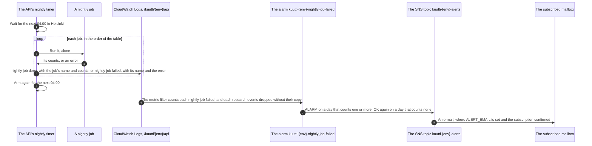
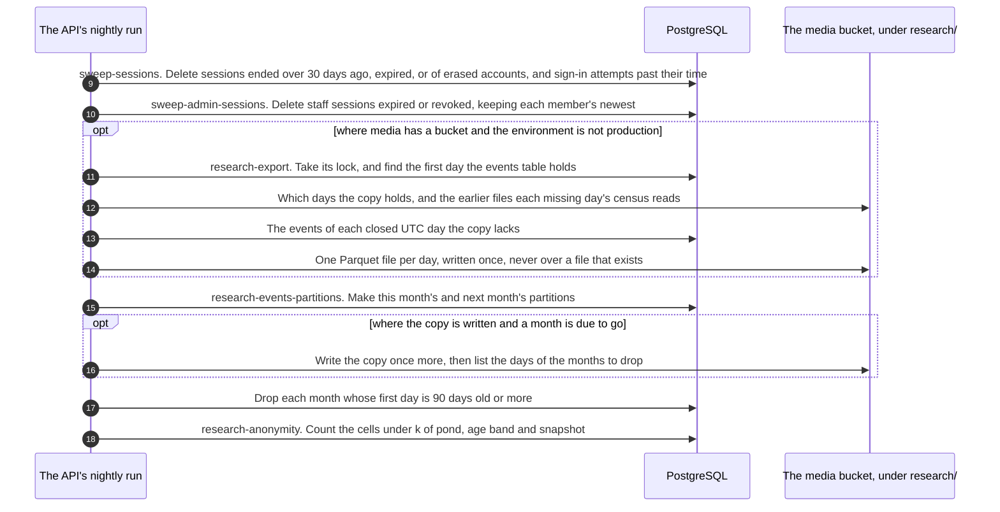
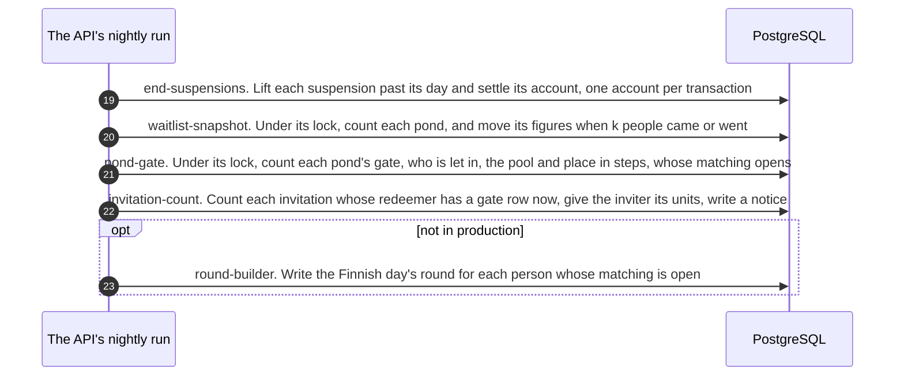
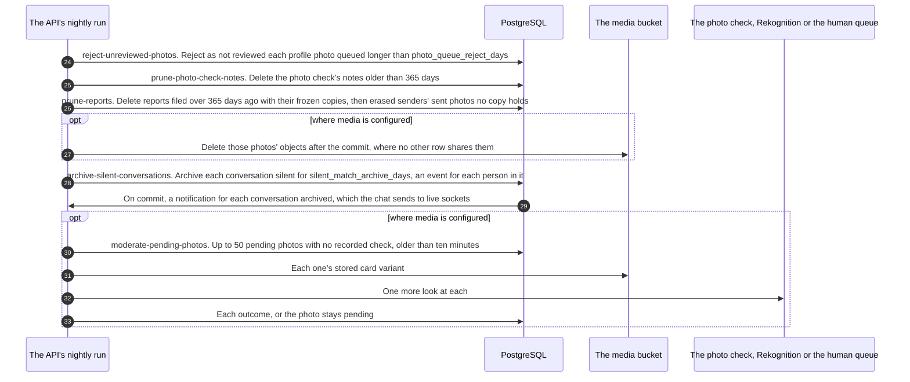

# The night's jobs, step by step

<!-- draws
apps/api/src/jobs/nightly.ts
apps/api/src/boot.ts
apps/api/src/jobs/round-push.ts
infra/modules/observability/
-->

What the API does at night, from the system's side: the timer that runs inside the API's own process at 04:00 in Helsinki, the fifteen jobs it runs one after another, what each reads and writes, and how a failed job reaches the maintainer's mailbox through the log and an alarm. It is written for a contributor who adds or changes a job, and for whoever answers the alarm. There is no cron and no second process: the jobs are listed in the API's boot and run by a timer in the same process as HTTP and the socket. This view draws ADR-006 §2, ADR-011 §6 and §9, ADR-013, ADR-015, ADR-024 §5, ADR-029, ADR-030 §8, ADR-031 §8, ADR-035 and ADR-044 §7.

In these diagrams every arrow is built. Mermaid's sequence diagrams take a message's words as they are, so the labels are not in quotes, and they name an environment as `{env}`, staging or prod.

## The jobs, in order

"Everywhere" is every process the API runs in: staging, a developer's machine, and each pull request's preview against its own database. Production runs the same list but the two jobs it holds back.

| # | Job, as the log names it | Where the work lives | Reads | Writes | Runs |
|---|---|---|---|---|---|
| 1 | `sweep-sessions` | identity | sessions, sign-in attempts | deletes ended, expired and erased sessions, and expired sign-in attempts | everywhere |
| 2 | `sweep-admin-sessions` | identity | staff sessions | deletes expired or revoked staff sessions, each member's newest kept | everywhere |
| 3 | `research-export` | research | the events table, the copy's files | one Parquet file per closed UTC day under `research/` in the media bucket | where media has a bucket, not in production: staging and a developer's S3 stand-in, never a preview |
| 4 | `research-events-partitions` | research | the events table's partitions; the copy, where there is one | this month's and next month's partitions; drops each month whose first day is 90 days old or more | everywhere |
| 5 | `research-anonymity` | research | the events table | nothing; a warning when a cell is under k | everywhere |
| 6 | `end-suspensions` | safety | sanctions | lifts each suspension past its day, settles the account | everywhere |
| 7 | `waitlist-snapshot` | jobs | accounts, profiles, photos, preferences, ponds | the day's waitlist figures per pond | everywhere |
| 8 | `pond-gate` | jobs | accounts, consents, profiles, photos, preferences, ponds, blocks | each person's gate row | everywhere |
| 9 | `invitation-count` | rewards | invitations, gate rows | invitations counted, the inviter's reward units, a notice | everywhere |
| 10 | `round-builder` | jobs, written through matching | accounts, profiles, photos, preferences, consents, blocks, gates, rounds, likes, conversations | the day's round and its cards | everywhere but production |
| 11 | `reject-unreviewed-photos` | media | profile photos in the human queue | rejects those waiting past `photo_queue_reject_days` as not reviewed | everywhere |
| 12 | `prune-photo-check-notes` | safety | the photo check's notes | deletes notes older than 365 days | everywhere |
| 13 | `prune-reports` | safety | reports, their frozen copies, erased senders' sent photos | deletes reports older than 365 days, then the photos no copy holds, then their objects | everywhere; the objects where media is configured |
| 14 | `archive-silent-conversations` | chat | conversations | archives the silent ones; a research event per person | everywhere |
| 15 | `moderate-pending-photos` | media | photos pending with no recorded check, their stored card variant | the check's outcome | where media is configured |

## Part 1: the run, and a failure

### Steps

1. Each API process arms one timer at its start, for the next 04:00 in Helsinki (`NIGHTLY_HOUR`). The timer does not keep the process alive by itself. Two containers that overlap during a deploy each arm one; the jobs that must not run twice at once take an advisory lock in the database (steps 11, 15, 17, 20 and 21).
2. The jobs run one at a time, in the order of the table: each waits for the one before it.
3. A job answers with counts, never with who: how many sessions, ponds, days, photos. A job that throws answers with its error.
4. One line per job: `nightly job done` with the job's name and its counts, or `nightly job failed` with its name and the error, which the logger redacts as everywhere. A failure is logged, never thrown, so one broken job stops neither the next job nor the server. On a deployed box Docker's `awslogs` driver sends every container's lines to the log group `/kuutti/{env}/api`, one stream per container, kept 30 days; a preview's container writes to the same group under its own stream. On a developer's machine the lines go to the terminal.
5. After the last job the timer is armed again for the next 04:00.
6. A metric filter on the log group counts each `nightly job failed` line and each `research events dropped without their copy` line (step 16) as `NightlyFailures`.
7. The alarm `kuutti-{env}-nightly-job-failed` sums a day: one or more is ALARM, and a day with none is OK again. Both go to the environment's topic.
8. The topic mails the address in the repository variable `ALERT_EMAIL`, once its subscription is confirmed from that mailbox; without the variable the topic has no subscriber. `docs/runbooks/alerts.md` has the first steps.

## Part 2: sessions and research

### Steps

9. `sweep-sessions` (identity, #35): deletes the sessions revoked more than 30 days ago, those past their expiry, and those of erased accounts; and the sign-in attempts past their time. A deleted session also closes any socket it still had (see Chat, step 43).
10. `sweep-admin-sessions` (identity, #49): deletes staff sessions that expired or were revoked, keeping each member of staff's newest.
11. `research-export` (research, #194, ADR-029), only where media has a bucket and the environment is not production: on staging and beside a developer's S3 stand-in, never in a preview, whose media is off. Production holds it until the maintainer has answered ADR-029's ninety days (a `shortcut:` in `boot.ts`). In one transaction it tries a lock of its own; a second container that finds it held writes nothing. Then it finds the first day the events table holds.
12. It asks the bucket which days the copy holds, and reads the files of the ninety days before each missing day, which are the census's prior. A file of a day not yet closed stops the run before anything is released.
13. It reads the events of each closed UTC day the table still holds and the copy lacks, oldest first. A day is closed an hour after it ends; 04:00 in Helsinki is one or two hours after midnight UTC.
14. It writes one Parquet file per day to `research/YYYY/MM/YYYY-MM-DD.parquet`, releasing a value only where k people with a live research consent share it (ADR-029 §4), and never the account, the event's id, the stored snapshot or text. The write is conditional: a file that exists is never written over. A night that fails writes what it finished, and the next night catches up while the table holds the days.
15. `research-events-partitions` (research, #50, ADR-011): under a lock, this month's and next month's partitions of the events table exist after every run, as after every boot.
16. Where the copy is written and a month is due to be dropped, the copy runs once more and then lists the days of those months (ADR-029 §6). Every day without its file is counted in one line, `research events dropped without their copy`, which the alarm counts (step 6).
17. Under the partitions' lock again, each month whose first day is 90 days old or more is dropped whole: the only deletion the events table allows, so no event lives past the ninety days the research text promises (ADR-011 §6). The drop goes ahead whether or not the copy has the days.
18. `research-anonymity` (research, ADR-011 §9): counts the distinct people in each cell of pond, age band and snapshot, over the table. A cell under k is a warning line with counts only, `research events: cells under k`; it is not a failure, and the alarm does not count it.

## Part 3: the pond and the round

### Steps

19. `end-suspensions` (safety, #307, ADR-024 §5): every suspension still open past its day is lifted by nobody, and its account's state settled from the sanctions still open, one account per transaction. It runs before the counts so that a person let back in is counted the same night. A login on the end day before 04:00 is still refused: a `shortcut:` in `safety/sanctions.ts`.
20. `waitlist-snapshot` (`jobs/`, #54, ADR-013): under its own advisory lock, counts the waitlist of each pond: live, bank-verified accounts with a pond. A pond's figures move only when at least k people have come or gone since they were taken, and the bands of whom its finished profiles seek on their own sum (#507). The public waitlist route serves the figures all day, and a signed-in route the bands of the caller's own pond, as shares. A database with no figures gets its first ones at boot.
21. `pond-gate` (`jobs/`, #94, ADR-015): under its own advisory lock, with every account it may write for held first, counts each pond's gate: who of a pond is let in, how large everybody's pool is and their place in the line, and for whom matching opens. The exact figures exist in memory only while it runs; what is written, said and logged is in steps (ADR-015 §6). It reads across slices, so it lives with the jobs.
22. `invitation-count` (rewards, #107, ADR-044 §7): in one transaction, each invitation whose redeemer now has a gate row, and was not counted yet, is counted once; its inviter gets the units `matching_config invitation_reward` says tonight, and one notice in the app (ADR-032). Its line says how many and of what, never who.
23. `round-builder` (`jobs/`, #95, ADR-035), after the gate: in each pond with an open gate, each person whose matching is open gets a round for the Finnish day, written through the matching slice's one writer. The people whose like waits on the person come first (ADR-037, ADR-039). Somebody the night did not build for gets theirs at the day's first read. Not in production, by night or by read, until the maintainer has set how long rounds are kept (ADR-034 Open 2, ADR-035 Open 1): a `shortcut:` in `boot.ts` and `app.ts`. The day's round is told later, at `matching_config round_push_hour` (9 in Helsinki), by a timer of its own in the same process and not by a nightly job: one push to each person whose round was built and who has not opened it, and who opened a round within `matching_config round_push_idle_days` (7), through Expo; a failed run is tried again three times five minutes apart, the same day (#102, ADR-055 §6; [Components](components.md), step 21).

## Part 4: photos, reports and silent conversations

### Steps

24. `reject-unreviewed-photos` (media, #376, ADR-006 §2): a profile photo in the human queue that nobody decided within `matching_config photo_queue_reject_days` is rejected as `not_reviewed`, a reason no moderator chooses. Nothing expires into visibility: the photo stays in its owner's list with the reason. The value 0 turns the job off.
25. `prune-photo-check-notes` (safety, #253): the photo check's notes, which kind of photo the check did not show and when, are kept twelve months.
26. `prune-reports` (safety, #84, #351, ADR-030 §8 and §12): in one transaction, every report filed more than twelve months ago goes, open or decided, with its frozen copy of a conversation; its block stays. Then every photo an erased person sent in a conversation that no copy holds any more goes, through the media slice's own erasure.
27. After the commit, where media is configured, those photos' objects are deleted from the media bucket where nothing else shares them.
28. `archive-silent-conversations` (chat, #348, TD-13, ADR-031 §8): in one transaction, the conversations with no message and no contact shared for `matching_config silent_match_archive_days` are locked, read afresh and archived, so one that a share brought back while the lock waited stays out. A closed conversation stays as it is, and a break stops no clock (ADR-022 §4). Each person in an archived conversation gets the research event `conversation_archived`, in bands.
29. On commit, the conversation trigger notifies `kuutti_chat`, and the chat tells each side's live sockets that the conversation is archived (see Chat, steps 41 and 42). The next message brings it back.
30. `moderate-pending-photos` (media, #49, ADR-006), where media is configured: up to 50 photos still pending with no check recorded, pending for more than ten minutes (a crash or a failed call), get one more look.
31. The job reads each one's stored card variant from the bucket; one with no card variant is logged and counted as failed.
32. The check is Rekognition through the instance role where `MODERATION=rekognition`, and otherwise the human queue for everything (ADR-006 §4).
33. Each outcome is written as the upload's would be. A photo the check cannot reach stays pending: nothing expires into visibility.

## Where it lives

- The timer and the list: `apps/api/src/jobs/nightly.ts` (`msUntilNightly` over `msUntilFinnishHour`, which the round's push uses too, `runNightly`, `scheduleNightly`), `apps/api/src/boot.ts` (the jobs, in order, and the two held back in production), `apps/api/src/index.ts` (`scheduleNightly` at start)
- The jobs: `apps/api/src/identity/sessions.ts` and `admin-session.ts`; `apps/api/src/research/copy.ts`, `copy-store.ts`, `partitions.ts`, `anonymity.ts`; `apps/api/src/safety/sanctions.ts` (`endSuspensions`), `photo-check.ts`, `reports.ts` (`pruneReports`); `apps/api/src/jobs/waitlist-snapshot.ts`, `pond-gate.ts`, `invitation-count.ts` with `apps/api/src/rewards/invitations.ts`, `round-builder.ts` with `apps/api/src/matching/rounds.ts` (`saveRound`); `apps/api/src/media/moderation.ts` (`rejectUnreviewedPhotos`, `sweepPendingPhotos`); `apps/api/src/chat/archive.ts`
- The alarm: `infra/modules/observability/main.tf` (the topic, the e-mail subscription, the metric filter `nightly-failures`, the alarm `nightly-job-failed`), `infra/modules/compute/main.tf` and `templates/user_data.sh.tpl` (the log group and the `awslogs` driver), `infra/envs/staging/main.tf` and `infra/envs/prod/main.tf` (each composes it), `docs/runbooks/alerts.md`
- Specs: `features/safety/sanctions.feature` (the night lifts a suspension), `features/pond/gate.feature`, `features/pond/waitlist.feature`, `features/matching/rounds.feature`, `features/media/moderation.feature`, `features/chat/conversations.feature`
- ADRs: [ADR-006](../adr/006-photo-moderation.md) §2 and §4, [ADR-011](../adr/011-research-events.md) §6 and §9, [ADR-013](../adr/013-waitlist-counter.md), [ADR-015](../adr/015-pond-gate.md), [ADR-022](../adr/022-taking-a-break.md) §4, [ADR-024](../adr/024-sanctions.md) §5, [ADR-029](../adr/029-the-research-copy.md) §1 to §6 and §12, [ADR-030](../adr/030-reports-and-blocks.md) §8 and §12, [ADR-031](../adr/031-chat.md) §8, [ADR-032](../adr/032-notification-choices-and-notices.md), [ADR-034](../adr/034-the-round-record.md), [ADR-035](../adr/035-the-round-builder-first-cut.md), [ADR-037](../adr/037-liked-you-in-the-round.md), [ADR-039](../adr/039-the-fish.md), [ADR-044](../adr/044-invitations.md) §7
- Issues: #35, #49, #50, #54, #84, #94, #95, #107, #194, #253, #307, #348, #351, #376; the alarm #11 and #194

## Open

- **Two jobs held back in production, the maintainer's to lift.** `round-builder` waits for how long rounds are kept (ADR-034 Open 2, ADR-035 Open 1), and `research-export` for ADR-029's ninety days. Both are `shortcut:` lines in `boot.ts`.
- **"As cron".** `.claude/rules/api.md` says the nightly jobs run "as cron inside the same container". There is no cron: one timer in the API's process (`jobs/nightly.ts`). Drawn as the code.
- **What `jobs/` holds.** `.claude/rules/layout.md` says `jobs/` holds the nightly runner and its jobs, "the slices' sweeps" among them. The sweeps live in their slices, `jobs/` also holds the round builder and the invitation count, and the order is `boot.ts`'s list. Drawn as `boot.ts`.
- **"Every 24 hours".** The comment at the top of `jobs/nightly.ts` says one timer to the next 04:00, then every 24 hours. The code arms the timer again for the next 04:00 after each run, so on the nights summer time begins or ends the wait is 23 or 25 hours. Drawn as the code: 04:00 in Helsinki, every night.
- **Whether staging's export succeeds tonight.** `infra/README.md` says staging's `research-export` fails every night with AccessDenied until `modules/research` is applied; whether it has been applied is not in the repository.
