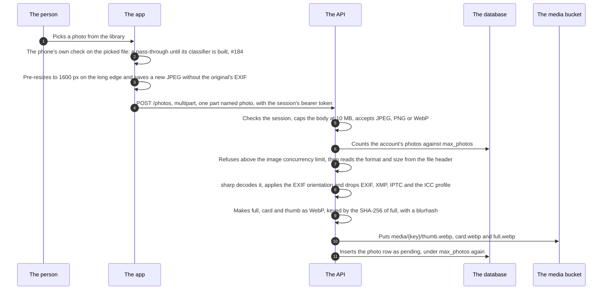
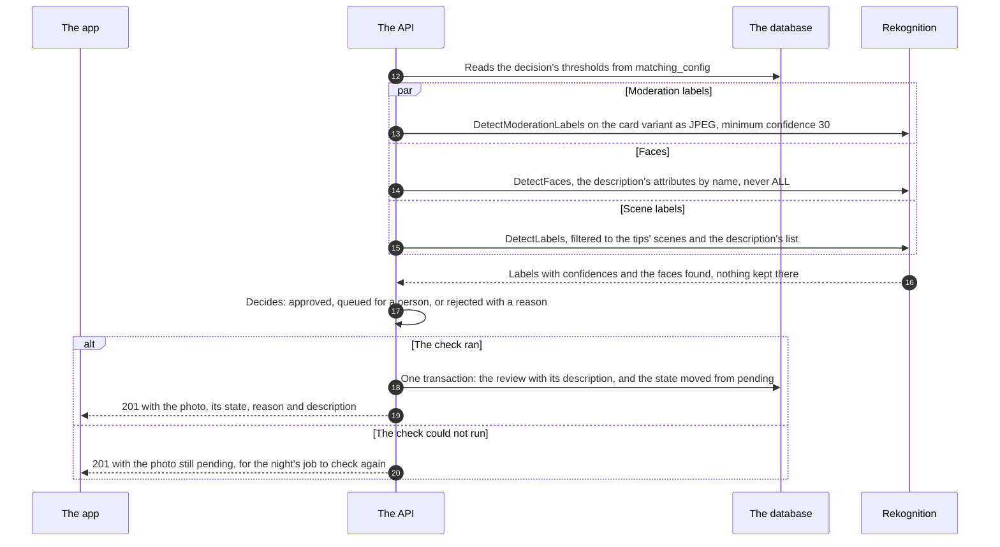
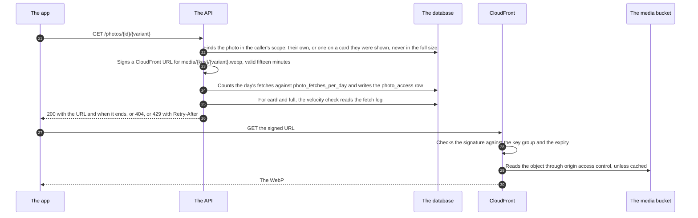

# The photo upload

<!-- draws
apps/api/src/media/routes.ts
apps/api/src/media/photos.ts
apps/api/src/media/pipeline.ts
apps/api/src/media/store.ts
apps/api/src/media/moderation.ts
apps/api/src/media/description.ts
apps/api/src/media/urls.ts
apps/api/src/media/budget.ts
apps/api/src/media/wiring.ts
apps/mobile/src/features/media/pick.ts
apps/mobile/src/features/media/localCheck.ts
apps/mobile/src/features/media/client.ts
infra/modules/media/
-->

How a profile photo gets from the phone to the media bucket and back to the people who may see it: the app's preparation, the API's pipeline, the automatic check by Rekognition, and the signed CloudFront URL a photo is fetched by. It is written for a contributor or a reviewer who is about to touch the media slice, the photo screens or the media infrastructure. The person's side of the same flow, with the queue and the moderators, is drawn in #395 (`docs/flows/photos.md` once it lands). It draws rule 4, TD-2, TD-6 and TD-8, ADR-005 (the pipeline and delivery), ADR-006 (the check and the queue), ADR-008 (the exposure budget and the shown record), ADR-041 (velocity) and ADR-056 (no full size of others). What is drawn is staging's: production has run since 2026-10-24 with photos off until its media cutover (ADR-049).

In the sequences a solid arrow is a request or an action and a dotted arrow is an answer. The numbers on the arrows are the steps under each part, and they run on from one part to the next.

## Part 1: from the phone to the bucket

### Steps

1. The person picks a photo from the phone's library.
2. The app runs the phone's own nudity check on the picked file, before any byte leaves the phone. Its classifier is native and not built yet (#184): until then every picture passes, and on the web preview always. A classifier that fails refuses the picture, and a refusal sends nothing.
3. The app pre-resizes the picture to 1600 px on the long edge with `expo-image-manipulator` and saves a new JPEG, which carries none of the original's EXIF, so location and camera data never leave the phone.
4. The app posts it to `POST /photos` as multipart with one part, `photo`, with this device's bearer token, refreshed first when it is stale and once more on a 401. There is no path from the phone to the bucket (rule 4).
5. The API checks the session before it reads the body, caps the body at 10 MB (413 `payload_too_large`), and validates the part: JPEG, PNG or WebP, anything else 400.
6. It counts the account's photos against `max_photos` in `matching_config` (409 `photo_limit`).
7. Above the image concurrency limit, `p-limit` at the box's vCPU count unless `IMAGE_CONCURRENCY` says otherwise, it answers 503 `media_busy` with `Retry-After` rather than queue the work. Then it reads the format, width and height from the file header alone: anything but JPEG, PNG or WebP is 415 `photo_unsupported`, and more than 30 million pixels is 422 `photo_too_many_pixels`, before any decoder runs.
8. sharp decodes the bytes, with `limitInputPixels` as the decoder's own backstop, takes the first frame of anything animated, and turns the EXIF orientation into the pixels. Re-encoding drops EXIF, XMP, IPTC and the ICC profile. A file the decoder cannot read is 422 `photo_invalid`.
9. Three WebP variants from one decode: `full`, at most 1600 px on the long edge and never enlarged; `card`, 800 × 1067; `thumb`, 200 × 200, the last two cropped by attention from `full`. The content key is the SHA-256 of `full`, and a blurhash is made from `thumb` for the app to paint before the bytes arrive.
10. The API puts the three objects at `media/{key}/thumb.webp`, `card.webp` and `full.webp` in the environment's media bucket, through the instance role, with an immutable cache header. The same picture uploaded twice, by one person or two, is one set of objects.
11. It inserts the photo row as `pending`, owner-only, applying `max_photos` again in the same statement. If anything fails between the objects and the row, the objects are removed unless another row shares them. From here the uploaded bytes are referenced by nothing: no original is kept (rule 4).

## Part 2: the automatic check

### Steps

12. The API reads the decision's thresholds from `matching_config`: the label and face lines, each hard group's review and reject lines, the no-appeal line for nudity, and the description's confidence.
13. `DetectModerationLabels` on the card variant, re-encoded in memory as a JPEG for the call, since Rekognition reads no WebP; minimum confidence 30, so the low labels exist for the tips. The three calls go at once, from the API through the instance role, which may make exactly these three.
14. `DetectFaces`, with the face attributes the description says asked for by name, never `ALL`, gender, age range or emotions.
15. `DetectLabels`, filtered by name to the tips' scenes and the description's closed list. A failure of this call never holds the decision.
16. Rekognition answers with labels and confidences and the faces it found, never the image. The detect calls are stateless: the image is bytes in the request, and nothing of ours is stored on that side.
17. The decision, a pure function (ADR-006 §2): rejected by the check where it is sure (a hard group at its reject line, no face at all, several sure faces), with a reason the owner reads at once and whether a person may be asked to look again; queued for a person where it is unsure; approved for one sure face with nothing flagged. An account with recent notes is checked against a closer look's lines (#253). The automatic description (#296) is made from what the check saw and decides nothing.
18. One transaction writes the `photo_review` row (at most fifty labels, the face count, what was flagged, the model version, the description) and moves the photo from `pending`, never over a person's decision. A rejection for a hard group leaves a note on the account. The log line carries counts, never a label name.
19. The app gets 201 with the photo: its state, the reason in words the app has, whether it may be appealed, and its description. Only an approved photo is ever shown to anyone else. The advisory tips (#56) come with the photo list, `GET /photos`, not with the upload.
20. If Rekognition failed, the photo stays `pending` and the app gets 201 with it. The night's `moderate-pending-photos` job looks again from the stored card variant; nothing becomes visible by waiting. A photo queued and not decided within `photo_queue_reject_days` is rejected by the night as `not_reviewed` (#376). Where there is no Rekognition (`moderation` other than `rekognition`, a developer's machine), every photo goes to the queue.

## Part 3: fetching a photo

### Steps

21. The app asks `GET /photos/{id}/{variant}` for the variant it shows: `thumb` in lists, `card` when a profile opens, `full` only from the zoom screen of one's own photos. It caches by photo id and variant, never by the URL.
22. The API finds the photo in the caller's scope, in the query itself (rule 6): the caller's own photo in any state, or another account's approved profile photo on a card the caller was shown, whose owner is active, with no block between the two, in the thumb and card sizes. Another account's full size, which the app never asks for, is refused like any miss (ADR-056 §3). Anything else, a guessed id included, is 404 and a warn line, the same for every miss (ADR-008 §3).
23. It signs a CloudFront canned-policy URL for `media/{key}/{variant}.webp` on the API's own name, valid fifteen minutes, with the private key read from SSM at boot (ADR-005 §3). Signing comes first because it has no side effect: a failure there spends nothing.
24. Under an advisory lock per account and variant, one statement counts the caller's fetches of this variant since midnight in Finland against `photo_fetches_per_day` and writes the `photo_access` row, the fetch log (ADR-008 §1). Over the budget there is no row and no URL. A block that landed meanwhile is the same 404 as step 22.
25. For a `card` or a `full`, the safety slice's velocity check reads the fetch log after the row has committed and before the answer (ADR-041); a `thumb` never counts. Since step 22 refuses another's full size, a `full` that reaches here is the caller's own, which the rule never counts.
26. The app gets 200 with the URL, the variant and when it stops working; or 429 `photo_budget_exceeded` with `Retry-After` until the day rolls, which the app says in words; or 404.
27. The app fetches the URL from CloudFront.
28. CloudFront serves `/media/*` only with a signature from a key in the key group the behaviour trusts, before its expiry.
29. CloudFront reads the object from the private bucket through origin access control, or from its cache; the bucket policy lets only this distribution read `media/`.
30. The WebP reaches the app.

## Where it lives

- App: [pick.ts](../../apps/mobile/src/features/media/pick.ts) (the pick, the check, the pre-resize), [localCheck.ts](../../apps/mobile/src/features/media/localCheck.ts), [client.ts](../../apps/mobile/src/features/media/client.ts) (the upload and the URL), [PhotosScreen.tsx](../../apps/mobile/src/features/media/PhotosScreen.tsx), [PhotoImage.tsx](../../apps/mobile/src/features/media/PhotoImage.tsx); the rule in `.claude/rules/mobile.md`, Images
- API: `POST /photos` and `GET /photos/{id}/{variant}` in [routes.ts](../../apps/api/src/media/routes.ts); [photos.ts](../../apps/api/src/media/photos.ts) (the service), [pipeline.ts](../../apps/api/src/media/pipeline.ts), [store.ts](../../apps/api/src/media/store.ts), [moderation.ts](../../apps/api/src/media/moderation.ts) (the check, the decision, the night's sweep), [description.ts](../../apps/api/src/media/description.ts), [urls.ts](../../apps/api/src/media/urls.ts), [budget.ts](../../apps/api/src/media/budget.ts), [repo.ts](../../apps/api/src/media/repo.ts), [wiring.ts](../../apps/api/src/media/wiring.ts); the night's jobs in [boot.ts](../../apps/api/src/boot.ts); the slice's [README](../../apps/api/src/media/README.md)
- Contracts: [packages/schema/src/media.ts](../../packages/schema/src/media.ts) (the sizes, the caps, the states)
- Infrastructure: [infra/modules/media](../../infra/modules/media/main.tf) (the bucket, the distribution, `/media/*`, the key group, origin access control), the `RekognitionDetect` statement in [infra/modules/compute](../../infra/modules/compute/main.tf), `moderation = "rekognition"` in [infra/envs/staging/main.tf](../../infra/envs/staging/main.tf); the signing key in SSM ([infra/README.md](../../infra/README.md), Secrets, Media)
- Locally: the compose S3 stand-in (versitygw) presigns its own GETs, refused outside development and test
- Specs: [moderation.feature](../../features/media/moderation.feature)
- ADRs: [ADR-005](../adr/005-media-pipeline-and-delivery.md), [ADR-006](../adr/006-photo-moderation.md), [ADR-008](../adr/008-exposure-budget-and-client-address.md), [ADR-030](../adr/030-reports-and-blocks.md) §2, [ADR-041](../adr/041-velocity.md), [ADR-056](../adr/056-attestation-later-no-screenshot-notice.md) §3
- Issues: #48 (the pipeline), #49 (the check), #52 (the budget), #56 (tips), #253 (the check's own rejections), #296 (the description), #376 (the queue's limit), #184 (the phone's check)

## Open

- **Fifteen minutes.** #397 says signed URLs last 15 minutes. That holds for this route, for a conversation's thumb and for the staff's views (`URL_TTL_MS`). A photo sent in a conversation (#350) is signed to the next five-minute mark plus fifteen minutes, so its URLs live 15 to 20 minutes (ADR-005, History of 2026-10-18). That path is the chat's and is not drawn here: it checks the full size, not the card, before anything is stored, and refuses rather than queues.
- **The phone's own check** is a seam with a pass-through (step 2) until the native batch, #184.
- **Rekognition and AWS's use of content.** AWS may use what its AI services are sent to improve them unless the account opts out, and the opt-out waits for the account to sit under the association's organisation (ADR-006 §1).
- **Production.** Running since 2026-10-24, with photos off: production's media module is dormant until its cutover (`infra/README.md`, Layout and Media).
