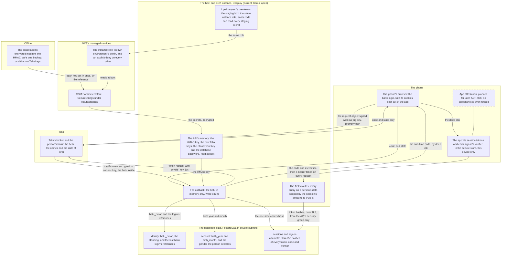

# Data and trust boundaries

<!-- draws
apps/api/src/identity/login.ts
apps/api/src/identity/hetu.ts
apps/api/src/identity/oidc-broker.ts
apps/api/src/identity/sessions.ts
apps/api/src/lib/auth-middleware.ts
apps/api/src/lib/push.ts
apps/api/src/notifications/push.ts
apps/api/src/notifications/tokens.ts
apps/api/src/lib/ssm.ts
apps/api/src/lib/cors.ts
apps/api/src/lib/sentry.ts
apps/api/src/research/track.ts
apps/mobile/src/lib/session.ts
packages/db/src/schema/research.ts
scripts/check-schema-words.ts
infra/modules/network/
infra/modules/data/
infra/modules/media/
infra/modules/research/
-->

Where a person's data lives, who can read it, and what crosses from one place to another: the phone, Telia, the box, the database and AWS's managed services. Part 1 follows the person's identity and the secrets that guard it; part 2 follows photos, research events and what leaves the box for logs and error reports. It is written for a reviewer of a change to identity, uploads, signed URLs, events or infrastructure, and for the `security-reviewer` agent, as the map behind `docs/security-checklist.md` and its four surfaces: the OIDC exchange with Telia, the hetu HMAC, session tokens, and signed URL issuance. It draws rules 1 to 6 and 8, TD-1, ADR-001 (secrets are never resources), ADR-005 (media delivery), ADR-006 (the check, staff, the audit), ADR-008 (the exposure budget), ADR-011 (research events), ADR-017 (the Telia kit), ADR-025 (the panel's host and CORS), ADR-027 (the bound code), ADR-029 (the research copy) and ADR-056 (attestation later). What is drawn is staging's. Production has run since 2026-10-24 without bank identification (ADR-049) and is drawn in [Deployment](deployment.md), part 5.

## Part 1: the person's identity and the secrets

### Steps

1. **The app.** It holds this device's access and refresh tokens and, while a sign-in is under way, the attempt's verifier, in `expo-secure-store`, readable while the phone is unlocked and on this device only. It never holds a client secret, an ID token or the hetu. What leaves it: the verifier's SHA-256 in the sign-in start's URL, the code and the verifier in the exchange's body, then the bearer token on every request (ADR-027).
2. **The phone's browser.** The bank login runs there, never in a WebView, so the bank's cookies stay out of the app. What crosses it: the signed request object on its way to Telia, Telia's code and state on the way back, and the one-time code to the app by deep link. The hetu never passes through the phone: Telia hands it to the API server to server (4).
3. **Planned for later, not built:** nothing on the phone attests the app. App attestation may come back when one of ADR-056 §1's triggers holds, and starting it is the maintainer's call. It would take §2's shape: bound to the session at the exchange, asserted at every refresh, refused only on iOS in production. Screenshots are never noticed, on either platform (ADR-056 §4).
4. **Telia's broker and the bank** know the person: the hetu, the names, the date of birth. Telia keeps the log of each identification for five years in a sealed environment, opened on a police request only (`docs/vendors/telia.md`). From the API it receives the request object signed with our `sig` key and the token request's `private_key_jwt`; to the API it sends, server to server, the ID token encrypted to our `enc` key, with the hetu and the other claims inside. This is the first of the four surfaces.
5. **The API's routes.** Every route outside the public list sits behind the session check, which hashes the bearer token and looks the hash up; everything a product route reads about the caller comes from there, and every query on a person's data carries the session's `account_id` in the query itself (rule 6). The third surface, session tokens, is this check and the exchange that issues them. Browser origins are refused unless allowlisted (rule 8; part 2, step 26).
6. **The callback** is the only place the hetu exists: in memory, while one callback runs. What leaves it is `hetu_hmac`, the HMAC-SHA256 under the key of step 7, the year and month of birth, and whether the person is 18 (rules 1 to 3). Legal sex is never read: the kit derives none, and the callback keeps only the year and month of birth of what the parser returns, never the individual number. The names and the date of birth stay in the adapter's frame and go with it. No log line carries the hetu, and a test sends one through every route and fails on any line that does. This is the second surface, the hetu HMAC.
7. **The API's memory** holds what it read at boot from its own SSM prefix through the instance role: the HMAC key, the two Telia private keys, the CloudFront signing key and the database password, and on staging also the preview role's password, which the prefix holds. Dokploy's application environment carries only `NODE_ENV`, `APP_ENV` and `PORT`; everything else comes from SSM.
8. **A pull request's preview** runs on the staging box under the same instance role and reads the same prefix. The API's own code then drops, before anything uses them, the database password, the Telia client and both keys, the HMAC key and the media settings, so a preview has no bank login and no photos (ADR-014 §1, ADR-005 §5), and keeps `db-preview-password` to connect to its own database as its own role. That drop is code the pull request controls, not a boundary: a pull request that removes it, or reads SSM itself, holds every staging secret, the HMAC key included. The role also lets a preview change one DNS record, the TXT record `_acme-challenge.preview.api.staging.kuutti.app` by which Traefik obtains the previews' wildcard certificate, and nothing else in the zone (ADR-053). Write access to the repository is that trust (ADR-004 §3; `infra/README.md`, Previews, Trust); staging's people are Telia's test persons (ADR-018).
9. **SSM Parameter Store** holds the secrets as SecureStrings under `/kuutti/staging/`: `hetu-hmac-key`, `telia-signing-key`, `telia-encryption-key`, `cloudfront-signing-key`, `db-app-password` and `db-preview-password`. `/kuutti/prod/` holds `db-app-password` alone until bank identification and the media cutover (ADR-049 §1). They are created by hand, never as OpenTofu resources, so no value is in state (ADR-001). The plan role can list them and is denied `kms:Decrypt`. The non-secret configuration sits beside them as plain Strings that the apply writes.
10. **The instance role** may read parameters under its own environment's prefix. An explicit deny on every other parameter wins over the wider allow that Session Manager's managed policy carries, so staging's box cannot read `/kuutti/prod/`. Decryption is allowed only through SSM and S3.
11. **identity**: `hetu_hmac` (unique), the standing, and the latest bank login's references, Telia's `sub`, the session index, the token id, `auth_time`, `acr` and `amr`, rewritten at each login and kept for a police request that names one. Never the claims themselves.
12. **account**: `birth_year` and `birth_month`, and the gender the person declares (rule 3). `pnpm check:schema-words` refuses any column for the hetu, legal sex, a full date of birth, a name from the bank or a network address.
13. **sessions and sign-in attempts**: only SHA-256 hashes of the access and refresh tokens, of the one-time codes and of the app's verifier (the challenge), and the attempt's state and nonce. The database sits in private subnets and admits only the API's security group, over TLS that the API verifies against the RDS certificates in its image.
14. **The association's encrypted medium**: the HMAC key's one offline backup (the key is never rotated, rule 2) and the two Telia keys as generated. From it each key went into SSM once, by file reference, never on a command line (`infra/README.md`, Secrets).

## Part 2: photos, research events and what leaves the box

```mermaid
flowchart TB
  accTitle: Data and trust boundaries, part 2: photos, research events and what leaves the box
  accDescr: The app reaches the API through CloudFront, or still straight on the box's port 443 until CloudFront-only ingress. Photos go to the API, which keeps no original, asks Rekognition about the card variant, stores three variants in the private bucket and hands out URLs signed for fifteen minutes (a conversation's photo, 15 to 20) that CloudFront alone serves. Research events are keyed by a research id that maps to an account only while consent lasts, and staging copies them nightly to a write-once Parquet file a read-only researcher role can read. Logs go to CloudWatch, and errors to Sentry with the request's data, local variables and extra data stripped; an error's own message goes as thrown. Pushes go to Expo, which hands them to Apple or Google, with one line of the app's words and what they are about, never a text, a name or an account. The admin panel is the one browser origin CORS answers.
  subgraph phone2["The phone"]
    b15["The app: uploads only to the API, and fetches photos by signed URL"]
  end
  subgraph aws2["AWS's managed services"]
    b16["CloudFront on the API's name: viewer TLS, and /media/* only with a valid signature"]
    b19["Rekognition: the card variant, or a conversation's photo at full size, as JPEG in, labels and faces out, nothing kept"]
    b20["The media bucket, media/: three WebP variants per photo, no original"]
    b21["The media bucket, research/, staging only: one Parquet file a day, written once"]
    b22["CloudWatch Logs: structured lines with account_id and request id, 30 days"]
  end
  subgraph box2["The box"]
    b17["The API: the photo pipeline in memory, URL signing, research events, the night's jobs"]
    b18["CloudFront the only way in on 443: planned, #198"]:::notbuilt
  end
  subgraph rds2["The database"]
    b23["photo, photo_review, card_shown and photo_access, the fetch log: a person's rows by account_id, staff and the night by photo id"]
    b24["research_subject: account_id to research_id, only while the research consent lasts"]
    b25["events: by research_id, never message text"]
  end
  subgraph others["Outside AWS"]
    b26["The admin panel at its own origin: the one browser origin CORS answers on staging"]
    b27["The researcher: a read-only role on research/, every read in a CloudTrail trail"]
    b28["Sentry: unhandled errors, with request data and variables stripped"]
    b29["Expo's push service, then Apple's APNs or Google's FCM: a device's token, one line of the app's words and its kind"]
  end
  b15 -->|"requests, uploads and signed photo URLs, over TLS"| b16
  b16 -->|"HTTPS to the box, viewer headers forwarded"| b17
  b15 -->|"or straight to the box's 443, still open to anyone"| b17
  b17 --- b18
  b17 -->|"the card variant, or a conversation's photo, as JPEG"| b19
  b19 -->|"labels, confidences and faces"| b17
  b17 -->|"three variants, by the instance role"| b20
  b17 -->|"a URL signed for fifteen minutes, a conversation's photo 15 to 20"| b15
  b16 -->|"media/ only, by origin access control"| b20
  b17 -->|"rows by account_id, over TLS"| b23
  b17 -->|"an event: looks up the research_id"| b24
  b24 -->|"the event, by research_id"| b25
  b25 -->|"yesterday's events, put once each night by the API"| b21
  b27 -->|"lists and reads research/ only"| b21
  b17 -->|"log lines without hetu, message text, e-mail, seeks or an address"| b22
  b17 -->|"error reports"| b28
  b17 -->|"a push, never a text, a name or an account"| b29
  b29 -->|"wakes the phone with it"| b15
  b26 -->|"a staff bearer token, eight hours, from its own origin"| b16
  classDef notbuilt stroke-dasharray: 5 5
```

### Steps

15. **The app** uploads only to the API (rule 4) and fetches a photo only by a URL the API signed for one object; it caches by photo id and variant, never by the URL.
16. **CloudFront** fronts the API on its own name. It ends the viewer's TLS, forwards every other request to the box over HTTPS with the viewer's headers and caches none of it, and serves `/media/*` from the bucket only with a signature from the key group's public key, before its expiry. The hop to the box goes over the box's public address, not inside the VPC.
17. **The API on the box.** A photo's uploaded bytes exist only in its memory during the upload; only the variants are stored (rule 4). It signs each URL with the key from SSM and, for a person's fetch, writes a `photo_access` row (for a conversation's photo, one per viewer, photo and variant in each five-minute window); a URL signed for staff is recorded by the audit row of step 26 instead. That is the fourth surface, which the upload's sequence draws step by step. It writes a research event only for an enrolled account. The box still admits 443 from anywhere, since Dokploy's control plane and the previews are served there directly (ADR-005 §7).
18. **Planned, #198:** CloudFront-only ingress, the switch that lets only CloudFront's addresses reach 443, flipped together with `trusted-proxy = cloudfront` (ADR-005 §7, ADR-008 §5). Until then the rate limiter keys on the CloudFront edge for traffic that comes through the distribution.
19. **Rekognition** receives the card variant, or a photo sent in a conversation at its full size, as JPEG bytes in three detect calls through the instance role, which may make exactly those three, and answers labels and faces. Nothing of ours is stored there (ADR-006 §1).
20. **The media bucket's `media/`** holds three WebP variants per photo under a content key, never an original. The bucket is private, public access blocked; its policy admits only the distribution to `media/`, through origin access control, and the instance role may put, get and delete there, so a preview's code may too.
21. **`research/`** in the same bucket, on staging only: one Parquet file per day of yesterday's events, put once with `If-None-Match: *` and never deleted, with the `research_id` and the registry's values and never an account id, an event id or text, each value only where at least k pseudonyms with a live research consent share it (ADR-029). Production writes no copy until ADR-029's ninety days are answered. The API's own code writes no copy from a preview. But a preview's code runs under staging's role, so it could read `research/` or write a day the night has not written yet, and that file would stand as the day's (ADR-029 §12).
22. **CloudWatch Logs** gets every container's lines from the box: structured, with `account_id` and the request id, never the hetu, message text, an e-mail, `seeks` or a client address: the logger redacts the first four by field name, no line is ever given the address, and a test fails on any of them in a line. Kept 30 days.
23. **photo, photo_review, card_shown and photo_access**: a statement run by a person's own request carries the caller's `account_id` (rule 6). Staff's queue, views and decisions, behind the admin guard with an audit row first (ADR-006 §6), and the night's limit on the queue act across accounts by photo id. `photo_access` is the fetch log the exposure budget counts (ADR-008).
24. **research_subject** maps an `account_id` to a random `research_id`, one row while the research consent lasts. Withdrawing the consent or erasing the account deletes it, and then nothing joins the events back to a person (ADR-011 §1).
25. **events**: keyed by `research_id`, never `account_id`, and never message text (rule 5), in monthly partitions of the main Postgres, dropped past their 90 days (ADR-011).
26. **The admin panel** runs in a browser at its own origin, the only origin staging's CORS allowlist names (rule 8, ADR-025 §10). It calls the API with an eight-hour staff token, and every view of a photo and every decision writes an audit row first (ADR-006 §6). A pull request's preview API answers its own web origin as well, and no other.
27. **The researcher** reaches `research/` through a role that may list and read there and nothing else, assumed through the Identity Center permission set `KuuttiResearchStaging` (the trust's wildcard suffix would also admit a set named `KuuttiResearchStaging_<anything>`, and only the maintainer creates sets); a CloudTrail trail logs every object call under `research/` into a bucket neither role can read (ADR-029 §10, §11).
28. **Sentry** receives unhandled errors only, with the request's body, headers, cookies and query, local variables and extra data stripped before sending, and no tracing.
29. **Expo's push service** (#102, ADR-055) receives, per push, the device's Expo token, one line of the app's own words in the device's language and its kind, never a message's text, a name, an account, a profile's field or the conversation, whose id both phones would share, and hands it to Apple's APNs or Google's FCM, which wake the phone. The tokens are `push_token` rows, one per session, deleted the moment the session is revoked or deleted and at erasure; the export names which sessions have one, never the token. The API sends where the parameter `push` says `expo`; once EAS's enhanced push security is on, only with the access token from SSM. What Expo receives and keeps: `docs/vendors/expo.md`.

## Where it lives

- Identity: [login.ts](../../apps/api/src/identity/login.ts), [hetu.ts](../../apps/api/src/identity/hetu.ts), [oidc-broker.ts](../../apps/api/src/identity/oidc-broker.ts), [broker.ts](../../apps/api/src/identity/broker.ts), [sessions.ts](../../apps/api/src/identity/sessions.ts), [auth-middleware.ts](../../apps/api/src/lib/auth-middleware.ts); the app's store in [lib/session.ts](../../apps/mobile/src/lib/session.ts)
- Configuration and secrets: [lib/ssm.ts](../../apps/api/src/lib/ssm.ts), [lib/config.ts](../../apps/api/src/lib/config.ts) (what a preview drops, the database's TLS, the CORS list), [lib/cors.ts](../../apps/api/src/lib/cors.ts); [infra/README.md](../../infra/README.md), Secrets; the instance role in [infra/modules/compute/main.tf](../../infra/modules/compute/main.tf); the parameters in [infra/envs/staging/main.tf](../../infra/envs/staging/main.tf)
- Network and database: [infra/modules/network/main.tf](../../infra/modules/network/main.tf) (443, the database's security group), [infra/modules/data/main.tf](../../infra/modules/data/main.tf) (private, TLS forced)
- Photos: [apps/api/src/media](../../apps/api/src/media/README.md), [infra/modules/media/main.tf](../../infra/modules/media/main.tf)
- Research: [apps/api/src/research](../../apps/api/src/research/README.md), [packages/db/src/schema/research.ts](../../packages/db/src/schema/research.ts), the copy's wiring in [boot.ts](../../apps/api/src/boot.ts), [infra/modules/research/main.tf](../../infra/modules/research/main.tf)
- Logs and errors: [lib/logger.ts](../../apps/api/src/lib/logger.ts), [lib/sentry.ts](../../apps/api/src/lib/sentry.ts), [src/test/pii-in-logs.test.ts](../../apps/api/src/test/pii-in-logs.test.ts)
- The schema's words: [scripts/check-schema-words.ts](../../scripts/check-schema-words.ts); the tables in [packages/db/src/schema/identity.ts](../../packages/db/src/schema/identity.ts)
- The checklist: [docs/security-checklist.md](../security-checklist.md); the Telia side: [docs/vendors/telia.md](../vendors/telia.md)
- ADRs: [ADR-001](../adr/001-infrastructure-as-code.md), [ADR-005](../adr/005-media-pipeline-and-delivery.md), [ADR-006](../adr/006-photo-moderation.md), [ADR-008](../adr/008-exposure-budget-and-client-address.md), [ADR-011](../adr/011-research-events.md), [ADR-014](../adr/014-demo-mode.md) §1, [ADR-017](../adr/017-tunnistus-oidc-package.md), [ADR-025](../adr/025-admin-host.md), [ADR-027](../adr/027-sign-in-code-bound-to-the-device.md), [ADR-029](../adr/029-the-research-copy.md), [ADR-056](../adr/056-attestation-later-no-screenshot-notice.md)
- Issues: #32, #33 (the bank login), #35 (sessions), #48, #49, #52 (photos), #50, #194 (research), #86 (anti-scraping: attestation later, ADR-056), #198 (CloudFront-only ingress)

## Open

- **Mail is not drawn.** `infra/envs/staging/main.tf` sets `mail = "ses"` and the instance role may send as `noreply@kuutti.app` (`SesSendAsNoreply`), so the optional e-mail address and its code would leave the box for SES. But the SES identity in `infra/bootstrap` is the maintainer's to apply, a verified send is still to be seen (the checklist's mail line is unticked, ADR-043's Status), and #397 lists SES as planned (#196, #385). Drawn once one of the two is settled.
- **The research copy's infrastructure.** `infra/modules/research` is on `main` and composed by staging, which merging applies, but the checklist's researcher line stays unticked until the maintainer has applied it and the first night's write has shown that S3 honours the write-once condition, and ADR-029's Status calls the infra half a pull request the maintainer applies. Drawn as on `main`; not confirmed as applied.
- **#198** is the issue #397 names for CloudFront-only ingress. The repository names the switch (`cloudfront_only_ingress`, ADR-005 §7) but no issue number.
- **Rule 6.** The checklist's line for rule 6 (every user-data query scoped by the session's `account_id`) is still unticked; steps 5 and 23 draw what the code does.
- **Session tokens.** The checklist's line "stored hashed, compared in constant time" is unticked. The code stores SHA-256 hashes and finds a token by its hash in the database (step 5), not by a constant-time compare in the API.
- **Rule 8's words** say no CORS. The code answers the panel's origin on staging and a preview's own web origin on a preview; the checklist also allows the waitlist site, which staging's list does not name.
- **Rekognition and AWS's use of content.** AWS may use what its AI services are sent to improve them unless the account opts out; the opt-out waits for the association's organisation (ADR-006 §1).
- **The hop from CloudFront to the box** crosses the public internet over HTTPS until the ingress switch (the checklist's TLS line, unticked).
- **Production** has run since 2026-10-24 without bank identification (ADR-049), so it holds nobody's data yet. It has no research module and no copy until ADR-029's ninety days are answered.
- **EAS Update's publish authority** (ADR-004) is a trust boundary of delivery and is drawn in that view, not here.
