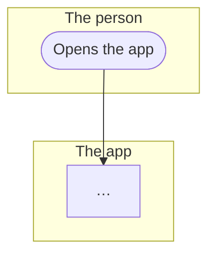

# User flows

Each file here shows one flow of Kuutti from the side of whoever goes through it: what the person does, what the app and the API do in answer, and who else takes part (the bank, the other person, a moderator, the night's jobs). It is written for anyone joining, a designer, a tester or a new volunteer, who wants to see how a part of the app works without reading code. The rules themselves are the specs in `features/`, the reasons are the ADRs in `docs/adr/`, and #397's architecture views draw the same sign-in, upload and chat from the system's side.

## The flows

In the order a person meets them, then the moderators' side.

| Flow | What it covers | Not built yet |
|---|---|---|
| [Signing in](sign-in.md) | The screens before the bank, the bank login every time, each refusal, a known account or a new one; how a session ends, Log out and Log out everywhere | nothing |
| [Onboarding](onboarding.md) | From a new account's first sign-in to a finished profile: a friend's code, the eight steps, the sensitive-answers consent on whom one seeks, the area, leaving midway, the terms asked again | nothing |
| [The profile, the card and deal-breakers](profile.md) | The profile's sections, the card as others see it, the later questions with Ask me later, setting deal-breakers, and how they pause and apply | nothing |
| [Photos](photos.md) | Adding a photo, the automatic check and description, a person's look, what an approved photo opens, captions, order, removing, and the moderators' photo queue | the phone's own check before upload, #184 |
| [The waitlist and the pond's gate](waitlist-and-gate.md) | From a finished profile to the first round: the area's counter, the Matching card, the night's count, what is said and in steps of what, what sends a person back in line | nothing |
| [The round, likes, fish and the match](round.md) | The day's round from the night that builds it, one card at a time with like, pass and the fish, the match, and the short round's relaxing a deal-breaker for the day | the round's push, #102 |
| [Chat](chat.md) | From a match to a conversation: the list, writing, messages live or later, a photo, sharing a contact, ending a conversation | a message's push, #102; the phone's own photo check, #184 |
| [Report and block](report-and-block.md) | Blocking, or reporting and blocking, from a card or a conversation; the moderators' queue and what each outcome means for the person reported | nothing |
| [Taking a break](break.md) | Pausing the account: the tick, every phone signed out, what others meet meanwhile, the next bank login back | nothing |
| [Found them](found-them.md) | Telling Kuutti one found someone: one of three reasons, counted with nobody's name, nothing else changes | nothing |
| [Deleting the account and downloading one's data](erasure-and-export.md) | Deleting the account: what goes at once, what is kept and why, what the night takes later, the cooldown; downloading the zip of one's data | nothing |
| [E-mail and its confirmation](email.md) | The optional e-mail: adding one, the code sent by mail and typed in the app, changing or removing it, what it is used for | further mail to a confirmed address, #196 |
| [The app lock](app-lock.md) | Turning the optional lock on and off, locking at a start and after time away, unlocking by face, fingerprint or passcode, the bank as the way out | nothing |
| [Inviting a friend](invitations.md) | Making, sharing and withdrawing a code; the friend typing it; the night's count and what an invitation earns | nothing |
| [Notifications and notices](notifications.md) | The notification switches, kept but with nothing sent yet; the notices on home and Got it | push itself, and whether the phone lets Kuutti notify, #102 |
| [Settings, consents and feedback](settings-and-feedback.md) | The Settings list, theme and language, the legal texts, the research and sensitive-answers consents given and withdrawn, Give feedback | nothing |
| [Moderation in the admin panel](moderation.md) | Staff sign-in and the menu by role, a report to its decision, the sanctions and what each does, the automatic shadow bans and their review, and the panel's other screens | nothing |

## How a flow is drawn

**What is drawn.** What the code does on `main`, not what is planned. Where the code and its spec disagree, the step is drawn neither way: the disagreement is raised as an issue and named under the file's Open until it is settled. Something planned and not built is drawn only where the flow already reaches it, dashed, with its issue.

**The diagram.** A Mermaid `flowchart TB`, which GitHub draws in the Markdown itself, so the diagram is text, reviewed in the pull request like code. One `subgraph` per actor, a lane, in this order where they appear, under these names:

| id | lane |
|---|---|
| `person` | The person |
| `app` | The app |
| `api` | The API |
| `bank` | The bank, through Telia |
| `other` | The other person |
| `moderator` | A moderator |
| `admin` | The admin panel |
| `night` | The night's jobs |

**Shapes.**

| Shape | Mermaid | For |
|---|---|---|
| stadium | `s1(["Opens the app"])` | the start and each end |
| box | `s2["Chooses Sign in"]` | a step |
| diamond | `s3{"Known account?"}` | a choice; its arrows carry the answers, `s3 -->\|"yes"\| s4` |
| hexagon | `s4{{"Waits for the night's round"}}` | a wait: the night's jobs, a moderator's queue, the gate's count |
| dashed box | `s5["Told by push: not built yet, #102"]:::notbuilt` | a step not built yet; its label says so and names the issue |

Every label is in double quotes, so punctuation cannot break the diagram. The dashed outline is never the only mark of a step not built: the label says it too. No colours, fills or other styles: GitHub draws the diagram in its light and dark themes, and meaning never rests on colour (CLAUDE.md, Accessibility). Every diagram opens with `accTitle` and `accDescr`, which GitHub hands to screen readers, and ends with `classDef notbuilt stroke-dasharray: 5 5` when it has a dashed step.

**Size.** At most about twenty boxes in one diagram. A larger flow is split into parts: each part is a section `## Part n: …` holding its diagram and, under `### Steps`, its steps, so that the words stand next to the drawing they tell. The last box of one part names the part it leads to, and the numbering runs on across the parts. A flow of one part has `## Diagram` and `## Steps`.

**Steps.** Under the diagram, the same flow as numbered steps, one per box, numbered as the boxes' ids (`s3` is step 3). A choice says where each answer leads ("yes: 4; no: 9"). A diagram alone is not readable by a screen reader; the steps are, and they are what the diagram is checked against.

**Words.** English, plain, and the app's own names for things, as the English of `packages/i18n/messages.yaml` says them ("the round", "a fish", "taking a break"). A number appears by its name in `matching_config` (`round_size`), never by its value, so that values live in one place: `matching_config`, and the register of product decisions once #396 has written it. No route, table or file names in the diagram or the steps; they go under "Where it lives".

**History.** Each file ends with its History: one line per pull request that changed the flow as a person or a moderator meets it, oldest first, the date the pull request merged, the issue and the pull request:

`- 2026-10-22 (#418, PR #422): the norms, the terms, the privacy summary and the research question move before the bank login.`

A refactor, a fix that changes no step, a test or a translation is no line. The lines before #395 were read from the git history of each flow's spec, screens and routes.

**Keeping them true.** A pull request that changes the steps of a flow here redraws its diagram, rewrites its steps and adds its History line, in that pull request (CLAUDE.md, Code). Nothing checks a drawing against the code: the specs and the Maestro flows hold the behaviour, and a check that diagrams match the code was left out on purpose (#395).

## A flow file

~~~markdown
# Signing in

One or two sentences for a person: what this flow is and who goes through it.

## Diagram

## Steps

1. The person opens the app.
2. …

## Open

Only when there is something: a step the code and its spec disagree on, with its issue.

## Where it lives

- Screens: links to `apps/mobile/app/…`
- API: the routes, with links to their slice
- Spec: links to `features/<slice>/….feature`
- Maestro: links to `apps/mobile/e2e/flows/….yaml`
- ADRs: links to `docs/adr/…`

## History

- 2026-09-30 (#40, PR #61): …
~~~
