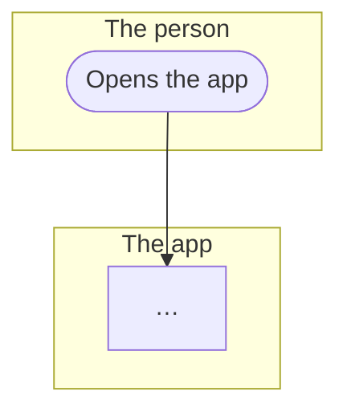

# User flows

Each file here shows one flow of Kuutti from the side of whoever goes through it: what the person does, what the app and the API do in answer, and who else takes part (the bank, the other person, a moderator, the night's jobs). It is written for anyone joining, a designer, a tester or a new volunteer, who wants to see how a part of the app works without reading code. The rules themselves are the specs in `features/`, their values and who decided them are the register of product decisions, [`docs/decisions.md`](../decisions.md) (#396), the reasons are the ADRs in `docs/adr/`, and the [architecture views](../architecture/README.md) (#397) draw the same sign-in, upload, chat and night from the system's side.

## The flows

In the order a person meets them, then the moderators' side.

| Flow | What it covers | Not built yet |
|---|---|---|
| [Signing in](sign-in.md) | The screens before the bank, the bank login every time, each refusal and what it offers, a known account or a new one; a session renewed while in use, Log out and Log out everywhere | nothing |
| [Onboarding](onboarding.md) | From a new account's first sign-in to a finished profile: a friend's code, one question a step, whom one seeks under the sensitive-answers consent, the home postal code, the photos and a few words, leaving midway, the terms asked again | nothing |
| [People on Kuutti and the Matching switch](people-on-kuutti.md) | From a finished profile to the first people: what the matching card says, the number of finished profiles and the bar of whom they seek, an admin opening or closing matching for everybody, the night's count | nothing |
| [People: the queue, likes, fish, the star and the match](queue.md) | From See people on: the queue's order, like, pass and Later, the fish, the likes left, the inbox stop and the your-turn limit, the star and Starred, the short card and the whole card, a deal-breaker relaxed at the end, the match | nothing |
| [The profile, the card and What you seek](profile.md) | The profile's sections, the card as others see it in its two depths, hiding an answer from it, the later questions, and What you seek: whom, the ages, the intent and each deal-breaker | nothing |
| [Photos](photos.md) | Adding a photo, the automatic check and description, a person's look, what an approved photo opens, captions, order, removing, the night's sweep, the moderators' photo queue and taking one approved photo down | the phone's own check before upload, #184 |
| [Chat](chat.md) | From a match to a conversation: Your turn, Their turn and Archived, writing, messages live or by push, a photo, sharing a way to reach you, ending a conversation | the phone's own photo check, #184 |
| [Report and block](report-and-block.md) | Blocking, or reporting and blocking, from a card, a photo or a conversation; the moderators' queue and what each outcome means for the person reported; the support page | nothing |
| [Taking a break](break.md) | Pausing the account: the tick, every phone signed out, what others meet meanwhile, the next bank login back | nothing |
| [Found them](found-them.md) | Telling Kuutti one found someone: one of three reasons, counted with nobody's name, nothing else changes | nothing |
| [Deleting the account and downloading one's data](erasure-and-export.md) | Deleting the account: what goes at once, what is kept and why, what the night takes later, the cooldown; downloading the zip of one's data | nothing |
| [E-mail and its confirmation](email.md) | The optional e-mail: adding one, the code sent by mail and typed in the app, changing or removing it, what it is used for, an announcement's e-mail | further mail to a confirmed address, each kind under its own consent, #196 |
| [The app lock](app-lock.md) | Turning the optional lock on and off, locking at a start and after time away, unlocking by face, fingerprint or passcode, the phone's pause after too many tries, the bank as the way out | nothing |
| [Inviting a friend](invitations.md) | Making, sharing and withdrawing a code, the one link to the store, the friend typing it, the night's count and the fish it earns both | the app taking the code from the link by itself, #184 |
| [Notifications and notices](notifications.md) | Being asked once, the switches, what a push says and never says, the quiet hours, the notices on home and Got it | nothing |
| [Announcements](announcements.md) | One admin writes, a second approves, and everybody is told: the notice on home, a push and an e-mail | nothing |
| [Settings, consents and feedback](settings-and-feedback.md) | Settings' one list, theme and language, the legal texts and the licences, the sensitive-answers consent given and withdrawn, the support page, Give feedback | nothing |
| [Moderation in the admin panel](moderation.md) | Staff sign-in and the menu by role, a report to its decision, the sanctions and what each does, the automatic shadow bans and their review, and the panel's other screens | nothing |

## How a flow is drawn

**What is drawn.** What the code does on `main`, not what is planned. Where the code and its spec or its ADR disagree, the step is drawn neither way: the disagreement is named under the file's Open until it is settled, with its issue or its note in the register's [Found on the way](../decisions.md#found-on-the-way). Something planned and not built is drawn only where the flow already reaches it, dashed, with its issue.

**The diagram.** A Mermaid `flowchart TB`, which GitHub draws in the Markdown itself, so the diagram is text, reviewed in the pull request like code. One `subgraph` per actor, a lane, in this order where they appear, under these names:

| id | lane |
|---|---|
| `person` | The person |
| `app` | The app |
| `api` | The API |
| `bank` | The bank, through Telia |
| `other` | The other person |
| `moderator` | A moderator; An admin, and Another admin where two must act, for what only an admin may do |
| `admin` | The admin panel |
| `night` | The night's jobs |

**Shapes.**

| Shape | Mermaid | For |
|---|---|---|
| stadium | `s1(["Opens the app"])` | the start and each end |
| box | `s2["Chooses Sign in"]` | a step |
| diamond | `s3{"Known account?"}` | a choice; its arrows carry the answers, `s3 -->\|"yes"\| s4` |
| hexagon | `s4{{"Waits for the night's round"}}` | a wait: the night's jobs, a moderator's queue, the gate's count |
| dashed box | `s5["Told by push: not built yet, #102"]:::notbuilt` | a step not built yet; its label says so and names the issue |

Every label is in double quotes, so punctuation cannot break the diagram. The dashed outline is never the only mark of a step not built: the label says it too. No colours, fills or other styles: GitHub draws the diagram in its light and dark themes, and meaning never rests on colour (CLAUDE.md, Accessibility). Every diagram opens with `accTitle` and `accDescr`, which GitHub hands to screen readers, and ends with `classDef notbuilt stroke-dasharray: 5 5` when it has a dashed step.

**Size.** At most about twenty boxes in one diagram. A larger flow is split into parts: each part is a section `## Part n: …` holding its diagram and, under `### Steps`, its steps, so that the words stand next to the drawing they tell. The last box of one part names the part it leads to, and the numbering runs on across the parts. A flow of one part has `## Diagram` and `## Steps`.

**Steps.** Under the diagram, the same flow as numbered steps, one per box, numbered as the boxes' ids (`s3` is step 3). A choice says where each answer leads ("yes: 4; no: 9"). A diagram alone is not readable by a screen reader; the steps are, and they are what the diagram is checked against.

**Words.** English, plain, and the app's own names for things, as the English of `packages/i18n/messages.yaml` says them ("the round", "a fish", "taking a break"). A number appears by its name in `matching_config` (`like_expiry_days`), never by its value, so that values live in one place: `matching_config`, which the register gives row by row with who decided each. A constant that lives in code is described without its value. No route, table or file names in the diagram or the steps; they go under "Where it lives", whose Rules line names the register's areas that hold the flow's rules. No TD number either: a flow links the ADR, which cites the TD.

**History.** Each file ends with its History: one line per pull request that changed the flow as a person or a moderator meets it, oldest first, the date the pull request merged, the issue and the pull request:

`- 2026-10-22 (#418, PR #422): the norms, the terms, the privacy summary and the research question move before the bank login.`

A refactor, a fix that changes no step, a test or a translation is no line. The lines before #395 were read from the git history of each flow's spec, screens and routes.

**What it draws.** Under its title each flow names, in a block that GitHub does not show, the files whose change would change its steps: its screens, the components and hooks that decide them, the API's routes and rules, the night's jobs, the panel's features. One path from the repository's root per line, a trailing `/` for a whole folder; never a test, a spec, a Maestro flow, an ADR or the messages (ADR-047 §1):

```
<!-- draws
apps/mobile/app/account/break.tsx
apps/api/src/identity/pause.ts
-->
```

**Keeping them true.** A pull request that changes the steps of a flow redraws its diagram, rewrites its steps and adds its History line, in that pull request (CLAUDE.md, Code). `pnpm check:docs`, in CI's `scenarios` job, fails a pull request that touches a file a flow names unless the flow is touched too or a commit message carries `Still-true: docs/flows/<file>`, written only after looking (ADR-047); a renamed or removed file fails it until the block follows. What it cannot see is whether a drawing is right: the specs and the Maestro flows hold the behaviour, review holds the drawing, and a check that diagrams match the code was left out on purpose (#395).

## A flow file

~~~markdown
# Signing in

<!-- draws
apps/mobile/app/auth/…
apps/api/src/identity/…
-->

One or two sentences for a person: what this flow is and who goes through it.

## Diagram



## Steps

1. The person opens the app.
2. …

## Open

Only when there is something: a step the code and its spec or ADR disagree on, with its issue or its note in the register.

## Where it lives

- Screens: links to `apps/mobile/app/…`
- API: the routes, with links to their slice
- Spec: links to `features/<slice>/….feature`
- Maestro: links to `apps/mobile/e2e/flows/….yaml`
- ADRs: links to `docs/adr/…`
- Rules: the register's areas, links to `docs/decisions.md#…`

## History

- 2026-09-30 (#40, PR #61): …
~~~
