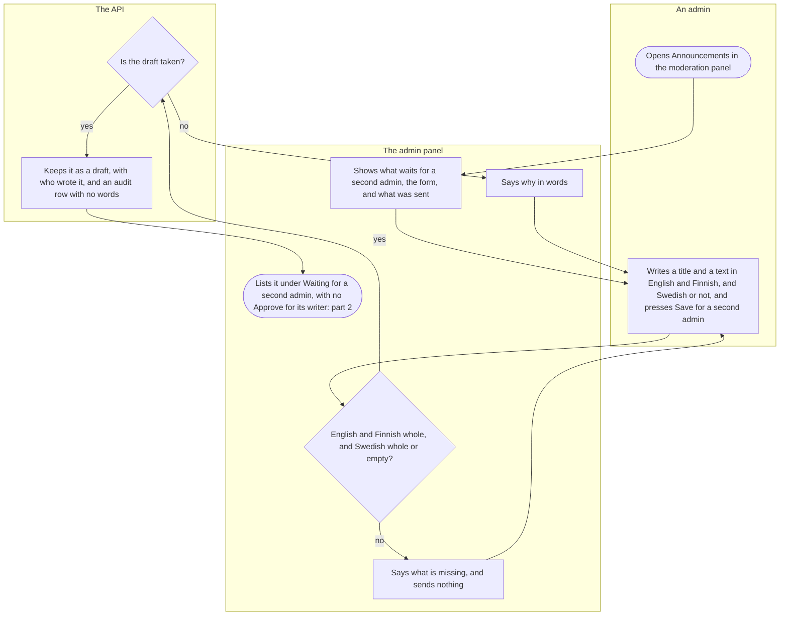
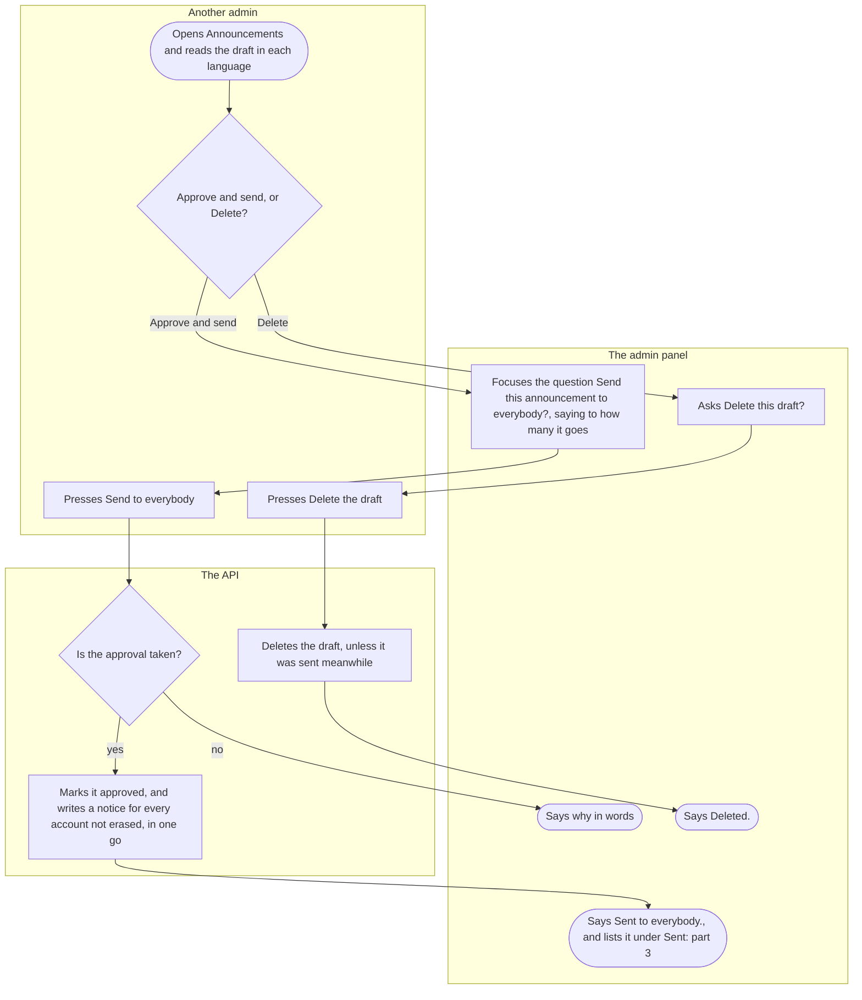
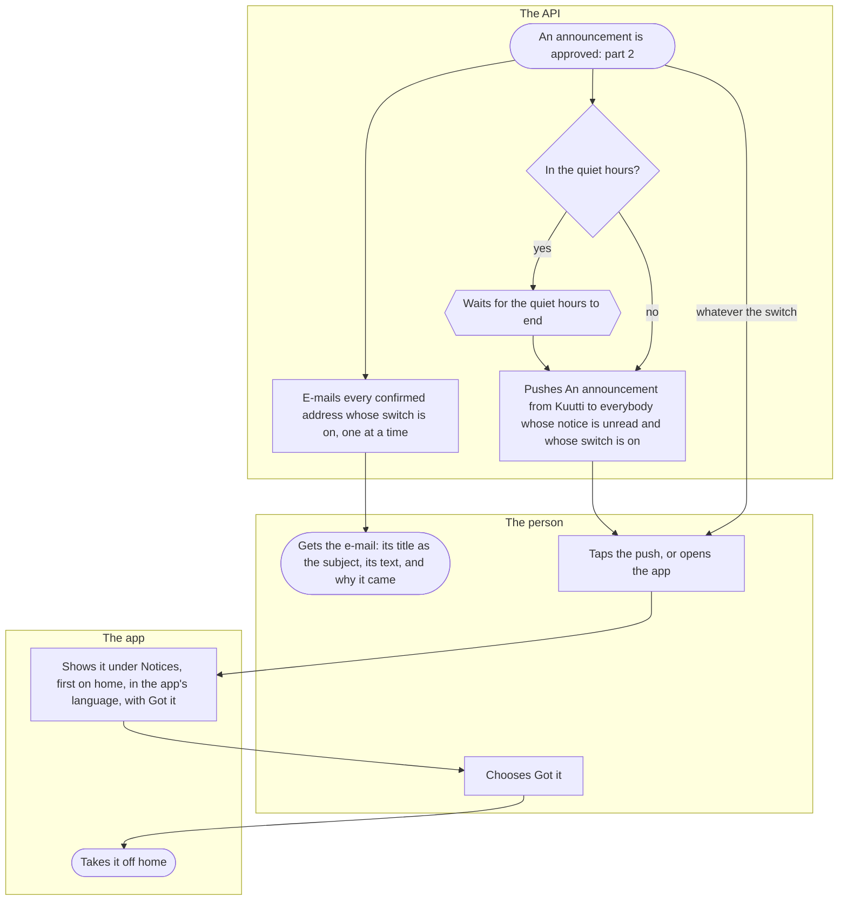

# Announcements

<!-- draws
apps/admin/src/features/notifications/Announcements.tsx
apps/api/src/notifications/admin-routes.ts
apps/api/src/notifications/announcements.ts
apps/api/src/notifications/repo.ts
apps/api/src/notifications/push.ts
apps/api/src/notifications/notifications.ts
apps/mobile/app/index.tsx
apps/mobile/src/features/notifications/Notices.tsx
apps/mobile/src/features/notifications/PushNotifications.tsx
apps/mobile/src/features/notifications/NotificationChoices.tsx
apps/mobile/src/features/home/HomeScreen.tsx
-->

How Kuutti tells everybody something they must know, such as a service break or a change in the rules: one admin writes it in the moderation panel, another admin approves it, and only then does it reach every account, as a notice in the app, a push and an e-mail. It is for the admins who write and approve it, and for everybody who reads it.

## Part 1: one admin writes it

### Steps

1. An admin signs in to the moderation panel with their bank ([Moderation](moderation.md)) and opens Announcements in its menu. The menu shows it to admins alone; a moderator who opens its address finds only its heading and "Your role does not allow this.", and the API refuses every announcement route to anybody but an admin.
2. "Announcements": first "Waiting for a second admin" ("Nothing is waiting." when nothing is), then "Write an announcement", then "Sent" ("Nothing has been sent yet." before the first), and Refresh. Each announcement shows when it was written or sent, and its title and text in each language, with "Not written: Swedish readers get the English." where it has no Swedish.
3. The form has a part for each language, each with a Title and a Text: English, Finnish, and "Swedish, if you write it", under which "People who read Kuutti in Swedish get the English when there is no Swedish." Each field takes only so many characters. The admin writes and presses "Save for a second admin".
4. The panel checks the draft before it sends anything: a title and a text in English and in Finnish, and in Swedish both or neither. Whole: 6. Not: 5.
5. "Write a title and a text in English and in Finnish." or "Swedish needs a title and a text, or neither.", and nothing is sent. Back to 3.
6. The API holds every title and text to the plain-text rule and to their lengths. Refused: 7. Taken: 8.
7. "An announcement cannot carry an e-mail address, a link, a phone number or a handle."; one the API does not accept for its lengths is refused with the limits in words; and when nothing answers, "That did not go through. Try again." What was typed stays. Back to 3.
8. The API keeps it as a draft, with who wrote it and when, and an audit row that carries none of its words. Nobody is told of a draft, and a draft is never changed: a typo seen later means deleting it and writing it again.
9. The panel says "Saved. It waits for another admin's approval.", empties the form if it still holds the submitted words and lists the draft under Waiting for a second admin. Words typed while saving, or while a list refresh fails, stay in the form. To the admin who wrote it the draft says "You wrote this, so another admin approves it." and offers Delete alone: part 2.

## Part 2: another admin approves it

### Steps

10. Another admin, not the one who wrote it, opens Announcements and reads the draft under Waiting for a second admin, in each language.
11. "Approve and send": 12. "Delete", which either admin may press, the one who wrote it too: 18.
12. The step "Send this announcement to everybody?" shows the English title and says, with the numbers of the moment, how many accounts it goes to as a notice in the app, how many confirmed addresses by e-mail and how many people as a push, "or once the quiet hours end if they hold. Nothing takes it back." The accounts are those not erased, the addresses those confirmed whose Announcements switch is on, and the people those with a signed-in phone and the switch on. The step itself takes focus, so a second Enter does not send it. Cancel or Escape leaves the draft as it was before submission; while sending, both are unavailable and the step stays open.
13. The admin presses "Send to everybody".
14. The API refuses an approval by the admin who wrote it, which a check in the database holds too, and one of an announcement already sent, writing nothing. Refused: 15. Taken: 16.
15. "You wrote this announcement, so another admin approves it." or "This announcement went to everybody already."; and when nothing answers, "That did not go through. Try again."
16. In one go, the API marks it approved, by whom and when, writes a notice of it for every account not erased, a shadow-banned one, one on a break and one suspended included, and writes an audit row that counts them; somebody who signs up later is not told. Its e-mails and pushes go after the answer: part 3. Nothing takes a sent announcement back, and it is kept for good.
17. The panel says "Sent to everybody.", moves focus to that outcome, and lists it under Sent, with when it was sent, to be read and never changed: part 3.
18. The step "Delete this draft?" shows the English title and says "Nobody has been told of it. It goes for good."; Cancel keeps it.
19. The admin presses "Delete the draft".
20. The API deletes the draft, with an audit row, unless another admin sent it meanwhile, which the panel says as "This announcement went to everybody already."
21. The panel says "Deleted.", moves focus to that outcome, and the draft is gone from the list.

## Part 3: everybody is told

### Steps

22. A second admin has approved the announcement, and its notice is written for every account (part 2). After the approval's answer, the API's own process sends the e-mails and the pushes.
23. The API e-mails every person its notice reached whose address is confirmed ([E-mail and its confirmation](email.md)) and whose Announcements switch is on, each read again just before their e-mail, one at a time and spaced to stay within the mail service's pace. Each is worded in the language the person read the terms in: Finnish for Finnish and Stadi, Swedish where it was written in Swedish, English otherwise. A failed e-mail is not tried again, and the rest go on.
24. The e-mail's subject is "Kuutti: " and the title; its body is the title, the text, "You get this because you confirmed this address in the Kuutti app. Announcements can be turned off in Settings, under Notifications." and "Kuutti ry". Plain text, with no link. An address not confirmed gets nothing.
25. In the quiet hours, from `push_quiet_from_hour` to `push_quiet_to_hour` in Helsinki: 26. Otherwise: 27.
26. Unlike a message's or a match's, the push is not dropped: it waits until the quiet hours end, and then goes to those who have not read the notice meanwhile: 27.
27. The API pushes everybody whose notice is still unread, whose Announcements switch is on, and who has a signed-in phone that lets Kuutti notify: "An announcement from Kuutti", in the phone's language, with its kind alone and never its words ([Notifications](notifications.md), part 3). Switched off, there is no push and no e-mail, but the notice stays.
28. The person taps the push, which opens home, after the app lock if it is on; or, pushed or not, opens the app any time.
29. Home shows the announcement under "Notices", first on the screen and newest first among the person's unread notices, with its title and its text as the admins wrote them, in the language the app asks in: Finnish for Finnish and Stadi, Swedish where it was written in Swedish, English otherwise. Got it under it. It stays until Got it; a person on a break or suspended when it went finds it when they come back, and one who signs up later never sees it.
30. The person chooses Got it.
31. The notice leaves home; the person's data export still lists it, with when it came and when it was read. An announcement's own words are in nobody's export.

## Where it lives

- Admin: [Announcements.tsx](../../apps/admin/src/features/notifications/Announcements.tsx), shown to admins alone by the panel's route table in [app.tsx](../../apps/admin/src/app.tsx) ([admin README](../../apps/admin/README.md)); its Playwright flow [announcements.spec.ts](../../apps/admin/e2e/announcements.spec.ts), one admin writing and another approving
- Screens: home [index.tsx](../../apps/mobile/app/index.tsx), with the notice in [Notices.tsx](../../apps/mobile/src/features/notifications/Notices.tsx); a push's tap in [PushNotifications.tsx](../../apps/mobile/src/features/notifications/PushNotifications.tsx); the switch in [NotificationChoices.tsx](../../apps/mobile/src/features/notifications/NotificationChoices.tsx)
- API: `GET` and `POST /admin/announcements`, `DELETE /admin/announcements/{id}` and `POST /admin/announcements/{id}/approve` in the notifications slice's [admin-routes.ts](../../apps/api/src/notifications/admin-routes.ts) ([README](../../apps/api/src/notifications/README.md)), with [announcements.ts](../../apps/api/src/notifications/announcements.ts) (the words a reader gets, the approval, the e-mail) and [repo.ts](../../apps/api/src/notifications/repo.ts) (a notice for every account, and how many it reaches); the push in [push.ts](../../apps/api/src/notifications/push.ts); the notice's words through `GET /notices` in [notifications.ts](../../apps/api/src/notifications/notifications.ts); the e-mail through [lib/mail.ts](../../apps/api/src/lib/mail.ts)
- Spec: [announcements.feature](../../features/notifications/announcements.feature)
- Maestro: no flow sends an announcement; [notification-settings.yaml](../../apps/mobile/e2e/flows/notification-settings.yaml) opens the Notifications row, whose line names announcements
- ADRs: [ADR-068](../adr/068-announcements.md) (§1 the texts, §2 two admins, §3 everybody's notice, §4 the push, §5 the e-mail, §6 the switch, §8 what is kept), [ADR-055](../adr/055-push.md) §1 and §7 (amended for the announcement's push), [ADR-032](../adr/032-notification-choices-and-notices.md) §1 and §2 (amended for its switch and notice), [ADR-043](../adr/043-email-confirmation.md) §1 (amended for its e-mail)
- Rules: the register's [Notifications](../decisions.md#notifications) and [E-mail](../decisions.md#e-mail) rows

## History

- 2026-11-07 (#573, PR #643): an announcement to everybody once a second admin approves it: a notice on home in Kuutti's own words and the reader's language, a push that says only that there is one and waits for the quiet hours to end, and an e-mail to a confirmed address; the Announcements switch stops the push and the e-mail, never the notice.
- 2026-11-07 (#573, PR #646): the panel's Announcements screen, admins only: one admin writes a draft in English and Finnish, and Swedish or not; another approves it through a step that says to how many it goes; either deletes a draft.

- 2026-11-13 (#380): Send starts with focus on its question, pending sends and deletions cannot be dismissed, confirmed outcomes receive focus, and newer typed words survive saving or a failed refresh.
