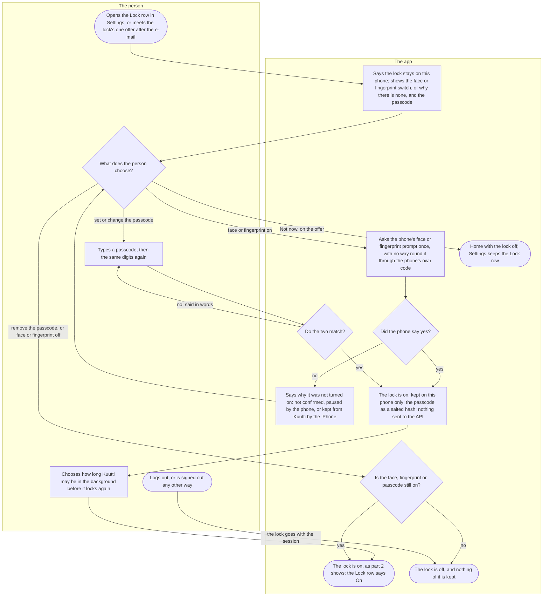
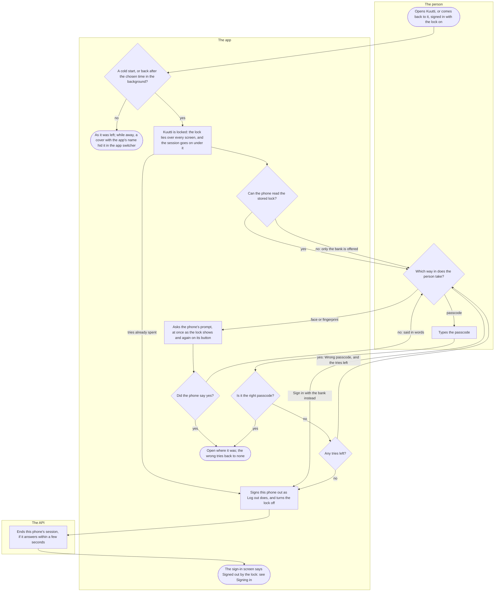

# The app lock

<!-- draws
apps/mobile/app/account/lock.tsx
apps/mobile/src/features/settings/SettingsScreen.tsx
apps/mobile/src/features/settings/LockControls.tsx
apps/mobile/src/features/settings/LockOfferScreen.tsx
apps/mobile/src/features/identity/lock/LockProvider.tsx
apps/mobile/src/features/identity/lock/LockScreen.tsx
apps/mobile/src/features/identity/lock/PasscodeField.tsx
apps/mobile/src/features/identity/lock/passcode.ts
apps/mobile/src/features/identity/lock/store.ts
apps/mobile/src/features/identity/lock/biometrics.ts
apps/mobile/src/features/identity/EmailCard.tsx
apps/mobile/src/features/identity/session.tsx
apps/mobile/src/features/identity/SignInScreen.tsx
apps/api/src/identity/routes.ts
-->

A person may lock Kuutti on their phone, so that somebody else holding it cannot open their matches and conversations. It is off until they turn it on, it lives on that phone only, and when the face, the fingerprint or the passcode fails them, signing in with the bank is always the way past it.

## Part 1: turning the lock on and off

### Steps

1. The person opens Settings and the row "Lock", whose value says "On" or "Off"; the row is there while they are signed in, on a phone and never in the web preview, and it opens in place. Or they meet the lock's one offer, "Lock Kuutti on this phone?", under "When you have a moment", right after the e-mail's screen that ends the later questions ([the profile](profile.md#part-4-the-later-questions)): it comes once on a phone, never while the lock is on and never in the web preview, and being shown counts as offered.
2. Both say "The lock stays on this phone, and logging out turns it off." Below it stands the "Face or fingerprint" switch, whose words turn it too; or, on a phone without any, "This phone has no face or fingerprint unlock that Kuutti can use."; or, on an iPhone that does not let Kuutti use Face ID, "This iPhone does not let Kuutti use Face ID." with "Open the phone's settings". A switch already on stays, so that it can be turned off, even when the phone no longer has the face or finger. Then "Set a passcode", or while one is set "Change the passcode" and "Remove the passcode". Each time the app comes back from the background while this is open, it asks the phone again what it has, so a face or finger set up meanwhile shows.
3. The person chooses. The switch on: 4. "Set a passcode" or "Change the passcode": 7. "Remove the passcode", or the switch off: 12. "Not now", on the offer: 15. Changing or removing asks for nothing first: whoever has reached Settings is past the lock already.
4. The phone's own face or fingerprint prompt, "Unlock Kuutti", is asked once. It never falls back to the phone's own code, which somebody close to the person may know.
5. Yes: 9. Anything else, a cancel included: 6.
6. "Your face or fingerprint was not confirmed, so it was not turned on."; or, when the phone has paused its face or fingerprint unlock after too many tries, "The phone has paused face or fingerprint unlock after too many tries, so it was not turned on. Lock the phone and open it with its own code, then try again."; or, when the iPhone answers that it keeps Face ID from Kuutti, the switch gives way to "This iPhone does not let Kuutti use Face ID." and the way to the phone's settings: 3.
7. "Choose a passcode of six digits", then "Type the same six digits again". The last digit moves on by itself; there is no button. "Cancel" leaves everything as it was.
8. The same digits: 9, and "A passcode is set." is heard. Two that differ: "The two did not match. Choose the passcode again.": 7.
9. The lock is on. It is kept on this phone only, never in a backup, and the passcode only as a salted hash, never the digits. Nothing of it reaches the API, the export or the account.
10. While the lock is on, the person can choose under "Lock again after Kuutti has been in the background": "Straight away" or one of the minutes offered, the shortest of them at first.
11. The lock is on, and part 2 is what it does; the Lock row says On, and "Change the passcode" and "Remove the passcode" show that a passcode is set. On the offer, "Not now" has become "Done", which goes home.
12. Still on with the other way in: 11. Neither the face nor a passcode left: 13.
13. The lock is off and removed from the phone; the Lock row says Off.
14. The person logs out, or the session ends another way: Log out everywhere from another phone, a break, a sanction, deleting the account, a session the API ended, or the lock's own way out (step 27); see [Signing in](sign-in.md#part-2-sessions-and-logging-out). The lock goes with the session: 13. The next sign-in starts unlocked, and the person turns the lock on again if they want it.
15. Home, with the lock off. The offer does not come again on this phone; the Lock row of Settings keeps it.

## Part 2: locking and unlocking

### Steps

16. The person opens Kuutti, or comes back to it from another app, signed in and with the lock on.
17. A cold start, or a return after at least the chosen time in the background: 19. A shorter time away: 18. A clock set back while the phone was awake counts as long enough.
18. Kuutti is as it was left, with no lock screen. While it was in the app switcher or the background, a plain cover with the app's name lay over the screens for the switcher's picture; on Android the picture may still show the last screen, since the cover is drawn a moment after the phone is told.
19. "Kuutti is locked" lies over every screen before any of them shows, above a photo picker or a share sheet too. Under it the app goes on as before: the session, the conversations arriving. At a cold start the cover stands until the phone has said whether it still has the face or finger the lock was set with, and the phone is asked again at every return. A lock that shows with its tries already spent, after a sign-out that never finished, goes to the bank at once: 27. Otherwise: 20.
20. The phone reads the stored lock. Read: 21, with the ways in the person set. A lock that cannot be read keeps the app locked with no passcode field and no face or finger, only the bank: 21.
21. The person takes a way in: the face or fingerprint where they chose it and the phone still has it: 22; the passcode where one is set: 24; "Sign in with the bank instead", always there, under "This signs Kuutti out of this phone and turns the lock off. Nothing on your account changes.": 27. A forgotten passcode, or a face the phone no longer knows, ends there too. Where the person chose the face and the iPhone does not let Kuutti use Face ID, the lock has no face button and says "This iPhone does not let Kuutti use Face ID. You can allow it in the phone's settings."
22. "Unlock with your face", "Unlock with your fingerprint" or "Unlock with your face or fingerprint": the phone's prompt is asked as the lock shows, and again on the button, never with the phone's own code. On Android the button stays while the phone pauses its unlock after too many tries, though the phone then answers as if it had none.
23. Yes: 30. A failure says, in the kind the button names, "Your face did not unlock Kuutti.", "Your fingerprint did not unlock Kuutti." or "Your face or fingerprint did not unlock Kuutti."; the phone's pause after too many tries says, in the same kind, "The phone has paused face unlock after too many tries. Lock the phone and open it with its own code, then try again."; a cancel says nothing: 21.
24. The person types the passcode into "Your Kuutti passcode". Each try is counted before it is checked, and the count outlives closing the app.
25. Right: 30. Wrong: 26.
26. Tries left: "Wrong passcode." and how many tries are left, said in words, and to a screen reader, with nothing shaking: 21. The last try wrong: 27.
27. The app signs this phone out as Log out does, and with the session the lock goes.
28. The API ends this phone's session. The app waits a few seconds at most and, without an answer, signs the phone out anyway.
29. The sign-in screen says "Signed out by the lock" and "Nothing on your account changed. The lock is off until you turn it on again in Settings.", over "Sign in with your bank". The person signs in with the bank as in [Signing in](sign-in.md#part-1-signing-in).
30. Kuutti opens where it was, and the count of wrong tries is back at none.

## Where it lives

- Screens: the Lock row of Settings in [SettingsScreen.tsx](../../apps/mobile/src/features/settings/SettingsScreen.tsx), at [settings/index.tsx](../../apps/mobile/app/settings/index.tsx), and the one offer at [account/lock.tsx](../../apps/mobile/app/account/lock.tsx), drawn by the settings feature's [LockControls.tsx](../../apps/mobile/src/features/settings/LockControls.tsx) and [LockOfferScreen.tsx](../../apps/mobile/src/features/settings/LockOfferScreen.tsx); the lock itself in the identity feature's [lock/](../../apps/mobile/src/features/identity/lock/): [LockProvider.tsx](../../apps/mobile/src/features/identity/lock/LockProvider.tsx) (when it locks, the cover, the tries, the phone asked again, removal at sign-out), [LockScreen.tsx](../../apps/mobile/src/features/identity/lock/LockScreen.tsx), [PasscodeField.tsx](../../apps/mobile/src/features/identity/lock/PasscodeField.tsx), [passcode.ts](../../apps/mobile/src/features/identity/lock/passcode.ts), [store.ts](../../apps/mobile/src/features/identity/lock/store.ts), [biometrics.ts](../../apps/mobile/src/features/identity/lock/biometrics.ts) (what the phone has, its pause, an iPhone keeping Face ID); the offer's place after the e-mail in [EmailCard.tsx](../../apps/mobile/src/features/identity/EmailCard.tsx); the sign-out in [session.tsx](../../apps/mobile/src/features/identity/session.tsx) and its notice in [SignInScreen.tsx](../../apps/mobile/src/features/identity/SignInScreen.tsx)
- API: none of its own; the way out is the sign-out of [Signing in](sign-in.md), `POST /auth/logout` in the identity slice's [routes.ts](../../apps/api/src/identity/routes.ts)
- Spec: [app-lock.feature](../../features/identity/app-lock.feature)
- Maestro: [app-lock.yaml](../../apps/mobile/e2e/flows/app-lock.yaml) (the passcode only: Maestro has no face or fingerprint); [sign-out.yaml](../../apps/mobile/e2e/common/sign-out.yaml) leaves a lock through the bank
- ADRs: [ADR-045](../adr/045-app-lock.md) (§4 when it locks, §5 the face or fingerprint, the phone's pause and an iPhone keeping Face ID, §6 the way out, §7 the offer and Settings)
- Rules: the register's [Sign-in and identity](../decisions.md#sign-in-and-identity) rows

## History

- 2026-10-22 (#418, PR #422): the app lock: the face or fingerprint or a passcode of six digits, off until turned on in Settings › Lock or in its one offer after the e-mail; locked at a cold start and after the chosen time in the background, covered in the app switcher; the bank always the way out, which signs the phone out and turns the lock off.
- 2026-10-29 (#464, PR #493): the phone's pause after too many tries is said as a pause, with how it ends, on the lock and in Settings, and Settings and the offer ask the phone again what it has when the app comes back.
- 2026-10-29 (#499, PR #504): on Android the lock keeps its face or fingerprint button through the phone's pause.
- 2026-10-30 (#511, PR #516): the lock becomes the Lock row of Settings' one list, opening in place, the passcode set there too.
- 2026-10-30 (#505, PR #539): an iPhone that does not let Kuutti use Face ID is said so, in Settings with the way to the phone's settings and on the lock, rather than taken for a phone without any.
