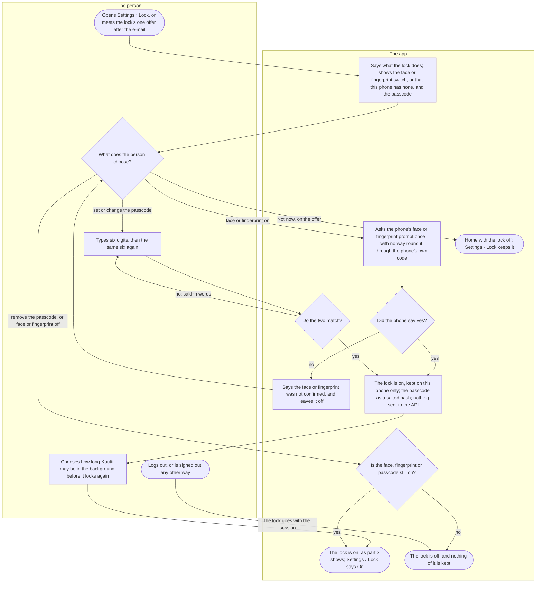
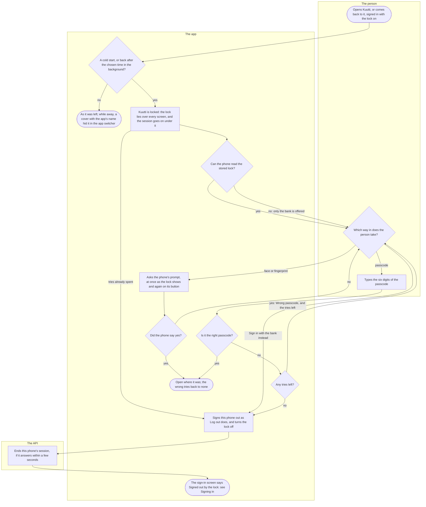

# The app lock

A person may lock Kuutti on their phone, so that somebody else holding it cannot open their matches and conversations. It is off until they turn it on, it lives on that phone only, and when the face, the fingerprint or the passcode fails them, signing in with the bank is always the way past it.

## Part 1: turning the lock on and off

### Steps

1. The person opens Settings and, under Account, Lock, whose row says On or Off; the row is there while they are signed in. Or they meet the lock's one offer, "Lock Kuutti on this phone?", among the "While you wait" screens, right after the e-mail: it comes once on a phone, never while the lock is on, and being shown counts as offered.
2. The screen says: "Lock Kuutti on this phone, so that somebody else holding it cannot open your matches and conversations. The lock stays on this phone, and logging out turns it off." Below it the "Face or fingerprint" switch, or "This phone has no face or fingerprint unlock set up. A passcode works without one."; then "Set a passcode", or while one is set "Change the passcode" and "Remove the passcode".
3. The person chooses. The face or fingerprint switch on: 4. "Set a passcode" or "Change the passcode": 7. "Remove the passcode", or the switch off: 12. "Not now" on the offer: 15. Changing or removing asks for nothing first: whoever has reached Settings is past the lock already.
4. The phone's own face or fingerprint prompt, "Unlock Kuutti", is asked once. It never falls back to the phone's own code, which somebody close to the person may know.
5. Yes: 9. Anything else: 6.
6. "Your face or fingerprint was not confirmed, so it was not turned on.": 3.
7. "Choose a passcode of six digits", then "Type the same six digits again". The sixth digit moves on by itself; there is no button. "Cancel" leaves everything as it was.
8. The same six: 9. Two that differ: "The two did not match. Choose the passcode again.": 7.
9. The lock is on. It is kept on this phone only, never in a backup, and the passcode only as a salted hash, never the digits. Nothing of it reaches the API, the export or the account.
10. While the lock is on, the person can choose how long Kuutti may be in the background before it locks again: "Straight away" or one of the minutes offered, the shortest of them at first. Under the choices: "Kuutti always locks when it starts."
11. The lock is on, and part 2 is what it does; the Settings row says On. On the offer, "Not now" has become "Done", which goes home.
12. Still on with the other way in: 11. Neither the face nor a passcode left: 13.
13. The lock is off and removed from the phone; the Settings row says Off.
14. The person logs out, or the session ends another way: Log out everywhere from another phone, a break, a sanction, deleting the account, a session the API ended, or the lock's own way out (step 27); see [Signing in](sign-in.md), part 2. The lock goes with the session: 13. The next sign-in starts unlocked, and the person turns the lock on again if they want it.
15. Home, with the lock off. The offer does not come again on this phone; Settings › Lock keeps it.

## Part 2: locking and unlocking

### Steps

16. The person opens Kuutti, or comes back to it from another app, signed in and with the lock on.
17. A cold start, or a return after at least the chosen time in the background: 19. A shorter time away: 18. A clock set back while the phone was awake counts as long enough.
18. Kuutti is as it was left, with no lock screen. While it was in the app switcher or the background, a plain cover with the app's name hid the screens from the switcher's picture.
19. "Kuutti is locked" lies over every screen before any of them shows. Under it the app goes on as before: the session, the conversations arriving. A lock that shows with its tries already spent, after a sign-out that never finished, goes to the bank at once: 27. Otherwise: 20.
20. The phone reads the stored lock. Read: 21, with the ways in the person set. A lock that cannot be read keeps the app locked with no passcode field and no face or finger, only the bank: 21.
21. The person takes a way in: the face or fingerprint where they chose it and the phone still has it: 22; the passcode where one is set: 24; "Sign in with the bank instead", always there, under "This signs Kuutti out of this phone and turns the lock off. Nothing on your account changes.": 27. A forgotten passcode, or a face the phone no longer knows, ends there too.
22. "Unlock with your face", "Unlock with your fingerprint" or "Unlock with your face or fingerprint": the phone's prompt is asked as the lock shows, and again on the button, never with the phone's own code.
23. Yes: 30. A failure says "Your face or fingerprint did not unlock Kuutti. Try again, or use another way below."; a cancel says nothing: 21.
24. The person types the six digits into "Your Kuutti passcode". Each try is counted before it is checked, and the count outlives closing the app.
25. Right: 30. Wrong: 26.
26. Tries left: "Wrong passcode." and how many tries are left, said in words, and to a screen reader, with nothing shaking: 21. The last try wrong: 27.
27. The app signs this phone out as Log out does, and with the session the lock goes.
28. The API ends this phone's session. The app waits a few seconds at most and, without an answer, signs the phone out anyway.
29. The sign-in screen says "Signed out by the lock" and "Sign in with your bank to come back. Nothing on your account changed. The lock is off until you turn it on again in Settings." The person signs in with the bank as in [Signing in](sign-in.md), part 1.
30. Kuutti opens where it was, and the count of wrong tries is back at none.

## Where it lives

- Screens: [settings/lock.tsx](../../apps/mobile/app/settings/lock.tsx) (Settings › Lock) and [account/lock.tsx](../../apps/mobile/app/account/lock.tsx) (the one offer), drawn by the settings feature's [LockSettingsScreen.tsx](../../apps/mobile/src/features/settings/LockSettingsScreen.tsx), [LockOfferScreen.tsx](../../apps/mobile/src/features/settings/LockOfferScreen.tsx) and [LockControls.tsx](../../apps/mobile/src/features/settings/LockControls.tsx); the lock itself in the identity feature's [lock/](../../apps/mobile/src/features/identity/lock/): [LockProvider.tsx](../../apps/mobile/src/features/identity/lock/LockProvider.tsx) (when it locks, the cover, the tries, removal at sign-out), [LockScreen.tsx](../../apps/mobile/src/features/identity/lock/LockScreen.tsx), [PasscodeField.tsx](../../apps/mobile/src/features/identity/lock/PasscodeField.tsx), [passcode.ts](../../apps/mobile/src/features/identity/lock/passcode.ts), [store.ts](../../apps/mobile/src/features/identity/lock/store.ts), [biometrics.ts](../../apps/mobile/src/features/identity/lock/biometrics.ts); the offer's place after the e-mail in [EmailCard.tsx](../../apps/mobile/src/features/identity/EmailCard.tsx); the sign-out's notice in [SignInScreen.tsx](../../apps/mobile/src/features/identity/SignInScreen.tsx)
- API: none of its own; the way out is the sign-out of [Signing in](sign-in.md), `POST /auth/logout` in the identity slice's [routes.ts](../../apps/api/src/identity/routes.ts)
- Spec: [app-lock.feature](../../features/identity/app-lock.feature)
- Maestro: [app-lock.yaml](../../apps/mobile/e2e/flows/app-lock.yaml) (the passcode only: Maestro has no face or fingerprint); [sign-out.yaml](../../apps/mobile/e2e/common/sign-out.yaml) leaves a lock through the bank
- ADRs: [ADR-045](../adr/045-app-lock.md)

## History

- 2026-10-22 (#418, PR #422): the app lock: the face or fingerprint or a passcode of six digits, off until turned on in Settings › Lock or in its one offer after the e-mail; locked at a cold start and after the chosen time in the background, covered in the app switcher; the bank always the way out, which signs the phone out and turns the lock off.
