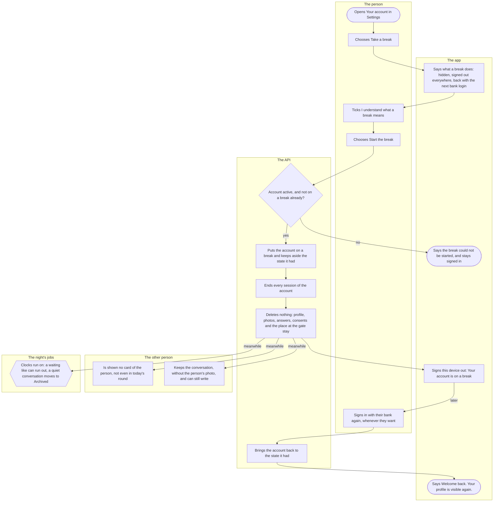

# Taking a break

How a person steps away from Kuutti for a while without deleting anything: their profile leaves everybody's view, every device is signed out, and their next bank login brings everything back as it was. Anyone whose account is active can take a break; the people they matched with meet it too.

## Diagram

## Steps

1. The person opens Settings from the home screen and, under Account, the row "Your account".
2. They choose "Take a break".
3. The app opens "Take a break from Kuutti": a break hides them without deleting anything, and three things happen. Their profile leaves everybody's view, and nobody new sees them while they are away. They are signed out on every device, this one included. Their next bank login brings them back, nothing deleted and nothing asked again, though meanwhile a like waiting for them can run out and a quiet conversation moves to Archived. The button "Start the break" waits for the tick.
4. The person ticks "I understand what a break means", a switch whose words toggle it too.
5. They choose "Start the break". The app says "Starting your break…".
6. The API checks that the account is active, which it becomes once onboarding has the matching answers and the two consents (an account still at the start has nothing to hide yet), and that no other device started a break a moment earlier. Yes: 8. No: 7.
7. The app says "The break could not be started. Try again." Nothing has changed and the person stays signed in. A request that fails on the way ends here too.
8. The API puts the account on a break and keeps aside the state it had, in one go with 9 and 10. If the person said yes to research, the break is noted there, without a reason.
9. It ends every session of the account. The other devices are signed out at their next request to the API.
10. Nothing is deleted: the profile, the photos, the answers, the consents, the e-mail and the place at the gate stay as they were. While the break lasts, the night's count at the gate and the people counter leave the person out, and their profile photos are refused to everybody else.
11. The app signs this device out to the sign-in screen, which says "Your account is on a break" and "Sign in with your bank whenever you want to come back. Everything is as you left it." Opened again later, the app shows the plain sign-in screen.
12. Meanwhile nobody is shown the person's card, not even a card already in someone's round today, and the night builds no round for the person.
13. Somebody the person matched with keeps the conversation, with the person's name but without their photo, and can still write; the messages wait for the person's return.
14. The night's clocks run on as at any other time: a like waiting for the person runs out after `like_expiry_days`, and a conversation silent for `silent_match_archive_days` moves to Archived. Writing in it brings it back.
15. Whenever they want, the person signs in with their bank again, as in [Signing in](sign-in.md). There is no waiting time: a break may end a minute after it began.
16. The API sees the break and brings the account back to the state it had before it. If the person said yes to research, how many days the break lasted is noted there.
17. The app opens where the person left off. On the home screen it says once "Welcome back. Your profile is visible again."; someone who had not finished their profile lands on the step they left. The next count at the gate gives them their place again.

## Where it lives

- Screens: [settings/account.tsx](../../apps/mobile/app/settings/account.tsx) (the button, in [AccountActions.tsx](../../apps/mobile/src/features/identity/AccountActions.tsx)), [account/break.tsx](../../apps/mobile/app/account/break.tsx) ([BreakScreen.tsx](../../apps/mobile/src/features/identity/BreakScreen.tsx)), the sign-out with its notice in [session.tsx](../../apps/mobile/src/features/identity/session.tsx) and [SignInScreen.tsx](../../apps/mobile/src/features/identity/SignInScreen.tsx), the welcome in [HomeScreen.tsx](../../apps/mobile/src/features/home/HomeScreen.tsx)
- API: `POST /account/pause` in [account-routes.ts](../../apps/api/src/identity/account-routes.ts), the break and its end in [pause.ts](../../apps/api/src/identity/pause.ts), the bank login that ends it in [login.ts](../../apps/api/src/identity/login.ts) (the [identity slice](../../apps/api/src/identity/README.md)); the card refused in [card.ts](../../apps/api/src/profile/card.ts), the round in [round-builder.ts](../../apps/api/src/jobs/round-builder.ts), the archive in [archive.ts](../../apps/api/src/chat/archive.ts)
- Spec: [pause.feature](../../features/identity/pause.feature); "A break stops no clock" in [conversations.feature](../../features/chat/conversations.feature); the paused person left out of the count in [gate.feature](../../features/pond/gate.feature) and [waitlist.feature](../../features/pond/waitlist.feature)
- Maestro: [take-a-break.yaml](../../apps/mobile/e2e/flows/take-a-break.yaml)
- ADRs: [ADR-022](../adr/022-taking-a-break.md), [ADR-015 §12](../adr/015-pond-gate.md), [ADR-013 §2](../adr/013-waitlist-counter.md), [ADR-031 Open 6](../adr/031-chat.md)

## History

- 2026-10-13 (#170, PR #277): taking a break: the screen with its three lines and the tick, the account hidden and every device signed out, the sign-in screen saying why, and the next bank login the way back with "Welcome back".
- 2026-10-14 (#287, PR #290): "Take a break" moves behind the "Your account" row of Settings.
- 2026-10-16 (#307, PR #315): the person's photos are refused to everybody else while the break lasts, and a sanction during a break keeps the break.
- 2026-10-17 (#348, PR #352): the person's conversations stay for the people they matched with, without the person's photo, and the night archives a quiet one as at any other time.
- 2026-10-19 (#96, PR #372): a card of the person already in someone's round is no longer shown once the break begins.
- 2026-10-20 (#95, PR #381): the night builds no round for a person on a break and puts their card in nobody's.
- 2026-10-20 (#97, PR #383): the break screen says that a like waiting for the person can run out meanwhile.
- 2026-10-20 (#100, PR #388): the break screen says that a quiet conversation moves to Archived meanwhile.
