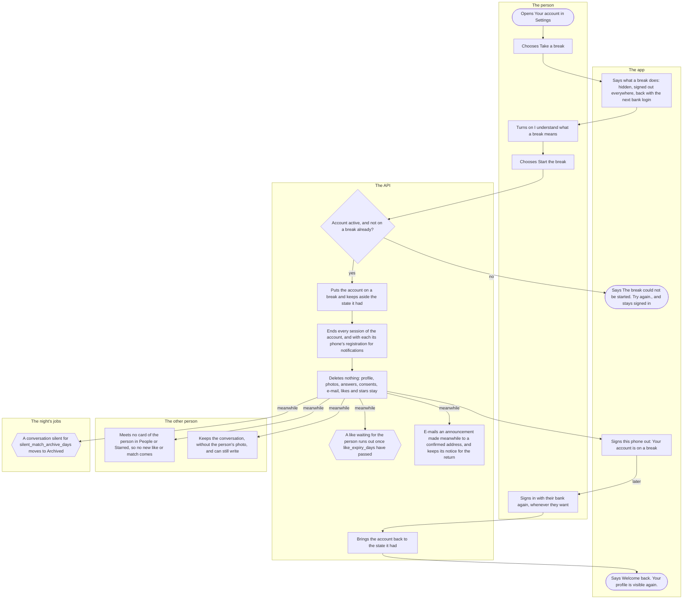

# Taking a break

<!-- draws
apps/mobile/app/account/break.tsx
apps/mobile/src/features/settings/SettingsScreen.tsx
apps/mobile/src/features/identity/AccountActions.tsx
apps/mobile/src/features/identity/BreakScreen.tsx
apps/mobile/src/features/identity/session.tsx
apps/mobile/src/features/identity/SignInScreen.tsx
apps/mobile/src/features/home/HomeScreen.tsx
apps/api/src/identity/account-routes.ts
apps/api/src/identity/pause.ts
apps/api/src/identity/login.ts
apps/api/src/jobs/pool.ts
apps/api/src/jobs/stars.ts
apps/api/src/profile/card.ts
apps/api/src/chat/archive.ts
-->

How a person steps away from Kuutti for a while without deleting anything: their profile leaves everybody's view, every device is signed out, and their next bank login brings everything back as it was. Anyone whose account is active can take a break; the people they matched with meet it too.

## Diagram

## Steps

1. The person opens Settings with the gear on home, and the row "Your account", there while they are signed in.
2. They choose "Take a break", between "I found someone" and "Delete my account".
3. The app opens "Take a break from Kuutti", a screen of its own, with three lines: "Your profile leaves everybody's view. Nobody new sees you while you are away.", "You are signed out on every device, this one included." and "Your next bank login brings you back. Nothing is deleted and nothing is asked again, though meanwhile a like waiting for you can run out, and a quiet conversation moves to Archived." The button "Start the break" waits for the switch.
4. The person turns on "I understand what a break means", a switch whose words turn it too.
5. They choose "Start the break". The app says "Starting your break…".
6. The API checks that the account is active, a shadow-banned one alike, so that the ban shows to nobody: it becomes active once onboarding has the answers and the consents matching needs, and an account still at the start has nothing to hide yet. It checks too that no other device started a break a moment earlier. Yes: 8. No: 7.
7. The app says "The break could not be started. Try again." Nothing has changed and the person stays signed in. A request that fails on the way ends here too.
8. The API puts the account on a break and keeps aside the state it had, in one go with 9 and 10. A research event notes the break, without a reason, only for somebody who said yes to research before it stopped being asked.
9. It ends every session of the account, and with each session goes its phone's registration for notifications, so nothing is pushed to the person while they are away. The other devices are signed out at their next request to the API.
10. Nothing is deleted: the profile, the photos, the answers, the consents, the e-mail, the likes the person gave, and the stars they put and those on them stay as they were. While the break lasts, the count on People on Kuutti leaves the person out ([People on Kuutti](people-on-kuutti.md#part-3-the-nights-count)), and their profile photos are refused to everybody else.
11. The app signs this phone out to the sign-in screen, which says "Your account is on a break" over "Sign in with your bank". Opened again later, the app shows the plain sign-in screen.
12. Meanwhile nobody meets the person's card in People, not even a card already in someone's queue for today ([People](queue.md#part-1-people-reads-the-queue)), and the person leaves the Starred list of whoever starred them, while the star waits for their return ([People](queue.md#part-4-the-star-and-starred)). So no new like or match reaches them.
13. Somebody the person matched with keeps the conversation, with the person's name but without their photo, and can still write; the messages wait for the person's return, pushed to nobody, since the person has no session.
14. The clocks run on as at any other time: a like waiting for the person runs out once `like_expiry_days` have passed since it was given.
15. The night moves a conversation silent for `silent_match_archive_days` to Archived, the person's as anybody's ([Chat](chat.md)). Writing in it brings it back.
16. An announcement to everybody made meanwhile is e-mailed to the person's confirmed address while their Announcements switch is on, and its notice waits on home until they are back ([Announcements](announcements.md#part-3-everybody-is-told)).
17. Whenever they want, the person signs in with their bank again, as in [Signing in](sign-in.md#part-1-signing-in). There is no waiting time: a break may end a minute after it began.
18. The API sees the break and brings the account back to the state it had before it; for somebody who said yes to research before it stopped being asked, how many days the break lasted is noted there.
19. The app goes home, which says once "Welcome back. Your profile is visible again."; someone who had not finished their profile lands on the step they left. The person's card is in People again from the next read, and People opens for them again, while matching is open for them ([People on Kuutti](people-on-kuutti.md#part-2-an-admin-opens-or-closes-matching)).

## Where it lives

- Screens: the "Your account" row of Settings in [SettingsScreen.tsx](../../apps/mobile/src/features/settings/SettingsScreen.tsx) (its button in [AccountActions.tsx](../../apps/mobile/src/features/identity/AccountActions.tsx)), [account/break.tsx](../../apps/mobile/app/account/break.tsx) ([BreakScreen.tsx](../../apps/mobile/src/features/identity/BreakScreen.tsx)), the sign-out with its notice in [session.tsx](../../apps/mobile/src/features/identity/session.tsx) and [SignInScreen.tsx](../../apps/mobile/src/features/identity/SignInScreen.tsx), the welcome in [HomeScreen.tsx](../../apps/mobile/src/features/home/HomeScreen.tsx)
- API: `POST /account/pause` in [account-routes.ts](../../apps/api/src/identity/account-routes.ts), the break and its end in [pause.ts](../../apps/api/src/identity/pause.ts), the bank login that ends it in [login.ts](../../apps/api/src/identity/login.ts) (the [identity slice](../../apps/api/src/identity/README.md)); who is in the pool in [pool.ts](../../apps/api/src/jobs/pool.ts), the Starred list in [stars.ts](../../apps/api/src/jobs/stars.ts), the card refused in [card.ts](../../apps/api/src/profile/card.ts), the archive in [archive.ts](../../apps/api/src/chat/archive.ts); a push only to a phone whose session is live, [push.ts](../../apps/api/src/notifications/push.ts); an announcement's e-mail, [announcements.ts](../../apps/api/src/notifications/announcements.ts)
- Spec: [pause.feature](../../features/identity/pause.feature); "A break stops no clock" in [conversations.feature](../../features/chat/conversations.feature); the paused person no card in anybody's queue in [opening.feature](../../features/pond/opening.feature), left out of the count in [counter.feature](../../features/pond/counter.feature), and out of Starred until back in [stars.feature](../../features/matching/stars.feature)
- Maestro: [take-a-break.yaml](../../apps/mobile/e2e/flows/take-a-break.yaml)
- ADRs: [ADR-022](../adr/022-taking-a-break.md), [ADR-060](../adr/060-no-waiting-at-the-pond.md) §3 (who matching is open for), [ADR-013](../adr/013-waitlist-counter.md) §2 (who is counted), [ADR-064](../adr/064-a-star.md) (a paused person's stars wait), [ADR-031](../adr/031-chat.md) §8 (the archive), [ADR-055](../adr/055-push.md) (a token goes with its session)
- Rules: the register's [Break and erasure](../decisions.md#break-and-erasure) rows, with the clocks of its [Likes and fish](../decisions.md#likes-and-fish) and [Chat](../decisions.md#chat) rows

## History

- 2026-10-13 (#170, PR #277): taking a break: the screen with its three lines and the tick, the account hidden and every device signed out, the sign-in screen saying why, and the next bank login the way back with "Welcome back".
- 2026-10-14 (#287, PR #290): "Take a break" moves behind the "Your account" row of Settings.
- 2026-10-16 (#307, PR #315): the person's photos are refused to everybody else while the break lasts, and a sanction during a break keeps the break.
- 2026-10-17 (#348, PR #352): the person's conversations stay for the people they matched with, without the person's photo, and the night archives a quiet one as at any other time.
- 2026-10-19 (#96, PR #372): a card of the person already in someone's round is no longer shown once the break begins.
- 2026-10-20 (#95, PR #381): the night builds no round for a person on a break and puts their card in nobody's.
- 2026-10-20 (#97, PR #383): the break screen says that a like waiting for the person can run out meanwhile.
- 2026-10-20 (#100, PR #388): the break screen says that a quiet conversation moves to Archived meanwhile.
- 2026-10-25 (#102, PR #459): nothing is pushed to a person on a break: the break ends every session, and each phone's registration for notifications with it.
- 2026-10-30 (#511, PR #516): "Take a break" stands under the "Your account" row of Settings' one list, between "I found someone" and "Delete my account".
- 2026-10-31 (#500, PR #555): with the gate gone, a break keeps no place in a line, and coming back waits for no count.
- 2026-11-03 (#502, PR #578): the daily round gives way to the one queue: while the break lasts nobody meets the person in People and they have none of their own, and once back they are in it from the next read.
- 2026-11-03 (#575, PR #582): a star put on the person waits through the break, and they leave the Starred list of whoever starred them until they are back.
- 2026-11-07 (#573, PR #643): an announcement made during a break reaches a confirmed address by e-mail, and its notice waits on home for the return.
