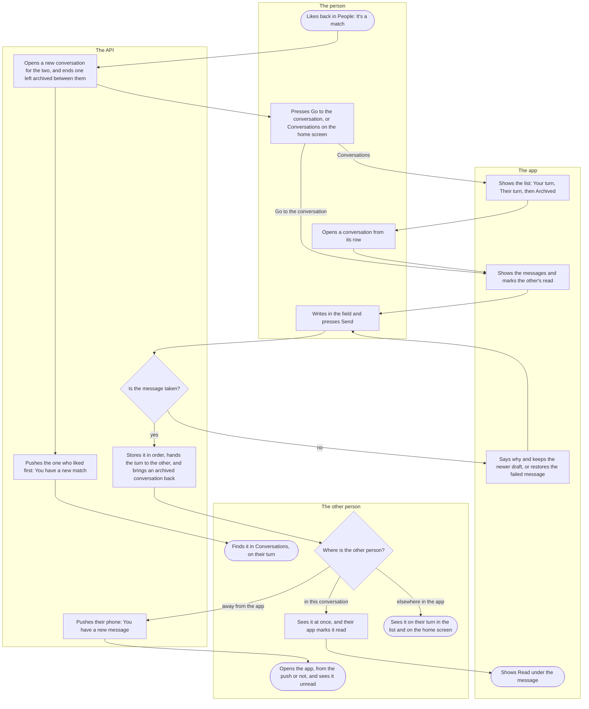
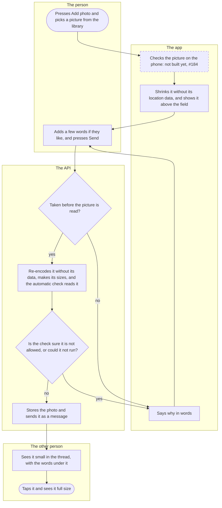
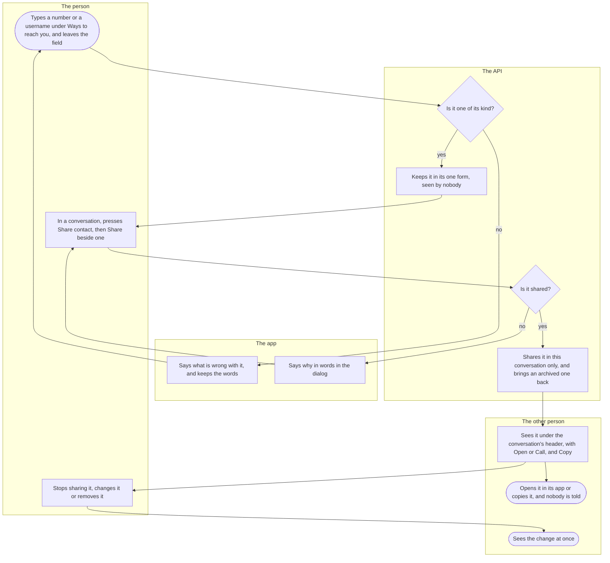
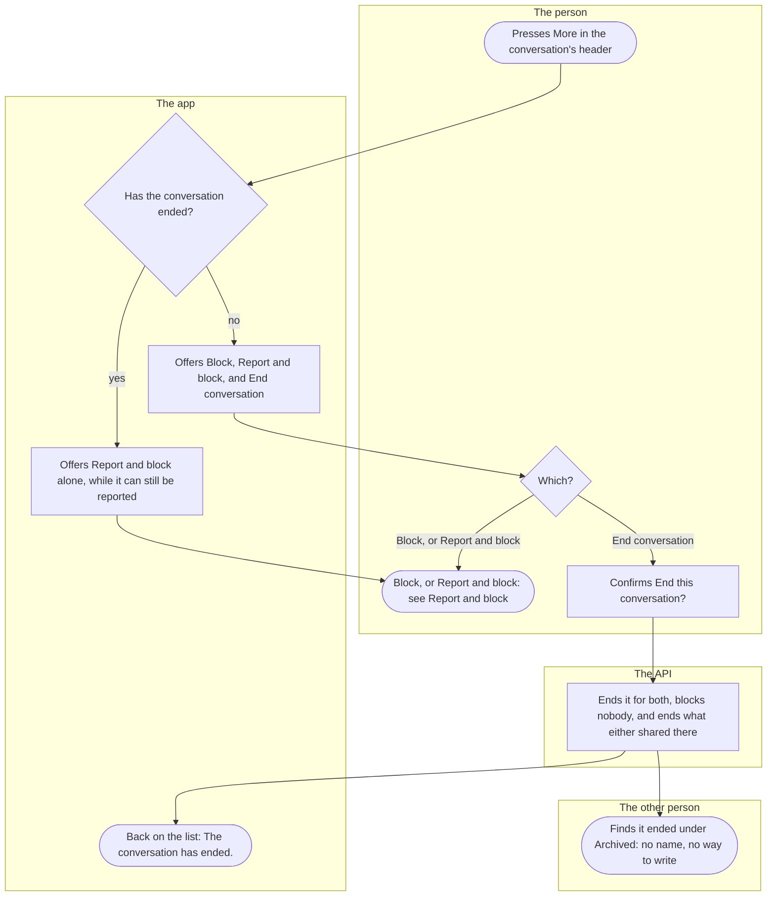

# Chat

<!-- draws
apps/mobile/app/chats/index.tsx
apps/mobile/app/chats/[id].tsx
apps/mobile/app/chats/photo/[messageId].tsx
apps/mobile/src/features/chat/ConversationsScreen.tsx
apps/mobile/src/features/chat/ConversationScreen.tsx
apps/mobile/src/features/chat/PhotoBubble.tsx
apps/mobile/src/features/chat/ChatPhotoScreen.tsx
apps/mobile/src/features/chat/YourContacts.tsx
apps/mobile/src/features/chat/ContactShare.tsx
apps/mobile/src/features/chat/SharedContacts.tsx
apps/mobile/src/features/media/pick.ts
apps/mobile/src/features/safety/SafetyActions.tsx
apps/mobile/src/features/matching/RoundScreen.tsx
apps/api/src/chat/routes.ts
apps/api/src/chat/conversations.ts
apps/api/src/chat/messages.ts
apps/api/src/chat/photos.ts
apps/api/src/chat/contacts.ts
apps/api/src/chat/repo.ts
apps/api/src/chat/archive.ts
apps/api/src/notifications/push.ts
-->

How two people talk once they have matched: the list of their conversations and whose turn each one is, writing to each other, a message arriving while the other person has the app open or later by push, sending a photo, sharing a way to reach them outside the app, and ending a conversation. Everyone with a match goes through it, on both sides.

## Part 1: from a match to a message

### Steps

1. The person likes someone in [People](queue.md) who has already liked them, or does so on a starred person's card: it's a match. The screen says "It's a match", with "Go to the conversation" and "Back to people" ("Back to Starred" on a starred person's card).
2. In the same moment the API opens a new conversation for the two, with nothing said in it yet, so it is both people's turn. A conversation of the same two left archived from an earlier match ends then, as an end does, with what either shared there (part 4): a pair has one conversation they can write in.
3. After the like's answer, the API pushes the other person, the one whose earlier like the match met: "You have a new match", never saying with whom, whether or not they have the app open, if their Matches switch is on, it is not the quiet hours, and a phone of theirs is signed in and lets Kuutti notify ([Notifications](notifications.md)). The person who just liked is pushed nothing: they saw the match.
4. The other person finds the conversation at their next look at Conversations, under Your turn, with no line under the name; a tap on the push opens Conversations. Nothing else tells them: there is no notice in the app.
5. The person presses "Go to the conversation": 8. Or, then or any time later, "Conversations" on the home screen, which shows how many messages wait unread: 6.
6. The list, "Conversations", in groups, each newest first, a group with nobody in it left out: "Your turn", with how many conversations wait on the person, those whose last thing said, a message or a shared contact, came from the other person, and every match where nothing has been said yet; "Their turn"; and "Archived", which holds a conversation quiet for `silent_match_archive_days`, which the night moves there, and one that has ended, which names nobody ("Conversation ended"). From `your_turn_warning` conversations on their turn, a line above the groups says that nobody new can be liked while `your_turn_limit` of them wait (the like itself is refused in [People](queue.md)); with either set to 0 there is no line. A row is the other person's name and age with their photo, the last line ("You: …" before one's own, "Photo" for a photo without words), when, and how many are unread; a match where nothing has been said has no line under the name. With no conversation at all: "No conversations yet." The list moves at once when a message comes, and says "Connection lost. Reconnecting…" while its live connection is down. Pulling it down reads it again.
7. The person opens a conversation by its row.
8. The messages, oldest at the top, the person's own on the right, a line where the day changes; "Earlier messages" loads more. While the conversation is on the screen in front of the person, the app marks the other's messages read. "Online" shows under the header while the other person has the app open. An archived conversation says above the field "This conversation was quiet for a week. Write to bring it back."
9. The person writes in the field, "Message", and presses Send, which is off while the field is empty. No count of characters comes first: past `message_max_length` the line beside Send says "The message is too long. Make it shorter and send it again." and Send stops. The message shows at once with "Sending…" under it.
10. The API takes it, or refuses it and stores nothing. Refused: 11. Taken: 12.
11. The app says why under the field, and restores the words for another try unless a newer draft was typed meanwhile; that draft stays: "A message cannot carry an e-mail address, a link, a phone number or a social media handle. To give your number or a username, keep it in Settings, under Ways to reach you, and share it from the top of the conversation." (part 3); "You are sending messages very fast. Wait a moment and send again." over `messages_per_minute`; "This conversation has ended, so the message was not sent.", and the screen reads the conversation again, which shows it ended (part 4); and when nothing answers, "The message was not sent. Check your connection and send it again." Back to 9; the same words sent again are never doubled.
12. The API stores the message in the conversation's order, and the conversation is now the other person's turn. An archived conversation comes back out of Archived for both. A person under a shadow ban sees their own message as sent, and the other person never gets it while the ban stands, nor a push of it (see [Report and block](report-and-block.md)).
13. Where the other person is decides how they learn of it. In this conversation: 14. Elsewhere in the app: 15. Away from the app: 16.
14. The message appears on their screen at once, and since they have it in front, their app marks it read: 18.
15. The list moves the conversation to the top of Your turn with the new line and its unread count, and the home screen's Conversations count goes up.
16. After the send's answer, the API pushes their phones "You have a new message", never what it says or who sent it, if their Messages switch is on, it is not the quiet hours, a phone of theirs is signed in and lets Kuutti notify, and no push of this conversation went to them within `message_push_min_interval_minutes` ([Notifications](notifications.md)). Otherwise nothing is pushed, and nothing is kept to send later.
17. When they next open the app, by a tap on the push, which opens Conversations, or not, its live connection catches up on what came meanwhile, and the list and the conversation show the message, unread.
18. The person who wrote it sees "Read" under their last message the other has read, at once while they have the conversation open, otherwise when they next open it. The read mark of a person under a shadow ban goes no further, for the one who wrote, than the newest message from before the ban began.

## Part 2: a photo

### Steps

19. In a conversation, the person presses Add photo beside the field and picks one picture from the phone's library. Without access to the photos: "Kuutti could not open your photos. Allow access in the phone's settings and try again."
20. Not built yet (#184): the app is to check the picture on the phone before any of it leaves the phone, and refuse a nude one there and then ("This photo cannot be used."). Until then every picture passes.
21. The app shrinks the picture on the phone, which leaves its location and camera data behind, and shows it above the field with Remove photo; a screen reader hears "Photo attached." A picture the phone cannot read: "The photo could not be read. Try another picture."
22. The person may write a few words to go under it, and presses Send. The photo shows in the thread with "Sending…" and how far it has gone.
23. The API first refuses what it can without reading the picture: a conversation that has ended; words that break a message's rules (step 11); the day's photos, `message_photos_per_day`, or the day's tries, refused ones included, `message_photo_attempts_per_day`, both until midnight in Finland; and `messages_per_minute`, shared with the texts. Refused: 24. Otherwise: 25.
24. The app says why: "You have tried to send many photos today. You can send photos again after midnight." for the day's photos, step 11's words for the words and the pace, and step 25's and 26's for the picture. A refusal of the words or the pace, or a busy check, keeps the photo attached for the next try; a refusal of the picture takes it off. Back to 22, or to 19 for another picture.
25. The API reads the picture as it reads a profile photo: a file that is no picture, or too large, is refused (24, "This file is not a photo Kuutti can use. Choose a JPEG, PNG or WebP picture.", "The photo is too large. Choose a smaller picture."); it is re-encoded without its data, made into its sizes, the original never kept, and the automatic check reads it before anything is stored.
26. The check is sure it shows nudity, violence or something else not allowed: 24, "Not sent. Photos with nudity cannot be sent on Kuutti.", "Not sent. Photos with violence or weapons cannot be sent on Kuutti." or "Not sent. This photo cannot be sent on Kuutti; try another one.", and nothing is stored. The check could not run, or too many photos are on their way at once: 24, "Many photos are being processed right now. Try again in a moment." Otherwise, also when the check is unsure: 27. No person looks at a photo sent in a conversation.
27. The API stores the photo and sends it as a message, in order, as a text is sent (12 to 17 hold for it too). The sender's thread shows it small, with the words under it.
28. The other person sees it small in the thread, its words under it, or "Photo" in the list without words. Only the two of them can see it; it is never on anybody's card.
29. A tap opens it full size, "Photo, full size", with "Back to the conversation"; under a photo the other person sent stands Report this photo while the conversation can be reported ([Report and block](report-and-block.md)). When the sender deletes their account, the message stays and reads "Photo removed".

## Part 3: sharing a contact

### Steps

30. The person opens Settings, where the row Ways to reach you, under Notifications and contacts, names the kinds kept, or says "Add a way to reach you". It opens in place: "Nobody sees them until you share one in a conversation. A change or a removal shows at once wherever you shared it." Then one of each kind, each with its service's mark: Phone number (with "For another country's number, choose its code first." and the Country code, Finland's until another is chosen), WhatsApp, Telegram, Instagram and Snapchat. There is no Save: the person types one and leaves the field, which keeps it.
31. The app checks its form first, and the API again. Not one of its kind: 32. Otherwise: 33.
32. The app says what is wrong for that kind under the field, for example "That does not look like a phone number. Write it with its country code (+358…) or as a Finnish number starting with 0." or "A digit or more seems to be missing.", keeps the words, and checks them again as the person types. Back to 30. Settings asks before it is left with words that were not kept, including a valid draft not yet sent or a save still in flight. "Keep editing" returns to the field; "Leave without saving" discards words not yet sent and starts no save on unmount. A request already sent can still complete.
33. The API keeps it in its one form (a Finnish number from 0 becomes +358…, a username loses its @) and the field says "Saved." Nobody sees it. An emptied field takes nothing away ("Still saved. Remove takes it away."); Remove does. A keep, a change and a removal each count against `messages_per_minute`: past it, "That was a lot in a short time. Wait a moment and try again."; a failure, "That did not go through. Try again." Either has a Try again button while pressing it would send the words; a removal is tried again with Remove.
34. In a conversation that has not ended, with a contact kept, Share contact is in the header. The dialog, "Share a contact", says "{the other person} sees what you share at once. You can stop sharing at any time, but what {the other person} already wrote down stays with them." Each contact kept has its mark, its kind and value, and Share, or Stop sharing once shared. The person presses Share beside one.
35. Refused: 36. Shared: 37.
36. The app says why in the dialog: "This conversation has ended, so nothing was shared."; "Save this contact under Settings, Ways to reach you, first." when it was removed on another phone; "This conversation is no longer available."; "That was a lot in a short time. Wait a moment and try again." over `messages_per_minute`; and otherwise "That did not go through. Try again." The first three have the screen read the conversation again. Back to 34.
37. The API shares it in this conversation only; an archived conversation comes back out of Archived. The button turns to Stop sharing, and a screen reader hears "Shared. {the other person} sees it now." Nothing asks the other person to share back. A share keeps a conversation out of the archive as a message does, and is an answer, as a message is: the conversation is now the other person's turn.
38. The other person sees it under the conversation's header, at once while they have it open, otherwise when they next open it: the service's mark and "Instagram: …" as text they can select, with Open beside it (Call for a phone number) and Copy. No push tells of a share. What a person shares under a shadow ban does not reach the other person while the ban stands.
39. Open takes them to the contact in its service's app, or its page where the app is not installed, or calls the number; a phone that will not open it says "This did not open on your phone.", and Copy stays. Copy puts it on the phone's clipboard and says so, as "Instagram copied." Neither tells Kuutti or the person who shared it.
40. The person presses Stop sharing in the same dialog (a screen reader hears "No longer shared here."), or changes or removes the contact in Settings (Remove: the field empties, and a screen reader hears "Removed. Wherever you shared it, it is gone now.").
41. The other person sees the change at once: the new value, or nothing. When the conversation ends, by any of the ways in part 4, every share in it ends, and nothing shows either way.

## Part 4: ending a conversation

### Steps

42. In a conversation the person presses More in the header, beside Share contact.
43. Has the conversation ended? No: 44. Yes: 45.
44. The dialog "Report, block or end" only chooses: Block, Report and block, and End conversation, with nothing under them, and Cancel.
45. In an ended conversation the dialog offers Report and block alone, while the conversation can still be reported: for `report_after_close_days` after it ended, and not once the other person has deleted their account. After that there is no More.
46. Block, or Report and block: 47. End conversation: 48.
47. See [Report and block](report-and-block.md).
48. The confirmation: "End this conversation?", "Neither of you can write in it any more. It stays in the archive for both of you, and nobody is told who ended it. Nobody is blocked, and either of you can still report it for a while." The person presses End conversation; Cancel leaves it as it was. A failure: "That did not go through. Try again."
49. The API ends it for both; only its two people can end it, and ending it again changes nothing. Nobody is blocked. What either shared there ends. Every message stays, for both, to read and never to add to, and each side's Read stays where it was.
50. The person is back on the list, which says "The conversation has ended.", with "Support when it's hard", the way to the support page. The conversation is under Archived as "Conversation ended" with its last line; opened, its heading says "Conversation ended", and where the field was stands only "Support when it's hard".
51. The other person finds it the same way, under Archived as "Conversation ended", with no name, age or photo; inside, "The other person" before their messages, the same heading, and "Support when it's hard" where the field was. A conversation open on their screen turns so at once, and a screen reader hears "This conversation has ended." Nothing says who ended it or how: an end, a block, a report and a ban all read the same. Either of them may still report it for `report_after_close_days`. They are not shown each other in [People](queue.md) for `ended_cooldown_days` after the end, and then only as somebody seen before; a new match then opens a new conversation (step 2). A conversation the other person's deletion ended reads instead "Deleted user", with "This person deleted their account."

## Where it lives

- Screens: [chats/index.tsx](../../apps/mobile/app/chats/index.tsx) (the list), [chats/[id].tsx](../../apps/mobile/app/chats/%5Bid%5D.tsx) (a conversation), [chats/photo/[messageId].tsx](../../apps/mobile/app/chats/photo/%5BmessageId%5D.tsx) (a photo full size), [settings/index.tsx](../../apps/mobile/app/settings/index.tsx) (Settings, whose Ways to reach you row opens in place in [SettingsScreen.tsx](../../apps/mobile/src/features/settings/SettingsScreen.tsx)); in the chat feature ([README](../../apps/mobile/src/features/chat/README.md)) [ConversationsScreen.tsx](../../apps/mobile/src/features/chat/ConversationsScreen.tsx), [ConversationScreen.tsx](../../apps/mobile/src/features/chat/ConversationScreen.tsx), [PhotoBubble.tsx](../../apps/mobile/src/features/chat/PhotoBubble.tsx), [ChatPhotoScreen.tsx](../../apps/mobile/src/features/chat/ChatPhotoScreen.tsx), [YourContacts.tsx](../../apps/mobile/src/features/chat/YourContacts.tsx) (Ways to reach you), [ContactShare.tsx](../../apps/mobile/src/features/chat/ContactShare.tsx), [SharedContacts.tsx](../../apps/mobile/src/features/chat/SharedContacts.tsx) with [contactLink.ts](../../apps/mobile/src/features/chat/contactLink.ts) and [ContactMark.tsx](../../apps/mobile/src/features/chat/ContactMark.tsx), [ChatsButton.tsx](../../apps/mobile/src/features/chat/ChatsButton.tsx) (home's Conversations), [notice.ts](../../apps/mobile/src/features/chat/notice.ts) (what the list says after an end), the live connection in [store.tsx](../../apps/mobile/src/features/chat/store.tsx) and [socket.ts](../../apps/mobile/src/features/chat/socket.ts); the photo's chain on the phone in [media/pick.ts](../../apps/mobile/src/features/media/pick.ts) and [media/localCheck.ts](../../apps/mobile/src/features/media/localCheck.ts); More in [safety/SafetyActions.tsx](../../apps/mobile/src/features/safety/SafetyActions.tsx); the match in [matching/RoundScreen.tsx](../../apps/mobile/src/features/matching/RoundScreen.tsx); a push's tap in [notifications/PushNotifications.tsx](../../apps/mobile/src/features/notifications/PushNotifications.tsx)
- API: the chat slice ([README](../../apps/api/src/chat/README.md)), its routes in [routes.ts](../../apps/api/src/chat/routes.ts): `GET /conversations`, `GET /conversations/{id}`, `GET` and `POST /conversations/{id}/messages`, `POST /conversations/{id}/photos`, `POST /conversations/{id}/read`, `POST /conversations/{id}/unmatch`, `GET /contacts`, `PUT` and `DELETE /contacts/{kind}`, `GET /conversations/{id}/contacts`, `POST` and `DELETE /conversations/{id}/contacts/{kind}`; the live socket `GET /ws` in [ws.ts](../../apps/api/src/chat/ws.ts), [live.ts](../../apps/api/src/chat/live.ts), [listen.ts](../../apps/api/src/chat/listen.ts) and [presence.ts](../../apps/api/src/chat/presence.ts); [messages.ts](../../apps/api/src/chat/messages.ts), [photos.ts](../../apps/api/src/chat/photos.ts), [contacts.ts](../../apps/api/src/chat/contacts.ts), [conversations.ts](../../apps/api/src/chat/conversations.ts) (the list, the end, and the opening a match calls), [repo.ts](../../apps/api/src/chat/repo.ts) (whose turn, and what a shadow ban withholds), the night's archive in [archive.ts](../../apps/api/src/chat/archive.ts); the pushes of a message and a match in the notifications slice's [push.ts](../../apps/api/src/notifications/push.ts)
- Spec: [conversations.feature](../../features/chat/conversations.feature), [your-turn.feature](../../features/chat/your-turn.feature), [live.feature](../../features/chat/live.feature), [photos.feature](../../features/chat/photos.feature), [contact-share.feature](../../features/chat/contact-share.feature), [closing.feature](../../features/chat/closing.feature); whom a push tells in [push.feature](../../features/notifications/push.feature)
- Maestro: [chat-text.yaml](../../apps/mobile/e2e/flows/chat-text.yaml), [chat-live.yaml](../../apps/mobile/e2e/flows/chat-live.yaml), [chat-photo.yaml](../../apps/mobile/e2e/flows/chat-photo.yaml), [contact-share.yaml](../../apps/mobile/e2e/flows/contact-share.yaml), [chat-report.yaml](../../apps/mobile/e2e/flows/chat-report.yaml) (More in an open and in an ended conversation)
- ADRs: [ADR-031](../adr/031-chat.md) (the chat: §3 the send, §4 what each side reads, §8 the archive, §9 the live socket, §10 a photo, §11 contacts), [ADR-005](../adr/005-media-pipeline-and-delivery.md) (the 2026-10-18 amendment: a photo sent in a conversation), [ADR-038](../adr/038-the-match.md) §1 (a match opens the conversation), [ADR-062](../adr/062-one-queue.md) (§5 whose turn, §6 the clock after an end, §7 a second match), [ADR-055](../adr/055-push.md) (§4 the message's push, §5 the match's), [ADR-030](../adr/030-reports-and-blocks.md) §12 (the end of a conversation, More)
- Rules: the register's [Match](../decisions.md#match), [Chat](../decisions.md#chat) and [Notifications](../decisions.md#notifications) rows

## History

- 2026-10-17 (#348, PR #352): conversations with text messages: the list with its Open and Archived groups, the unread count on the home screen, Read under a message, and the night's archive of a quiet conversation.
- 2026-10-18 (#349, PR #354): messages, Read and Online arrive live while the app is open, and a line says when the connection is lost.
- 2026-10-18 (#350, PR #361): a photo from the library, through the pipeline and the automatic check, small in the thread and full size on a tap.
- 2026-10-18 (#103, PR #363): contacts kept in Settings, Your contacts, and shared into a conversation with one press.
- 2026-10-18 (#351, #84, PR #365): More in the conversation's header: report, block or end; an ended conversation names nobody, and either person may still report it for a while.
- 2026-10-19 (#351, #84, PR #366): ending and blocking read the same to the other person, Read stays where an end found it, End conversation's confirmation says either can still report it, and the Archived group says what it holds.
- 2026-10-20 (#100, PR #384): a like meeting a like opens the conversation; the other person finds it at their next look at Conversations.
- 2026-10-25 (#102, PR #459): a new message pushes the other person while they are away from the app, at most once a conversation in a while, and a match pushes the one who liked first; a tap opens Conversations.
- 2026-10-28 (#474, PR #485): Snapchat joins the contacts one can keep and share, and Your contacts is renamed Ways to reach you.
- 2026-10-28 (#474, PR #486): a contact shows its service's mark before its name, in Settings, in the share dialog and under the conversation's header.
- 2026-10-29 (#470, PR #498): a shadow-banned person's read mark no longer reaches the other side past the newest message from before the ban.
- 2026-10-30 (#511, PR #516): Ways to reach you opens in place in Settings' one list and keeps a contact as its field is left, with no Save; a phone number takes its country code from a list.
- 2026-10-30 (#510, PR #531): an ended conversation has the way to Support when it's hard where the field was, and so has the list under what an end, a block or a report left to say.
- 2026-10-30 (#473, PR #537): a shared contact has Open (Call for a phone number) and Copy beside it, and neither tells anybody.
- 2026-11-03 (#502, PR #578): the list groups the open conversations by whose turn it is, with how many wait on the person and a line as the your-turn limit nears; a second match of the same two opens a new conversation and ends one left archived; the two are kept apart for a while after an end.
- 2026-11-04 (#581, PR #591): a contact's Try again in Ways to reach you shows only while pressing it would send something.
- 2026-11-05 (#581, PR #602): an ended conversation reads by its heading, and a screen reader hears when one ends on the screen; the composer's count goes, and past the longest message the line beside Send says it is too long; the match and the share dialog explain less, and More's first step only chooses.
- 2026-11-13 (#657): a failed send preserves a newer draft, and a failed background refresh preserves an already loaded empty conversation. Settings asks before leaving an unsent contact or a save still pending; choosing to leave sends no discarded draft.
