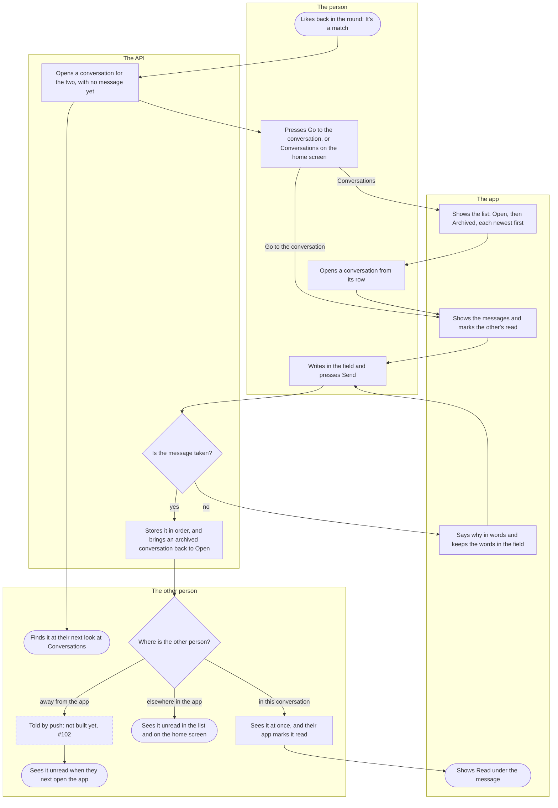
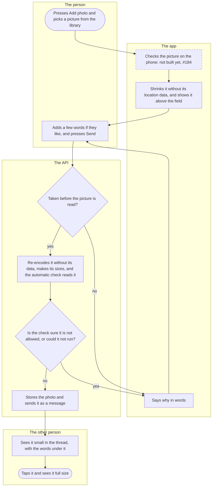
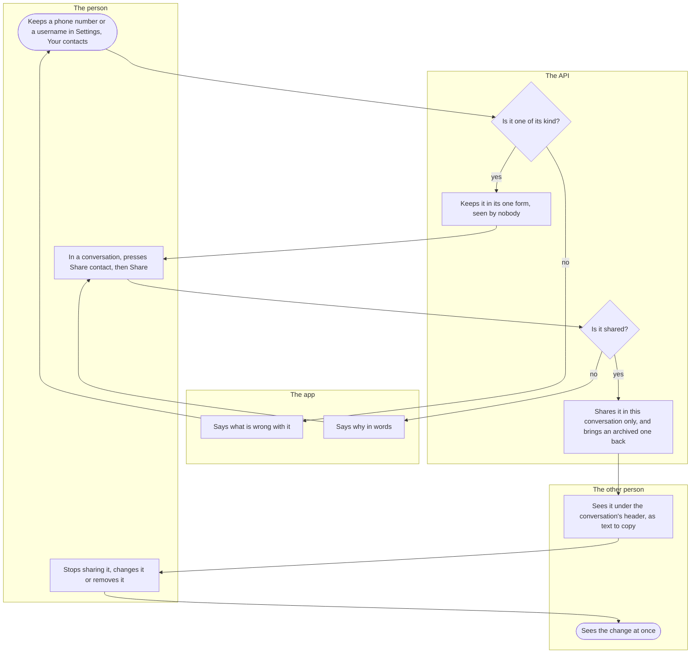
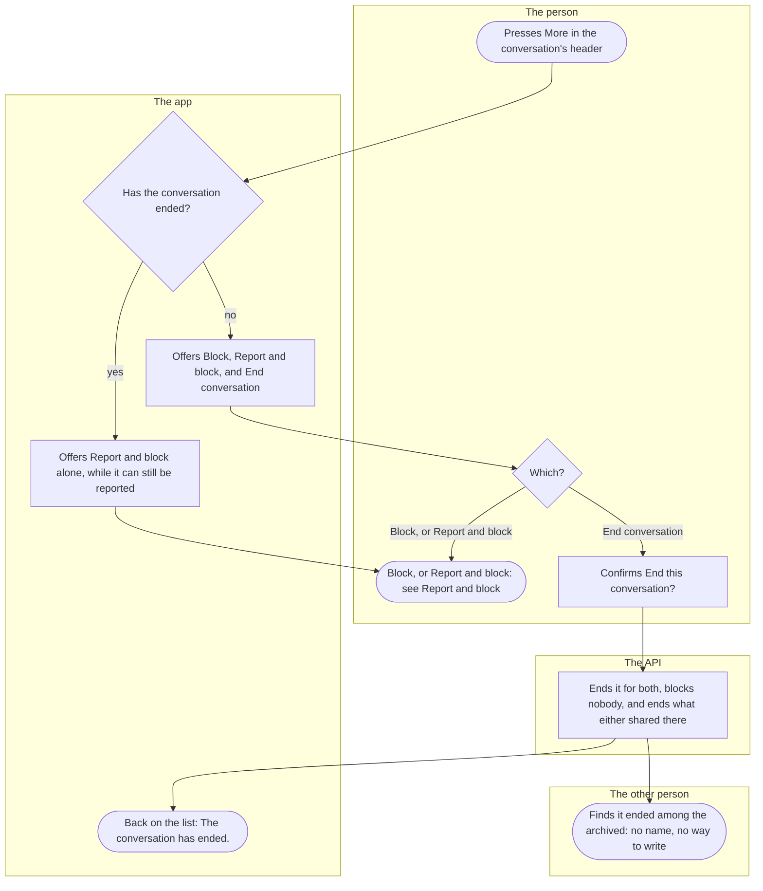

# Chat

How two people talk once they have matched: the list of their conversations, writing to each other, a message arriving while the other person has the app open or later, sending a photo, sharing a way to reach them outside the app, and ending a conversation. Everyone with a match goes through it, on both sides.

## Part 1: from a match to a message

### Steps

1. The person likes a card in [today's round](round.md) whose person has already liked them: it's a match. The round says "It's a match": "You both liked each other, so a conversation is open for you two under Conversations."
2. In the same moment the API opens a conversation for the two, with no message in it yet.
3. The other person finds it at their next look at Conversations, under Open, with "No messages yet". Nothing tells them of the match: no notice and no push.
4. The person presses "Go to the conversation" on the match: 7. Or, then or any time later, "Conversations" on the home screen, which says how many messages wait unread: 5.
5. The list, "Conversations": the open ones first, then "Archived", each newest first by its last message. A row is the other person's name and age with their photo, the last line ("You: …" before one's own, "No messages yet" for a silent match) and how many are unread. "Archived" holds a conversation quiet for `silent_match_archive_days`, which the night moves there, and one that has ended, which names nobody ("Conversation ended"). The list moves at once when a message comes, and says "Connection lost. Reconnecting…" while its live connection is down. Pulling it down reads it again.
6. The person opens a conversation by its row.
7. The messages, oldest at the top, the person's own on the right, a line where the day changes; "Earlier messages" loads more. While the conversation is on the screen in front of the person, the app marks the other's messages read. "Online" shows under the header while the other person has the app open. In an archived conversation a line above the field says that writing brings it back.
8. The person writes in the field, "Message", and presses Send. Under the field a count says how many characters are left of `message_max_length`; Send is off while the field is empty or too long. The message shows at once with "Sending…" under it.
9. The API takes it, or refuses it and stores nothing. Refused: 10. Taken: 11.
10. The app says why under the field, and keeps the words in it for another try: "The message is too long. Make it shorter and send it again."; "A message cannot carry an e-mail address, a link, a phone number or a social media handle. To give your number or a username, keep it in Settings, under Your contacts, and share it from the top of the conversation." (part 3); "You are sending messages very fast. Wait a moment and send again." over `messages_per_minute`; "This conversation has ended, so the message was not sent."; and when nothing answers, "The message was not sent. Check your connection and send it again." Back to 8; the same words sent again are never doubled.
11. The API stores the message in the conversation's order. An archived conversation comes back to Open for both. A person under a shadow ban sees their own message as sent, and the other person never gets it while the ban stands (see [Report and block](report-and-block.md)).
12. Where the other person is decides when they see it. In this conversation: 13. Elsewhere in the app: 14. Away from the app: 15.
13. The message appears on their screen at once, and since they have it in front, their app marks it read: 17.
14. The list moves the conversation to the top with the new line and its unread count, and the home screen's Conversations count goes up.
15. Not built yet (#102): a push would say that there is a message, never what it says or who sent it. Today nothing reaches a phone whose app is closed or in the background.
16. When they next open the app, its live connection catches up on what came meanwhile, and the list and the conversation show the message, unread.
17. The person who wrote it sees "Read" under their last message the other has read, at once while they have the conversation open, otherwise when they next open it.

## Part 2: a photo

### Steps

18. In a conversation, the person presses Add photo beside the field and picks one picture from the phone's library. Without access to the photos: "Kuutti could not open your photos. Allow access in the phone's settings and try again."
19. Not built yet (#184): the app is to check the picture on the phone before any of it leaves the phone, and refuse a nude one there and then ("This photo cannot be used."). Until then every picture passes.
20. The app shrinks the picture on the phone, which leaves its location and camera data behind, and shows it above the field: "Photo attached. The words in the field go under it.", with Remove photo.
21. The person may write a few words to go under it, and presses Send. The photo shows in the thread with "Sending…" and how far it has gone.
22. The API first refuses what it can without reading the picture: a conversation that has ended; words that break a message's rules (step 10); the day's photos, `message_photos_per_day`, or the day's tries, refused ones included, `message_photo_attempts_per_day`, both until midnight in Finland; and `messages_per_minute`, shared with the texts. Refused: 23. Otherwise: 24.
23. The app says why: "You have tried to send many photos today. You can send photos again after midnight." for the day's photos, step 10's words for the words and the pace, and step 25's for the picture. A refusal of the words or the pace, or a busy check, keeps the photo attached for the next try; a refusal of the picture takes it off. Back to 21, or to 18 for another picture.
24. The API reads the picture as it reads a profile photo: a file that is no picture, or too large, is refused (23, "This file is not a photo Kuutti can use. Choose a JPEG, PNG or WebP picture.", "The photo is too large. Choose a smaller picture."); it is re-encoded without its data, made into its sizes, the original never kept, and the automatic check reads it before anything is stored.
25. The check is sure it shows nudity, violence or something else not allowed: 23, "Not sent. Photos with nudity cannot be sent on Kuutti." (or violence, or "This photo cannot be sent on Kuutti; try another one."), and nothing is stored. The check could not run: 23, "Many photos are being processed right now. Try again in a moment." Otherwise, also when the check is unsure: 26. No person looks at a photo sent in a conversation.
26. The API stores the photo and sends it as a message, in order, as a text is sent (11 to 16 hold for it too). The sender's thread shows it small, with the words under it.
27. The other person sees it small in the thread, its words under it, or "Photo" in the list without words. Only the two of them can see it; it is never on anybody's card.
28. A tap opens it full size, "Photo, full size", with "Back to the conversation". When the sender deletes their account, the message stays and reads "Photo removed".

## Part 3: sharing a contact

### Steps

29. The person opens Settings, Your contacts: "Keep the ways to reach you outside the app here. Nobody sees them until you share one in a conversation, with the button at its top. A change or a removal shows at once wherever you shared it." There is one of each: a phone number, WhatsApp, Telegram and Instagram. They type one and press Save.
30. The app checks its form first, and the API again. Not one of its kind: 31. Otherwise: 32.
31. The app says what is wrong for that kind, for example "That does not look like a phone number. Write it with its country code (+358…) or as a Finnish number starting with 0." Back to 29.
32. The API keeps it in its one form (a Finnish number from 0 becomes +358…, a username loses its @) and says "Saved." Nobody sees it. A keep, a change and a removal each count against `messages_per_minute`.
33. In a conversation that has not ended, with a contact kept, Share contact is in the header. The dialog, "Share a contact", says "{the other person} sees what you share at once, at the top of this conversation. You can stop sharing at any time, but what {the other person} already wrote down stays with them." The person presses Share beside one.
34. Refused: 35. Shared: 36.
35. The app says why in the dialog: "This conversation has ended, so nothing was shared."; "Save this contact under Settings, Your contacts, first." when it was removed on another phone; "That was a lot in a short time. Wait a moment and try again." over `messages_per_minute`; "Nothing changed. Check your connection and try again." Back to 33.
36. The API shares it in this conversation only; an archived conversation comes back to Open. The dialog says "Shared. {the other person} sees it now." and marks it "Shared in this conversation". Nothing asks the other person to share back. A share keeps a conversation out of the archive as a message does.
37. The other person sees it under the conversation's header, at once while they have it open, otherwise when they next open it: "Instagram: …", text they can select and copy, never a link. What a person shares under a shadow ban does not reach the other person while the ban stands.
38. The person presses Stop sharing in the same dialog ("No longer shared here."), or changes or removes the contact in Settings ("Removed. Wherever you shared it, it is gone now.").
39. The other person sees the change at once: the new value, or nothing. When the conversation ends, by any of the ways in part 4, every share in it ends, and nothing shows either way.

## Part 4: ending a conversation

### Steps

40. In a conversation the person presses More in the header, beside Share contact.
41. Has the conversation ended? No: 42. Yes: 43.
42. The dialog "Report, block or end" offers Block, Report and block, and End conversation ("Neither of you can write in it any more. Nobody is blocked."), each with its line, and Cancel.
43. In an ended conversation the dialog offers Report and block alone, while the conversation can still be reported: for `report_after_close_days` after it ended, and not once the other person has deleted their account. After that there is no More.
44. Block, or Report and block: 45. End conversation: 46.
45. See [Report and block](report-and-block.md).
46. The confirmation: "End this conversation? Neither of you can write in it any more. It stays in the archive for both of you, and nobody is told who ended it. Nobody is blocked, and either of you can still report it for a while." The person presses End conversation; Cancel leaves it as it was. A failure: "The conversation could not be ended. Try again."
47. The API ends it for both; only its two people can end it, and ending it again changes nothing. Nobody is blocked. What either shared there ends. Every message stays, for both, to read and never to add to, and each side's Read stays where it was.
48. The person is back on the list, which says "The conversation has ended." The conversation is under Archived as "Conversation ended" with its last line; opened, it shows "This conversation has ended." where the field was.
49. The other person finds it the same way, under Archived as "Conversation ended", with no name, age or photo; inside, "The other person" before their messages and "This conversation has ended." where the field was. A conversation open on their screen turns so at once. Nothing says who ended it or how: an end, a block, a report and a ban all read the same. Either of them may still report it for `report_after_close_days`, and the two are never shown each other in a round again. A conversation the other person's deletion ended instead reads "Deleted user" and "This person deleted their account."

## Where it lives

- Screens: [chats/index.tsx](../../apps/mobile/app/chats/index.tsx) (the list), [chats/[id].tsx](../../apps/mobile/app/chats/[id].tsx) (a conversation), [chats/photo/[messageId].tsx](../../apps/mobile/app/chats/photo/[messageId].tsx) (a photo full size), [settings/contacts.tsx](../../apps/mobile/app/settings/contacts.tsx) (Your contacts); in the chat feature ([README](../../apps/mobile/src/features/chat/README.md)) [ConversationsScreen.tsx](../../apps/mobile/src/features/chat/ConversationsScreen.tsx), [ConversationScreen.tsx](../../apps/mobile/src/features/chat/ConversationScreen.tsx), [PhotoBubble.tsx](../../apps/mobile/src/features/chat/PhotoBubble.tsx), [ChatPhotoScreen.tsx](../../apps/mobile/src/features/chat/ChatPhotoScreen.tsx), [ContactShare.tsx](../../apps/mobile/src/features/chat/ContactShare.tsx), [SharedContacts.tsx](../../apps/mobile/src/features/chat/SharedContacts.tsx), [YourContacts.tsx](../../apps/mobile/src/features/chat/YourContacts.tsx), [ChatsButton.tsx](../../apps/mobile/src/features/chat/ChatsButton.tsx) (home's Conversations), the live connection in [store.tsx](../../apps/mobile/src/features/chat/store.tsx) and [socket.ts](../../apps/mobile/src/features/chat/socket.ts); the photo's chain on the phone in [media/pick.ts](../../apps/mobile/src/features/media/pick.ts) and [media/localCheck.ts](../../apps/mobile/src/features/media/localCheck.ts); More in [safety/SafetyActions.tsx](../../apps/mobile/src/features/safety/SafetyActions.tsx); the match in [matching/RoundScreen.tsx](../../apps/mobile/src/features/matching/RoundScreen.tsx)
- API: the chat slice ([README](../../apps/api/src/chat/README.md)), its routes in [routes.ts](../../apps/api/src/chat/routes.ts): `GET /conversations`, `GET /conversations/{id}`, `GET` and `POST /conversations/{id}/messages`, `POST /conversations/{id}/photos`, `POST /conversations/{id}/read`, `POST /conversations/{id}/unmatch`, `GET /contacts`, `PUT` and `DELETE /contacts/{kind}`, `GET /conversations/{id}/contacts`, `POST` and `DELETE /conversations/{id}/contacts/{kind}`; the live socket `GET /ws` in [ws.ts](../../apps/api/src/chat/ws.ts), [live.ts](../../apps/api/src/chat/live.ts) and [listen.ts](../../apps/api/src/chat/listen.ts); [messages.ts](../../apps/api/src/chat/messages.ts), [photos.ts](../../apps/api/src/chat/photos.ts), [contacts.ts](../../apps/api/src/chat/contacts.ts), [conversations.ts](../../apps/api/src/chat/conversations.ts) (the list, and the opening a match calls), the night's archive in [archive.ts](../../apps/api/src/chat/archive.ts)
- Spec: [conversations.feature](../../features/chat/conversations.feature), [live.feature](../../features/chat/live.feature), [photos.feature](../../features/chat/photos.feature), [contact-share.feature](../../features/chat/contact-share.feature), [closing.feature](../../features/chat/closing.feature)
- Maestro: [chat-text.yaml](../../apps/mobile/e2e/flows/chat-text.yaml), [chat-live.yaml](../../apps/mobile/e2e/flows/chat-live.yaml), [chat-photo.yaml](../../apps/mobile/e2e/flows/chat-photo.yaml), [contact-share.yaml](../../apps/mobile/e2e/flows/contact-share.yaml), [chat-report.yaml](../../apps/mobile/e2e/flows/chat-report.yaml) (More in an open and in an ended conversation)
- ADRs: [ADR-031](../adr/031-chat.md) (the chat: §3 the send, §4 what each side reads, §8 the archive, §9 the live socket, §10 a photo, §11 contacts), [ADR-005](../adr/005-media-pipeline-and-delivery.md) (the 2026-10-18 amendment: a photo sent in a conversation), [ADR-038](../adr/038-the-match.md) §1 (a match opens the conversation, and nothing tells the other person yet), [ADR-030](../adr/030-reports-and-blocks.md) §12 (the end of a conversation, More)

## History

- 2026-10-17 (#348, PR #352): conversations with text messages: the list with its Open and Archived groups, the unread count on the home screen, Read under a message, and the night's archive of a quiet conversation.
- 2026-10-18 (#349, PR #354): messages, Read and Online arrive live while the app is open, and a line says when the connection is lost.
- 2026-10-18 (#350, PR #361): a photo from the library, through the pipeline and the automatic check, small in the thread and full size on a tap.
- 2026-10-18 (#103, PR #363): contacts kept in Settings, Your contacts, and shared into a conversation with one press.
- 2026-10-18 (#351, #84, PR #365): More in the conversation's header: report, block or end; an ended conversation names nobody, and either person may still report it for a while.
- 2026-10-19 (#351, #84, PR #366): ending and blocking read the same to the other person, Read stays where an end found it, End conversation's confirmation says either can still report it, and the Archived group says what it holds.
- 2026-10-20 (#100, PR #384): a like meeting a like opens the conversation; the other person finds it at their next look at Conversations.
