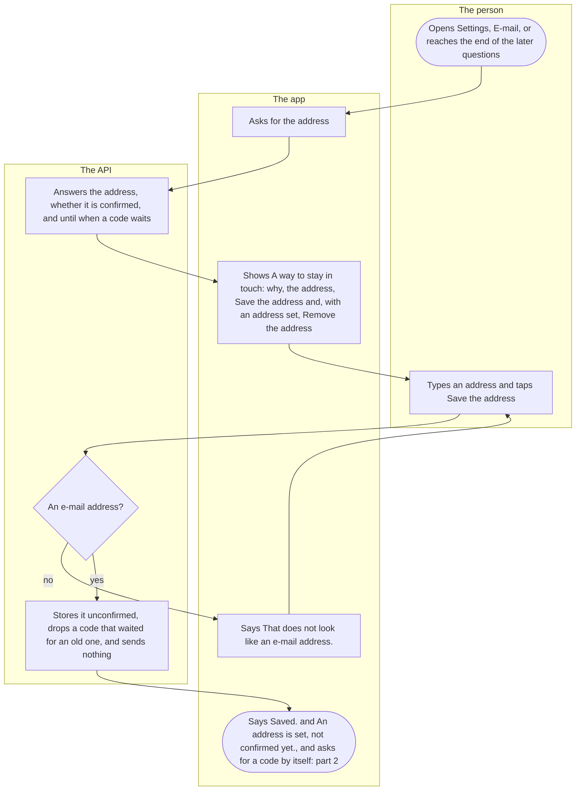
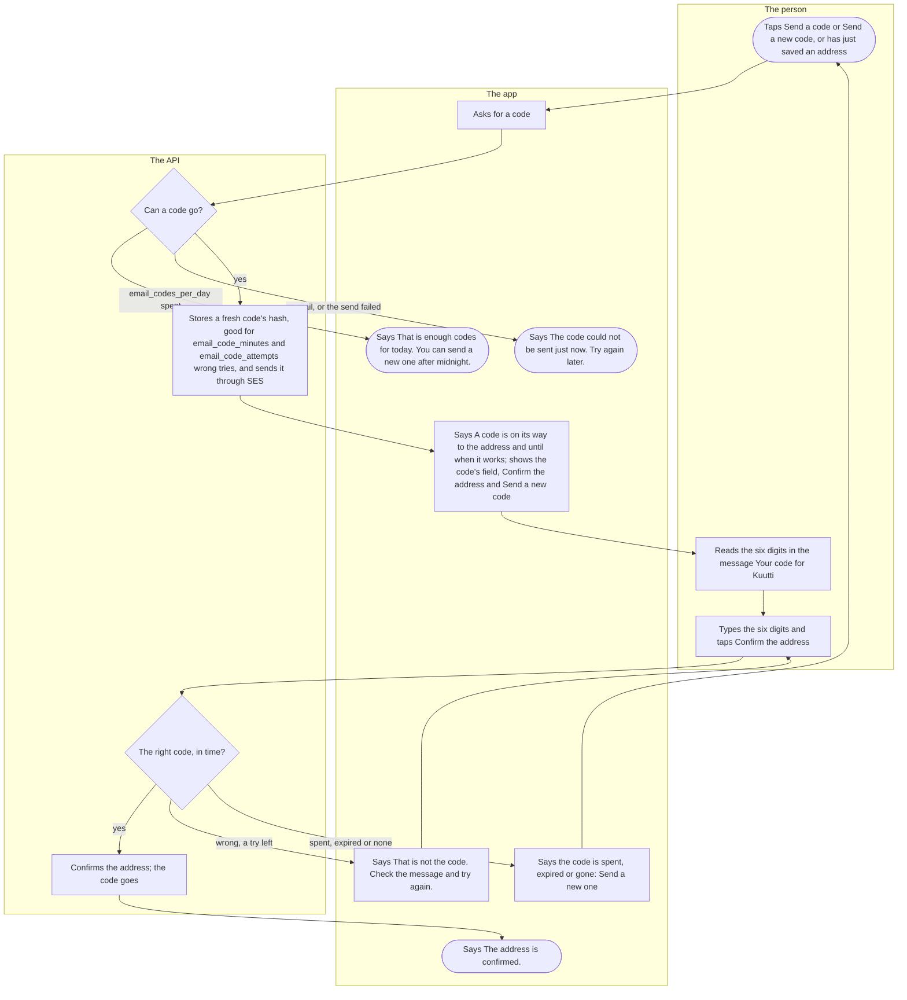
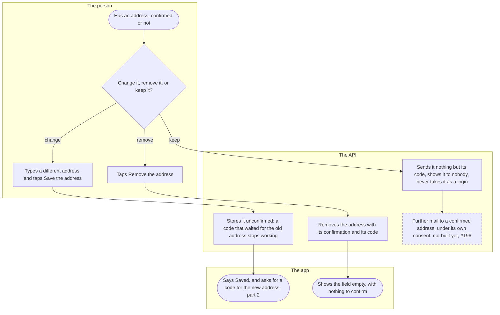

# E-mail and its confirmation

A person may give Kuutti an e-mail address as a way to stay in touch. It is optional, shown to nobody and never a way to sign in. Kuutti confirms the address with a code sent to it before it is ever used, and today sends it nothing else. The address is reached from Settings and after the last of the profile's later questions ([The profile](profile.md), part 3).

## Part 1: adding an address

### Steps

1. The person opens "E-mail" in Settings, or reaches "A way to stay in touch" after the last of the later questions. Both show the same card; after the questions it sits under "While you wait", with "Your deal-breakers" and "Done" below it ([The profile](profile.md), step 39).
2. The app asks the API for the person's address.
3. The API answers the address or none, whether it is confirmed, and until when a code waits for it. If the read fails, the app says "Your e-mail address could not be read." with a way to try again.
4. The app shows "A way to stay in touch": "Optional. A way for Kuutti to reach you. Never shown to anyone and never a login. A code confirms the address; nothing else is sent to it without asking you first.", the field "E-mail address" and "Save the address", which opens once the field holds an address other than the stored one. With an address set it also says "An address is set, not confirmed yet." or "An address is set and confirmed.", shows the code's part while the address is unconfirmed (part 2), and offers "Remove the address" (part 3).
5. The person types an address and taps "Save the address".
6. The API checks that it is an e-mail address of a bounded length. No: 7. Yes: 8.
7. The app says "That does not look like an e-mail address." Nothing is stored (5).
8. The API stores the address. An address different from the one stored is unconfirmed, and a code that waited for the old one stops working. Saving sends nothing, so a send that fails never fails the save.
9. The app says "Saved." and "An address is set, not confirmed yet.", and, since no code waits, asks for one by itself (part 2, step 11).

## Part 2: the code

### Steps

10. The person taps "Send a code", shown while no code waits, or "Send a new code", shown while one does; or step 9 asks by itself after a save.
11. The app asks the API for a code.
12. The API checks whether a code may go. The codes sent today, by the Finnish day, reach `email_codes_per_day`: 13. No mail is sent in this environment, or SES refused the message: 14. Otherwise: 15. An address removed or confirmed on another phone meanwhile is no refusal the person sees: the app reads the address again and shows what the API holds.
13. The app says "That is enough codes for today. You can send a new one after midnight."
14. The app says "The code could not be sent just now. Try again later." Nothing was stored or counted.
15. The API makes six digits, replaces any code that waited, keeps only the code's hash, good for `email_code_minutes` and `email_code_attempts` wrong tries, counts the send, and sends the message through SES, all in one step: a send that fails leaves no code and counts nothing. Neither the address nor the code reaches a log line.
16. The app says "A code is on its way to the address. It works until (a time by the phone's clock)." and shows "The code from the message", "Confirm the address", which opens at six digits, and "Send a new code".
17. The person reads the message "Your code for Kuutti": "Your code is (six digits). It works for (`email_code_minutes`) minutes.", "Someone added this address in the Kuutti app as a way to stay in touch. If that was not you, you can ignore this message.", and "Kuutti ry". It names nobody and carries no link.
18. The person types the six digits and taps "Confirm the address".
19. The API checks the code. The right one in time: 22. Wrong with a try left: 20. Wrong at the last of `email_code_attempts`, past `email_code_minutes`, or no code waiting (none was sent, or the address changed since): 21.
20. The app says "That is not the code. Check the message and try again." The try is counted (18).
21. The app says "Too many wrong codes. Send a new one.", "That code has expired. Send a new one." or "No code is waiting. Send a new one."; the code is gone, and "Send a code" takes the place of the code's field (10).
22. The API confirms the address, and the code goes. The same code typed again, from a second tap or a second phone, gets the same answer.
23. The app says "The address is confirmed.", and from then on "An address is set and confirmed." Confirming is optional: nothing in the app waits for it.

## Part 3: changing, removing, and what the address is for

### Steps

24. The person has an address, confirmed or not, and opens it again (step 1).
25. The person chooses: change it (26), remove it (29), or keep it (32).
26. The person types a different address and taps "Save the address". The same address again cannot be saved: the button stays closed, and the API would change nothing, its confirmation included.
27. The API stores the new address unconfirmed, and a code that waited for the old address stops working.
28. The app says "Saved." and asks for a code for the new address by itself (part 2, step 11).
29. The person taps "Remove the address".
30. The API removes the address with its confirmation and any code that waited.
31. The app shows the field empty, with no state line, no code to confirm and nothing to remove.
32. The API sends the address nothing but its code, shows it to nobody and never takes it as a way to sign in. The person's data export carries the address and when it was confirmed, and deleting the account removes the address, its code and the day's count of sends.
33. Other mail to a confirmed address, such as one mail after a long absence, each under its own consent, is not built yet: #196.

## Where it lives

- Screens: [account/email.tsx](../../apps/mobile/app/account/email.tsx) (after the later questions), [settings/email.tsx](../../apps/mobile/app/settings/email.tsx)
- App: [EmailCard.tsx](../../apps/mobile/src/features/identity/EmailCard.tsx) (the card and the screen after the questions), [email-client.ts](../../apps/mobile/src/features/identity/email-client.ts), [EmailSettingsScreen.tsx](../../apps/mobile/src/features/settings/EmailSettingsScreen.tsx)
- API: `GET`, `PUT` and `DELETE /account/email`, `POST /account/email/code` and `POST /account/email/confirm` in the identity slice, [account-routes.ts](../../apps/api/src/identity/account-routes.ts), [email.ts](../../apps/api/src/identity/email.ts), [repo.ts](../../apps/api/src/identity/repo.ts); the mail itself through [mail.ts](../../apps/api/src/lib/mail.ts); `email_code_minutes`, `email_code_attempts` and `email_codes_per_day` in `matching_config` ([seed.ts](../../packages/db/src/seed.ts))
- Spec: [email-confirmation.feature](../../features/identity/email-confirmation.feature)
- Maestro: [email.yaml](../../apps/mobile/e2e/flows/email.yaml)
- ADRs: [ADR-043](../adr/043-email-confirmation.md) (the confirmation, SES, where mail goes), [ADR-007](../adr/007-erasure-and-export.md) (the export and erasure)

## History

- 2026-10-09 (#148, PR #156): the optional e-mail, on the settings sheet and after the last later question: checked as an address and nothing more, never a login, never shown, sent nothing.
- 2026-10-14 (#287, PR #290): the e-mail gets its own screen in Settings.
- 2026-10-20 (#385, PR #387): it is called a way to stay in touch, not a way back in.
- 2026-10-22 (#385, PR #403): a code confirms the address, sent through SES after a save or on request and typed in the app, within `email_code_minutes`, `email_code_attempts` and `email_codes_per_day`.
