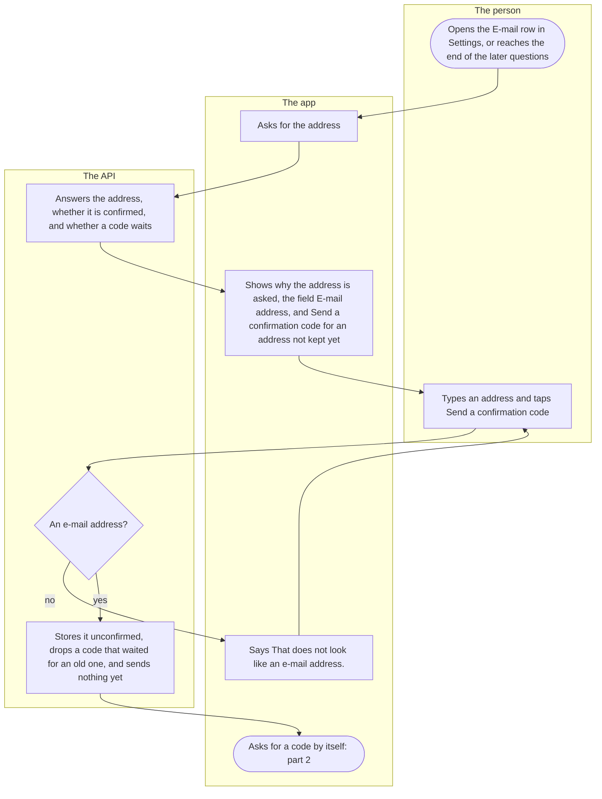
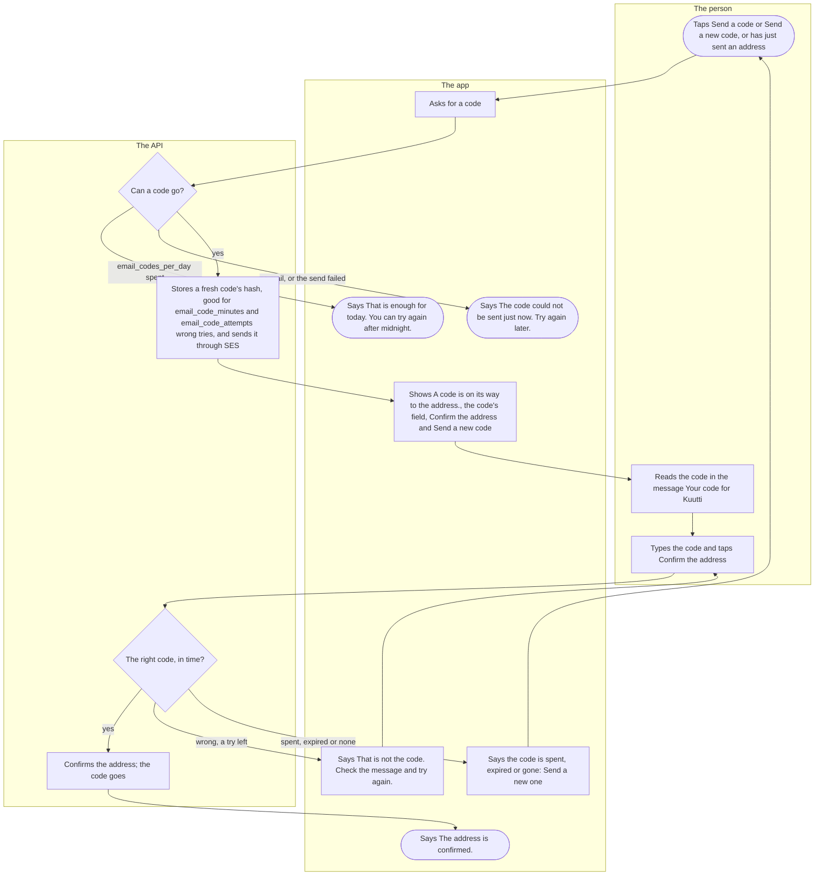
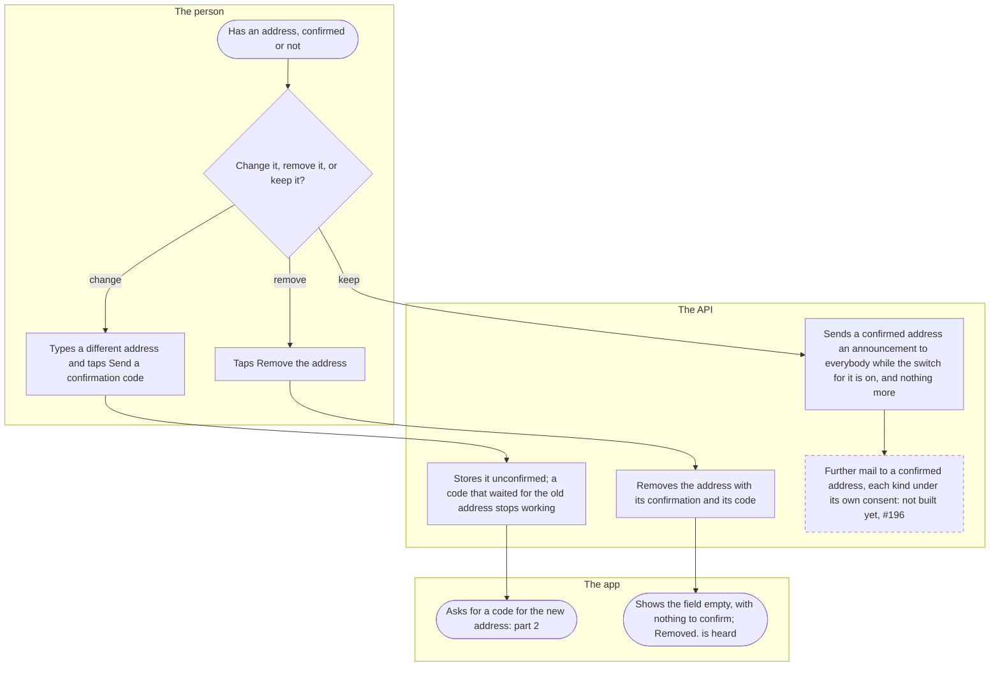

# E-mail and its confirmation

<!-- draws
apps/mobile/app/account/email.tsx
apps/mobile/src/features/settings/SettingsScreen.tsx
apps/mobile/src/features/identity/EmailCard.tsx
apps/mobile/src/features/identity/email-client.ts
apps/api/src/identity/account-routes.ts
apps/api/src/identity/email.ts
apps/api/src/notifications/announcements.ts
-->

A person may give Kuutti an e-mail address as a way to stay in touch. It is optional, shown to nobody and never a way to sign in. Kuutti confirms the address with a code sent to it before it is ever used; once it is confirmed, the one other mail it gets is an announcement to everybody, while the person's switch for announcements is on. The address is reached from Settings and after the last of the profile's later questions ([the profile](profile.md#part-4-the-later-questions)).

## Part 1: adding an address

### Steps

1. The person opens Settings and the row "E-mail", there while they are signed in, which opens in place; its value is the address once it is confirmed, "(the address), not confirmed yet", marked, while it waits for its code, or "Add your e-mail". Or they reach the last of the later screens, "When you have a moment", after the last of the profile's later questions, where the same card stands as "A way to stay in touch", with "Done" under it, which leads to the lock's one offer ([The app lock](app-lock.md)) or home.
2. The app asks the API for the person's address, saying "Loading…".
3. The API answers the address or none, whether it is confirmed, and until when a code waits for it. If the read fails, the app says why and offers the way out that fits.
4. The app says "Optional. A way for Kuutti to reach you. Never shown to anyone and never a login. A code confirms the address; nothing else is sent to it without asking you first." (but see Open), then the field "E-mail address", and "Send a confirmation code", drawn only while the field holds an address other than the one kept; the keyboard's own send key does the same. With an address kept it also shows the code's part while the address is unconfirmed (part 2) and "Remove the address" (part 3). Nothing on the card says in words that an address is confirmed: the row's value says it in Settings, and the later screen has no row. In Settings, an address typed and not sent marks the row "Not saved", and leaving the list then asks first.
5. The person types an address and taps "Send a confirmation code".
6. The API checks that it is an e-mail address of a bounded length. No: 7. Yes: 8.
7. The app says "That does not look like an e-mail address." Nothing is stored (5).
8. The API stores the address. An address different from the one stored is unconfirmed, and a code that waited for the old one stops working. Storing sends nothing, so a send that fails never undoes the address.
9. Since no code waits, the app asks for one by itself (part 2, step 11). "Saved." and, once the code is on its way, "A code is on its way to the address." are heard, not drawn: the code's part shows it.

## Part 2: the code

### Steps

10. The person taps "Send a code", shown while the address is unconfirmed and no code waits, or "Send a new code", shown while one does; or step 9 asks by itself after an address was sent.
11. The app asks the API for a code.
12. The API checks whether a code may go. The codes sent today, by the Finnish day, reach `email_codes_per_day`: 13. No mail is sent in this environment, or SES refused the message: 14. Otherwise: 15. An address removed or confirmed on another phone meanwhile is no refusal the person sees: the app reads the address again and shows what the API holds, with "The address is confirmed." when it was confirmed there.
13. The app says "That is enough for today. You can try again after midnight.", after "Saved." when the address was just sent: the address is kept.
14. The app says "The code could not be sent just now. Try again later.", after "Saved." when the address was just sent. Nothing was stored or counted.
15. The API makes a code of digits, replaces any code that waited, keeps only the code's hash, good for `email_code_minutes` and `email_code_attempts` wrong tries, counts the send, and sends the message through SES, all in one step: a send that fails leaves no code and counts nothing. Neither the address nor the code reaches a log line.
16. The app shows "A code is on its way to the address.", naming no time, with the field "The code from the message", "Confirm the address", which opens once the code is whole, and "Send a new code". A new code asked for while one waited says the line again under the buttons.
17. The person reads the message "Your code for Kuutti": "Your code is (the code). It works for (`email_code_minutes`) minutes.", "Someone added this address in the Kuutti app as a way to stay in touch. If that was not you, you can ignore this message.", and "Kuutti ry". It names nobody and carries no link.
18. The person types the code and taps "Confirm the address".
19. The API checks the code. The right one in time: 22. Wrong with a try left: 20. Wrong at the last of `email_code_attempts`, past `email_code_minutes`, or no code waiting (none was sent, or the address changed since): 21.
20. The app says "That is not the code. Check the message and try again." The try is counted (18).
21. The app says "Too many wrong codes. Send a new one.", "That code has expired. Send a new one." or "No code is waiting. Send a new one."; the code is gone, and "Send a code" takes the place of the code's field (10). Any other failure of the code says "Something went wrong with the code. Try again."
22. The API confirms the address, and the code goes. The same code typed again, from a second tap or a second phone, gets the same answer.
23. The app says "The address is confirmed." The code's part goes, and in Settings the row's value becomes the address alone, unmarked. Confirming is optional: nothing in the app waits for it.

## Part 3: changing, removing, and what the address is for

### Steps

24. The person has an address, confirmed or not, and opens it again (step 1).
25. The person chooses: change it (26), remove it (29), or keep it (32).
26. The person types a different address and taps "Send a confirmation code". With the kept address in the field the button is not drawn, and the API would change nothing for the same address, its confirmation included.
27. The API stores the new address unconfirmed, and a code that waited for the old address stops working.
28. The app asks for a code for the new address by itself (part 2, step 11), and "Saved." is heard.
29. The person taps "Remove the address".
30. The API removes the address with its confirmation and any code that waited.
31. The app shows the field empty, with no code to confirm and nothing to remove; "Removed." is heard, not drawn, and in Settings the row says "Add your e-mail" again.
32. The API shows the address to nobody and never takes it as a way to sign in. An unconfirmed address is sent nothing but its code. A confirmed one is also sent an announcement to everybody, which two admins agreed on, while the person's Announcements switch under Notifications is on, as it is until they turn it off: "Kuutti: " and its title as the subject, its title and its text, "You get this because you confirmed this address in the Kuutti app. Announcements can be turned off in Settings, under Notifications." and "Kuutti ry", plain text with no link, in the language the person read the terms in ([Announcements](announcements.md#part-3-everybody-is-told)). Nothing else goes to it. The person's data export carries the address and when it was confirmed, and deleting the account removes the address, its code and the day's count of sends.
33. Other mail to a confirmed address, such as one mail after a long absence, each kind under its own consent, is not built yet: #196.

## Open

- **What the card says is sent.** The card says "A code confirms the address; nothing else is sent to it without asking you first." (`account.email.explain` in [messages.yaml](../../packages/i18n/messages.yaml), shown by [EmailCard.tsx](../../apps/mobile/src/features/identity/EmailCard.tsx)). [ADR-068](../adr/068-announcements.md) §5 and §6, with [ADR-043](../adr/043-email-confirmation.md) §1 as amended on 2026-11-07, send a confirmed address an announcement to everybody while the person's Announcements switch is on, and the switch is on until the person turns it off, so nobody is asked first ([announcements.ts](../../apps/api/src/notifications/announcements.ts)). The register has no note on it under Found on the way. Step 4 quotes the card and step 32 says what the API sends.

## Where it lives

- Screens: [account/email.tsx](../../apps/mobile/app/account/email.tsx) (after the later questions); the E-mail row of Settings in [SettingsScreen.tsx](../../apps/mobile/src/features/settings/SettingsScreen.tsx), at [settings/index.tsx](../../apps/mobile/app/settings/index.tsx)
- App: [EmailCard.tsx](../../apps/mobile/src/features/identity/EmailCard.tsx) (the card, the screen after the questions and the row's value), [email-client.ts](../../apps/mobile/src/features/identity/email-client.ts)
- API: `GET`, `PUT` and `DELETE /account/email`, `POST /account/email/code` and `POST /account/email/confirm` in the identity slice, [account-routes.ts](../../apps/api/src/identity/account-routes.ts), [email.ts](../../apps/api/src/identity/email.ts), [repo.ts](../../apps/api/src/identity/repo.ts); an announcement's e-mail in the notifications slice, [announcements.ts](../../apps/api/src/notifications/announcements.ts); the mail itself through [mail.ts](../../apps/api/src/lib/mail.ts); `email_code_minutes`, `email_code_attempts` and `email_codes_per_day` in `matching_config` ([seed.ts](../../packages/db/src/seed.ts))
- Spec: [email-confirmation.feature](../../features/identity/email-confirmation.feature), [announcements.feature](../../features/notifications/announcements.feature) (whom an announcement's e-mail reaches)
- Maestro: [email.yaml](../../apps/mobile/e2e/flows/email.yaml)
- ADRs: [ADR-043](../adr/043-email-confirmation.md) (the confirmation, SES, where mail goes), [ADR-068](../adr/068-announcements.md) §5 and §6 (an announcement's e-mail and its switch), [ADR-007](../adr/007-erasure-and-export.md) (the export and erasure)
- Rules: the register's [E-mail](../decisions.md#e-mail) rows, and its [Other](../decisions.md#other) row on how Settings saves

## History

- 2026-10-09 (#148, PR #156): the optional e-mail, on the settings sheet and after the last later question: checked as an address and nothing more, never a login, never shown, sent nothing.
- 2026-10-14 (#287, PR #290): the e-mail gets its own screen in Settings.
- 2026-10-20 (#385, PR #387): it is called a way to stay in touch, not a way back in.
- 2026-10-22 (#385, PR #403): a code confirms the address, sent through SES after a save or on request and typed in the app, within `email_code_minutes`, `email_code_attempts` and `email_codes_per_day`.
- 2026-10-30 (#511, PR #516): the e-mail becomes a row of Settings' one list that opens in place, its value the address, or that it waits for its code, or "Add your e-mail"; its one button, "Send a confirmation code", keeps the address and sends its code.
- 2026-11-04 (#581, PR #590): the lines saying whether an address is set and confirmed go, the line while a code waits names no time, the button is not drawn while the field holds the kept address, and a save, a removal and a first code are heard rather than drawn.
- 2026-11-05 (#581, PR #598): the screen after the later questions loses its way to the deal-breakers; Done is its one way on.
- 2026-11-07 (#573, PR #643): a confirmed address is also sent an announcement to everybody while the person's Announcements switch is on.
