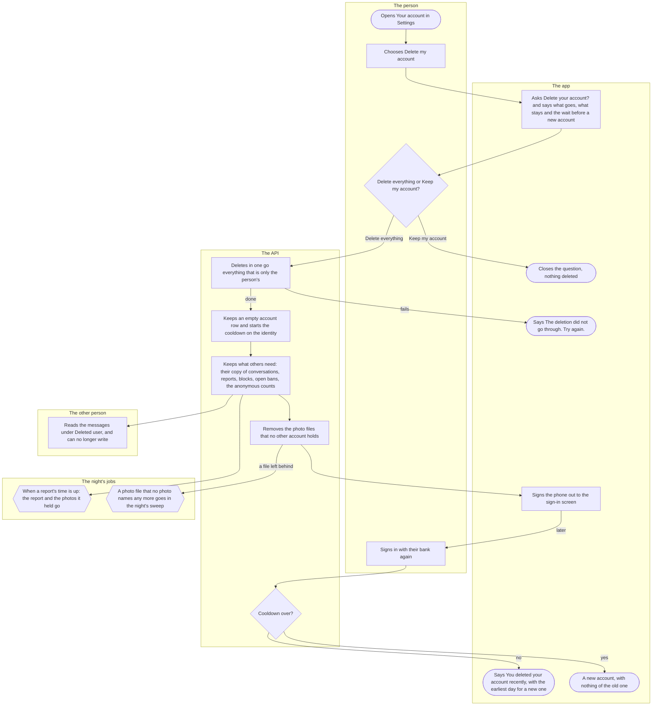
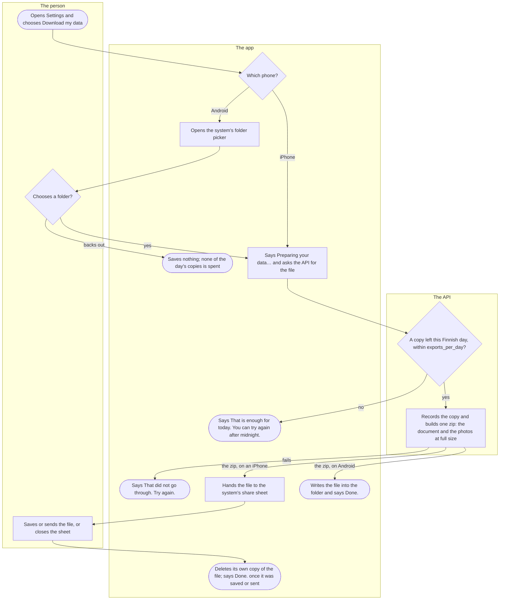

# Deleting the account and downloading one's data

<!-- draws
apps/mobile/src/features/settings/SettingsScreen.tsx
apps/mobile/src/features/identity/AccountActions.tsx
apps/mobile/src/features/identity/session.tsx
apps/mobile/src/features/identity/SignInScreen.tsx
apps/api/src/identity/account-routes.ts
apps/api/src/identity/erasure.ts
apps/api/src/identity/export.ts
apps/api/src/identity/registration.ts
apps/api/src/media/erasure.ts
apps/api/src/safety/reports.ts
-->

Two things anyone with an account can do from Settings. Deleting the account removes what Kuutti holds about the person at once and keeps only what others need and the rules keep, as [ADR-007](../adr/007-erasure-and-export.md) and the register's rows say; the same person can open a new account only after a cooldown, a number of days set in code. Downloading one's data gives the person a file with everything Kuutti holds about them, before or instead of deleting.

## Part 1: deleting the account

### Steps

1. The person opens Settings with the gear on home, and the row "Your account", there while they are signed in.
2. They choose "Delete my account", the last button there, below a line, after "I found someone" and "Take a break".
3. The app asks "Delete your account?": "Your profile, photos, matches and contacts go now and cannot be brought back. Messages you sent stay with the people who received them, under 'Deleted user'. What safety and the law require is kept for a time, as the privacy policy says. A new account is possible after" the cooldown, in days. The question is what names the wait; no line under the button says it first.
4. The person chooses "Keep my account" (5) or "Delete everything" (6).
5. The question closes and nothing is deleted.
6. The app says "Deleting your account…". In one go, the API deletes everything that is only the person's: every session and sign-in under way, with each phone's registration for notifications; the photos with the log of their fetches and the cards the person was shown; the photo check's notes; the profile, the answers and the deal-breakers; whom they seek and the ages; the consents; the record of the people they went through in People and their places on other people's, others' likes on them included; the stars they put and those put on them; the e-mail and its codes; the copies of their data they took; the feedback they sent; the contacts kept to share; the notification choices and notices; the sanctions except an open ban or suspension; the invitations still open and the rewards they earned; and the link between the account and its research pseudonym. Their conversations close. If anything fails, nothing is deleted (7); otherwise 8.
7. The app says "The deletion did not go through. Try again." The person stays signed in.
8. The account row stays as a tombstone with nothing personal on it: no year and month of birth, no gender, no home, no e-mail, no answer to "I found someone", no state kept aside for a break. The identity, which knows the person only by a code that cannot be turned back into them, counts one more deletion and starts the cooldown ([ADR-007](../adr/007-erasure-and-export.md) §2; the register's [Break and erasure](../decisions.md#break-and-erasure) rows).
9. What others need, or the rules keep, stays, each for its own time ([Retention](../decisions.md#retention) rows): the other person's copy of each conversation; the reports the person filed and those filed about them; the blocks either way, on the two identities; an open ban or suspension, on the identity; an invitation somebody redeemed, for its redeemer, without the person; the research events, joinable to nobody until their own time ends; the anonymous count of people who found someone; the audit log; and a moderator's role, if the person had one.
10. After the rows, the API removes the photo files that no remaining row holds, so a picture another account also uploaded stays for them.
11. The app signs the phone out to the sign-in screen. Every other device is signed out at its next request, since every session is gone.
12. Somebody the person was talking to reads "This person deleted their account." and every message they could read before, under "Deleted user". The conversation is closed, so they cannot write, and a photo the person sent reads "Photo removed" ([Chat](chat.md)).
13. A report is kept for its time from filing, whoever was deleted meanwhile, and so are the person's photos that a report's copy of a conversation holds. When that time is up, the night deletes the report, its copy and those photos.
14. A photo file that a failed delete left behind, or that no photo row names for any other reason, goes in the night's sweep once it is old enough not to be an upload still under way. Nothing of the person's photos stays in the store for good.
15. Later, the person signs in with their bank again, as in [Signing in](sign-in.md#part-1-signing-in).
16. The API checks the identity's cooldown. Not over: 17. Over: 18. A banned identity is refused there whatever the cooldown.
17. The sign-in screen says "Sign-in did not complete" and "You deleted your account recently. The earliest day for a new one:" and the date, with "Sign in with your bank" under it rather than "Try again", since another try only repeats the refusal. Each such refusal is counted on the identity.
18. A new account begins with nothing of the old one restored, at the start of [onboarding](onboarding.md#part-1-arriving-the-consents-and-a-friends-code).

## Part 2: downloading one's data

### Steps

19. The person opens Settings and chooses "Download my data" (where it sits: see Open). There is no line over it.
20. An iPhone: 24. Android: 21. In the web preview the file downloads in the browser.
21. On Android the app first opens the system's folder picker, before anything is asked of the API.
22. The person chooses a folder (24) or backs out (23).
23. Nothing is saved and nothing is said, and none of the day's copies is spent.
24. The app says "Preparing your data…" and asks the API for the file.
25. The API counts the copies the person took this Finnish day. Fewer than `exports_per_day`: 27. Otherwise: 26.
26. The app says "That is enough for today. You can try again after midnight." Nothing is built.
27. The API records the copy and builds one zip, named in the person's language and with nothing about them in its name: a document with everything Kuutti holds about them (below), and beside it the full-size file of each of their profile photos and of the newest photos they sent in conversations. Each photo read is written to the person's log of photo fetches, as any look at a photo is; a profile photo's read counts toward the day's `photo_fetches_per_day` like any other, but is never refused. The copy is counted first, so the document lists it with the earlier ones, and given back if building fails (28). Otherwise: on an iPhone 29, on Android 32.
28. The app says "That did not go through. Try again."
29. On an iPhone the app writes the file to its own cache and hands it to the system's share sheet.
30. The person saves the file, to Files for example, or sends it, or closes the sheet.
31. Once the sheet closes, the app deletes its own copy of the file: personal data does not wait in the phone's cache. A file saved or sent says "Done."; a sheet closed without either says nothing, and the day's copy counts all the same.
32. On Android the app writes the file from memory straight into the chosen folder, and says "Done."

The document carries, in the person's language where there are words: the account with its dates, the year and month of birth, the gender, the home in words (the place kept and what the card shows), the e-mail and when it was confirmed, and whether they told Kuutti they found someone; the identity's dates, its standing, its deletions, its refused sign-ins and its cooldown; the devices signed in, each with whether it gets notifications and in which language, never its token, and whether it proved at sign-in that it runs the real app, never its key (ADR-069); the profile, whom they seek and the ages, and the deal-breakers; every consent given; the photos with the check's outcome and description, the log of photo fetches and the cards shown to the person; the photo check's notes; the research enrolment; the copies taken; the feedback sent; the sanctions, never who decided them; the reports filed and the blocks set, never whom; each conversation, with the person's own words and the other's messages as a time and a length; the contacts kept and the person's own shares; the notification choices and notices; the days they went through People, each card's place, its reason and their own decision, a second pass marked, never who was on a card; when each star they have now was put, never on whom; and the invitations and their rewards, never a code. Each history lists its newest rows up to a number set in code, the older ones left out without a word. Never anything of another person, nor the code the identity is known by, the research events or the research pseudonym.

## Open

- **Where Download my data sits.** The code gives it a row of its own in Settings, "A copy of your data", in the section "Privacy and security", which opens in place with the one button ([SettingsScreen.tsx](../../apps/mobile/src/features/settings/SettingsScreen.tsx), `ExportData` in [AccountActions.tsx](../../apps/mobile/src/features/identity/AccountActions.tsx), since #511, PR #516). [ADR-022](../adr/022-taking-a-break.md) §6, as amended on 2026-10-14, still puts the export behind the "Your account" row, in a Settings of four sections, with the break and the deletion, which do stay there, and [ADR-007](../adr/007-erasure-and-export.md) §5 still puts "Download my data" and "Delete my account" on home's account card, until the profile screens exist. The register has no note on it under Found on the way. Step 19 names neither row.

## Where it lives

- Screens: the rows of Settings in [SettingsScreen.tsx](../../apps/mobile/src/features/settings/SettingsScreen.tsx), at [settings/index.tsx](../../apps/mobile/app/settings/index.tsx), with the identity slice's [AccountActions.tsx](../../apps/mobile/src/features/identity/AccountActions.tsx) (the deletion and its question, and `ExportData`, the download handed over); the requests in [session.tsx](../../apps/mobile/src/features/identity/session.tsx), the refusal in [SignInScreen.tsx](../../apps/mobile/src/features/identity/SignInScreen.tsx)
- API: `POST /account/delete` and `GET /account/export` in [account-routes.ts](../../apps/api/src/identity/account-routes.ts); the erasure and the document in [erasure.ts](../../apps/api/src/identity/erasure.ts), the tombstone in [repo.ts](../../apps/api/src/identity/repo.ts), the zip and the day's copies in [export.ts](../../apps/api/src/identity/export.ts), the cooldown in [registration.ts](../../apps/api/src/identity/registration.ts) (the [identity slice](../../apps/api/src/identity/README.md)); the photos, their files and the night's sweep in [media/erasure.ts](../../apps/api/src/media/erasure.ts); the conversations' part in the [chat slice](../../apps/api/src/chat/README.md); the night's prune of reports in [reports.ts](../../apps/api/src/safety/reports.ts) (the [safety slice](../../apps/api/src/safety/README.md)); `exports_per_day` and `photo_fetches_per_day` in `matching_config` ([seed.ts](../../packages/db/src/seed.ts))
- Spec: [erasure.feature](../../features/identity/erasure.feature), [re-registration.feature](../../features/identity/re-registration.feature) (the cooldown)
- Maestro: [account-deletion.yaml](../../apps/mobile/e2e/flows/account-deletion.yaml), [data-export.yaml](../../apps/mobile/e2e/flows/data-export.yaml), [sign-in-refusals.yaml](../../apps/mobile/e2e/flows/sign-in-refusals.yaml) (a login inside the cooldown)
- ADRs: [ADR-007](../adr/007-erasure-and-export.md) (§1 the erasure, §2 the tombstone and the cooldown, §3 the export; its History lists what each later change added to both halves), [ADR-030](../adr/030-reports-and-blocks.md) §8, [ADR-031](../adr/031-chat.md) §5, [ADR-024](../adr/024-sanctions.md) §8, [ADR-040](../adr/040-found-them.md), [ADR-044](../adr/044-invitations.md) §10, [ADR-055](../adr/055-push.md) §11, [ADR-061](../adr/061-one-home-no-ponds.md) §9, [ADR-064](../adr/064-a-star.md) §9
- Rules: the register's [Break and erasure](../decisions.md#break-and-erasure) and [Retention](../decisions.md#retention) rows, and its [Limits](../decisions.md#limits) row on the copies a day

## History

- 2026-09-26 (#51, PR #62): deleting the account behind a question that names the cooldown, signed out at once, and the next bank login refused until the cooldown's day; downloading one's data as a document with links to the photos.
- 2026-10-13 (#51, PR #272): the consents go with the account, and the document carries what it had left out: the identity's standing, the refused sign-ins, what each device called itself and the cards shown.
- 2026-10-13 (#237, PR #279): the download becomes one zip with the photos inside, at most `exports_per_day` copies a day, handed over by the share sheet on an iPhone and a folder picker on Android.
- 2026-10-14 (#287, PR #290): both move behind the "Your account" row of Settings.
- 2026-10-15 (#51, PR #293): the document leaves out the research events and keeps the enrolment.
- 2026-10-16 (#307, PR #315): an open ban or suspension stays on the identity through a deletion, and the document lists the person's sanctions without who.
- 2026-10-17 (#84, PR #345): reports and blocks outlive the deletion of either person, and the document lists the reports filed and the blocks set, never whom.
- 2026-10-17 (#348, PR #352): a deletion closes the person's conversations, and the other person reads their messages under "Deleted user"; the document carries the conversations, the other's messages as a time and a length.
- 2026-10-18 (#351, PR #365): the person's photos that a report's copy of a conversation holds stay until the report's time is up, and the night deletes them with it.
- 2026-10-21 (#83, PR #392): the count of people who found someone stays after a deletion; the account's answer goes.
- 2026-10-22 (#107, PR #417): an invitation somebody redeemed stays for them without the person.
- 2026-10-25 (#102, PR #459): a deletion also takes each phone's registration for notifications, and the document says of each device whether it gets notifications and in which language, never its token.
- 2026-10-29 (#465, PR #495): on Android the folder is chosen before the file is asked for, so backing out spends none of the day's copies, and a file handed over is said.
- 2026-10-30 (#511, PR #516): Your account and Download my data move into Settings' one list, the deletion last under Your account, below a line.
- 2026-10-30 (#466, PR #535): after the cooldown's refusal the sign-in screen offers "Sign in with your bank", not "Try again".
- 2026-10-31 (#500, PR #555): the place at the gate leaves both the deletion and the document, the gate being gone.
- 2026-11-01 (#514, PR #556): the home joins both: it goes with the account, and the document says it in words.
- 2026-11-03 (#502, PR #578): the document's days in People take the rounds' place, a decision there also Later and a second pass marked.
- 2026-11-03 (#575, PR #582): the stars go with the account, both those the person put and those put on them, and the document says when each of their own was put, never on whom.
- 2026-11-07 (#636, PR #638): a photo file that a failed delete left behind goes in the night's sweep.
- 2026-11-10 (#580): the document says of each device whether it proved at sign-in that it runs the real app, never its key.
