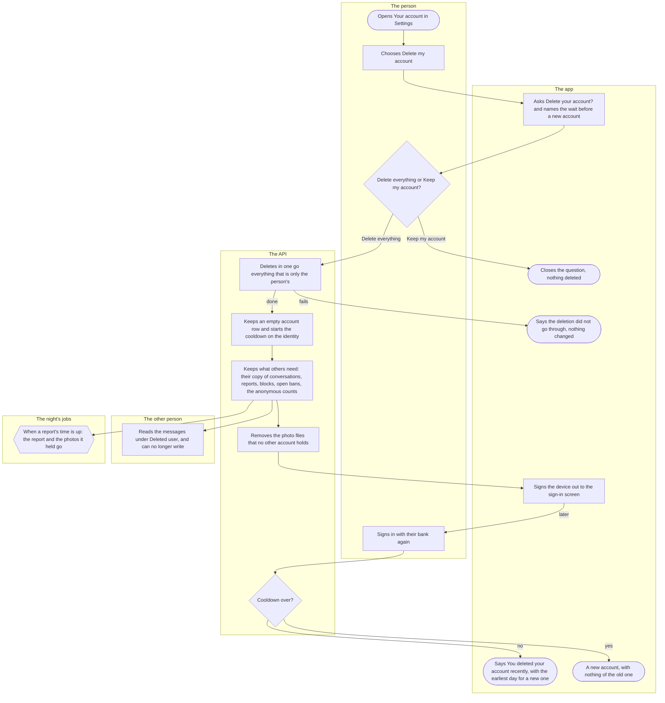
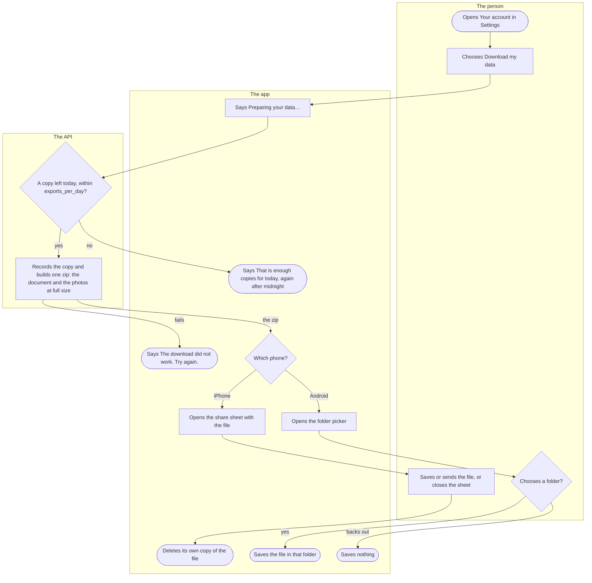

# Deleting the account and downloading one's data

Two things anyone with an account can do from Your account in Settings. Deleting the account removes what Kuutti holds about the person at once and keeps only what the rules say to keep; the same person can open a new account only after a cooldown. Downloading one's data gives the person a file with everything Kuutti holds about them, before or instead of deleting.

## Part 1: deleting the account

### Steps

1. The person opens Settings from the home screen and, under Account, the row "Your account".
2. They choose "Delete my account", the last button there.
3. The app asks "Delete your account?": "Your photos, your devices and your data go now and cannot be brought back. A new account is possible after" the cooldown of TD-7, in days.
4. The person chooses "Keep my account" (5) or "Delete everything" (6).
5. The question closes and nothing is deleted.
6. The app says "Deleting your account…". In one go, the API deletes everything that is only the person's: every session and sign-in under way, the photos with the log of their fetches and the cards the person was shown, the photo check's notes, the profile, the answers and deal-breakers, the consents, their rounds and their places in other people's rounds, the e-mail and its codes, the copies of their data they took, the feedback they sent, the contacts kept to share, the notification choices and notices, the sanctions except an open ban or suspension, the place at the gate, the invitations still open and the rewards they earned, and the link between the account and its research pseudonym. Their conversations close. If anything fails, nothing is deleted (7); otherwise 8.
7. The app says "The deletion did not go through. Try again." The person stays signed in.
8. The account row stays as a tombstone with nothing personal on it: no year and month of birth, no gender, no pond, no e-mail, no answer to "I found someone". The identity, which knows the person only by a code that cannot be turned back into them, counts one more deletion and starts the cooldown of TD-7.
9. What others need, or the rules keep, stays (TD-7): the other person's copy of each conversation; the reports the person filed and those filed about them, each for its time; the blocks either way, on the two identities; an open ban or suspension, on the identity; an invitation somebody redeemed, for its redeemer, without the person; the research events, joinable to nobody until their own time ends; the anonymous count of people who found someone; the audit log; and a moderator's role, if the person had one.
10. After the rows, the API removes the photo files that no remaining row holds, so a picture another account also uploaded stays for them.
11. The app signs the device out to the sign-in screen. Every other device is signed out at its next request, since every session is gone.
12. Somebody the person was talking to reads "This person deleted their account." and every message they could read before, under "Deleted user". The conversation is closed, so they cannot write, and a photo the person sent reads "Photo removed".
13. A report is kept for its time from filing, whoever was deleted meanwhile, and so are the person's photos that a report's copy of a conversation holds. When that time is up, the night deletes the report, its copy and those photos.
14. Later, the person signs in with their bank again, as in [Signing in](sign-in.md).
15. The API checks the identity's cooldown. Not over: 16. Over: 17. A banned identity is refused there whatever the cooldown.
16. The sign-in screen says "You deleted your account recently. The earliest day for a new one:" and the date.
17. A new account begins with nothing of the old one restored, at the start of [onboarding](onboarding.md).

## Part 2: downloading one's data

### Steps

18. The person opens Settings from the home screen and, under Account, the row "Your account". It says "A file with everything Kuutti holds about you, and nothing about anyone else."
19. They choose "Download my data".
20. The app says "Preparing your data…" and asks the API for the file.
21. The API counts the copies the person took this Finnish day. Fewer than `exports_per_day`: 23. Otherwise: 22.
22. The app says "That is enough copies for today. You can download your data again after midnight." Nothing is built.
23. The API records the copy and builds one zip, named in the person's language and with nothing about them in its name: a document with everything Kuutti holds about them (below), and beside it the full-size file of each of their profile photos and of the newest photos they sent in conversations. Each photo read is written to the person's log of photo fetches, as any look at a photo is; a profile photo's read counts toward the day's `photo_fetches_per_day` like any other, but is never refused. If building fails, the copy is not counted (24); otherwise 25.
24. The app says "The download did not work. Try again."
25. On an iPhone: 26. On Android: 29.
26. The app hands the file to the system's share sheet.
27. The person saves the file, to Files for example, or sends it, or closes the sheet.
28. Once the sheet closes, the app deletes its own copy of the file: personal data does not wait in the phone's cache.
29. On Android the app opens the system's folder picker.
30. The person chooses a folder (31) or backs out (32).
31. The app saves the file in that folder.
32. Nothing is saved; the day's copy counts all the same.

The document carries, in the person's language where there are words: the account with its dates, the year and month of birth, the gender, the pond, the e-mail and whether it is confirmed, and whether they told Kuutti they found someone; the identity's dates, its standing, its deletions, its refused sign-ins and its cooldown; the devices signed in; the profile, the answers and the deal-breakers; every consent given; the photos with the check's outcome and description, the log of photo fetches and the cards shown to the person; the photo check's notes; the research enrolment; the place at the gate; the copies taken; the feedback sent; the sanctions, never who decided them; the reports filed and the blocks set, never whom; each conversation, with the person's own words and the other's messages as a time and a length; the contacts kept and the person's own shares; the notification choices and notices; the rounds, never who was on a card; and the invitations and their rewards, never a code. Never anything of another person, nor the code the identity is known by, the research events or the research pseudonym.

## Where it lives

- Screens: [settings/account.tsx](../../apps/mobile/app/settings/account.tsx) ([AccountScreen.tsx](../../apps/mobile/src/features/settings/AccountScreen.tsx), [AccountActions.tsx](../../apps/mobile/src/features/identity/AccountActions.tsx)), the requests in [session.tsx](../../apps/mobile/src/features/identity/session.tsx), the refusal in [SignInScreen.tsx](../../apps/mobile/src/features/identity/SignInScreen.tsx)
- API: `POST /account/delete` and `GET /account/export` in [account-routes.ts](../../apps/api/src/identity/account-routes.ts); the erasure and the document in [erasure.ts](../../apps/api/src/identity/erasure.ts), the zip and the day's copies in [export.ts](../../apps/api/src/identity/export.ts), the cooldown in [registration.ts](../../apps/api/src/identity/registration.ts) (the [identity slice](../../apps/api/src/identity/README.md)); the conversations' part in the [chat slice](../../apps/api/src/chat/README.md); the night's prune of reports in [reports.ts](../../apps/api/src/safety/reports.ts) (the [safety slice](../../apps/api/src/safety/README.md))
- Spec: [erasure.feature](../../features/identity/erasure.feature)
- Maestro: [account-deletion.yaml](../../apps/mobile/e2e/flows/account-deletion.yaml), [data-export.yaml](../../apps/mobile/e2e/flows/data-export.yaml)
- ADRs: [ADR-007](../adr/007-erasure-and-export.md) (its History lists what each later change added to both halves), [ADR-030 §8](../adr/030-reports-and-blocks.md), [ADR-031 §5](../adr/031-chat.md), [ADR-024 §8](../adr/024-sanctions.md), [ADR-040](../adr/040-found-them.md), [ADR-044 §10](../adr/044-invitations.md)

## History

- 2026-09-26 (#51, PR #62): deleting the account behind a question that names the cooldown, signed out at once, and the next bank login refused until the cooldown's day; downloading one's data as a document with links to the photos.
- 2026-10-13 (#51, PR #272): the consents go with the account, and the document carries what it had left out: the identity's standing, the refused sign-ins, what each device called itself and the cards shown.
- 2026-10-13 (#237, PR #279): the download becomes one zip with the photos inside, at most `exports_per_day` copies a day, handed over by the share sheet on an iPhone and a folder picker on Android.
- 2026-10-14 (#287, PR #290): both move behind the "Your account" row of Settings.
- 2026-10-15 (#51, PR #293): the document leaves out the research events and keeps the enrolment.
- 2026-10-16 (#307, PR #315): an open ban or suspension stays on the identity through a deletion, and the document lists the person's sanctions without who.
- 2026-10-17 (#84, PR #345): reports and blocks outlive the deletion of either person, and the document lists the reports filed and the blocks set, never whom.
- 2026-10-17 (#348, PR #352): a deletion closes the person's conversations, and the other person reads their messages under "Deleted user"; the document carries the conversations, the other's messages as a time and a length.
- 2026-10-18 (#351, PR #365): the person's photos that a report's copy of a conversation holds stay until the report's time is up, and the night deletes them with it.
- 2026-10-21 (#83, PR #392): the count of people who found someone stays after a deletion; the account's answer goes.
- 2026-10-22 (#107, PR #417): an invitation somebody redeemed stays for them without the person.
