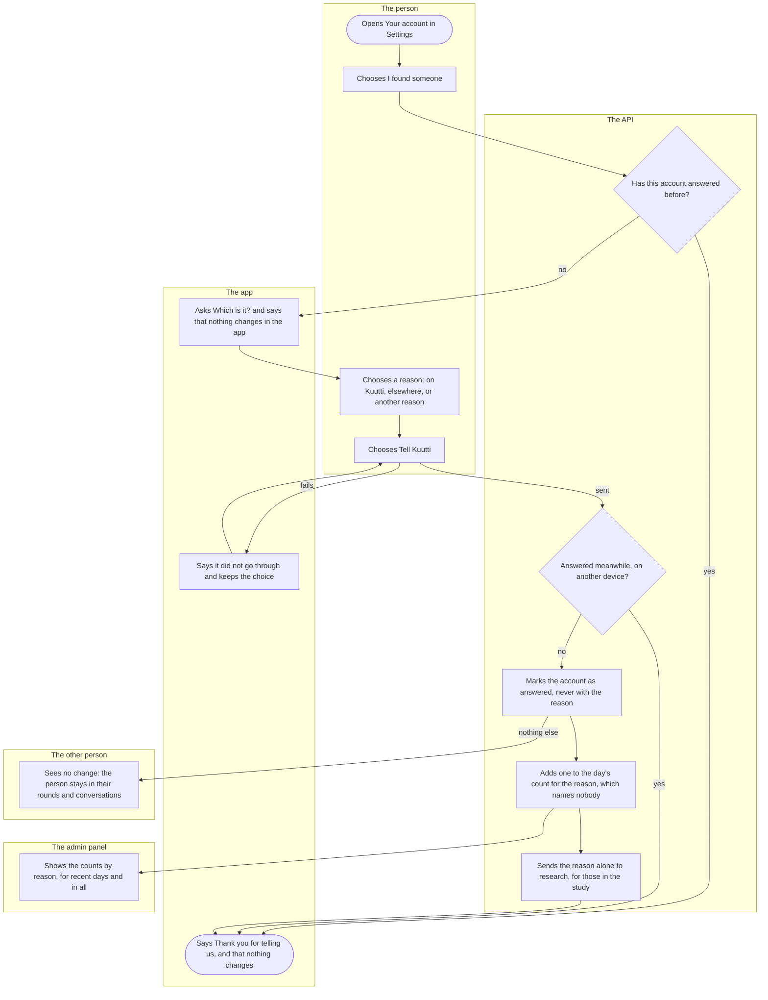

# Found them

How a person tells Kuutti they have found someone, and why, from three reasons ("Löysin hänet" in Finnish). It is an indication and nothing more: nothing in the app changes for them or for anybody else, and the answer feeds the association's one measure of success, a count that names nobody. Any signed-in person can answer, once.

## Diagram

## Steps

1. The person opens Settings from the home screen and, under Account, the row "Your account". The API takes an answer from any signed-in account, onboarding finished or not, and asks for no fresh bank login: the answer changes nothing and is worth nothing to someone who took the phone.
2. They choose "I found someone", which sits after "Download my data" and before "Take a break".
3. The app asks the API whether this account has answered before; the account knows that much and never which reason. Yes: 4. No: 5. If the app cannot find out, it asks (5), and the API tells a second answer apart at 8.
4. The app says "Thank you for telling us." and "Nothing changes in the app: your profile, your rounds and your conversations stay as they are. To step away, take a break or delete your account under Your account." Opening the screen again comes back here: nobody is asked twice, and an answer cannot be taken back or changed.
5. The app says "Your answer tells the association whether Kuutti works. It is shown to nobody, and it is counted without your name.", asks "Which is it?" over the three reasons, and says that nothing changes in the app.
6. The person chooses "I found someone on Kuutti", "I found someone elsewhere" or "Another reason". The chosen one is ticked in words, not by colour alone. "Another reason" asks for no words.
7. They choose "Tell Kuutti", which waits for a choice and then says "Sending…". Sent: 8. If it fails on the way: 12.
8. Under the account's lock, the API checks whether the account answered meanwhile, from another device perhaps. Yes: nothing is counted, and the app thanks the person (4). No: 9.
9. The API marks the account as having answered. That is all the account keeps, so each person counts once.
10. In the same go it adds one to the day's count for that reason, by Finnish day and reason and nothing else. The count names nobody, so it stays when accounts are deleted, and the measure counts those who later left.
11. For a person who said yes to research, a research event carries the reason and nothing else. Then the app thanks the person (4).
12. The app says "That did not go through. Your choice is kept; try again." The person can choose "Tell Kuutti" again (7).
13. Nothing else changes, for the person or for anybody: no state, no session, no round, no conversation. The other person sees the person as before and is not told. Stepping away is [Taking a break](break.md) or [deleting the account](erasure-and-export.md).
14. In the admin panel, a moderator or an admin sees on the overview "Told Kuutti they found someone": the counts by reason, on Kuutti, elsewhere and another reason, for a recent window of Finnish days and in all, never a single day and never a person.

Deleting the account takes the account's answer with it, and the day's count stays. A person who deletes and registers again is a new account and may answer again.

## Where it lives

- Screens: [settings/account.tsx](../../apps/mobile/app/settings/account.tsx) (the button, in [AccountActions.tsx](../../apps/mobile/src/features/identity/AccountActions.tsx)), [settings/found-them.tsx](../../apps/mobile/app/settings/found-them.tsx) ([FoundThemScreen.tsx](../../apps/mobile/src/features/settings/FoundThemScreen.tsx), [found-them-client.ts](../../apps/mobile/src/features/settings/found-them-client.ts)); the panel's overview in [Overview.tsx](../../apps/admin/src/features/safety/Overview.tsx)
- API: `GET` and `POST /account/found-them` in [account-routes.ts](../../apps/api/src/identity/account-routes.ts), the answer and the count in [found-them.ts](../../apps/api/src/identity/found-them.ts) (the [identity slice](../../apps/api/src/identity/README.md)); `GET /admin/overview` in [overview-routes.ts](../../apps/api/src/safety/overview-routes.ts) (the [safety slice](../../apps/api/src/safety/README.md))
- Spec: [found-them.feature](../../features/identity/found-them.feature)
- Maestro: [found-them.yaml](../../apps/mobile/e2e/flows/found-them.yaml)
- ADRs: [ADR-040](../adr/040-found-them.md), [ADR-022](../adr/022-taking-a-break.md) (its History: this is not a break), [ADR-007](../adr/007-erasure-and-export.md) (the answer in erasure and export)

## History

- 2026-10-21 (#83, PR #392): "I found someone" on Your account: three reasons, once per account, counted by day and reason with nobody's name, a research event for those in the study, the counts on the panel's overview, and nothing else in the app changes.
