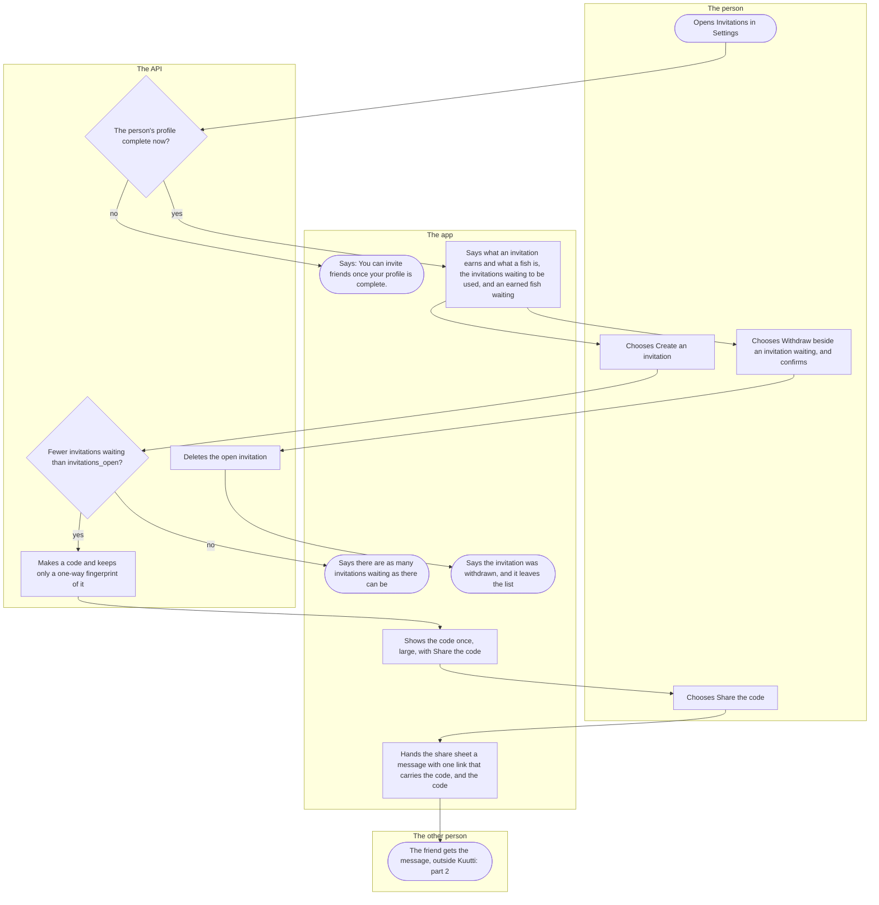
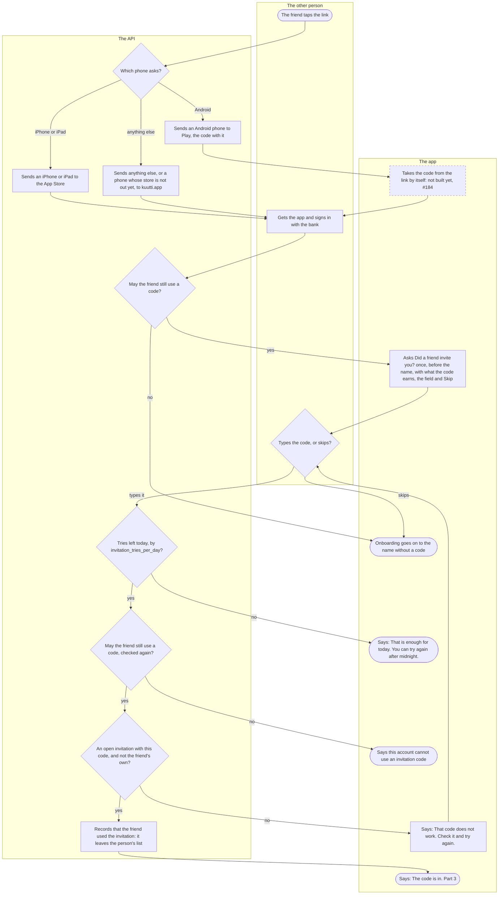
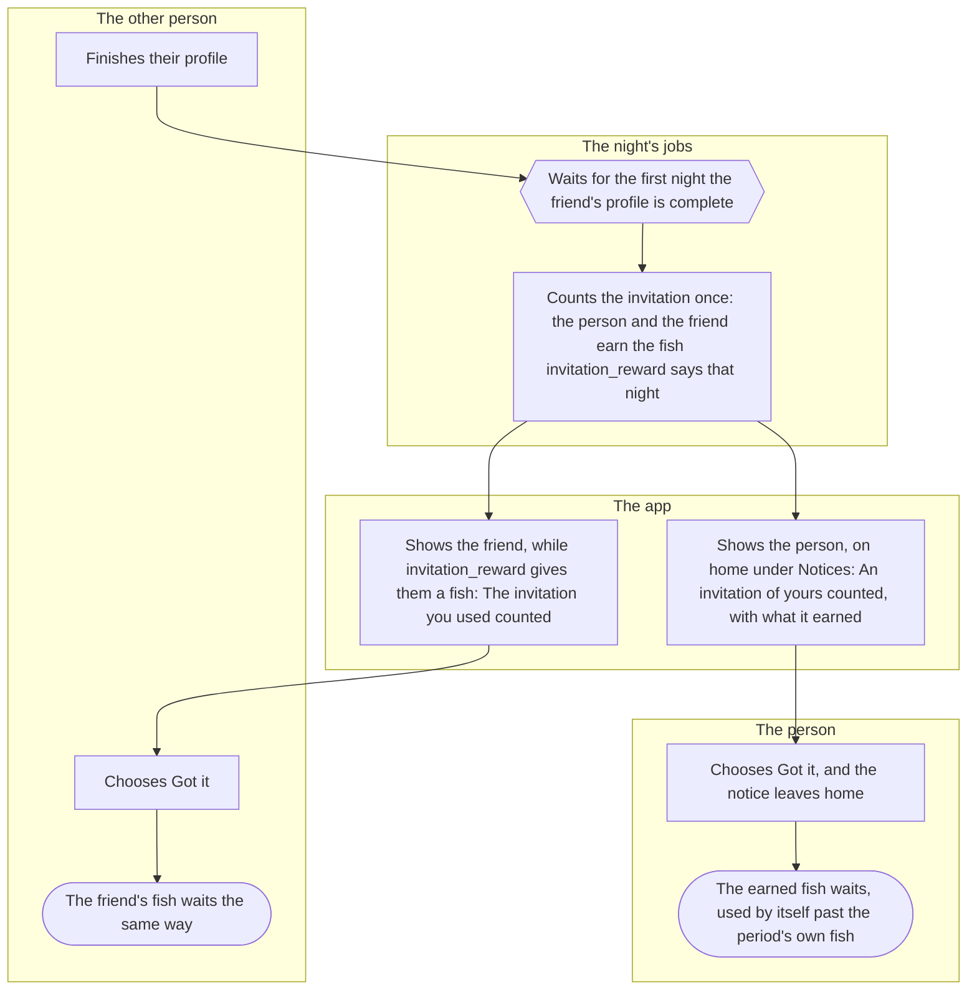

# Inviting a friend

<!-- draws
apps/mobile/src/features/rewards/Invitations.tsx
apps/mobile/src/features/rewards/RedeemInvitation.tsx
apps/mobile/src/features/rewards/InvitationStep.tsx
apps/mobile/src/features/rewards/useInvitations.ts
apps/mobile/src/features/rewards/words.ts
apps/mobile/src/features/identity/onboarding/OnboardingScreen.tsx
apps/mobile/src/features/notifications/Notices.tsx
apps/api/src/rewards/routes.ts
apps/api/src/rewards/invitations.ts
apps/api/src/rewards/repo.ts
apps/api/src/rewards/link.ts
apps/api/src/rewards/ledger.ts
apps/api/src/jobs/invitation-count.ts
apps/api/src/jobs/pool.ts
-->

How a person whose profile is complete invites a friend with a code and one link, how the friend gets the app and types the code, and what both earn the night the friend's profile is complete. It is for the person who invites and for the friend they invite.

## Part 1: making and sharing an invitation

### Steps

1. The person opens Invitations in Settings. Once they may invite, its row says how many invitations wait to be used, or "Create an invitation" while none does.
2. The API reads the person's invitations, each time Invitations opens and when the app comes back to the front, and answers whether the person's profile and onboarding are complete now, by the test People uses (every step onboarding asks, enough approved photos, the current consents and an account in good standing); whether they may still type a friend's code; what an invitation earns today under `invitation_reward`; their invitations waiting; and their earned fish not used yet. A shadow ban changes nothing here, since a shadow ban never shows. Yes: 4. No: 3.
3. The app says "You can invite friends once your profile is complete." While the person may still type a code of their own, its field is below (part 2, from step 25). The flow ends here for them.
4. The app says what an invitation earns, a whole sentence for the sides `invitation_reward` names, the person and the friend ("When a friend you invite finishes their profile, you get …"), with "A fish is a like that comes first in the other person's queue, ahead of ordinary likes."; neither is said while an invitation earns nothing. Then "Create an invitation"; the invitations under "Waiting to be used", each "Made {date}" with "Withdraw"; and an earned fish not used yet ("You have an earned fish waiting."). It never names a friend, and never says that one used a code and has not finished. Creating one: 5. Withdrawing one: 13.
5. The person chooses "Create an invitation".
6. The API counts the person's invitations waiting, under a lock on the account, in the statement that makes the new one. Fewer than `invitations_open`, and never more than a ceiling the contract sets whatever the panel says: 8. Otherwise: 7. A profile no longer complete meanwhile is refused in the words of step 3.
7. The app says "You have as many invitations waiting as you can have. Withdraw one, or wait until a friend uses one." Nothing was made.
8. The API makes a code from an alphabet without look-alike letters, shown in groups, and keeps only a one-way fingerprint of it. The code itself is in no record, log line or export.
9. "Your invitation is ready. Its code is below." is said aloud, and the app shows the code under "Your invitation code", large, selectable and read to a screen reader one character at a time, with "Kuutti shows this code only now. Share it with one friend." The code goes from the screen once a later read no longer lists it as waiting: a friend used it, or it was withdrawn.
10. The person chooses "Share the code".
11. The app hands the phone's share sheet a message: "You're invited to Kuutti, a free dating app for Finland where everyone signs in with their bank ID.", then, while `invitation_reward` gives the friend a fish, what the code earns the friend and the person, with "A fish is a like that says a little more."; then "Get the app:" and the one link, an address of the API's with the code in it; then "After signing in, type this code:" and the code. Nothing else about the person. If the sheet does not open, the app says "The share did not open. You can copy the code above instead."
12. The friend gets the message in whatever app the person chose, outside Kuutti. Part 2 follows the friend.
13. The person chooses "Withdraw" beside an invitation waiting; a dialog asks "Withdraw this invitation?" ("Its code stops working at once."), and they choose "Withdraw the invitation". "Keep it" closes the dialog.
14. The API deletes the invitation, if it is the person's own and still waiting. One a friend has used cannot be withdrawn.
15. "The invitation was withdrawn. Its code no longer works." is said aloud, and the invitation leaves the list; the code goes from the screen if it was this one's. Where the list cannot be read again, the words are drawn too.

## Part 2: the friend follows the link and uses the code

### Steps

16. The friend taps the link in the message.
17. The API looks at which phone asks, by the request's User-Agent alone. The code is never looked up, so every code gets the same answer, and nothing is kept. iPhone or iPad: 18. Android: 19. Anything else: 20.
18. An iPhone or an iPad goes to the App Store, or to kuutti.app while the store's listing is not out (#193). The App Store carries nothing through an install, so the friend will type the code (25). Then 22.
19. An Android phone goes to Play, the code with it as the install referrer, which Play hands the app at its first start; or to kuutti.app while the listing is not out. Then 21.
20. Anything else goes to kuutti.app, whose page has both stores. Then 22.
21. The app takes the code from the link by itself: not built yet, #184's native batch. Today nothing reads it, and the friend will type the code (25). Then 22.
22. The friend gets the app, accepts the terms and the privacy summary, and signs in with their bank ([Signing in](sign-in.md), [Onboarding](onboarding.md)).
23. Onboarding asks the API whether the friend may still use a code: their profile and onboarding are not complete, their identity has never had an account deleted, they have used no code before, and they have given the current terms and privacy consents. Yes: 25. No, or the question could not be answered: 24.
24. Onboarding goes on to the name without asking for a code. The flow ends here for the friend.
25. Onboarding asks "Did a friend invite you?" once, before the name, with what the code earns them while `invitation_reward` gives the friend a fish ("The code earns you … once your profile is complete."), the field "Invitation code", "Use the code" and "Skip"; it has no number in onboarding's "Step {step} of {total}". The same field stays in Settings' Invitations, under "Have an invitation code?", for as long as step 23's answer is yes, so a friend who skipped, or got the code later, types it there, and the steps from 26 on are the same.
26. The friend types the code, or chooses "Skip". "Use the code" stays dimmed until what is typed reads as a code (upper or lower case, with or without spaces and the hyphen, O read as zero, I and L as one), so a slip spends no try. Types it and chooses "Use the code": 27. Skips: 24.
27. The API counts the friend's tries of the Finnish day: every code typed counts, whatever the answer. Within `invitation_tries_per_day`: 29. Otherwise: 28.
28. The app says "That is enough for today. You can try again after midnight." The flow ends here for today.
29. The API checks the friend again, as in step 23, under a lock on their account, before it looks at the code, so it tells nothing about a code to somebody who could not use one. Yes: 31. No: 30.
30. The app says "This account cannot use an invitation code. A code is for someone new, before their profile is complete, and works once." It never says which condition failed.
31. The API looks the code up. An open invitation with that code, made by somebody else: 33. A code that does not exist, one already used and the friend's own all get the same answer: 32.
32. The app says "That code does not work. Check it and try again." Back to 26.
33. The API records that the friend used the invitation. It leaves the person's list of invitations waiting, and the person's screen shows nothing more about it. A person can use one invitation, ever.
34. The app says "The code is in."; in onboarding, "Continue" goes on to the name. Part 3.

## Part 3: the night counts it

### Steps

35. The friend finishes their profile: every step onboarding asks, with approved photos and the current consents ([Onboarding](onboarding.md), [Photos](photos.md)).
36. The night's jobs wait for the first night the friend's profile and onboarding are complete, by the test People uses, whether or not matching has opened. The count runs as a batch at night, so its moment tells the person neither which friend it was nor how far the friend got. A friend suspended or banned is not complete while it stands, so their invitation waits.
37. The night counts the invitation once: the person earns the fish `invitation_reward` gives the inviter that night, and the friend the fish it gives the friend. An invitation whose inviter deleted their account before it counted still counts, for the friend alone: they get their fish and their notice, and nothing tells them the inviter left. A friend who deletes their account before this night takes the invitation they used with them, uncounted. Then 38 for the person and 39 for the friend.
38. On the person's home screen, under "Notices", the app says "An invitation of yours counted": "Somebody you invited has finished their profile." and what it earned, or "Thank you for inviting them." when it earned nothing; never who ([Notifications and notices](notifications.md)). There is no push.
39. On the friend's home screen, while `invitation_reward` gives the friend a fish, the app says "The invitation you used counted": "The invitation earned you …", never who invited them. There is no push.
40. The person chooses "Got it", and the notice leaves home.
41. The friend chooses "Got it".
42. The earned fish waits, said under Invitations ("You have an earned fish waiting."), and is used by itself on a fish past the own `fish_budget` of the period of `fish_window_days`; it still needs one of the day's likes. A fish changed the same day gives it back, and a fish on a card that answers a like is a like and never spends one: [People](queue.md).
43. The friend's earned fish waits and is used the same way.

## Open

- **Where Invitations sits in Settings.** The code has Invitations as a row of Settings' one list, under Community, that opens in place ([SettingsScreen.tsx](../../apps/mobile/src/features/settings/SettingsScreen.tsx), since #511, PR #516); [ADR-044](../adr/044-invitations.md) §12 still says Settings › Invitations, a row under Account, at a route that is gone. The register has no note on it yet. Step 1 says neither.

## Where it lives

- Screens: the Invitations row of Settings, [SettingsScreen.tsx](../../apps/mobile/src/features/settings/SettingsScreen.tsx), holding the rewards slice's [Invitations.tsx](../../apps/mobile/src/features/rewards/Invitations.tsx), [RedeemInvitation.tsx](../../apps/mobile/src/features/rewards/RedeemInvitation.tsx), [useInvitations.ts](../../apps/mobile/src/features/rewards/useInvitations.ts) and [words.ts](../../apps/mobile/src/features/rewards/words.ts) ([README](../../apps/mobile/src/features/rewards/README.md)); onboarding's step, [InvitationStep.tsx](../../apps/mobile/src/features/rewards/InvitationStep.tsx), in [onboarding.tsx](../../apps/mobile/app/onboarding.tsx) and [OnboardingScreen.tsx](../../apps/mobile/src/features/identity/onboarding/OnboardingScreen.tsx); the notices on home, [index.tsx](../../apps/mobile/app/index.tsx), in [Notices.tsx](../../apps/mobile/src/features/notifications/Notices.tsx)
- API: `GET /invitations`, `POST /invitations`, `DELETE /invitations/{id}` and `POST /invitations/redeem` in the rewards slice ([routes.ts](../../apps/api/src/rewards/routes.ts), [invitations.ts](../../apps/api/src/rewards/invitations.ts), [repo.ts](../../apps/api/src/rewards/repo.ts), [README](../../apps/api/src/rewards/README.md)); the one link, `GET /i/{code}`, in [link.ts](../../apps/api/src/rewards/link.ts); whether a profile is complete in the jobs' [pool.ts](../../apps/api/src/jobs/pool.ts); the night's count, [invitation-count.ts](../../apps/api/src/jobs/invitation-count.ts), run by [boot.ts](../../apps/api/src/boot.ts); the notices in [notifications.ts](../../apps/api/src/notifications/notifications.ts); spending what was earned in [ledger.ts](../../apps/api/src/rewards/ledger.ts), called by the matching slice's decisions in [rounds.ts](../../apps/api/src/matching/rounds.ts)
- Config: `invitation_reward`, `invitations_open`, `invitation_tries_per_day`, `fish_budget` and `like_budget_balanced` in `matching_config` (defaults in [seed.ts](../../packages/db/src/seed.ts)); the stores' addresses are the API's configuration, unset until each listing is out
- Spec: [earned.feature](../../features/matching/earned.feature) (spending what was earned); the invitations' scenarios in [erasure.feature](../../features/identity/erasure.feature); the routes, the link and the night's count have ordinary tests
- Maestro: [invite.yaml](../../apps/mobile/e2e/flows/invite.yaml) (create, share, withdraw); [onboarding.yaml](../../apps/mobile/e2e/flows/onboarding.yaml) skips the code step
- ADRs: [ADR-044](../adr/044-invitations.md), [ADR-060](../adr/060-no-waiting-at-the-pond.md) §7, [ADR-032](../adr/032-notification-choices-and-notices.md), [ADR-039](../adr/039-the-fish.md), [ADR-036](../adr/036-the-days-likes.md)
- Rules: the register's [Invitations and rewards](../decisions.md#invitations-and-rewards) and [Likes and fish](../decisions.md#likes-and-fish) rows.

## History

- 2026-10-22 (#107, PR #417): a person whose profile is complete makes an invitation, shares its code and withdraws an open one in Settings › Invitations; the friend types the code once in onboarding or in Settings; the night counts it and the person earns what `invitation_reward` says, with a notice on home.
- 2026-10-22 (#418, PR #422): the consents move before the bank login, so the code step comes first in onboarding and counts no number in "Step x of n".
- 2026-10-30 (#511, PR #516): Invitations becomes a row of Settings' one list.
- 2026-10-31 (#500, PR #555): a person may invite once their profile is complete, as asked when Invitations is read, and an invitation counts the first night the friend's profile is complete, with no gate's count before it.
- 2026-11-03 (#503, PR #579): an invitation earns fish alone, for the person and now for the friend too, each told by a notice on home, and the friend is told beforehand what the code earns them; earned likes go; an inviter who deleted their account before the count still leaves the friend their fish.
- 2026-11-04 (#581, PR #590): Invitations loses its opening line and its count of friends who finished; its button is "Create an invitation".
- 2026-11-07 (#574, PR #642): the shared message carries one link with the code, which sends a phone to its store and anything else to the website.
