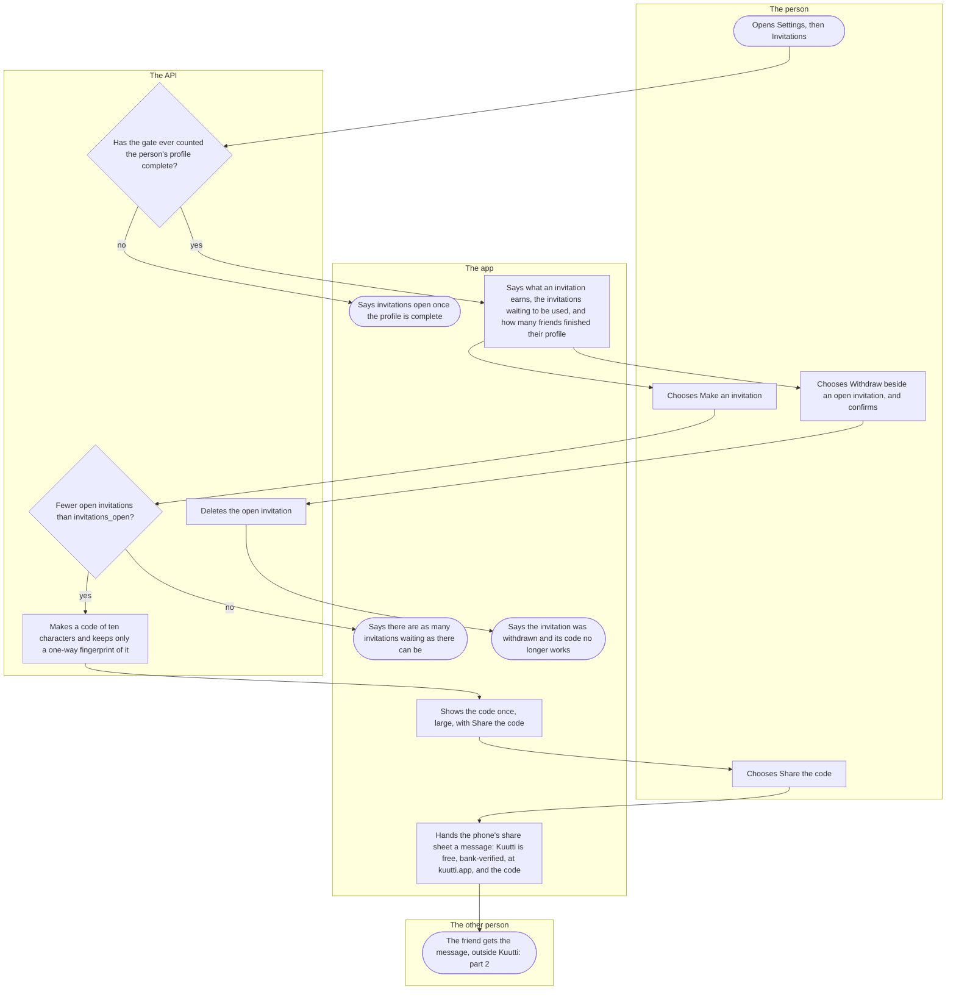
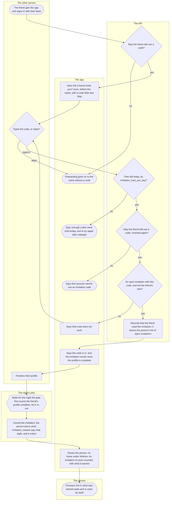

# Inviting a friend

How a person whose profile is complete invites a friend with a code, how the friend uses it, and what the person earns the night the friend's profile is complete. It is for the person who invites and for the friend they invite.

## Part 1: making and sharing an invitation

### Steps

1. The person opens Settings and, under Account, Invitations.
2. The API reads the person's invitations and answers whether the pond's gate has ever counted their profile complete (every step onboarding asks, approved photos, the current consents, and an account in good standing), whether they may still type a friend's code, what an invitation earns today, and their open invitations. A shadow ban changes nothing here, since a shadow ban never shows. Yes: 4; no: 3.
3. The app says "You can invite friends once your profile is complete." While the person may still type a code of their own, the field for it is below (part 2, from step 19). The flow ends here for them.
4. The app says how a friend gets in ("They get the app at kuutti.app, sign in with their bank and type the code before their profile is complete. Each code works once."), what an invitation earns today from `invitation_reward` in a whole sentence (a fish, extra likes, both, or "Invitations earn nothing just now" when both are 0), the invitations under "Waiting to be used" by when they were made, how many friends invited have finished their profile, and the earned fish and extra likes still waiting. It never names a friend, and never says that one used a code and has not finished. Making one: 5; withdrawing one: 13.
5. The person chooses Make an invitation.
6. The API counts the person's open invitations under a lock on the account. Fewer than `invitations_open`, and never more than a ceiling the contract sets whatever the panel says: 8; otherwise: 7.
7. The app says "You have as many invitations waiting as you can have. Withdraw one, or wait until a friend uses one." Nothing was made.
8. The API makes a code of ten characters from an alphabet without look-alike letters, shown in two groups of five, and keeps only a one-way fingerprint of it. The code itself is in no record, log line or export.
9. The app says "Your invitation is ready. Its code is below." and shows the code large, selectable, read to a screen reader one character at a time, with "Kuutti shows this code only now and keeps no copy of it." The code goes from the screen once a later read no longer lists it as open: a friend used it, or it was withdrawn.
10. The person chooses Share the code.
11. The app hands the phone's share sheet a message: "You're invited to Kuutti, a free dating app for Finland where everyone signs in with their bank ID. Get the app at https://kuutti.app/ and type this code after signing in:" and the code. Nothing about the person, and no link into the app: a link that opens the app waits for #184. If the sheet does not open, the app says so, and the code can be copied from the screen.
12. The friend gets the message in whatever app the person chose, outside Kuutti. Part 2 follows the friend.
13. The person chooses Withdraw beside an open invitation; a dialog asks "Withdraw this invitation?" ("Its code stops working at once.") and they choose Withdraw the invitation. Keep it closes the dialog.
14. The API deletes the invitation, if it is the person's own and still open. One a friend has used cannot be withdrawn.
15. The app says "The invitation was withdrawn. Its code no longer works.", and the code goes from the screen if it was this one's.

## Part 2: the friend uses the code, and the night counts it

### Steps

16. The friend gets the app from kuutti.app, accepts the terms and the privacy summary, and signs in with their bank ([Signing in](sign-in.md), [Onboarding](onboarding.md)).
17. Onboarding asks the API whether the friend may still use a code: their identity has never had an account deleted, the gate has never counted their profile complete, they have used no code before, and they have given the current terms and privacy consents. Yes: 19; no, or the question could not be answered: 18.
18. Onboarding goes on to the name without asking for a code. The flow ends here for the friend.
19. Onboarding asks "Did a friend invite you?" once, before the name, with a code field and Skip; it has no number in "Step x of n". The same field stays in Settings › Invitations, under "Have an invitation code?", for as long as step 17's answer is yes, so a friend who skipped, or got the code later, types it there, and the steps from 20 on are the same.
20. The friend types the code, or chooses Skip. Use the code stays dimmed until what is typed reads as a code (upper or lower case, with or without spaces and the hyphen, O read as zero, I and L as one), so a slip spends no try. Types it and chooses Use the code: 21; skips: 18.
21. The API counts the friend's tries of the Finnish day: every code typed counts, whatever the answer. Within `invitation_tries_per_day`: 23; otherwise: 22.
22. The app says "You have tried enough codes for today. You can try again after midnight." The flow ends here for today.
23. The API checks the friend again, as in step 17, before it looks at the code, so it tells nothing about a code to somebody who could not use one. Yes: 25; no: 24.
24. The app says "This account cannot use an invitation code. A code is for someone new, before their profile is complete, and works once." It never says which condition failed.
25. The API looks the code up. An open invitation with that code, made by somebody else: 27. A code that does not exist, one already used and the friend's own all get the same answer: 26.
26. The app says "That code does not work. Check it and try again." Back to 20.
27. The API records that the friend used the invitation. It leaves the person's list of open invitations, and the person's screen shows nothing more about it. A person can use one invitation, ever.
28. The app says "The code is in. Your friend's invitation counts once your profile is complete." In onboarding, Continue goes on to the name.
29. The friend finishes their profile: every step onboarding asks, with approved photos and the current consents ([Onboarding](onboarding.md), [Photos](photos.md)).
30. The night's jobs wait for the first night the gate's count finds the friend's profile complete, whether or not the gate lets the friend in. The count runs as a batch at night, so its moment tells the person neither which friend it was nor whether the friend waits in line. An invitation whose inviter has deleted their account never counts.
31. Right after the gate's count, the night counts the invitation once: the person earns one unit for each fish and each like that `invitation_reward` says that night, and gets a notice, even when the reward is nothing. A friend who deletes their account before this night takes their used invitation with them, uncounted.
32. On the person's home screen, under Notices, the app says "An invitation of yours counted": "Somebody you invited has finished their profile." and what it earned ("You earned a fish."), never who ([Notifications and notices](notifications.md)).
33. The person chooses Got it, and the notice leaves home. What was earned waits in Settings › Invitations and is used by itself: an earned like on a like past the day's `like_budget_balanced`, an earned fish on a fish past the window's `fish_budget`. A decision changed the same day gives its unit back, and a like or a fish on a card that liked the person or sent them a fish never spends one. While `like_budget_balanced` is not below `round_size`, an earned like is never needed.

## Where it lives

- Screens: [settings/invite.tsx](../../apps/mobile/app/settings/invite.tsx), [onboarding.tsx](../../apps/mobile/app/onboarding.tsx) (the invitation step), home [index.tsx](../../apps/mobile/app/index.tsx) (the notice); the rewards slice's [Invitations.tsx](../../apps/mobile/src/features/rewards/Invitations.tsx), [RedeemInvitation.tsx](../../apps/mobile/src/features/rewards/RedeemInvitation.tsx), [InvitationStep.tsx](../../apps/mobile/src/features/rewards/InvitationStep.tsx) and [words.ts](../../apps/mobile/src/features/rewards/words.ts) ([README](../../apps/mobile/src/features/rewards/README.md)); onboarding's [OnboardingScreen.tsx](../../apps/mobile/src/features/identity/onboarding/OnboardingScreen.tsx); the notice in [Notices.tsx](../../apps/mobile/src/features/notifications/Notices.tsx)
- API: `GET /invitations`, `POST /invitations`, `DELETE /invitations/{id}` and `POST /invitations/redeem` in the rewards slice ([routes.ts](../../apps/api/src/rewards/routes.ts), [invitations.ts](../../apps/api/src/rewards/invitations.ts), [README](../../apps/api/src/rewards/README.md)); the night's count [invitation-count.ts](../../apps/api/src/jobs/invitation-count.ts), after the gate's [pond-gate.ts](../../apps/api/src/jobs/pond-gate.ts); spending what was earned in [ledger.ts](../../apps/api/src/rewards/ledger.ts), called by the matching slice's decisions
- Config: `invitation_reward`, `invitations_open`, `invitation_tries_per_day`, `like_budget_balanced`, `fish_budget`, `round_size` in `matching_config` (defaults in [seed.ts](../../packages/db/src/seed.ts))
- Spec: [earned.feature](../../features/matching/earned.feature) (spending what was earned); the invitations' scenarios in [erasure.feature](../../features/identity/erasure.feature); the routes and the night's count have ordinary tests
- Maestro: [invite.yaml](../../apps/mobile/e2e/flows/invite.yaml) (make, share, withdraw); [onboarding.yaml](../../apps/mobile/e2e/flows/onboarding.yaml) skips the code step
- ADRs: [ADR-044](../adr/044-invitations.md), [ADR-032](../adr/032-notification-choices-and-notices.md) §7, [ADR-036](../adr/036-the-days-likes.md), [ADR-039](../adr/039-the-fish.md), [ADR-015](../adr/015-pond-gate.md)

## History

- 2026-10-22 (#107, PR #417): a person whose profile is complete makes an invitation, shares its code and withdraws an open one in Settings › Invitations; the friend types the code once in onboarding or in Settings; the night counts it and the person earns what `invitation_reward` says, with a notice on home.
- 2026-10-22 (#418, PR #422): the consents move before the bank login, so the code step comes first in onboarding and counts no number in "Step x of n".
