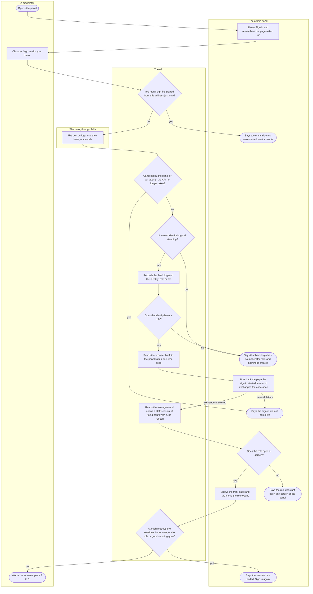
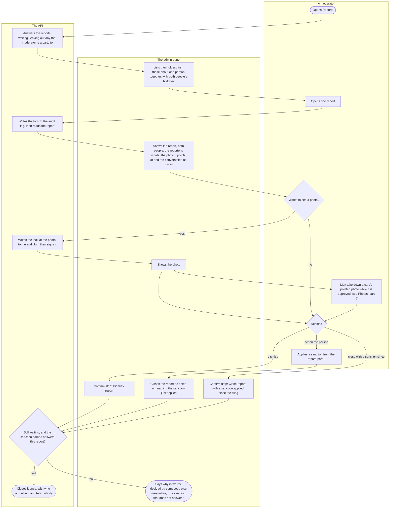
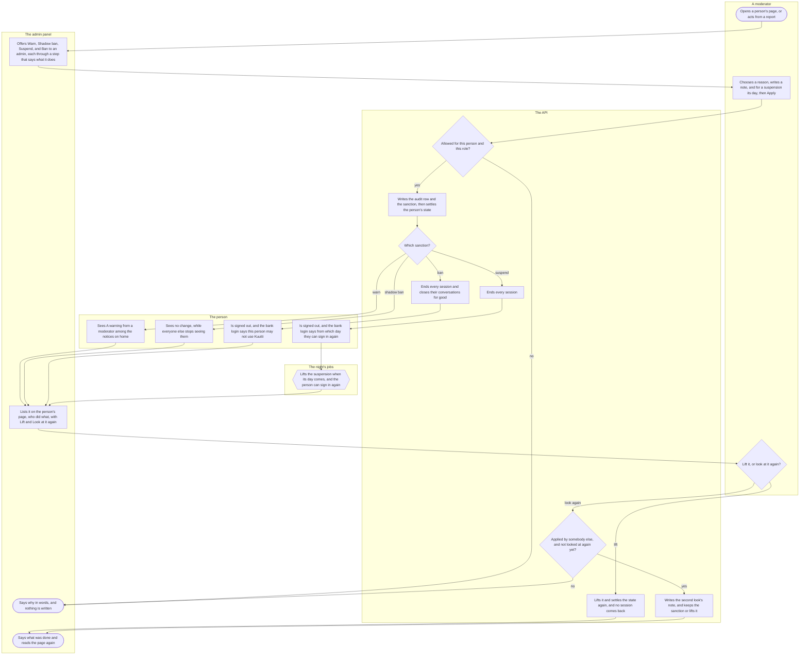
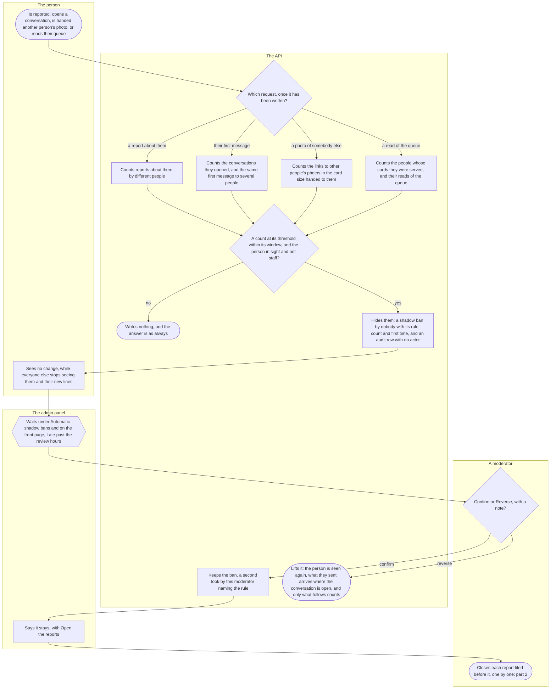
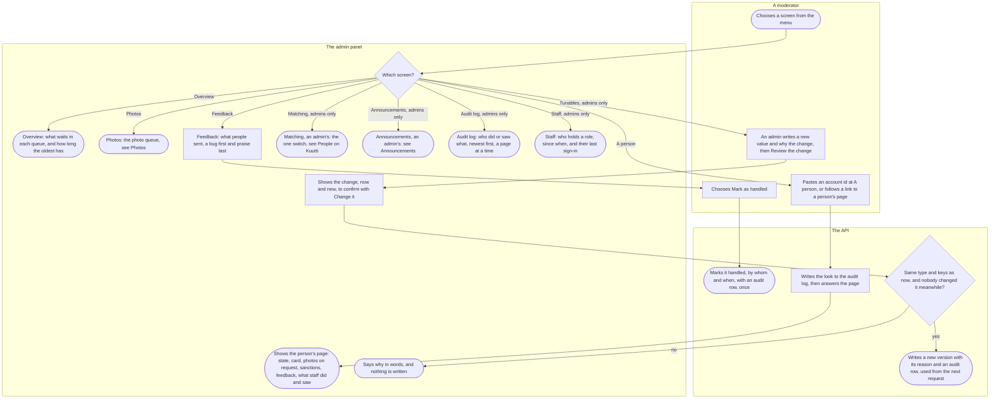

# Moderation in the admin panel

<!-- draws
apps/admin/src/app.tsx
apps/admin/src/features/identity/
apps/admin/src/features/safety/
apps/api/src/identity/admin-session.ts
apps/api/src/safety/report-admin-routes.ts
apps/api/src/safety/report-queue.ts
apps/api/src/safety/sanction-routes.ts
apps/api/src/safety/sanctions.ts
apps/api/src/safety/automatic.ts
apps/api/src/safety/overview-routes.ts
apps/api/src/safety/accounts.ts
apps/api/src/safety/feedback.ts
apps/api/src/safety/config.ts
apps/api/src/safety/audit-routes.ts
apps/api/src/safety/staff-routes.ts
apps/api/src/identity/standing.ts
apps/api/src/safety/reports.ts
apps/api/src/chat/first-messages.ts
-->

The moderators' side of Kuutti: how a member of staff signs in to the admin panel, works a report to a decision, warns, shadow-bans, suspends or bans a person, reviews the shadow bans the automatic rules applied, and uses the panel's other screens. It is written for moderators, admins and anyone who wants to see what happens to a person after somebody reports them. How a person makes a report is in [Report and block](report-and-block.md#part-1-blocking-and-reporting); the photo queue and taking down one photo are drawn in [Photos](photos.md#part-6-the-photo-queue), the Matching switch in [People on Kuutti](people-on-kuutti.md#part-2-an-admin-opens-or-closes-matching), and an announcement to everybody in [Announcements](announcements.md).

## Part 1: signing in to the panel

### Steps

1. A member of staff opens the panel in a browser: on staging and in production at their own addresses, locally on a developer's machine. Signed out, the panel shows only the sign-in, whatever page was asked for.
2. "Sign in", with one button. The panel remembers the page the moderator asked for.
3. The moderator chooses "Sign in with your bank". The browser goes to the API, marked as a staff attempt.
4. The API counts the sign-ins started from this address just now, the app's and the panel's together. Too many: 5. Otherwise: 6.
5. Nothing is written and the bank is asked nothing. The browser goes back to the panel, which says "Too many sign-ins were started just now. Wait a minute and sign in again." The end.
6. The person logs in at their bank, afresh every time, as in [Signing in](sign-in.md#part-1-signing-in), or cancels there.
7. The API answers each attempt once. Cancelled at the bank, an attempt already completed, refused or expired before the bank answered, a bank answer it cannot use, or a person under 18: 8. Otherwise: 9.
8. The browser goes back to the panel, never to the app, and the panel says "Sign-in did not complete. Try again." The end.
9. The API turns the personal identity code into its keyed code, as at every bank login, and asks whether it belongs to an identity it knows, in good standing: neither banned nor suspended. Yes: 10. No: 12.
10. The API records this bank login on the identity, whether or not it has a role, as the app's login does. So the maintainer, about to grant somebody a role with their own tool, finds the person who just tried first.
11. Does the identity have a role: moderator, admin or researcher? Roles are granted and taken away only by the maintainer's tool, never in the panel. Yes: 13. No: 12.
12. Nothing is created: no identity, account or session. The browser goes back to the panel, which says "That bank login has no moderator role. Ask the maintainer to add it." The end.
13. The API sends the browser back to the panel with a one-time code in the part of the address that no server sees.
14. The panel puts back the page the sign-in started from and exchanges the code, once, within its short life. A code already used or out of time, or one whose role was taken away or whose standing changed meanwhile, is refused, and the panel says why as in 8 or 12. A network failure also returns to 8, so another bank sign-in can be started.
15. The API reads the role again and opens a staff session of the fixed hours the code sets: one token, no refresh. This session is the "Last sign-in" the staff list shows (step 94). The header says "Signed in as" and the role, with "Sign out"; it does not say when the session ends. The panel keeps the session in its browser tab, so a closed tab signs out of the panel.
16. Does the role open a screen of the panel? Yes: 17. No: 18.
17. The panel shows the front page and the menu. A moderator's menu: "Overview", "Reports", "Automatic shadow bans", "Photos", "Feedback", "A person". An admin's adds "Matching", "Announcements", "Tunables", "Audit log" and "Staff". A screen the role does not open answers at its address with its heading and "Your role does not allow this.", asking the API for nothing, and the API refuses it anyway, whatever the panel shows.
18. A researcher: "Your role does not open any screen of this panel.", and no menu. The end.
19. At every request the API reads the session, the role and the identity's standing again. The session's hours over, the role taken away, or the identity banned or suspended: 20. Otherwise: 21.
20. The panel goes back to Sign in from whatever screen was open and says "Your session has ended. Sign in again." There is no renewal and no warning before: a new bank login is the way back, and a note being typed at that moment is lost. "Sign out" ends the session too, and the panel shows Sign in without the message. The end.
21. The moderator works the reports (part 2), the sanctions (part 3), the automatic shadow bans (part 4) and the other screens (part 5).

## Part 2: working a report

### Steps

22. The moderator opens "Reports" from the menu, or from the "Reports" card of the front page. How a person makes a report, from a card, from a conversation or from a photo sent in one, is in [Report and block](report-and-block.md#part-1-blocking-and-reporting).
23. The API answers the reports waiting for a decision, with its own clock and `moderation_response_hours`. A report the moderator is a party to, as the reporter or the reported person through any account of theirs, is left out of the list and out of every count, so a moderator never learns who reported them.
24. The panel lists them oldest first, those about one person together under "About account" and the account's id, linked to the person's page, with the reports they received and their sanctions. Each report is one link to its page, named by its reason, where it was made ("from a card" or "from a conversation") and "Filed" with its time; under it how long it has waited, "Waited:", with "Late" and the response time in hours once past `moderation_response_hours`, and "Reported by account" with the reporter's id, linked to their page, the reports they filed and how many were upheld. Neither the reporter's words nor anything of a conversation is in the list. Above it, how many wait, or "Nothing waiting", and "Refresh". The other choice, "Decided", lists the decided reports instead, with their outcome, "Dismissed" or "Acted on", and when.
25. The moderator opens one report, "Report" and its id. A report they are a party to answers "No such report.", as one that does not exist.
26. The API writes the look to the audit log, about the report and never about a person, before anything of the report is read. A look whose row cannot be written shows nothing.
27. The panel shows "The report": its "Reason", where it was "Made", when it was "Filed" and its "State", "Waiting for a decision" or the outcome with when and who; "The two people", each linked to their page, with their histories; "The reporter's words", or "No note."; for a card's report that points at one of the card's photos, "The photo the reporter pointed at", with its state, shown only on request, or "Photo removed" once its owner deleted it; and for a report from a conversation, "The conversation as it was when reported", every line marked "Reporter" or "Reported person", with its time, the line of a photo the reporter pointed at listed first and marked "The reporter pointed at this photo". The copy keeps every line, those a shadow ban withheld too, also after both people deleted their accounts. No photo is loaded. "Back to the reports" leads back.
28. Does the moderator want to see a photo? Yes: 29. No: 32.
29. On "Show photo" the API writes that look to the audit log, about the report, then signs the photo for a short while: a photo of the conversation in its full size, a card's pointed photo in the card size. Every look is its own row.
30. The panel shows the photo, one of the conversation described as sent by the reporter or by the reported person, with its time.
31. Beside a card's pointed photo, while it is approved, stands "Take down…": the moderator may take it down with a reason the owner is told, which is no sanction and decides nothing of the report ([Photos](photos.md#part-7-taking-down-an-approved-photo)); the page takes the photo's new state from the answer and is not read again. A photo sent in a conversation is never taken down. Then 32.
32. The moderator decides, under "Decision", with the report's reason at the top of the page and nothing preset. Act on the person: 34. Close with a sanction applied since the report was filed: 36. Dismiss: 33.
33. "Dismiss" opens "Dismiss the report": "The report closes with no action on the reported person. The block between the two stays." The moderator chooses "Dismiss report": 37.
34. Under "Act on the reported person" the moderator applies "Warn", "Shadow ban", "Suspend" or, as an admin, "Ban", through the sanction's own confirm step (part 3, from step 41), which adds "Applying one also closes this report as acted on."
35. Once the sanction stands, the panel says "Applied:" and the sanction, "Closing the report…", and closes the report as acted on, naming it: 37. Whatever happens to this second step, the sanction stays.
36. Under "Applied since the report", the sanctions that may close it, each applied at or after the filing, each with "Close with this": any a person gave the reported account, a ban of the reported person's identity through any account of theirs, or an automatic shadow ban a moderator confirmed (part 4), lifted since or not. One sanction may close several reports. "Close the report as acted on" names the sanction and when it was applied, and says "Nothing more happens to the reported person."; "Close report": 37.
37. The API asks whether the report is still waiting and whether the sanction named, if any, answers this report, and writes the decision to the audit log before it changes anything. Yes: 38. No: 39.
38. The report is closed, dismissed or acted on, by whom and when, once: of two moderators deciding at the same moment, one decision is written. The panel says "Report dismissed." or "Report closed as acted on.", or after a sanction applied from the report, "Applied:", the sanction and "The report is closed as acted on." Nobody is told; the reporter's copy of their data says dismissed or acted on, never which action ([Report and block](report-and-block.md#part-2-the-wait-and-the-outcome)). The end.
39. The panel says "Another member of staff decided this report meanwhile." or "That sanction does not answer this report.", and the report still waits for the latter. After a sanction applied from the report, it says the sanction "stands", and either that the report is not closed, to be closed "with that sanction in the list above" (step 36), or that another member of staff decided it meanwhile, with "The reported person's page", where the sanction can be lifted. The end.

## Part 3: the sanctions and what each does

### Steps

40. A moderator opens a person's page (part 5) or works a report (part 2). The page of a deleted account shows its deletion date and nothing else, and offers no action; a ban that keeps a deleted person's identity out is offered to an admin from a report about them.
41. Under "Sanctions" on the person's page, or under "Act on the reported person" on a report's, the panel offers, the gentlest first: "Warn", "Shadow ban", "Suspend", and, to an admin only and set apart, "Ban". Each opens its step, "Warn this person", "Hide this person from others", "Suspend this person" or "Ban this person", which says what it does: "Writes a warning on the person's file. Nothing else changes for them." (see Open), "Hides the person from everyone else at once, without telling them: they see no change.", "Ends every session now and refuses the bank login until the start of the chosen day in Finland, when the night lifts it." or "Ends every session now and refuses the next bank login and any new account, until an admin lifts it."
42. The moderator chooses a "Reason" (Harassment, Misrepresentation, Under 18, Commercial use, Scraping, Other; none preset, "Choose a reason"), writes a "Note" of what happened, and for a suspension the day it ends, "Suspended until", then "Apply"; "Cancel" leaves it.
43. The API asks whether it is allowed. A ban, its lift and its second look are an admin's; a member of staff is never sanctioned in the panel, since the maintainer takes the role away first; a deleted account takes only a ban; a suspension ends after today and within the most days ahead the code allows. Allowed: 45. Not: 44.
44. The panel says why: "This person is staff: the role is taken away first.", "The account is erased: only a ban binds it.", that the end day must be after today and within the code's limit, or "It could not be done. Try again."; for a second look, "You applied this one: somebody else looks at it again.", "Somebody looked at it again already." or "This is about your own account: somebody else decides." A role refused says "Your role does not allow this." once, at the top of the screen. Nothing is written. The end.
45. The API writes the audit row about the account, then the sanction with its reason and the note, and settles every account of the person from what is still open: a ban first, then a suspension, then a shadow ban. A break is kept: a shadow-banned person on a break stays on it, and a suspended or banned one is on it again once the sanction is lifted. The note is staff's words and reaches no log line and not the person's copy of their data.
46. Which sanction? Warn: 47. Shadow ban: 48. Suspend: 49. Ban: 51.
47. A warning: the person sees "A warning from a moderator", its reason and "A warning by itself changes nothing in how you use the app." among the notices on home, until they press "Got it" or the warning is lifted ([Notifications and notices](notifications.md#part-4-the-notices-on-home)). Nothing else changes for them.
48. A shadow ban: the person sees no change from any route, and their copy of their data lists no open shadow ban. Everyone else stops seeing them at once: their card leaves others' People and Starred, their photos are given to nobody, even from a card shown before, the lines and contacts they send from now on are withheld from the people they write to, they never show as Online, and their read mark goes no further for the other side than where it stood when the ban began. Their own People holds back the people who liked them or sent them a fish until the lift, since a like back would make no match. Their conversations stay open.
49. A suspension: the API ends every session of the person's accounts at once.
50. The person is signed out at their next request, and their bank login is refused with "This account is suspended. You can sign in again from:" and the day, in Finland's time ([Signing in](sign-in.md#part-1-signing-in)): 53.
51. A ban, an admin's: the API ends every session and closes the person's conversations for good, which the people in them read as ended conversations ([Chat](chat.md#part-4-ending-a-conversation)). It binds the person's identity, so it keeps them out with any account, and no new account is possible.
52. The person is signed out at their next request, and their bank login is refused with "This person may not use Kuutti.": 54.
53. The night's jobs lift a suspension once its day has come, by nobody, and settle the account; the next bank login resumes it. A bank login on the end day before the night's run is still refused.
54. The panel says "Applied:" and the sanction, and the person's page lists every sanction, newest first: its kind ("Warning", "Shadow ban", "Suspension", "Ban"), its reason, when and until when, the note, "Applied by:" who, and when it was "Lifted:" or "Looked at again:" and by whom, each by identity id with their role now, "no role now", or "Kuutti itself" for what no person did. "Lift" and "Look at it again" are offered where the role allows and while each is still open; a ban's only to an admin.
55. Lift: 56. Look at it again: 57.
56. "Lift" opens "Lift:" and the sanction, a step that says what lifting does: "The warning is marked lifted. Nothing else changes for the person.", "Others see the person again, unless something else still open hides them." or, for a suspension or a ban, "The person may sign in again, unless something else still open stops them." The API writes the audit row, lifts the sanction and settles the person from what is still open. No session comes back: a suspended or banned person signs in anew. Nobody lifts a sanction on their own identity, and one already lifted answers "It is lifted already.": 59.
57. "Look at it again" is a second member of staff's look: "Your note", and under "Decision", "Keep it" or "Lift it" with the lift's sentence beside it, only "Keep it" for one already lifted; then "Apply". Applied by somebody else, and not looked at again yet: 58. Otherwise: 44.
58. The API writes the audit row and the note, and keeps the sanction or lifts it in the same step.
59. The panel says "Lifted:" or "Looked at again:" and the sanction, and reads the person's page again, which is another look in the audit log. The end.

## Part 4: automatic shadow bans

### Steps

60. Something a rule watches happens: other people report the person; the person sends the first message of a conversation; the API hands them the link to another person's photo in the card size (another person's full size is never handed out, [Photos](photos.md#part-4-what-an-approved-photo-opens)); or they read their queue in People, or open a starred person's card ([the queue](queue.md)). Being blocked never counts.
61. Once the request has been written, and before it answers, the API checks the rules that request can trigger. Whatever the check finds, the answer is the one the person would have had anyway. A report about them: 62. Their first message: 63. Another person's photo: 64. A read of the queue: 65.
62. Reports: different people's reports about the person within `auto_shadow_ban_reports_days`, each person counted once through any account of theirs, a report a moderator dismissed not at all; the threshold is `auto_shadow_ban_reports`.
63. First messages: the conversations the person opened within `auto_shadow_ban_first_messages_minutes`, threshold `auto_shadow_ban_first_messages`; and the same first message, the same letters and digits whatever the case, spacing, punctuation or emoji, to different people within `auto_shadow_ban_same_first_message_hours`, threshold `auto_shadow_ban_same_first_message`. A reply is not a first message, and a photo with no caption never counts. When both are met, the same first message is what is recorded. The words are compared in memory and nothing of them is kept.
64. Photos (velocity): the links to other people's profile photos in the card size handed to the person within `auto_shadow_ban_photo_fetches_minutes`, threshold `auto_shadow_ban_photo_fetches`. A thumb, the person's own photos and photos sent in a conversation never count.
65. The queue (velocity): the different people whose cards the person was served within `auto_shadow_ban_cards_served_minutes`, threshold `auto_shadow_ban_cards_served`; then their reads of the queue within `auto_shadow_ban_round_reads_minutes`, threshold `auto_shadow_ban_round_reads`, counted in memory only. A read the API refused hands over nothing and is not counted. With no ceiling on the cards a person may read in a day, the rules on cards served and on photos are the alarms that stand, beside the request limit ([the register](../decisions.md#safety)). When both are met, the cards served are what is recorded.
66. Does a count reach its threshold within its window? A threshold of zero switches its rule off, and every window starts after the last lift of a shadow ban on the account, so a reversal ends the evidence it judged. A rule writes nothing on a deleted account, on a person already out of sight (an open shadow ban, suspension or ban), or on a member of staff. Reached: 68. Otherwise: 67.
67. Nothing is written. The end.
68. The API hides the person: a shadow ban by nobody, for the reason Other (the reports and first-message rules) or Scraping (the velocity rules), carrying the rule, its count and the time of the first event counted, and an audit row with no actor, naming the rule. Counts and times only: no message, no reporter, no owner of a photo. Two requests reaching a threshold at the same moment apply one ban.
69. The person sees no change from any route: what they sent before the ban, the first message that met a rule included, stays delivered. From now on everyone else stops seeing them, and their new lines and their read mark are held back, as any shadow ban does (step 48).
70. The ban waits under "Automatic shadow bans", oldest first, under a line that asks to "Confirm or reverse each within" the hours of `auto_shadow_ban_review_hours`, and is counted on the front page. Each says "Account" and its id, linked to the person's page; the rule in counts and times, between the first event counted and the last; "Hidden:" and for how long; and "Late" past `auto_shadow_ban_review_hours`. Nobody sees a ban on their own identity. Past the review hours nothing happens by itself: the ban stays until a moderator decides. A moderator may also lift it, or suspend or ban the person, from the person's page (part 3).
71. The moderator chooses "Confirm" or "Reverse". Its step, on the account by its id, says what the rule counted and what follows: to confirm, "The person stays hidden from everyone else, and what they send stays withheld, until somebody lifts it. They are not told. The reports filed before it can then be closed with it, one by one."; to reverse, "The person is seen again at once, unless something else still open hides them, and what they sent while hidden reaches the people they wrote to. They are not told." It asks for "Your note". Confirm: 72. Reverse: 75.
72. The API records a second look by this moderator that keeps the ban, naming the rule.
73. The panel says "Confirmed:", that the shadow ban on the account "stays.", beside "Open the reports".
74. The moderator closes each report filed before the ban as acted on with it, each its own decision (part 2, step 36). A ban nobody confirmed, or one reversed, closes no report. The end.
75. The API lifts the ban as a second look that lifts it. The person is seen again at once, unless something else still open hides them; what they sent while hidden reaches the people they wrote to, under its old times, in a conversation still open, while nothing of it appears in one that ended before the lift; their read mark moves on as it is. Only what follows the reversal counts toward a rule again. The panel says "Reversed:", that the automatic shadow ban on the account "is lifted." The end.

## Part 5: the other screens

### Steps

76. The moderator chooses a screen from the menu.
77. Which screen? Overview: 78. Photos: 79. Feedback: 80. A person: 83. For an admin: Matching: 86, Announcements: 87, Tunables: 88, Audit log: 93, Staff: 94. Reports and Automatic shadow bans are parts 2 and 4.
78. "Overview", the front page: a card for each of "Reports", "Automatic shadow bans", "Photos" and "Feedback", each linked to its screen, saying how many wait and how long the oldest has waited ("Oldest:"), or "nothing waits.", by the API's clock, with "Late" and the response time in hours past `moderation_response_hours` (the automatic bans past `auto_shadow_ban_review_hours`); reports the reader is a party to and automatic bans on their own identity are not counted. Below, "Told Kuutti they found someone": how many, by reason ("On Kuutti", "Elsewhere", "Another reason"), over the last days the code counts and "In all", naming nobody ([Found them](found-them.md)). "Refresh" reads it again. The end.
79. "Photos", the photo queue, is [Photos](photos.md#part-6-the-photo-queue)'s. The end.
80. "Feedback": what people sent from the app and nobody has handled, how many wait, a bug first and praise last, oldest first within a kind ("Bug", "Idea", "Complaint", "Praise"), each with its text, the app's version, the platform, the language and the time, and "Account" with the sender's id, which links to the person's page ([Settings, consents and feedback](settings-and-feedback.md)).
81. The moderator chooses "Mark as handled" on a row.
82. The API records it handled, by whom and when, with an audit row; marking it a second time is refused. The row says "Handled.", or "Marking did not work." The end.
83. "A person": the "Account id", pasted from a report, a photo, an automatic ban or a feedback row, then "Open the page"; there is no search by name or anything else, and what is not an id is "This is not an account id." Reports, automatic bans, photos in review and feedback rows link to the page as well, by their "Account" and its id.
84. The API writes the look to the audit log first, then answers. An id of no account: "No account has this id."
85. The page, "Account" and its id, shows under "State" the account's state and since when, its "Standing", until when, and when it "Registered"; "As the card shows them": the name, the age, the gender, the bio and the answers as others see them; "Photos", each with its state and when it was uploaded, shown only on "Show photo", each look an audit row, and beside an approved one "Take down…" ([Photos](photos.md#part-7-taking-down-an-approved-photo)); "Sanctions", with the actions and the list (part 3); "Feedback sent"; and "What staff did and saw" about them, the newest first, up to a limit. Never the keyed code, the bank's references, the research id or the e-mail. A deleted account shows its deletion date and nothing else. The end.
86. "Matching", an admin's: the one switch that opens or closes matching for everybody, in [People on Kuutti](people-on-kuutti.md#part-2-an-admin-opens-or-closes-matching). The end.
87. "Announcements", an admin's: one admin writes an announcement to everybody and another approves it, in [Announcements](announcements.md#part-1-one-admin-writes-it). The end.
88. "Tunables", an admin's: every tunable by its key, with its value; opened, its versions, newest first, with the value, "From" when, "By" whom and "Why". The admin writes the "New value" and "Why the change", and chooses "Review the change". A value not of the key's type is caught in the form: "This is not a value of the key's type."
89. The panel asks to "Change" the key, with "Now:" and "New:", and offers "Change it" and "Cancel".
90. The API asks whether the value keeps the type its key declared, an object its keys, and whether nobody changed the key meanwhile. Yes: 92. No: 91.
91. The panel says "This is not a value of the key's type." or "Another admin changed this key meanwhile. Refresh and look again."; anything else, "The change was not saved." Nothing is written. The end.
92. The API writes a new version with the admin and the reason, keeps the earlier ones, and writes the change to the audit log. Every reader uses it from the next request, with no deploy: the automatic rules' thresholds of part 4 too. The panel says "Saved." with the key and its value. The end.
93. "Audit log", an admin's: who did or saw what, newest first, a page at a time with "Newer" and "Older", never all at once, narrowed under "Filters" by who, what, the subject and the days, then "Show". What the automatic rules did shows as "The automatic rules". A read narrowed to one subject is itself an audit row about that subject. No row can be changed or deleted. The end.
94. "Staff", an admin's: every member of staff by identity, their role, when and by whom it was granted, and their "Last sign-in" to the panel, or "Never". It only reads: a role is granted and taken away with the maintainer's own tool, which the screen does not say. The end.

## Open

- What the panel says a warning does. Its step says "Writes a warning on the person's file. Nothing else changes for them." and its lift "The warning is marked lifted. Nothing else changes for the person." (`admin.sanction.effect.warn` and `admin.sanction.liftEffect.warn` in [messages.yaml](../../packages/i18n/messages.yaml)), and the second look now shows the second line too. Yet a warning puts a notice on the person's home until they press Got it, and its lift takes the notice away (step 47), as [ADR-024](../adr/024-sanctions.md) §7 and its History of 2026-10-18, the scenario "A warning shows the person a notice in the app until it is read, and none once lifted" of [sanctions.feature](../../features/safety/sanctions.feature) and the API's [sanctions.ts](../../apps/api/src/safety/sanctions.ts) have it. ADR-024's History of 2026-11-04 records the panel's line as a finding of #581's table, left as it is for the maintainer; the register's Found on the way has no note on it. Drawn as the API does it, with the panel's words quoted as they stand.

## Where it lives

- Panel: the menu by role in [app.tsx](../../apps/admin/src/app.tsx); the sign-in in [SignIn.tsx](../../apps/admin/src/features/identity/SignIn.tsx), [session.tsx](../../apps/admin/src/features/identity/session.tsx) and [return-path.ts](../../apps/admin/src/features/identity/return-path.ts); the screens in the safety feature: [Overview.tsx](../../apps/admin/src/features/safety/Overview.tsx), [ReportQueue.tsx](../../apps/admin/src/features/safety/ReportQueue.tsx), [ReportPage.tsx](../../apps/admin/src/features/safety/ReportPage.tsx), [Sanctions.tsx](../../apps/admin/src/features/safety/Sanctions.tsx), [AutomaticBans.tsx](../../apps/admin/src/features/safety/AutomaticBans.tsx), [AccountPage.tsx](../../apps/admin/src/features/safety/AccountPage.tsx), [TakeDown.tsx](../../apps/admin/src/features/safety/TakeDown.tsx), [FeedbackList.tsx](../../apps/admin/src/features/safety/FeedbackList.tsx), [ConfigList.tsx](../../apps/admin/src/features/safety/ConfigList.tsx), [AuditLog.tsx](../../apps/admin/src/features/safety/AuditLog.tsx), [StaffList.tsx](../../apps/admin/src/features/safety/StaffList.tsx); the photo queue's [PhotoQueue.tsx](../../apps/admin/src/features/media/PhotoQueue.tsx), the Matching switch's [MatchingSwitch.tsx](../../apps/admin/src/features/pond/MatchingSwitch.tsx) and the announcements' [Announcements.tsx](../../apps/admin/src/features/notifications/Announcements.tsx); the panel's [README](../../apps/admin/README.md)
- API, identity slice: `GET /admin/auth/start`, the shared `GET /auth/callback`, `POST /admin/auth/exchange`, `GET /admin/whoami`, `POST /admin/auth/logout` in [routes.ts](../../apps/api/src/identity/routes.ts), with [admin-session.ts](../../apps/api/src/identity/admin-session.ts) and [login.ts](../../apps/api/src/identity/login.ts); the staff guard on every admin route in [admin-middleware.ts](../../apps/api/src/lib/admin-middleware.ts), each route's roles pinned in the route table's test, [app.test.ts](../../apps/api/src/app.test.ts)
- API, safety slice ([README](../../apps/api/src/safety/README.md)): `GET /admin/reports`, `GET /admin/reports/{id}`, `GET /admin/reports/{id}/copy/{seq}/photo`, `GET /admin/reports/{id}/photo`, `POST /admin/reports/{id}/decision` in [report-admin-routes.ts](../../apps/api/src/safety/report-admin-routes.ts) and [report-queue.ts](../../apps/api/src/safety/report-queue.ts); `GET /admin/sanctions/automatic`, `GET` and `POST /admin/accounts/{id}/sanctions`, `POST /admin/accounts/{id}/bans`, `POST /admin/sanctions/{id}/lift` and `/review`, `POST /admin/bans/{id}/lift` and `/review` in [sanction-routes.ts](../../apps/api/src/safety/sanction-routes.ts) and [sanctions.ts](../../apps/api/src/safety/sanctions.ts); the six rules in [automatic.ts](../../apps/api/src/safety/automatic.ts); `GET /admin/overview` in [overview-routes.ts](../../apps/api/src/safety/overview-routes.ts); `GET /admin/accounts/{id}` in [account-routes.ts](../../apps/api/src/safety/account-routes.ts) with [accounts.ts](../../apps/api/src/safety/accounts.ts); `GET /admin/feedback` and `POST /admin/feedback/{id}/handled` in [feedback-routes.ts](../../apps/api/src/safety/feedback-routes.ts) with [feedback.ts](../../apps/api/src/safety/feedback.ts); `GET /admin/config` and `POST /admin/config/{key}` in [config-routes.ts](../../apps/api/src/safety/config-routes.ts) with [config.ts](../../apps/api/src/safety/config.ts); `GET /admin/audit` in [audit-routes.ts](../../apps/api/src/safety/audit-routes.ts); `GET /admin/staff` in [staff-routes.ts](../../apps/api/src/safety/staff-routes.ts); a take-down through `POST /admin/photos/{id}/decision` in the media slice's [admin-routes.ts](../../apps/api/src/media/admin-routes.ts)
- The person's side: the warning's notice in [notifications.ts](../../apps/api/src/notifications/notifications.ts); what a shadow ban withholds in a conversation in the chat slice's [repo.ts](../../apps/api/src/chat/repo.ts); the night's `end-suspensions` job in [boot.ts](../../apps/api/src/boot.ts)
- Spec: [admin-session.feature](../../features/identity/admin-session.feature), [report-queue.feature](../../features/safety/report-queue.feature), [report-decision.feature](../../features/safety/report-decision.feature), [sanctions.feature](../../features/safety/sanctions.feature), [automatic-shadow-bans.feature](../../features/safety/automatic-shadow-bans.feature), [velocity.feature](../../features/safety/velocity.feature), [feedback.feature](../../features/safety/feedback.feature), [config.feature](../../features/safety/config.feature), [audit.feature](../../features/safety/audit.feature); a take-down in [moderation.feature](../../features/media/moderation.feature)
- Maestro: the panel's own flows are Playwright's ([README](../../apps/admin/e2e/README.md)): [sign-in.spec.ts](../../apps/admin/e2e/sign-in.spec.ts), [roles.spec.ts](../../apps/admin/e2e/roles.spec.ts) (a screen the role does not open), [report.spec.ts](../../apps/admin/e2e/report.spec.ts) (a report with its pointed photo, dismissed), [sanctions.spec.ts](../../apps/admin/e2e/sanctions.spec.ts) (a person's page, a suspension applied and lifted, a take-down); the app's [sign-in-refusals.yaml](../../apps/mobile/e2e/flows/sign-in-refusals.yaml) walks a banned person refused at the bank login (step 52)
- ADRs: [ADR-006](../adr/006-photo-moderation.md) §5 and §6 (staff sessions, the audit log), [ADR-023](../adr/023-feedback-from-the-app.md) (feedback), [ADR-024](../adr/024-sanctions.md) (sanctions), [ADR-025](../adr/025-admin-host.md) (the panel's host), [ADR-026](../adr/026-limits-per-person-and-sign-in-doors.md) §4 (too many sign-ins), [ADR-030](../adr/030-reports-and-blocks.md) §6, §8, §12 and §13 (what each side learns, the frozen copy, the photo a report points at), [ADR-031](../adr/031-chat.md) §4 (what a shadow ban withholds in a conversation), [ADR-033](../adr/033-automatic-shadow-bans.md) (automatic shadow bans), [ADR-040](../adr/040-found-them.md) (the front page's count), [ADR-041](../adr/041-velocity.md) (velocity), [ADR-050](../adr/050-admin-components.md) (the panel's components), [ADR-051](../adr/051-admin-flows-with-playwright.md) (the panel's flows), [ADR-062](../adr/062-one-queue.md) §9 (no ceiling on cards, the alarms that stand)
- Rules: the register's [Safety](../decisions.md#safety), [Sign-in and identity](../decisions.md#sign-in-and-identity), [Photos](../decisions.md#photos) and [Retention](../decisions.md#retention) rows
- Other flows: [Report and block](report-and-block.md), [Photos](photos.md), [People on Kuutti](people-on-kuutti.md), [Announcements](announcements.md), [Signing in](sign-in.md)

## History

- 2026-09-25 (#49, PR #60): staff sign in to the panel with their bank, through the same login as everyone, when their identity has a role; an eight-hour session with no refresh, and every look and decision an audit row.
- 2026-10-12 (#250, PR #266): a session that ends or is taken away sends the panel back to the sign-in, which says the session has ended.
- 2026-10-15 (#171, PR #295): the feedback people send from the app waits in the panel, a bug first, until a moderator marks it handled.
- 2026-10-16 (#302, PR #314): a page per screen and a menu by role; a role with no screen is told so, and the sign-in comes back to the page it started from.
- 2026-10-16 (#307, PR #315): sanctions are recorded and settle the person's state: a suspension or a ban ends every session and refuses the bank login, a shadow ban hides the person without telling them, and the night lifts a suspension at its day.
- 2026-10-16 (#304, #305, PR #316): an admin reads every tunable with its versions and changes one with a reason, used from the next request.
- 2026-10-16 (#303, PR #317): the panel opens on what waits in each queue and how long the oldest has, Late past `moderation_response_hours`.
- 2026-10-16 (#306, PR #320): a person's page, opened by account id only, every look an audit row.
- 2026-10-16 (#309, #310, PR #321): admins read the audit log fifty rows a page, and the staff list with each member's last sign-in.
- 2026-10-16 (#308, PR #322): staff warn, hide, suspend or ban from a person's page through a confirm step, a ban an admin's; somebody else may look at a sanction again, and any may be lifted.
- 2026-10-16 (#313, PR #323): the panel gets a host of its own on staging, so staff open it from their browser rather than a developer's machine.
- 2026-10-16 (#41, PR #325): too many sign-ins started from one address are refused before the bank, and the panel asks for a minute's wait.
- 2026-10-17 (#202, #250, PR #330): a refused staff bank login of a known identity in good standing is recorded on it, and a staff attempt the API no longer takes goes back to the panel, not to the app.
- 2026-10-17 (#348, PR #352): a ban closes the person's conversations for good, and a shadow-banned person's lines are withheld from the people they write to until the lift.
- 2026-10-19 (#176, PR #367): a warned person sees the warning among the notices on the home screen until they read it.
- 2026-10-19 (#311, PR #369): the report queue: reports waiting oldest first, those about one person together, with both people's histories, the decided ones behind a filter, and none the moderator is a party to.
- 2026-10-19 (#312, PR #370): a moderator opens a report, reads the reporter's words and the conversation as it was when reported, sees its photos on request, and dismisses it or closes it as acted on with a sanction.
- 2026-10-19 (#105, PR #371): three rules hide a person at once on reports by different people, many first messages or the same first message to many; moderators confirm or reverse each under Automatic bans, and a confirmed one may close the reports filed before it.
- 2026-10-21 (#83, PR #392): the front page also counts how many told Kuutti they found someone, by reason.
- 2026-10-21 (#86, PR #400): three velocity rules hide an account that takes in other people's photos, cards or the round faster than a person does, on the same list, for the reason Scraping.
- 2026-10-27 (#477, PR #479): a moderator takes down one approved photo from the person's page, through a step that says what it does and a reason the owner is told; nothing is deleted, and it is not a sanction.
- 2026-10-27 (#476, PR #481): a report can point at the one photo it is about: a conversation's line is marked and listed first, and a card's photo is shown on request with the take-down beside it.
- 2026-10-29 (#470, PR #498): a shadow ban also holds back the person's read mark from the people they talk to, and a lift brings nothing it withheld into a conversation that ended meanwhile.
- 2026-10-31 (#500, PR #555): an admin's menu gains Ponds, where matching was opened pond by pond, as the pond's gate goes.
- 2026-11-01 (#500, PR #563): Ponds becomes Matching, one switch for everybody, and a person's page no longer names a pond.
- 2026-11-03 (#502, PR #578): with one queue in the day's round's place and no ceiling on cards, the rule on cards served is switched on beside the one on photos, and the read rule counts reads of the queue; a shadow-banned person's waiting likes and fish are held back until the lift, those queued before the ban too.
- 2026-11-03 (#575, PR #582): opening a starred person's card counts as a read of the queue for the read rule.
- 2026-11-05 (#581, PR #600): the panel's words: the menu says Automatic shadow bans and Photos, as their screens do; a count reads as so many waiting or "Nothing waiting"; the actions are Warn, Shadow ban, Suspend and Ban; a report's reason stands at the top of its page, not beside the actions; the header no longer says when the session ends, and Sign in and Staff lose their explanations.
- 2026-11-07 (#573, PR #646): an admin's menu gains Announcements, where one admin writes an announcement to everybody and another approves it.
- 2026-11-13 (#657): a failed exchange request returns to Sign in with the existing failure message.
