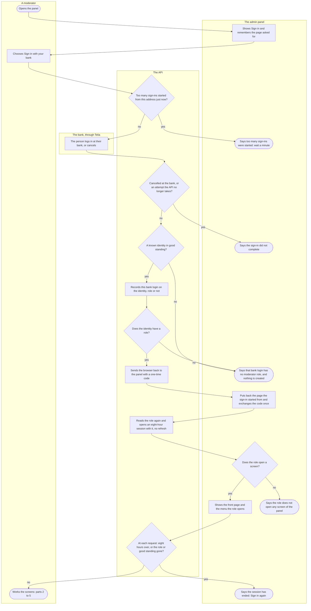
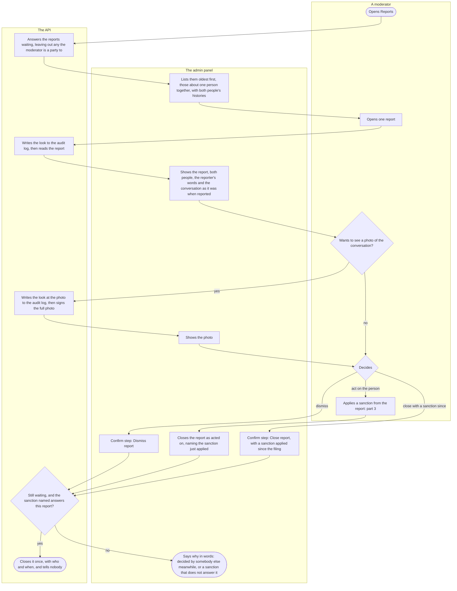
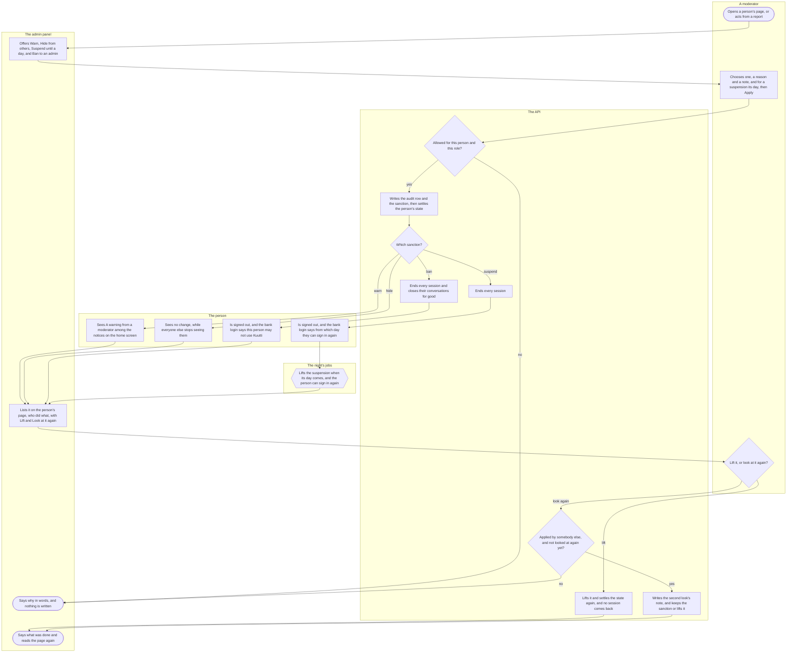
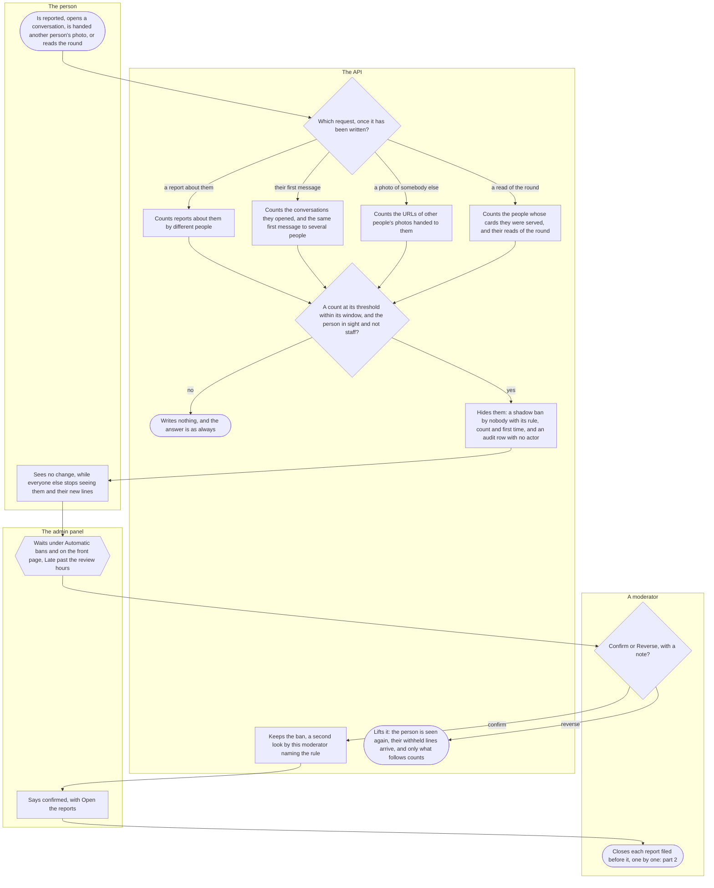
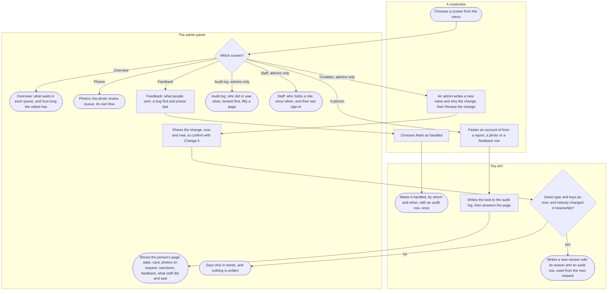

# Moderation in the admin panel

The moderators' side of Kuutti: how a member of staff signs in to the admin panel, works a report to a decision, warns, hides, suspends or bans a person, reviews the shadow bans the automatic rules applied, and uses the panel's other screens. It is written for moderators, admins and anyone who wants to see what happens to a person after somebody reports them. How a person makes a report is in [Reporting and blocking](report-and-block.md), and the photo review queue in [its own flow](photos.md).

## Part 1: signing in to the panel

### Steps

1. A member of staff opens the panel in a browser: on staging at its own address, locally on a developer's machine. Signed out, the panel shows only the sign-in, whatever page was asked for.
2. "Sign in": "Moderators sign in with their bank, like everyone. The panel opens only for a bank login that has a moderator role." The panel remembers the page the moderator asked for.
3. The moderator chooses "Sign in with your bank". The browser goes to the API, marked as a staff attempt.
4. The API counts the sign-ins started from this address just now, the app's and the panel's together. Too many: 5. Otherwise: 6.
5. Nothing is written and the bank is asked nothing. The browser goes back to the panel, which says "Too many sign-ins were started just now. Wait a minute and sign in again." The end.
6. The person logs in at their bank, afresh every time, as in [Signing in](sign-in.md), or cancels there.
7. The API answers each attempt once. Cancelled at the bank, an attempt already completed, refused or expired before the bank answered, a bank answer it cannot use, or a person under 18: 8. Otherwise: 9.
8. The browser goes back to the panel, never to the app, and the panel says "Sign-in did not complete. Try again." The end.
9. The API turns the personal identity code into its keyed code, as at every bank login, and asks whether it belongs to an identity it knows, in good standing: neither banned nor suspended. Yes: 10. No: 12.
10. The API records this bank login on the identity, whether or not it has a role, as the app's login does. So the maintainer, about to grant somebody a role with their own tool, finds the person who just tried first.
11. Does the identity have a role: moderator, admin or researcher? Roles are granted and taken away only by the maintainer's tool, never in the panel. Yes: 13. No: 12.
12. Nothing is created: no identity, account or session. The browser goes back to the panel, which says "That bank login has no moderator role. Ask the maintainer to add it." The end.
13. The API sends the browser back to the panel with a one-time code in the part of the address that no server sees.
14. The panel puts back the page the sign-in started from and exchanges the code, once, within its minute. A code already used or out of time, or one whose role was taken away or whose standing changed meanwhile, is refused, and the panel says why as in 8 or 12.
15. The API reads the role again and opens a session of eight hours with it: one token, no refresh. This session is the "Last sign-in" the staff list shows (step 91). The header says "Signed in as" the role and "Session ends:" the time, with "Sign out". The panel keeps the session in its browser tab, so a closed tab signs out of the panel.
16. Does the role open a screen of the panel? Yes: 17. No: 18.
17. The panel shows the front page and the menu. A moderator's menu: Overview, Reports, Automatic bans, Photos, Feedback, A person. An admin's adds Tunables, Audit log and Staff. A screen the role does not open says "Your role does not allow this." where it is asked for, and the API refuses it anyway, whatever the panel shows.
18. A researcher: "Your role does not open any screen of this panel.", and no menu. The end.
19. At every request the API reads the session, the role and the identity's standing again. Eight hours over, the role taken away, or the identity banned or suspended: 20. Otherwise: 21.
20. The panel goes back to Sign in from whatever screen was open and says "Your session has ended. Sign in again." There is no renewal: a new bank login is the way back. "Sign out" ends the session too, and the panel shows Sign in without the message. The end.
21. The moderator works the reports (part 2), the sanctions (part 3), the automatic shadow bans (part 4) and the other screens (part 5).

## Part 2: working a report

### Steps

22. The moderator opens "Reports" from the menu, or from the front page's line about them. How a person makes a report, from a card or from a conversation, is in [Reporting and blocking](report-and-block.md).
23. The API answers the reports waiting for a decision, with its own clock and `moderation_response_hours`. A report the moderator is a party to, as the reporter or the reported person through any account of theirs, is left out of the list and out of every count, so a moderator never learns who reported them.
24. The panel lists them oldest first, those about one person together under "About account" and the account id. Each says its reason, where it was made ("from a card" or "from a conversation"), when it was filed and how long it waited, "Late" past `moderation_response_hours`, and both people by account id, linked to their pages, with how each has figured before: the reporter's reports filed and how many were upheld, the reported person's reports received and sanctions. Neither the reporter's words nor anything of a conversation is in the list. "Show: Decided" lists the decided reports instead, the newest decision first, with their outcome.
25. The moderator opens one report. A report they are a party to answers "No such report.", as one that does not exist.
26. The API writes the look to the audit log, about the report and never about a person, before anything of the report is read. A look whose row cannot be written shows nothing.
27. The panel shows the report: its reason, where it was made, when it was filed and its state; both people, linked to their pages, with their histories; "The reporter's words" or "No note."; and for a report from a conversation, "The conversation as it was when reported", every line marked "Reporter" or "Reported person", with its time. The copy keeps every line, those a shadow ban withheld too, also after both people deleted their accounts. No photo is loaded.
28. Does the moderator need to see a photo sent in the conversation? Yes: 29. No: 31.
29. On "Show photo" the API writes that look to the audit log, then signs the full photo for a short while. Every look is its own row.
30. The panel shows the photo, described as sent by the reporter or by the reported person, with its time.
31. The moderator decides, with "Reported for:" and the report's reason shown beside the actions; nothing is preset. Dismiss: 32. Act on the person: 33. Close with a sanction applied since the report was filed: 35.
32. The confirm step, "Dismiss the report": "The report closes with no action on the reported person. The block between the two stays. The reporter's export will say it was dismissed." The moderator chooses "Dismiss report": 36.
33. Under "Act on the reported person" the moderator applies Warn, Hide from others, Suspend until a day or, as an admin, Ban, through the sanction's own confirm step (part 3, from step 40), which adds: "Applying one also closes this report as acted on; the reporter's export will say it was acted on, never which action."
34. Once the sanction stands, the panel says "Applied:" the sanction, "Closing the report…", and closes the report as acted on, naming it: 36. Whatever happens to this second step, the sanction stays.
35. Under "Close as acted on with a sanction applied since the report", the sanctions that may close it, each applied at or after the filing: any a person gave the reported account, a ban of the reported person's identity through any account of theirs, or an automatic shadow ban a moderator confirmed (part 4), lifted since or not. One sanction may close several reports. The confirm step says which sanction and when it was applied; "Close report": 36.
36. The API asks whether the report is still waiting and whether the sanction named, if any, answers this report, and writes the decision to the audit log before it changes anything. Yes: 37. No: 38.
37. The report is closed, dismissed or acted on, by whom and when, once: of two moderators deciding at the same moment, one decision is written. Nobody is told; the reporter's export says dismissed or acted on, never which action. The end.
38. The panel says "Another member of staff decided this report meanwhile." or "That sanction does not answer this report.", and the report still waits for the latter. After a sanction applied from the report, it says the sanction stands, and either that the report is not closed, to be closed with that sanction from the list (step 35), or that somebody else decided it meanwhile, with a link to the reported person's page, where the sanction can be lifted. The end.

## Part 3: the sanctions and what each does

### Steps

39. A moderator opens a person's page (part 5) or works a report (part 2). The page of a deleted account shows its deletion date and nothing else, and offers no action; a ban that keeps a deleted person's identity out is offered to an admin from a report about them.
40. Under "Actions on this person" the panel offers, the gentlest first: "Warn", "Hide from others (shadow ban)", "Suspend until a day", and, to an admin only and set apart, "Ban".
41. The moderator chooses one. Its confirm step says what it does in words. They choose a reason (Harassment, Misrepresentation, Under 18, Commercial use, Scraping, Other; none preset), write a short note of what happened, and for a suspension choose the day it ends, then "Apply".
42. The API asks whether it is allowed. A ban, its lift and its second look are an admin's; a member of staff is never sanctioned in the panel, since the maintainer takes the role away first; a deleted account takes only a ban; a suspension ends after today and within a year. Allowed: 44. Not: 43.
43. The panel says why: "This person is staff: the role is taken away first.", "The account is erased: only a ban binds it.", "The end day is after today and at most 366 days ahead." or "Your role does not allow this."; for a second look, "You applied this one: somebody else looks at it again.", "Somebody looked at it again already." or "This is about your own account: somebody else decides." Nothing is written. The end.
44. The API writes the audit row about the account, then the sanction with its reason and the note, and settles every account of the person from what is still open: a ban first, then a suspension, then a shadow ban. A person on a break stays on their break. The note is staff's words and reaches no log line and not the person's export.
45. Which sanction? Warn: 46. Hide: 47. Suspend: 48. Ban: 50.
46. A warning: the person sees "A warning from a moderator", with its reason, among the notices on the home screen, until they mark it read or the warning is lifted. Nothing else changes for them.
47. A shadow ban: the person sees no change from any route, and their export lists no open shadow ban. Everyone else stops seeing them at once: their card is no longer served, their photos are not served even from a card shown before, and the lines they send from now on are withheld from the people they write to until it is lifted. Their own round holds no liked-you or fish places while it lasts.
48. A suspension: the API ends every session of the person's accounts at once.
49. The person is signed out at their next request, and their bank login is refused with "This account is suspended. You can sign in again from:" and the day, in Finland's time: 52.
50. A ban, an admin's: the API ends every session and closes the person's conversations for good. It binds the person's identity, so it keeps them out with any account, and no new account is possible.
51. The person is signed out at their next request, and their bank login is refused with "This person may not use Kuutti.": 53.
52. The night's jobs lift a suspension once its day has come, by nobody, and settle the account; the next bank login resumes it. A bank login on the end day before the night's run is still refused.
53. The panel says "Applied:" and the sanction, and the person's page lists every sanction, newest first: kind, reason, when and until when, the note, who applied it, and who lifted it or looked at it again and when, each by identity id with their role now, or "Kuutti itself, by no person". "Lift" and "Look at it again" are offered where the role allows; a ban's only to an admin.
54. Lift: 55. Look at it again: 56.
55. "Lift", after a confirm step that says what lifting does. The API writes the audit row, lifts the sanction and settles the person from what is still open. No session comes back: a suspended or banned person signs in anew. Nobody lifts a sanction on their own identity, and one already lifted answers "It is lifted already.": 58.
56. "Look at it again" is a second member of staff's look: a note, and "Keep it" or "Lift it". Applied by somebody else, and not looked at again yet: 57. Otherwise: 43.
57. The API writes the audit row and the note, and keeps the sanction or lifts it in the same step.
58. The panel says "Lifted:" or "Looked at again:" and the sanction, and reads the person's page again, which is another look in the audit log. The end.

## Part 4: automatic shadow bans

### Steps

59. Something a rule watches happens: other people report the person; the person sends the first message of a conversation; the API hands them the address of another person's photo in the card or full size; or they read today's round. Being blocked never counts.
60. Once the request has been written, and before it answers, the API checks the rules that request can trigger. Whatever the check finds, the answer is the one the person would have had anyway. A report about them: 61. Their first message: 62. Another person's photo: 63. A read of the round: 64.
61. Reports: different people's reports about the person within `auto_shadow_ban_reports_days`, each person counted once through any account of theirs, a report a moderator dismissed not at all; the threshold is `auto_shadow_ban_reports`.
62. First messages: the conversations the person opened within `auto_shadow_ban_first_messages_minutes`, threshold `auto_shadow_ban_first_messages`; and the same first message, the same letters and digits whatever the case, spacing, punctuation or emoji, to different people within `auto_shadow_ban_same_first_message_hours`, threshold `auto_shadow_ban_same_first_message`. A reply is not a first message, and a photo with no caption never counts. When both are met, the same first message is what is recorded. The words are compared in memory and nothing of them is kept.
63. Photos (velocity): the addresses of other people's profile photos in the card and full sizes handed to the person within `auto_shadow_ban_photo_fetches_minutes`, threshold `auto_shadow_ban_photo_fetches`. A thumb, the person's own photos and photos sent in a conversation never count.
64. The round (velocity): the different people whose cards the person was served within `auto_shadow_ban_cards_served_minutes`, threshold `auto_shadow_ban_cards_served`; then their reads of today's round within `auto_shadow_ban_round_reads_minutes`, threshold `auto_shadow_ban_round_reads`, counted in memory only. A read refused over the day's cards is not counted. When both are met, the cards served are what is recorded.
65. Does a count reach its threshold within its window? A threshold of zero switches its rule off, and every window starts after the last lift of a shadow ban on the account, so a reversal ends the evidence it judged. A rule writes nothing on a deleted account, on a person already out of sight (an open shadow ban, suspension or ban), or on a member of staff. Reached: 67. Otherwise: 66.
66. Nothing is written. The end.
67. The API hides the person: a shadow ban by nobody, for the reason Other (the reports and first-message rules) or Scraping (the velocity rules), carrying the rule, its count and the time of the first event counted, and an audit row with no actor, naming the rule. Counts and times only: no message, no reporter, no owner of a photo. Two requests reaching a threshold at the same moment apply one ban.
68. The person sees no change from any route: what they sent before the ban, the first message that met a rule included, stays delivered. From now on everyone else stops seeing them and their new lines are withheld, as any shadow ban does (step 47).
69. The ban waits under "Automatic bans", oldest first, and is counted on the front page: "Account" and its id, linked to the person's page; the rule in counts and times, such as "Read the day's round … times between … and …"; "Hidden:" and for how long; and "Late" past `auto_shadow_ban_review_hours`. Nobody sees a ban on their own identity. Past the review hours nothing happens by itself: the ban stays until a moderator decides. A moderator may also lift it, or suspend or ban the person, from the person's page (part 3).
70. The moderator chooses "Confirm" or "Reverse". The step names the account and what the rule counted, says what follows ("They are not told."), and asks for a note. Confirm: 71. Reverse: 74.
71. The API records a second look by this moderator that keeps the ban, naming the rule.
72. The panel says "Confirmed: the shadow ban on account … stays. The reports filed before it can now be closed with it, one by one.", with "Open the reports".
73. The moderator closes each report filed before the ban as acted on with it, each its own decision (part 2, step 35). A ban nobody confirmed, or one reversed, closes no report. The end.
74. The API lifts the ban as a second look that lifts it. The person is seen again at once, unless something else still open hides them, and what they sent while hidden reaches the people they wrote to, under its old times. Only what follows the reversal counts toward a rule again. The panel says "Reversed: the automatic shadow ban on account … is lifted." The end.

## Part 5: the panel's other screens

### Steps

75. The moderator chooses a screen from the menu.
76. Which screen? Overview: 77. Photos: 78. Feedback: 79. A person: 82. For an admin: Tunables: 85, Audit log: 90, Staff: 91. Reports and Automatic bans are parts 2 and 4.
77. "What waits", the front page: for Reports, Automatic shadow bans, the photo review queue and Feedback, how many wait and how long the oldest has, by the API's clock, "Late" past `moderation_response_hours` (the automatic bans past `auto_shadow_ban_review_hours`), each linked to its screen; reports the reader is a party to and automatic bans on their own identity are not counted. Below, "Told Kuutti they found someone": how many, by reason, over the last thirty days and in all, naming nobody. The end.
78. The photo review queue is [its own flow](photos.md). The end.
79. "Feedback": what people sent from the app and nobody has handled, a bug first and praise last, oldest first within a kind, each with its text, the app's version, the platform, the language and the sender's account id, with a link to "The person's page".
80. The moderator chooses "Mark as handled" on a row.
81. The API records it handled, by whom and when, with an audit row; marking it a second time is refused. The panel says "Handled." The end.
82. "A person's page": "Paste the account id from a report, a photo or a feedback row. There is no search by name or anything else." Reports, automatic bans, photos in review and feedback rows link to the page as well ("The person's page").
83. The API writes the look to the audit log first, then answers.
84. The page shows the account's state and standing, until when, and when it registered; the profile "As the card shows them"; the photos, each shown only when asked for, each look an audit row; the sanctions and their actions (part 3); the feedback the person sent; and "What staff did and saw" about them, newest first, at most fifty. Never the keyed code, the bank's references, the research id or the e-mail. A deleted account shows its deletion date and nothing else. The end.
85. "Tunables", an admin's: every tunable by its key, with its value and its versions, newest first, with the value, from when, by whom and why. The admin opens a key, writes the "New value" and "Why the change", and chooses "Review the change". A value not of the key's type is caught in the form: "This is not a value of the key's type."
86. The panel shows "Change" the key, "Now:" and "New:", and "Change it".
87. The API asks whether the value keeps the current one's type, an object its keys, and whether nobody changed the key meanwhile. Yes: 89. No: 88.
88. The panel says "The value must keep the current one's type and keys." or "Another admin changed this key meanwhile. Refresh and look again." Nothing is written. The end.
89. The API writes a new version with the admin and the reason, keeps the earlier ones, and writes the change to the audit log. Every reader uses it from the next request, with no deploy: the automatic rules' thresholds of part 4 too. The panel says "Saved." with the key, its version and value. The end.
90. "Audit log", an admin's: who did or saw what, newest first, fifty rows a page with "Newer" and "Older", never all at once, narrowed by who, what, subject and days. What the automatic rules did shows as "The automatic rules". A read narrowed to one subject is itself an audit row about that subject. No row can be changed or deleted. The end.
91. "Staff", an admin's: every member of staff by identity id, their role, when and by whom it was granted, and their last sign-in to the panel. It is read-only: "Roles are granted and revoked by the maintainer's moderator tool, not here." The end.

## Open

- The confirm step of a warning says "Writes a warning on the person's file. Nothing else changes for them.", and lifting one says "The warning is marked lifted. Nothing else changes for the person." Since #176 a warning also shows the person a notice on the home screen until it is read, and lifting it takes the notice away (step 46), as the sanctions spec and ADR-024's History say and the API does; the panel's words were written before the notice and do not say so. To be raised as an issue.

## Where it lives

- Panel: the menu by role in [app.tsx](../../apps/admin/src/app.tsx); the sign-in in [SignIn.tsx](../../apps/admin/src/features/identity/SignIn.tsx), [session.tsx](../../apps/admin/src/features/identity/session.tsx) and [return-path.ts](../../apps/admin/src/features/identity/return-path.ts); the screens in the safety feature: [Overview.tsx](../../apps/admin/src/features/safety/Overview.tsx), [ReportQueue.tsx](../../apps/admin/src/features/safety/ReportQueue.tsx), [ReportPage.tsx](../../apps/admin/src/features/safety/ReportPage.tsx), [Sanctions.tsx](../../apps/admin/src/features/safety/Sanctions.tsx), [AutomaticBans.tsx](../../apps/admin/src/features/safety/AutomaticBans.tsx), [AccountPage.tsx](../../apps/admin/src/features/safety/AccountPage.tsx), [FeedbackList.tsx](../../apps/admin/src/features/safety/FeedbackList.tsx), [ConfigList.tsx](../../apps/admin/src/features/safety/ConfigList.tsx), [AuditLog.tsx](../../apps/admin/src/features/safety/AuditLog.tsx), [StaffList.tsx](../../apps/admin/src/features/safety/StaffList.tsx); the panel's [README](../../apps/admin/README.md)
- API, identity slice: `GET /admin/auth/start`, the shared `GET /auth/callback`, `POST /admin/auth/exchange`, `GET /admin/whoami`, `POST /admin/auth/logout` in [routes.ts](../../apps/api/src/identity/routes.ts), with [admin-session.ts](../../apps/api/src/identity/admin-session.ts) and [login.ts](../../apps/api/src/identity/login.ts); the staff guard on every admin route in [admin-middleware.ts](../../apps/api/src/lib/admin-middleware.ts)
- API, safety slice ([README](../../apps/api/src/safety/README.md)): `GET /admin/reports`, `GET /admin/reports/{id}`, `GET /admin/reports/{id}/copy/{seq}/photo`, `POST /admin/reports/{id}/decision` in [report-admin-routes.ts](../../apps/api/src/safety/report-admin-routes.ts) and [report-queue.ts](../../apps/api/src/safety/report-queue.ts); `GET /admin/sanctions/automatic`, `GET` and `POST /admin/accounts/{id}/sanctions`, `POST /admin/accounts/{id}/bans`, `POST /admin/sanctions/{id}/lift` and `/review`, `POST /admin/bans/{id}/lift` and `/review` in [sanction-routes.ts](../../apps/api/src/safety/sanction-routes.ts) and [sanctions.ts](../../apps/api/src/safety/sanctions.ts); the six rules in [automatic.ts](../../apps/api/src/safety/automatic.ts); `GET /admin/overview` in [overview-routes.ts](../../apps/api/src/safety/overview-routes.ts); `GET /admin/accounts/{id}` in [account-routes.ts](../../apps/api/src/safety/account-routes.ts); `GET /admin/feedback` and `POST /admin/feedback/{id}/handled` in [feedback-routes.ts](../../apps/api/src/safety/feedback-routes.ts); `GET /admin/config` and `POST /admin/config/{key}` in [config-routes.ts](../../apps/api/src/safety/config-routes.ts); `GET /admin/audit` in [audit-routes.ts](../../apps/api/src/safety/audit-routes.ts); `GET /admin/staff` in [staff-routes.ts](../../apps/api/src/safety/staff-routes.ts)
- The person's side: the warning's notice in [notifications.ts](../../apps/api/src/notifications/notifications.ts); the night's `end-suspensions` job in [boot.ts](../../apps/api/src/boot.ts)
- Spec: [admin-session.feature](../../features/identity/admin-session.feature), [report-queue.feature](../../features/safety/report-queue.feature), [report-decision.feature](../../features/safety/report-decision.feature), [sanctions.feature](../../features/safety/sanctions.feature), [automatic-shadow-bans.feature](../../features/safety/automatic-shadow-bans.feature), [velocity.feature](../../features/safety/velocity.feature), [feedback.feature](../../features/safety/feedback.feature), [config.feature](../../features/safety/config.feature), [audit.feature](../../features/safety/audit.feature)
- Maestro: the panel has no flows; [sign-in-refusals.yaml](../../apps/mobile/e2e/flows/sign-in-refusals.yaml) walks a banned person refused at the bank login (step 51)
- ADRs: [ADR-006](../adr/006-photo-moderation.md) §5 and §6 (staff sessions, the audit log), [ADR-023](../adr/023-feedback-from-the-app.md) (feedback), [ADR-024](../adr/024-sanctions.md) (sanctions), [ADR-025](../adr/025-admin-host.md) (the panel's host), [ADR-026](../adr/026-limits-per-person-and-sign-in-doors.md) §4 (too many sign-ins), [ADR-030](../adr/030-reports-and-blocks.md) §6, §8 and §12 (what each side learns, the frozen copy), [ADR-033](../adr/033-automatic-shadow-bans.md) (automatic shadow bans), [ADR-040](../adr/040-found-them.md) (the front page's count), [ADR-041](../adr/041-velocity.md) (velocity)
- Other flows: [Reporting and blocking](report-and-block.md), [the photo review queue](photos.md), [Signing in](sign-in.md)

## History

- 2026-09-25 (#49, PR #60): staff sign in to the panel with their bank, through the same login as everyone, when their identity has a role; an eight-hour session with no refresh, and every look and decision an audit row.
- 2026-10-12 (#250, PR #266): a session that ends or is taken away sends the panel back to the sign-in, which says the session has ended.
- 2026-10-15 (#171, PR #295): the feedback people send from the app waits in the panel, a bug first, until a moderator marks it handled.
- 2026-10-16 (#302, PR #314): a page per screen and a menu by role; a role with no screen is told so, and the sign-in comes back to the page it started from.
- 2026-10-16 (#307, PR #315): sanctions are recorded and settle the person's state: a suspension or a ban ends every session and refuses the bank login, a shadow ban hides the person without telling them, and the night lifts a suspension at its day.
- 2026-10-16 (#304, #305, PR #316): an admin reads every tunable with its versions and changes one with a reason, used from the next request.
- 2026-10-16 (#303, PR #317): the panel opens on what waits in each queue and how long the oldest has, Late past `moderation_response_hours`.
- 2026-10-16 (#306, PR #320): a person's page, opened by account id only, every look an audit row.
- 2026-10-16 (#309, #310, PR #321): admins read the audit log fifty rows a page, and the staff list with each member's last sign-in.
- 2026-10-16 (#308, PR #322): staff warn, hide, suspend or ban from a person's page through a confirm step, a ban an admin's; somebody else may look at a sanction again, and any may be lifted.
- 2026-10-16 (#313, PR #323): the panel gets a host of its own on staging, so staff open it from their browser rather than a developer's machine.
- 2026-10-16 (#41, PR #325): too many sign-ins started from one address are refused before the bank, and the panel asks for a minute's wait.
- 2026-10-17 (#202, #250, PR #330): a refused staff bank login of a known identity in good standing is recorded on it, and a staff attempt the API no longer takes goes back to the panel, not to the app.
- 2026-10-17 (#348, PR #352): a ban closes the person's conversations for good, and a shadow-banned person's lines are withheld from the people they write to until the lift.
- 2026-10-19 (#176, PR #367): a warned person sees the warning among the notices on the home screen until they read it.
- 2026-10-19 (#311, PR #369): the report queue: reports waiting oldest first, those about one person together, with both people's histories, the decided ones behind a filter, and none the moderator is a party to.
- 2026-10-19 (#312, PR #370): a moderator opens a report, reads the reporter's words and the conversation as it was when reported, sees its photos on request, and dismisses it or closes it as acted on with a sanction.
- 2026-10-19 (#105, PR #371): three rules hide a person at once on reports by different people, many first messages or the same first message to many; moderators confirm or reverse each under Automatic bans, and a confirmed one may close the reports filed before it.
- 2026-10-21 (#83, PR #392): the front page also counts how many told Kuutti they found someone, by reason.
- 2026-10-21 (#86, PR #400): three velocity rules hide an account that takes in other people's photos, cards or the round faster than a person does, on the same list, for the reason Scraping.
