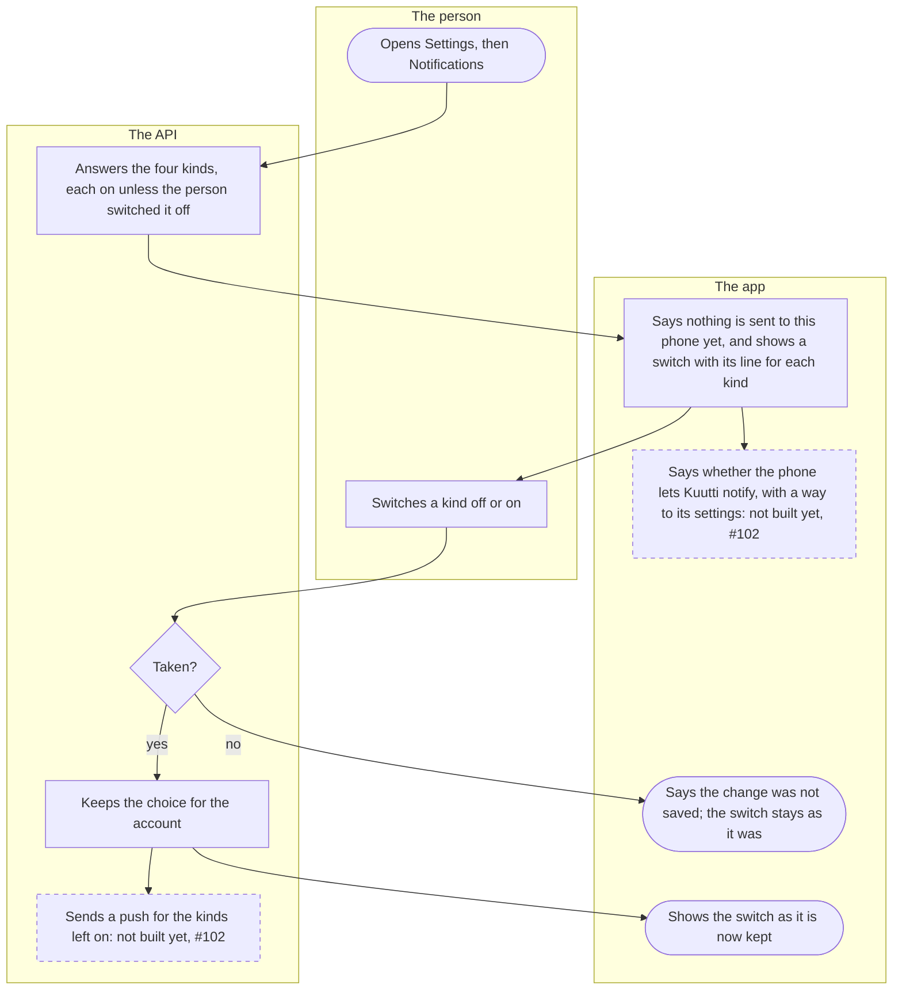
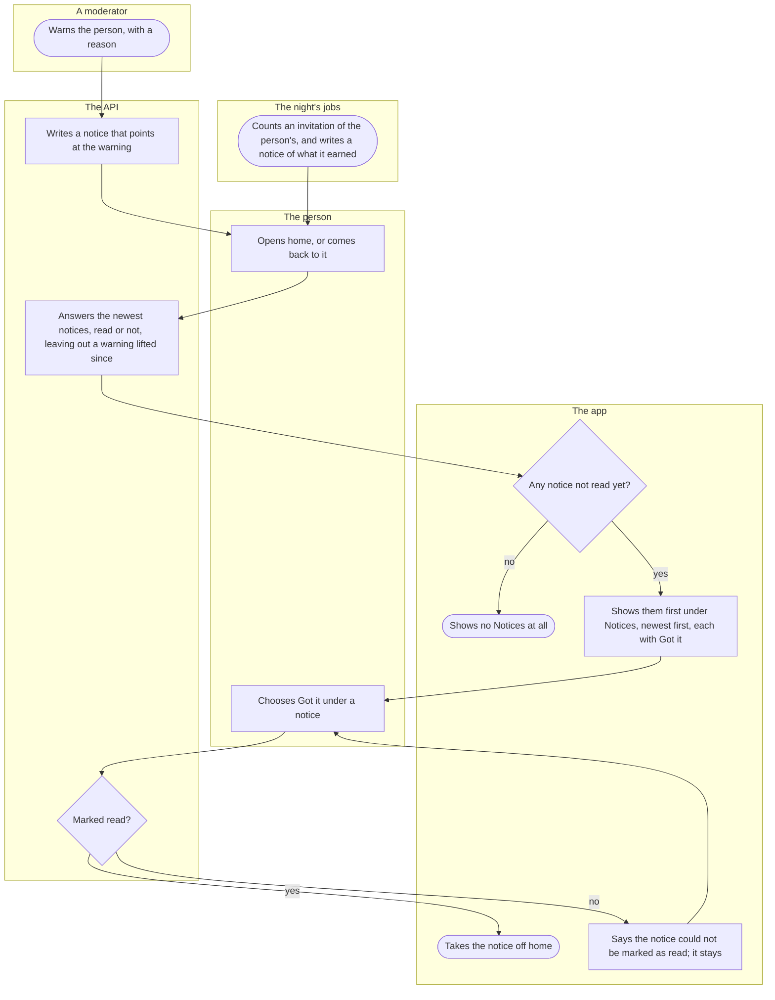

# Notifications and notices

What Kuutti tells a person and how, as it stands: the choices in Settings of what they may be notified of, kept for later since nothing is sent to the phone yet, and the notices the home screen shows until the person has read them. It is for every signed-in person.

## Part 1: choosing what one is notified of

### Steps

1. The person opens Settings and, under Account, Notifications.
2. The API answers the four kinds, in this order, each on unless the person switched it off: a new round, messages, matches, and moderators' decisions. A kind the person never touched is on, and is stored only once they switch it.
3. The app says "Nothing is sent to this phone yet. What you choose here is kept, and decides what is sent once it is. Each kind is on until you switch it off." Under it, one switch per kind with its line: "A new round" ("When the day's people are ready for you."), "Messages" ("That there is a new message, never what it says or who sent it."), "Matches" ("When someone you liked likes you back.") and "Moderators' decisions" ("About your photos and the reports you made. A warning to you is shown in the app whatever you choose here."). If the choices cannot be read, the app says so and offers to try again. The line on the phone's own permission waits for push: 10.
4. The person switches a kind off or on, by the switch or by its words. Every switch waits while the change is on its way.
5. The API takes the change for the person's own account. Taken: 6; not taken (no answer, or the account was deleted meanwhile): 8.
6. The API keeps the choice for the account, not on the phone, so every phone of the person's and every sender to come reads the same. Nothing is sent from here: 9.
7. The app shows every switch as the API now keeps it. The choice is still there the next time the screen opens, on any phone.
8. The app says "The change was not saved. Try again." and the switch stays as it was.
9. Not built yet (#102): a push to the phone, through Expo's push service, for the kinds left on, never carrying what a message says. The senders of the four kinds are to read these switches once they exist.
10. Not built yet (#102, in #184's native batch): a line saying whether the phone lets Kuutti notify at all, and a way to the phone's settings.

## Part 2: the notices on home

### Steps

11. A moderator warns the person, with a reason, in the moderation panel ([Moderation](moderation.md)). A suspension and a ban leave no notice: they end the person's sessions and are said at the bank login. A shadow ban tells nobody anything.
12. In the same step as the warning, the API writes a notice that points at it. A notice holds no words of its own: the app says it from its kind and what it points at. A warning is a notice whatever the person chose for moderators' decisions in part 1.
13. Separately, the night's count of invitations writes a notice for each invitation of the person's that counted ([Inviting a friend](invitations.md)).
14. The person opens the app on home, or comes back to home from another screen.
15. The API answers the person's newest notices, read or not, up to a ceiling the contract sets. A warning lifted since is left out.
16. The app keeps the ones not read yet. Any: 18; none: 17.
17. Home shows no Notices heading and no space for them. A read that fails is left out quietly: home does not fail for it.
18. Home shows the notices first, above the area and the gate, under "Notices", newest first, each with its title, its sentence and Got it: "A warning from a moderator" ("Reason: Harassment. A warning by itself changes nothing in how you use the app."), or "An invitation of yours counted" ("Somebody you invited has finished their profile. You earned a fish."), never who was invited. No badge, no count and no push.
19. The person chooses Got it, a button.
20. The API marks the notice read, once: the first time stands. One that is not the person's is refused. Marked: 21; not marked: 22.
21. The app takes the notice off home. The person's data export still lists it, with when it was read.
22. The app says "The notice could not be marked as read. Try again." and the notice stays. Back to 19.

## Where it lives

- Screens: [settings/notifications.tsx](../../apps/mobile/app/settings/notifications.tsx) and the settings slice's [NotificationsSettingsScreen.tsx](../../apps/mobile/src/features/settings/NotificationsSettingsScreen.tsx); home [index.tsx](../../apps/mobile/app/index.tsx) and [HomeScreen.tsx](../../apps/mobile/src/features/home/HomeScreen.tsx); the notifications slice's [NotificationChoices.tsx](../../apps/mobile/src/features/notifications/NotificationChoices.tsx) and [Notices.tsx](../../apps/mobile/src/features/notifications/Notices.tsx) ([README](../../apps/mobile/src/features/notifications/README.md))
- API: `GET /account/notifications`, `PUT /account/notifications/{kind}`, `GET /notices` and `POST /notices/{id}/read` in the notifications slice ([routes.ts](../../apps/api/src/notifications/routes.ts), [notifications.ts](../../apps/api/src/notifications/notifications.ts), [README](../../apps/api/src/notifications/README.md)); a warning's notice is written by the safety slice's [sanctions.ts](../../apps/api/src/safety/sanctions.ts), a counted invitation's by the night's [invitation-count.ts](../../apps/api/src/jobs/invitation-count.ts)
- Spec: the notifications slice has ordinary tests; a warning's notice in [sanctions.feature](../../features/safety/sanctions.feature) ("A warning shows the person a notice in the app until it is read, and none once lifted"); the choices and notices in the export and erasure in [erasure.feature](../../features/identity/erasure.feature)
- Maestro: [notification-settings.yaml](../../apps/mobile/e2e/flows/notification-settings.yaml) (the messages switch off, kept, and on again)
- ADRs: [ADR-032](../adr/032-notification-choices-and-notices.md), [ADR-024](../adr/024-sanctions.md) §7, [ADR-044](../adr/044-invitations.md) §9

## History

- 2026-10-19 (#176, PR #367): Settings › Notifications holds a switch per kind, kept on the server and on until switched off, and says nothing is sent to the phone yet; home shows a moderator's warning under Notices until Got it.
- 2026-10-22 (#107, PR #417): a second notice, an invitation of the person's that counted, with what it earned and never who.
