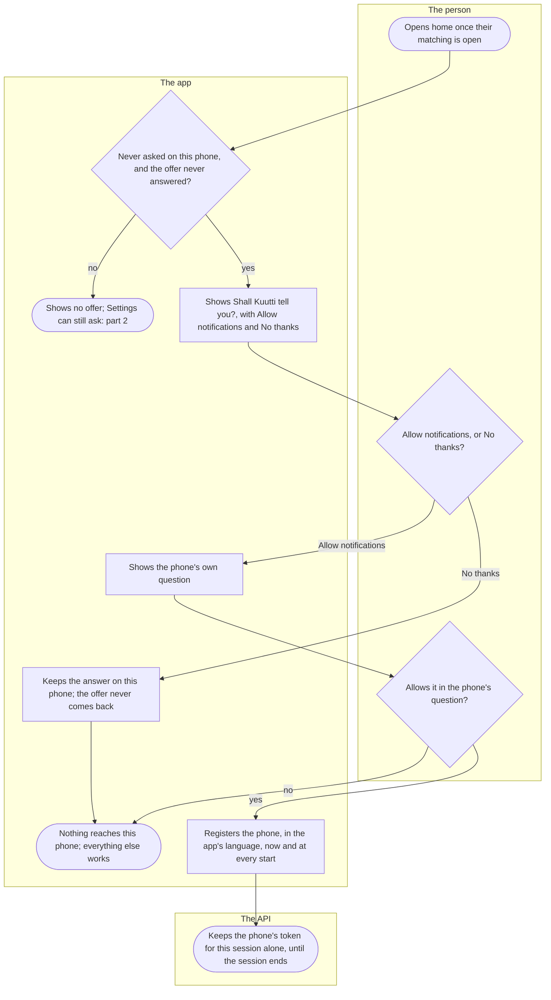
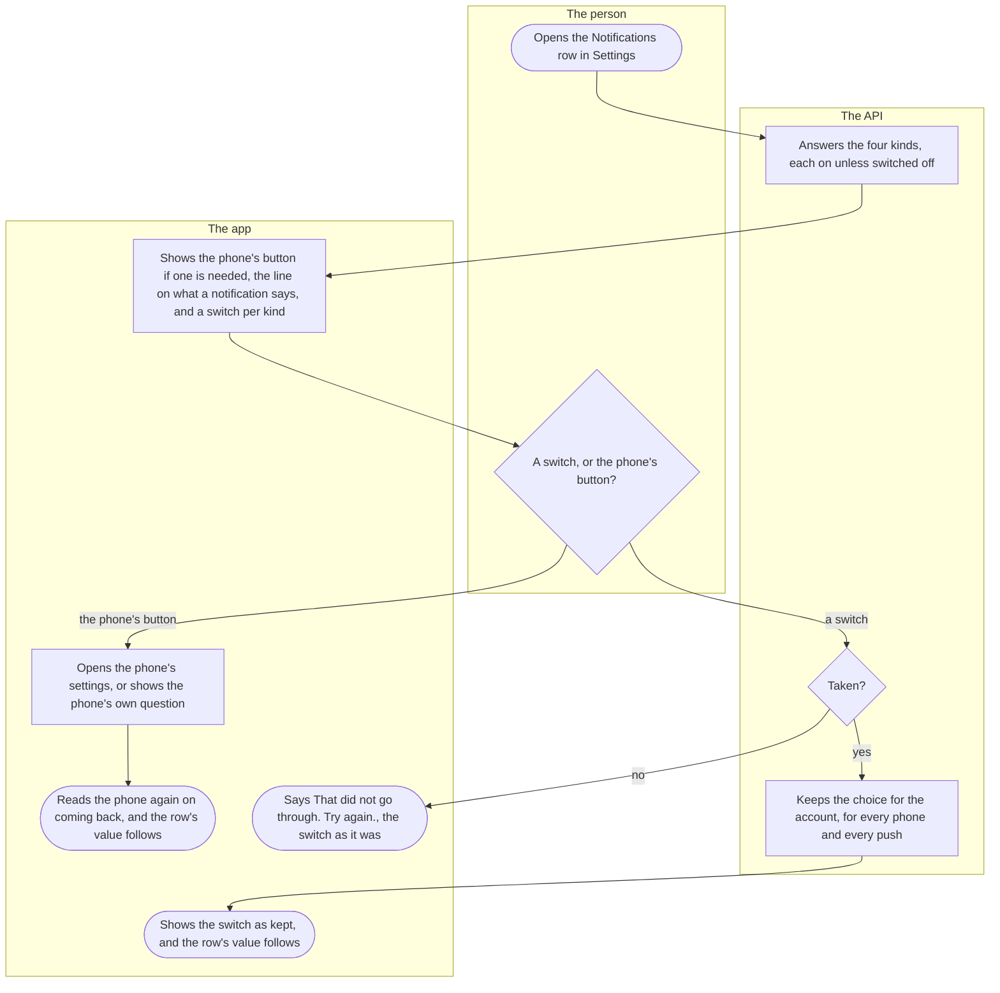
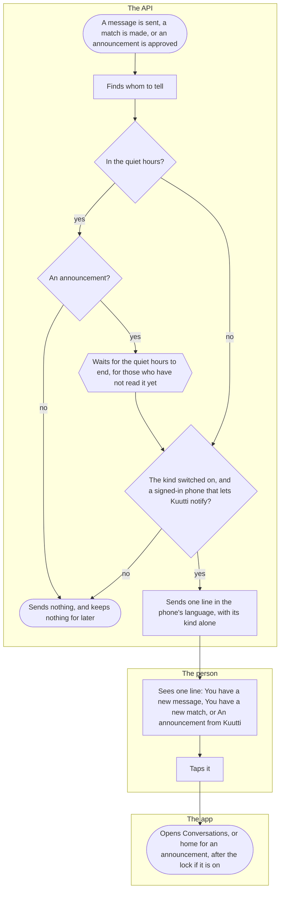
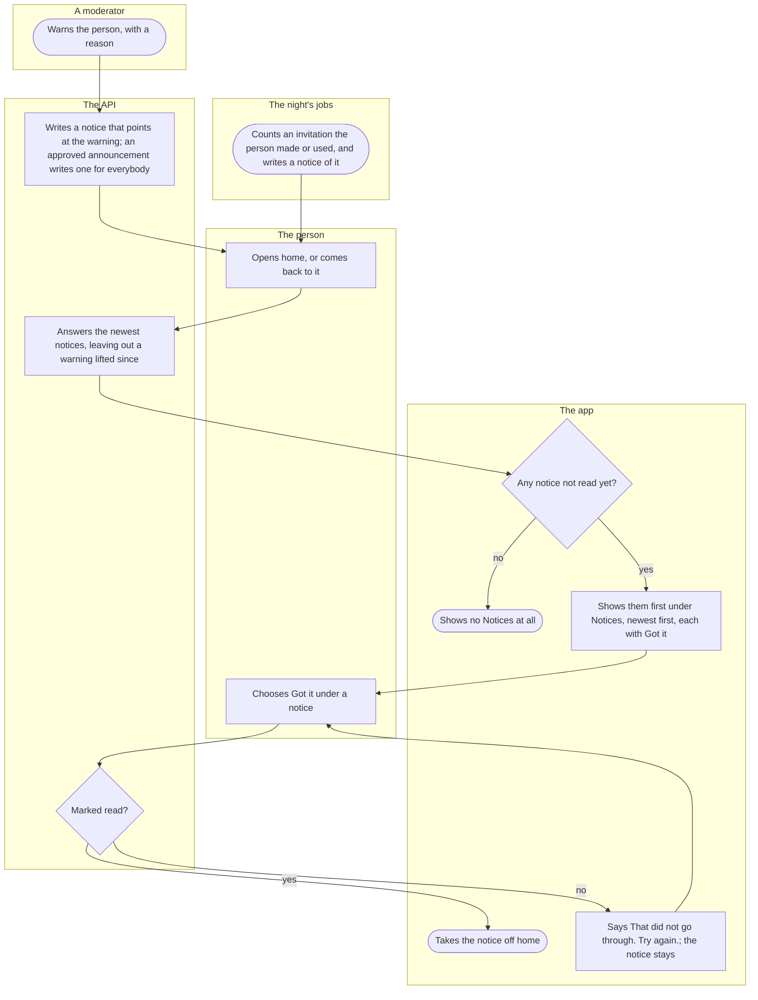

# Notifications and notices

<!-- draws
apps/mobile/app/index.tsx
apps/mobile/app/settings/index.tsx
apps/mobile/src/features/home/HomeScreen.tsx
apps/mobile/src/features/settings/SettingsScreen.tsx
apps/mobile/src/features/notifications/PushOffer.tsx
apps/mobile/src/features/notifications/NotificationChoices.tsx
apps/mobile/src/features/notifications/PhoneLine.tsx
apps/mobile/src/features/notifications/usePhonePermission.ts
apps/mobile/src/features/notifications/phone.ts
apps/mobile/src/features/notifications/PushNotifications.tsx
apps/mobile/src/features/notifications/Notices.tsx
apps/api/src/notifications/routes.ts
apps/api/src/notifications/notifications.ts
apps/api/src/notifications/tokens.ts
apps/api/src/notifications/push.ts
apps/api/src/safety/sanctions.ts
apps/api/src/jobs/invitation-count.ts
-->

What Kuutti tells a person while they are not looking, and how: the one offer to let the phone be notified, the switches in Settings, what a push says and never says, and the notices the home screen shows until the person has read them. It is for every signed-in person.

## Part 1: being asked

### Steps

1. The person opens home once their matching is open ([People on Kuutti](people-on-kuutti.md)), where the card that holds See people also holds the offer: there is something to tell now. It never comes at the first start.
2. The app offers only while this phone was never asked by its own question and the offer was never answered on it. Never asked: 4. Otherwise: 3.
3. No offer. A phone asked before keeps its answer, and Settings shows what it leaves to do (part 2). The web preview never offers.
4. Under See people: "Shall Kuutti tell you?", "Kuutti can tell this phone when someone likes you back and when a message arrives. A notification says that there is a new message, a new match or an announcement, never what it says or from whom. You choose which kinds in Settings.", and two buttons of equal weight, "Allow notifications" and "No thanks". Both wait from a tap until the answer is in.
5. No thanks: 6. Allow notifications: 7.
6. Either answer is kept on this phone first, so the offer never comes back on it, not even after the app was closed under the phone's question. After No thanks: 9.
7. With the answer kept as in 6, the app shows the phone's own question, for a banner and a sound, never a badge.
8. Refused: 9. Allowed: 10.
9. Nothing reaches this phone, and everything else in the app works without it. The phone remembers a refusal itself; Settings has the way to the phone's settings (part 2).
10. The app registers the phone with the API, in the app's language: at once, at every start, when the person changes the app's language, and when the app comes back to the front with a registration owed, such as a permission given meanwhile in the phone's settings or a start that found no network.
11. The API keeps the phone's token for this session alone, worded in that language: a phone has one, and it belongs to the session signed in on it now. It goes when the session ends: a sign-out, Log out everywhere, a break, a sanction, the lock's way out or the account's deletion, so a person on a break, suspended or banned is pushed nothing.

## Part 2: the switches

### Steps

12. The person opens Settings with the gear on the home screen. Its Notifications row says, as its value, "Not allowed on this phone", marked, when the phone refuses them, since then nothing arrives whatever the switches say; "Not asked on this phone yet"; or "All on", "All off", or how many kinds are on and off. A press opens the row in place, under itself.
13. The API answers the four kinds, in this order, each on unless the person switched it off: messages, matches, moderators' decisions and announcements. A kind the person never touched is on, and is stored only once they switch it.
14. First what the phone's answer leaves to do: "Open the phone's settings" when it refuses them, "Allow notifications" when it was never asked, and nothing when it allows them; a device that cannot show them, the web preview, says "This device cannot show Kuutti's notifications." Then "A notification says that there is a new message, a new match or an announcement, never what it says or from whom." Then one switch per kind: "Messages", "Matches", "Moderators' decisions" with "Nothing is sent to your phones for these yet.", and "Announcements from Kuutti" with "When this is off, an announcement still shows in the app, with no push and no email." While the choices are read it says "Loading…"; if they cannot be read, it says why, with Try again.
15. The phone's button: 16. A switch, by the switch or by its name: 18.
16. "Open the phone's settings" opens the phone's own settings for Kuutti; "Allow notifications" shows the phone's own question, as the home screen's offer does (part 1), and waits while it is open. No dialog of Kuutti's asks.
17. When the app comes back to the front it reads the phone's answer again; a change is said aloud, as "This phone shows Kuutti's notifications.", and the row's value follows.
18. The API takes the change for the person's own account; every switch waits while it is on its way. Taken: 19. Not taken (no answer, or the account deleted meanwhile): 21.
19. The API keeps the choice for the account, not on the phone, so every phone of the person's and every push reads the same: Messages and Matches decide their pushes, Announcements an announcement's push and e-mail but never its notice, and Moderators' decisions nothing yet (part 3).
20. The app shows every switch as the API now keeps it, and the row's value says so. The choice is there the next time, on any phone.
21. The app says "That did not go through. Try again." and the switch stays as it was.

## Part 3: what a push says

### Steps

22. Something to tell has happened, and its own answer has gone first: a message was sent ([Chat](chat.md), part 1), a like made a match ([People](queue.md)), or a second admin approved an announcement ([Announcements](announcements.md)). Nothing is pushed by the clock: there is no daily push, and none for a moderator's decision.
23. The API finds whom to tell. For a message, each person who may read it and is away from the app, at most once a conversation in `message_push_min_interval_minutes`, never across a block or a close and never of a shadow-banned sender's words. For a match, the one whose earlier like it met, in the app or not, never the one who just liked. For an announcement, everybody whose notice of it is still unread.
24. In the quiet hours, from `push_quiet_from_hour` to `push_quiet_to_hour` in Helsinki: 25. Otherwise: 27.
25. An announcement: 26. A message or a match: 28.
26. An announcement's push waits until the quiet hours end, then goes on to those who have not read its notice meanwhile: 27.
27. The person's switch for the kind is read fresh, and so are their phones: only those signed in now that registered while they let Kuutti notify. Switched off, or no such phone: 28. Otherwise: 29.
28. Nothing is pushed, and nothing is kept to send later: the person sees it all when they next open the app.
29. The API sends each phone one line of the app's own words in that phone's language, through Expo, which hands it to Apple or Google, with its kind alone: never a message's text, a name, an account, the conversation or an announcement's own words, no title and no badge. A newer push of a kind takes the older one's place on the phone, and none is delivered to a phone that was off once the quiet hours have begun or the Finnish day has ended.
30. The phone shows "You have a new message", "You have a new match" or "An announcement from Kuutti". With the app in front it shows as a banner and in the phone's list, silently.
31. The person taps it.
32. The app opens Conversations for a message or a match, and home for an announcement, whose notice is there (part 4); after the app lock, if it is on. Nothing opens while signed out, and a sign-out clears the phone's list of Kuutti's notifications.

## Part 4: the notices on home

### Steps

33. A moderator warns the person, with a reason, in the moderation panel ([Moderation](moderation.md), [Report and block](report-and-block.md)). A suspension and a ban leave no notice: they end the person's sessions and are said at the bank login. A shadow ban tells nobody anything.
34. Separately, the night's count of invitations writes a notice for each invitation of the person's that counted, even one that earned nothing, and one for the invitation the person used, when it earned them a fish ([Inviting a friend](invitations.md)).
35. In the same step as the warning, the API writes a notice that points at it; the approval of an announcement writes one for every account not erased ([Announcements](announcements.md)). A notice holds no words of its own but an announcement's: the app says it from its kind and what it points at. A warning is a notice whatever the person chose for moderators' decisions in part 2.
36. The person opens the app on home, or comes back to home from another screen.
37. The API answers the person's newest notices, read or not, up to a ceiling the contract sets, an announcement's in the app's language: Finnish for Finnish and Stadi, Swedish where it was written in Swedish, English otherwise. A warning lifted since is left out.
38. The app keeps the ones not read yet. Any: 40; none: 39.
39. Home shows no Notices heading and no space for them. A read that fails is left out quietly: home does not fail for it.
40. Home shows them under "Notices", before anything else it offers, newest first, each with its title, its sentence and Got it: "A warning from a moderator" ("Reason: {reason}. A warning by itself changes nothing in how you use the app."); "An invitation of yours counted" ("Somebody you invited has finished their profile." and what it earned, as "You earned a fish." or "Thank you for inviting them."), never who was invited; "The invitation you used counted" ("The invitation earned you a fish."), never who invited them; or an announcement's own title and text. No badge and no count.
41. The person chooses Got it, a button.
42. The API marks the notice read, once: the first time stands. One that is not the person's is refused. Marked: 43; not marked: 44.
43. The app takes the notice off home. The person's data export still lists it, with when it was read.
44. The app says "That did not go through. Try again." and the notice stays. Back to 41.

## Open

- **Where the switches sit in Settings.** [ADR-032](../adr/032-notification-choices-and-notices.md) §6 puts them at Settings › Account › Notifications; the code makes them a row of the section "Notifications and contacts", opening in place ([SettingsScreen.tsx](../../apps/mobile/src/features/settings/SettingsScreen.tsx), since #511, PR #516). The register has no note on it yet. Drawn as the Notifications row of Settings, naming neither section.

## Where it lives

- Screens: home [index.tsx](../../apps/mobile/app/index.tsx) and [HomeScreen.tsx](../../apps/mobile/src/features/home/HomeScreen.tsx) (the offer and the notices); [settings/index.tsx](../../apps/mobile/app/settings/index.tsx) and [SettingsScreen.tsx](../../apps/mobile/src/features/settings/SettingsScreen.tsx) (the Notifications row, opened in place); in the notifications feature ([README](../../apps/mobile/src/features/notifications/README.md)) [PushOffer.tsx](../../apps/mobile/src/features/notifications/PushOffer.tsx) (home's offer), [NotificationChoices.tsx](../../apps/mobile/src/features/notifications/NotificationChoices.tsx) (the switches and the row's value), [PhoneLine.tsx](../../apps/mobile/src/features/notifications/PhoneLine.tsx), [usePhonePermission.ts](../../apps/mobile/src/features/notifications/usePhonePermission.ts) and [phone.ts](../../apps/mobile/src/features/notifications/phone.ts) (the phone's answer, its question, the registration), [PushNotifications.tsx](../../apps/mobile/src/features/notifications/PushNotifications.tsx) (the registration at each start, a push in front, a tap), [Notices.tsx](../../apps/mobile/src/features/notifications/Notices.tsx)
- API: `GET /account/notifications`, `PUT /account/notifications/{kind}`, `GET /notices`, `POST /notices/{id}/read` and `PUT /push-token` in the notifications slice ([README](../../apps/api/src/notifications/README.md), [routes.ts](../../apps/api/src/notifications/routes.ts), [notifications.ts](../../apps/api/src/notifications/notifications.ts), [tokens.ts](../../apps/api/src/notifications/tokens.ts)); whom a push tells, and when, in [push.ts](../../apps/api/src/notifications/push.ts), sent through Expo by [lib/push.ts](../../apps/api/src/lib/push.ts); a message's readers from the chat slice's [messages.ts](../../apps/api/src/chat/messages.ts) and a match from the matching slice, both handed over in [app.ts](../../apps/api/src/app.ts); a warning's notice is written by the safety slice's [sanctions.ts](../../apps/api/src/safety/sanctions.ts), a counted invitation's by the night's [invitation-count.ts](../../apps/api/src/jobs/invitation-count.ts) through the rewards slice's [invitations.ts](../../apps/api/src/rewards/invitations.ts), an announcement's by [announcements.ts](../../apps/api/src/notifications/announcements.ts)
- Spec: whom a push tells in [push.feature](../../features/notifications/push.feature); an announcement's notice and push in [announcements.feature](../../features/notifications/announcements.feature); a warning's notice in [sanctions.feature](../../features/safety/sanctions.feature) ("A warning shows the person a notice in the app until it is read, and none once lifted"); the choices, the notices and the tokens in the export and erasure in [erasure.feature](../../features/identity/erasure.feature)
- Maestro: [notification-settings.yaml](../../apps/mobile/e2e/flows/notification-settings.yaml) (the Notifications row: the phone's button, the messages switch off, kept, and on again)
- ADRs: [ADR-032](../adr/032-notification-choices-and-notices.md) (the switches and the notices), [ADR-055](../adr/055-push.md) (the push: §1 what it says, §2 and §3 a token per session, §4 and §5 a message and a match, §7 the quiet hours, §9 the app's question), [ADR-062](../adr/062-one-queue.md) §12 (no daily push), [ADR-068](../adr/068-announcements.md) §3, §4 and §6 (an announcement's notice, push and switch), [ADR-024](../adr/024-sanctions.md) §7, [ADR-044](../adr/044-invitations.md) §9
- Rules: the register's [Notifications](../decisions.md#notifications), [Invitations and rewards](../decisions.md#invitations-and-rewards) and [Safety](../decisions.md#safety) rows

## History

- 2026-10-19 (#176, PR #367): Settings › Notifications holds a switch per kind, kept on the server and on until switched off, and says nothing is sent to the phone yet; home shows a moderator's warning under Notices until Got it.
- 2026-10-22 (#107, PR #417): a second notice, an invitation of the person's that counted, with what it earned and never who.
- 2026-10-25 (#102, PR #459): pushes through Expo, of a new message, a new match and the day's round, each by its switch and none in the quiet hours; home offers notifications once matching is open; Settings says what the phone allows, with the way to its settings or its question, and no longer says that nothing is sent.
- 2026-10-30 (#511, PR #516): Notifications is a row of Settings' one list that opens in place, its value saying which kinds are on, or that the phone refuses them or was never asked.
- 2026-11-03 (#502, PR #578): the day's round push and its switch go with the daily round.
- 2026-11-03 (#503, PR #579): a third notice: the invitation the person used counted, with the fish it earned them.
- 2026-11-07 (#573, PR #643): an announcement to everybody leaves a notice in Kuutti's own words and has its own push and its own switch, which stops the push and the e-mail, never the notice; a tap on its push opens home.
