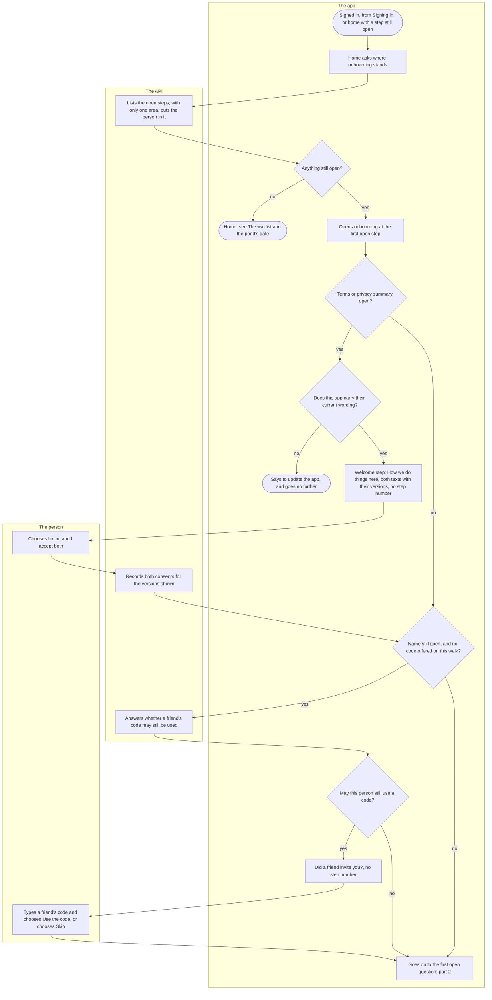
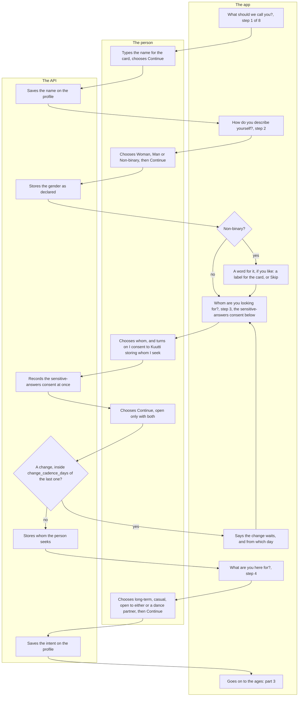
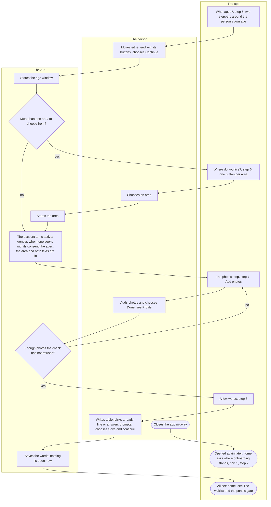

# Onboarding

What a person answers after their first bank login before Kuutti can show them to anyone: the name for their card, their gender, whom they seek, what they are here for, the ages, the area, photos and a few words, one question per screen. Everyone with a new account goes through it, and a person whose terms changed, or who took back the consent for whom they seek, comes back to the part that is open again.

## Part 1: arriving, the consents and a friend's code

### Steps

1. The person has just signed in with their bank (see [Signing in](sign-in.md)), or home has come to the front while a step of onboarding is open: a wording of the terms or the privacy summary changed, or the person withdrew the consent for whom they seek in Settings.
2. Home asks the API where onboarding stands, every time it comes to the front. Until the answer is there it shows nothing that needs a finished account; an answer it cannot read keeps it closed, says why, and offers Try again.
3. The API lists the steps still open, and answers the person's age from the bank's year and month of birth. An account without an area is put in the one `default_pond` names, while that is the only area without a parent; with more than one, nothing is assigned and the area is asked (step 41).
4. Nothing open: 5. Something open: 6. A new account always has something open.
5. Home: see [The waitlist and the pond's gate](waitlist-and-gate.md).
6. The app opens onboarding, under "Welcome to Kuutti", at the first open step. After every answer it asks the API again and shows the next open step; a step already answered is passed over, so a walk left midway goes on where it stopped (step 54). Research is never asked here: it was asked before the bank, and Settings has its switch.
7. The terms or the privacy summary missing for their current wording: 8. Otherwise: 13.
8. Does this app carry the current version of both texts? No: 9. Yes: 10.
9. "This text has a newer version than the one built into this app. Update the app to continue." There is no button: nothing goes further until the app is updated.
10. The welcome step, the fallback for the consents normally given before the bank: "How we do things here", the four norms, the terms and the privacy summary each with its version as a link to the full text, and outside Finnish the line that the Finnish text is the one that counts. It has no "Step x of n". It comes when a wording changed since the person accepted it, when a second person signs in on a shared phone, when the record after the bank failed, or when the answers were lost while the bank was open. A person with a finished profile whose terms changed sees this and nothing else, then home.
11. The person chooses "I'm in, and I accept both".
12. The API records the terms and the privacy summary for the versions the app showed, in the language they were shown in; a consent it has already is recorded once. The phone remembers the versions, so its next sign-in skips the screens before the bank.
13. The name still open, and no friend's code offered on this walk: 14. Otherwise: 18.
14. The API answers whether this person may still use a friend's invitation code: only while they never had an account deleted, have used no code, have not yet been counted at the pond's gate, and have the current terms and privacy summary.
15. Yes: 16. No, or the answer could not be read: 18, and Settings offers the code later.
16. "Did a friend invite you?": "If a friend gave you an invitation code, type it here. You can also skip this and type it later in Settings, until your profile is complete." No step number.
17. The person types the code and chooses "Use the code": a code that works says "The code is in. Your friend's invitation counts once your profile is complete." with Continue, and one that does not is said in words. Or they choose "Skip". Either way the code is done with for this walk.
18. On to the first open question: part 2, from step 19.

## Part 2: the name, the gender, whom one seeks and the intent

### Steps

19. "What should we call you?": "The name on your card. Yours to choose, not the bank's." The field is never filled in from the bank. "Step 1 of 8".
20. The person types a name and chooses "Continue", which opens once the field has something in it.
21. The API saves the name on the person's profile.
22. "How do you describe yourself?": "Your own words, not the bank's. This is shown on your card." Woman, Man or Non-binary. "Step 2 of 8".
23. The person chooses one and "Continue".
24. The API stores the gender as the person declared it; nothing from the bank informs it. Onboarding asks it only while none is stored, so here it is always a first answer.
25. Non-binary: 26. Otherwise: 27.
26. "A word for it, if you like": "Shown on your card, never used for matching. Skip it if non-binary says it." A label chosen with a button and saved on the profile with "Continue", or "Skip", which saves nothing. Still step 2. It is offered only here, right after the gender: once skipped, or with the app closed before it, it is not offered again, and the profile shows a label only to change or clear one given.
27. "Whom are you looking for?": "Pick everyone you want to see. Nobody outside your choice is ever shown to you, and you are never shown to anyone who did not pick you." Women, Men, Non-binary people, or Anyone. Below, the "Sensitive answers" card with its summary, its version as a link to the full text, outside Finnish the line that the Finnish text counts, and the switch "I consent to Kuutti storing whom I seek". "Step 3 of 8". When the app carries an older wording of the consent than the API, the card says to update the app in place of the switch, and the step cannot be passed.
28. The person chooses one or more, and turns the switch on.
29. The API records the sensitive-answers consent as soon as the switch is turned on, and the switch stays on here. Withdrawing it is in Settings: it takes whom the person seeks with it, so this step is asked again, while the age window stays.
30. The person chooses "Continue", which opens only with a choice and the consent. Whom they seek is saved now, on leaving this screen.
31. Is it a change, inside `change_cadence_days` of the last change? Yes: 32. No: 33. A first answer is no change, nor the same answer given again while one is stored. The step only comes back after the consent was withdrawn or its wording changed; after a withdrawal any answer counts as a change while an earlier change is on record, so withdrawing is no way round the wait.
32. "You changed this recently. A change is possible again once the waiting time has passed.", and "Next change possible:" with the date: 27.
33. The API stores whom the person seeks, a filter that holds both ways. If the answer brings a person who was counted at the gate into a contest they were not in, their place there waits for the night (see [The waitlist and the pond's gate](waitlist-and-gate.md), part 3).
34. "What are you here for?": "You're shown only to people who want the same thing. Open to either covers long-term and casual. You can change this later." "Step 4 of 8".
35. The person chooses "Something long-term", "Something casual", "Open to either" or "A dance partner", and "Continue". A dance partner meets dance partners only.
36. The API saves the intent on the profile.
37. On to the ages: part 3, from step 38.

## Part 3: the ages, the area, photos and a few words

### Steps

38. "What ages?": "We start around your own age; move the ends as you like.", with the lowest and highest ages Kuutti allows. Two steppers, "Youngest" and "Oldest", start five years either side of the person's own age, inside those bounds. "Step 5 of 8". The step is asked only while no window is stored.
39. The person moves either end with its buttons ("Youngest, one year older", "Oldest, one year younger" and their pairs): the youngest never passes the oldest and neither leaves the bounds. Then "Continue".
40. The API stores the age window, a filter that holds both ways.
41. More than one area without a parent: 42. One: 45; the API put the person in it at step 3.
42. "Where do you live?": "Kuutti matches people inside one area. Choose yours." One button per area, named in the person's language. "Step 6 of 8". A list that cannot be read says so, with Try again.
43. The person chooses an area.
44. The API stores the area.
45. On the next read after the last of them, the API turns the account active: the gender, whom one seeks with its consent, the age window, the area, and the terms and the privacy summary in their current wording are all there. Nothing on the screen changes, and home still sends the person back while anything is open; the gate counts a person only once nothing is open and their photos are approved.
46. The photos step, "Step 7 of 8": why a face photo matters, and "Add photos". How many photos close the step is under Open below.
47. The person adds photos on "Your photos", one at a time from the phone, and chooses "Done", which returns to onboarding: see [Profile](profile.md).
48. Does the person have enough photos that the check has not refused? A photo still waiting for the check or for a moderator counts here; the card and the gate wait for its approval. Yes: 49. No: 46.
49. "A few words": two answered prompts, a bio of the length the screen names, or a ready line in its place; "Your card leads with a photo and one answer." "Step 8 of 8".
50. The person writes a bio, picks a ready line or answers prompts, and chooses "Save and continue", which opens only once the words count as the profile's completeness reads them. A save the API refuses is said in the profile's own words.
51. The API saves the words on the profile. Nothing is open now.
52. "All set. Your place in line is on the home screen.", and home: see [The waitlist and the pond's gate](waitlist-and-gate.md). The optional questions and the rest of the profile wait there: see [Profile](profile.md).
53. The person closes the app, or leaves it, midway.
54. When they open it again, home asks where onboarding stands (step 2) and onboarding opens at the first open step; nothing answered is asked again. Each answer was stored with its Continue, the sensitive-answers consent with its switch. What lived only on the screen is gone: a choice not yet continued, the steppers (they start around the person's age again), the label's offer after non-binary (not offered again), and the friend's code (offered again only while the name is still open).

## Open

- How many photos close the photos step (step 48). The code asks for two that the check has not refused ([profile.ts](../../packages/schema/src/profile.ts) line 23, read in [onboarding.ts](../../apps/api/src/identity/onboarding.ts) line 198), the screen's title is "Two photos of you" ([messages.yaml](../../packages/i18n/messages.yaml) line 4100), and [ADR-009](../adr/009-profile-and-card.md) §4 has said two since 2026-10-05 (#56). [ADR-010](../adr/010-onboarding-and-consents.md) §10, written on 2026-10-08, says three photos, and so do the comments of the Maestro flow [onboarding.yaml](../../apps/mobile/e2e/flows/onboarding.yaml) (lines 6 and 132), which adds three and passes either way. To be raised as an issue.

## Where it lives

- Screens: [onboarding.tsx](../../apps/mobile/app/onboarding.tsx); in the identity feature [OnboardingScreen.tsx](../../apps/mobile/src/features/identity/onboarding/OnboardingScreen.tsx) (the steps and their order), [useOnboarding.ts](../../apps/mobile/src/features/identity/onboarding/useOnboarding.ts), [useOnboardingGate.ts](../../apps/mobile/src/features/identity/onboarding/useOnboardingGate.ts) (home sends an unfinished account here), [client.ts](../../apps/mobile/src/features/identity/onboarding/client.ts), the welcome step's [BeforeSignIn.tsx](../../apps/mobile/src/features/identity/BeforeSignIn.tsx) and [agreements.ts](../../apps/mobile/src/features/identity/agreements.ts); the code step's [InvitationStep.tsx](../../apps/mobile/src/features/rewards/InvitationStep.tsx) and [RedeemInvitation.tsx](../../apps/mobile/src/features/rewards/RedeemInvitation.tsx); the words' [BioEditor.tsx](../../apps/mobile/src/features/profile/BioEditor.tsx) and [PromptsEditor.tsx](../../apps/mobile/src/features/profile/PromptsEditor.tsx); the areas' names in [names.ts](../../apps/mobile/src/features/pond/names.ts); the photos screen [photos/index.tsx](../../apps/mobile/app/photos/index.tsx)
- API: `GET /onboarding`, `PUT /account/gender` and `POST /consents` in the identity slice's [onboarding-routes.ts](../../apps/api/src/identity/onboarding-routes.ts), with [onboarding.ts](../../apps/api/src/identity/onboarding.ts) (the open steps, the default area, activation); `PUT /preferences` in the matching slice's [routes.ts](../../apps/api/src/matching/routes.ts), with [preferences.ts](../../apps/api/src/matching/preferences.ts) (whom one seeks, the ages, the cadence); `GET /ponds` and `PUT /account/pond` in the pond slice's [routes.ts](../../apps/api/src/pond/routes.ts); `PUT /profile` in the profile slice's [routes.ts](../../apps/api/src/profile/routes.ts); `GET /invitations` and `POST /invitations/redeem` in the rewards slice's [routes.ts](../../apps/api/src/rewards/routes.ts) with [invitations.ts](../../apps/api/src/rewards/invitations.ts); the steps, activation's six and the age bounds in [packages/schema/src/onboarding.ts](../../packages/schema/src/onboarding.ts), the photos and the words a finished profile needs in [packages/schema/src/profile.ts](../../packages/schema/src/profile.ts)
- Spec: [onboarding.feature](../../features/identity/onboarding.feature), [preferences.feature](../../features/matching/preferences.feature), [choice.feature](../../features/pond/choice.feature)
- Maestro: [onboarding.yaml](../../apps/mobile/e2e/flows/onboarding.yaml) (the whole walk, closed and resumed after whom one seeks), [age-window-bounds.yaml](../../apps/mobile/e2e/flows/age-window-bounds.yaml), [identity-label-on-card.yaml](../../apps/mobile/e2e/flows/identity-label-on-card.yaml), [terms-asked-again.yaml](../../apps/mobile/e2e/flows/terms-asked-again.yaml), [sensitive-answers-withdrawal.yaml](../../apps/mobile/e2e/flows/sensitive-answers-withdrawal.yaml); the shared step [welcome-step.yaml](../../apps/mobile/e2e/common/welcome-step.yaml)
- ADRs: [ADR-010](../adr/010-onboarding-and-consents.md) §4 (a consent bound to its version), §6 (activation), §10 (the field sheet's steps), §12 (the area as a choice), §13 (whom one seeks saved on its own), §15 (the consents before the bank, the welcome step as the fallback); [ADR-019](../adr/019-profile-fields-and-roles.md) §1 (the label) and §4 (the sensitive-answers consent); [ADR-015](../adr/015-pond-gate.md) §10 (the cadence of a change) and §13 (a dance partner); [ADR-044](../adr/044-invitations.md) §6 and §12 (a friend's code); [ADR-009](../adr/009-profile-and-card.md) §4 (what a finished profile needs)

## History

- 2026-09-26 (#46, PR #65): onboarding: both consents for the version read, the gender, whom one seeks with the age window, the area, and the research question; home sends anybody unfinished back to it, and the account turns active once the answers are there.
- 2026-10-08 (#146, PR #154): the field sheet's order, one question per screen: the welcome with the norms, the name, the gender and after non-binary a label, whom one seeks with the sensitive-answers consent on the same screen, the intent, the ages as two steppers, photos and a few words; the one area is assigned without a step.
- 2026-10-09 (#147, PR #155): a change of whom one seeks from an earlier answer waits `change_cadence_days`, and the step says from which day.
- 2026-10-10 (#146, PR #169): the photos screen has Done, the way back to onboarding.
- 2026-10-10 (#174, PR #212): a second area: "Where do you live?" after the ages, one button per area, named in the person's language.
- 2026-10-10 (#204, PR #214): after the sensitive-answers consent is withdrawn, only whom one seeks is asked again; the age window stays.
- 2026-10-10 (#146, PR #219): whom one seeks is saved on leaving its screen, so closing the app before the ages keeps it.
- 2026-10-13 (#239, PR #271): a ready line counts as a few words.
- 2026-10-14 (#175, PR #284): "A dance partner" joins the intents.
- 2026-10-14 (#223, PR #286): "Save and continue" on the words waits until they count, and a refused save says why.
- 2026-10-17 (#208, PR #343): each legal text on the welcome step and on whom one seeks shows its version as a link to the full text.
- 2026-10-22 (#107, PR #417): a friend's invitation code, offered once before the name, with Skip.
- 2026-10-22 (#418, PR #422): the consents move before the bank login, the welcome step becomes the fallback with no step number, the research step goes, and the steps are counted as eight from the name.
