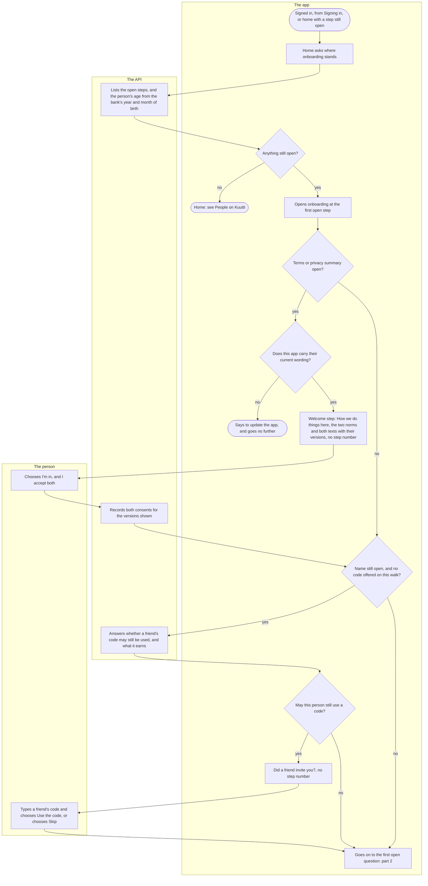
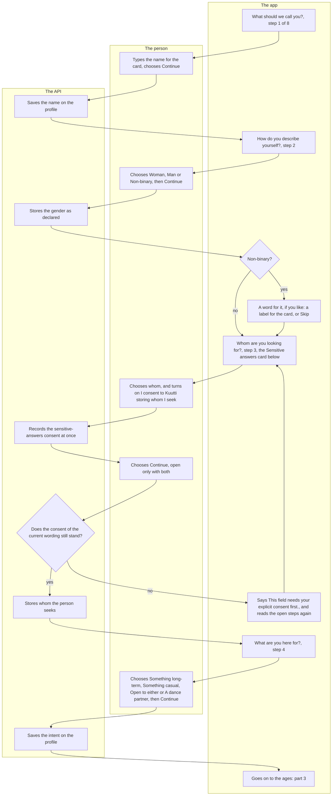
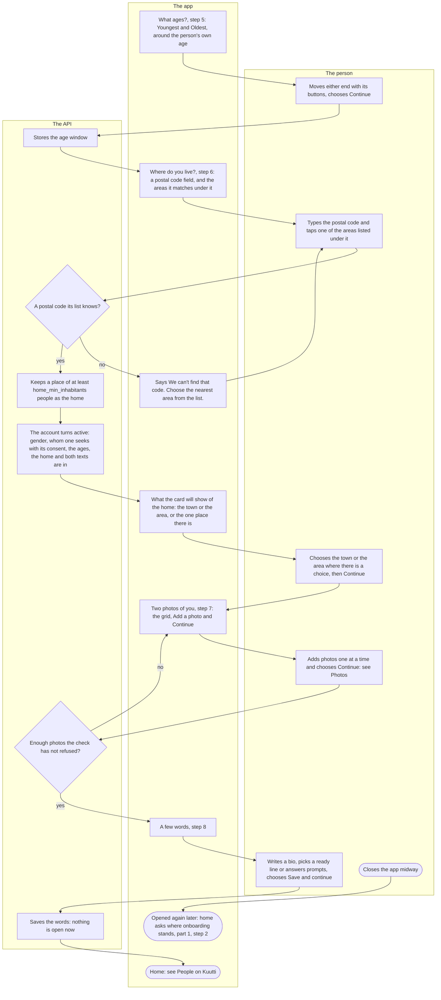

# Onboarding

<!-- draws
apps/mobile/app/onboarding.tsx
apps/mobile/src/features/identity/onboarding/OnboardingScreen.tsx
apps/mobile/src/features/identity/onboarding/useOnboarding.ts
apps/mobile/src/features/identity/onboarding/useOnboardingGate.ts
apps/mobile/src/features/identity/BeforeSignIn.tsx
apps/mobile/src/features/rewards/InvitationStep.tsx
apps/mobile/src/features/rewards/RedeemInvitation.tsx
apps/mobile/src/features/profile/PlaceEditor.tsx
apps/mobile/src/features/media/PhotosScreen.tsx
apps/mobile/src/features/profile/BioEditor.tsx
apps/mobile/src/features/profile/PromptsEditor.tsx
apps/api/src/identity/onboarding-routes.ts
apps/api/src/identity/onboarding.ts
apps/api/src/matching/routes.ts
apps/api/src/matching/preferences.ts
apps/api/src/pond/routes.ts
apps/api/src/pond/home.ts
apps/api/src/rewards/invitations.ts
packages/schema/src/onboarding.ts
packages/schema/src/profile.ts
-->

What a person answers after their first bank login before Kuutti can show them to anyone: the name for their card, their gender, whom they seek, what they are here for, the ages, their home, photos and a few words, one question per screen. Everyone with a new account goes through it, and a person whose terms changed, or who took back the consent for whom they seek, comes back to the part that is open again.

## Part 1: arriving, the consents and a friend's code

### Steps

1. The person has just signed in with their bank (see [Signing in](sign-in.md)), or home has come to the front while a step of onboarding is open: a wording of the terms, the privacy summary or the sensitive-answers consent changed, the person turned off "Store my sensitive answers" in Settings, which takes whom they seek with it, or the place kept as their home is one the list of places no longer knows. The profile's What you seek sends a person back here the same way when its consent is gone (see [Profile](profile.md)).
2. Home asks the API where onboarding stands, every time it comes to the front. Until the answer is there it says "Loading…" and shows nothing that needs a finished account; an answer it cannot read keeps it closed, says why, and offers Try again.
3. The API lists the steps still open, in the order the app asks them, and the person's age from the bank's year and month of birth.
4. Nothing open: 5. Something open: 6. A new account always has something open.
5. Home: see [People on Kuutti](people-on-kuutti.md).
6. The app opens onboarding at the first open step, each step under its question as its one heading. After every answer it asks the API again and shows the next open step; a step already answered is passed over, so a walk left midway goes on where it stopped (step 57). A step the API does not take says why in its own words where it has them, else "Something did not load. Try again." Nothing asks about research until there is a researcher, and nothing under onboarding is a screen to go back to.
7. The terms or the privacy summary missing for their current wording: 8. Otherwise: 13.
8. Does this app carry the current version of both texts? No: 9. Yes: 10.
9. "This text has a newer version than the one built into this app. Update the app to continue." There is no button: nothing goes further until the app is updated.
10. The welcome step, the fallback for the consents normally given before the bank: the screen of [Signing in](sign-in.md) step 3, "How we do things here" with the two norms, the terms and the privacy summary each with its version as a link to the full text, and outside Finnish the line that the Finnish text is the one that counts. It has no "Step x of n". It comes when a wording changed since the person accepted it, when a second person signs in on a shared phone, when the record after the bank failed, or when the answers were lost while the bank was open. A person with a finished profile whose terms changed sees this and nothing else, then home.
11. The person chooses "I'm in, and I accept both".
12. The API records the terms and the privacy summary for the versions the app showed, in the language they were shown in; a consent it has already is recorded once. The phone remembers the versions, so its next sign-in skips the screens before the bank.
13. The name still open, and no friend's code offered on this walk: 14. Otherwise: 18.
14. The API answers whether this person may still use a friend's invitation code: only while their profile is not complete, they never had an account deleted, they have used no code, and they have the current terms and privacy summary. It also answers what a code earns, which `invitation_reward` sets.
15. Yes: 16. No, or the answer could not be read: 18, and Settings offers the code later while it may still be used.
16. "Did a friend invite you?", with no step number. While `invitation_reward` gives the person typing a code a fish, a line says what the code earns them, and their friend when the friend earns too, once their profile is complete. Under it the field "Invitation code", "Use the code" and "Skip".
17. The person types the code and chooses "Use the code": a code that works says "The code is in." with "Continue", and one that does not is said in words. Or they choose "Skip". Either way the code is done with for this walk: see [Inviting a friend](invitations.md).
18. On to the first open question: part 2, from step 19.

## Part 2: the name, the gender, whom one seeks and the intent

### Steps

19. "What should we call you?", with "Name on your card" over the field. The field is never filled in from the bank. "Step 1 of 8".
20. The person types a name and chooses "Continue", which opens once the field has something in it.
21. The API saves the name on the person's profile.
22. "How do you describe yourself?": "Yours to choose, not the bank's. This is shown on your card." Woman, Man or Non-binary. "Step 2 of 8".
23. The person chooses one and "Continue".
24. The API stores the gender as the person declared it; nothing from the bank informs it. Onboarding asks it only while none is stored, so here it is always a first answer, and the wait of `change_cadence_days` between two changes of gender never applies here. A later change is the profile's: see [Profile](profile.md).
25. Non-binary: 26. Otherwise: 27.
26. "A word for it, if you like": "Shown on your card, never used for matching." A label chosen with a button and saved on the profile with "Continue", which opens once one is chosen, or "Skip", which saves nothing. Still step 2. Onboarding offers it only here, right after the gender: once skipped, or with the app closed before it, onboarding does not offer it again; the profile's gender screen does, while non-binary is chosen and no label is stored.
27. "Whom are you looking for?": "Nobody outside your choice is ever shown to you, and you are never shown to anyone who did not pick you." Women, Men, Non-binary people, or Anyone. Below, the "Sensitive answers" card: its summary, which says that whom one seeks is stored to match the person and, counted together with everyone else's answers, for the shares on the home screen, and that their own answer is never shown to anyone; its version as a link to the full text; outside Finnish the line that the Finnish text counts; and the switch "I consent to Kuutti storing whom I seek". "Step 3 of 8". When the app carries an older wording of the consent than the API, the card says "This text has a newer version than the one built into this app. Update the app to continue." in place of the switch, and the step cannot be passed. After a new wording, the choice starts from the answer stored before.
28. The person chooses one or more, and turns the switch on.
29. The API records the sensitive-answers consent as soon as the switch is turned on, and the switch stays on here. Withdrawing it is in Settings, "Store my sensitive answers": it takes whom the person seeks with it, so this step is asked again, while the age window stays.
30. The person chooses "Continue", which opens only with a choice and the consent. Whom they seek is saved now, on leaving this screen.
31. Does the consent of the current wording still stand when the answer arrives? The API reads it under the same lock a withdrawal takes. No, as when it was withdrawn on another phone while this step was open: 32, and nothing is stored. Yes: 33. Whom one seeks may be changed as often as the person likes; no wait applies to it.
32. "This field needs your explicit consent first." The app reads the open steps again, so the switch can be turned on again: 27.
33. The API stores whom the person seeks, a filter that holds both ways.
34. "What are you here for?": "You're shown only to people who want the same thing." "Step 4 of 8".
35. The person chooses "Something long-term", "Something casual", "Open to either" or "A dance partner", each a row the width of the screen, and "Continue". Open to either covers long-term and casual; a dance partner meets dance partners only.
36. The API saves the intent on the profile.
37. On to the ages: part 3, from step 38.

## Part 3: the ages, the home, photos and a few words

### Steps

38. "What ages?", with the lowest and highest ages Kuutti allows. Two steppers, "Youngest" and "Oldest", one above the other, start a few years either side of the person's own age, inside those bounds. "Step 5 of 8". The step is asked only while no window is stored.
39. The person moves either end with its buttons ("Youngest, one year older", "Oldest, one year younger" and their pairs): the youngest never passes the oldest and neither leaves the bounds. Then "Continue".
40. The API stores the age window, a filter that holds both ways.
41. "Where do you live?": "Your postal code tells Kuutti how far people are. Others see a town or your area by name, never the digits." A field, "Postal code", which never opens the keyboard by itself, and under it the areas whose codes start with the digits typed, each a button with its code and its name. "Step 6 of 8". The digits stay on the phone until an area is tapped.
42. The person types the postal code and taps their area. Digits that no code in the phone's own list starts with are said at once, "We can't find that code. Choose the nearest area from the list.", with the nearest areas to choose from.
43. Does the API's list know the code? A phone with an older list can still offer one the API no longer has. No: 44. Yes: 45.
44. "We can't find that code. Choose the nearest area from the list.", and nothing is kept: 42.
45. The API keeps as the home a place of at least `home_min_inhabitants` people: the postal area if it has that many, else its municipality, else the nearest municipality that has them. The digits of an area too small to keep are looked up and gone, and the answer names places, never digits. The home can be changed later in the profile: see [Profile](profile.md).
46. On the read after the home, the last of them, the API turns the account active: the gender, whom one seeks with its consent, the age window, the home, and the terms and the privacy summary in their current wording are all there. Nothing on the screen changes, and home still sends the person back while anything is open; matching opens for a person only once nothing is open, their photos are approved and an admin has opened it: see [People on Kuutti](people-on-kuutti.md).
47. What the card will show of the home, still step 6. Where an area is kept, "What should your card show?" with the town and the area as two buttons, the town chosen; otherwise "On your card:" and the one place there is. The town is the kept place's own municipality when it has at least `home_town_min_inhabitants` people, else the nearest one that has.
48. The person chooses the town or the area where there is a choice, which is saved at once, and "Continue".
49. The photos step, "Step 7 of 8", is the photos screen itself: "Two photos of you", "Profiles with a face photo get seen.", the grid of photos, "Add a photo" and "Continue", its only way on.
50. The person adds photos one at a time from the phone, as on the photos screen of the profile (see [Photos](photos.md)), and chooses "Continue", which opens once enough photos count as the API counts them: one waiting for the check or for a moderator counts, a refused one does not. How many is under Open below.
51. Continue reads the photos and the open steps again: does the person have enough photos the check has not refused? A photo refused meanwhile keeps the step, and its tile says why. Yes: 52. No: 49. The card and matching wait for the photos' approval.
52. "A few words": "Answer two questions, write a bio of at least {min, number} characters, or pick a ready line.", where min is the length the code holds for a bio. "Step 8 of 8".
53. The person writes a bio, picks a ready line or answers prompts, and chooses "Save and continue", which opens only once the words count as the profile's completeness reads them. A save the API refuses is said in the profile's own words.
54. The API saves the words on the profile. Nothing is open now.
55. Home follows, with nothing between: see [People on Kuutti](people-on-kuutti.md). The optional questions and the rest of the profile wait there: see [Profile](profile.md).
56. The person closes the app, or leaves it, midway.
57. When they open it again, home asks where onboarding stands (step 2) and onboarding opens at the first open step; nothing answered is asked again. Each answer was stored with its Continue, the sensitive-answers consent with its switch, the home with its tap. What lived only on the screen is gone: a choice not yet continued, the steppers (they start around the person's age again), the label's offer after non-binary (not offered again here), the choice of what the card shows of the home (the town stays, and the profile still offers the area), and the friend's code (offered again only while the name is still open).

## Open

- How many photos close the photos step (steps 50 and 51). The code asks for two that the check has not refused ([profile.ts](../../packages/schema/src/profile.ts), read in [onboarding.ts](../../apps/api/src/identity/onboarding.ts) and in [PhotosScreen.tsx](../../apps/mobile/src/features/media/PhotosScreen.tsx)), the step's title is "Two photos of you", [ADR-009](../adr/009-profile-and-card.md) §4 has said two since 2026-10-05 (#56), and ADR-010's History of 2026-11-04 speaks of two. [ADR-010](../adr/010-onboarding-and-consents.md) §10 still says three photos, and so do the comment on the steps in [onboarding.ts](../../packages/schema/src/onboarding.ts), the spec's scenario in [onboarding.feature](../../features/identity/onboarding.feature) and the opening comment of the Maestro flow [onboarding.yaml](../../apps/mobile/e2e/flows/onboarding.yaml); the scenario and the flow add three and pass either way. The register notes it under [Found on the way](../decisions.md#found-on-the-way).

## Where it lives

- Screens: [onboarding.tsx](../../apps/mobile/app/onboarding.tsx); in the identity feature [OnboardingScreen.tsx](../../apps/mobile/src/features/identity/onboarding/OnboardingScreen.tsx) (the steps and their order), [useOnboarding.ts](../../apps/mobile/src/features/identity/onboarding/useOnboarding.ts), [useOnboardingGate.ts](../../apps/mobile/src/features/identity/onboarding/useOnboardingGate.ts) (home sends an unfinished account here), [client.ts](../../apps/mobile/src/features/identity/onboarding/client.ts), the welcome step's [BeforeSignIn.tsx](../../apps/mobile/src/features/identity/BeforeSignIn.tsx) and [agreements.ts](../../apps/mobile/src/features/identity/agreements.ts); the code step's [InvitationStep.tsx](../../apps/mobile/src/features/rewards/InvitationStep.tsx) and [RedeemInvitation.tsx](../../apps/mobile/src/features/rewards/RedeemInvitation.tsx); the home's [PlaceEditor.tsx](../../apps/mobile/src/features/profile/PlaceEditor.tsx); the photos step [PhotosScreen.tsx](../../apps/mobile/src/features/media/PhotosScreen.tsx); the words' [BioEditor.tsx](../../apps/mobile/src/features/profile/BioEditor.tsx) and [PromptsEditor.tsx](../../apps/mobile/src/features/profile/PromptsEditor.tsx)
- API: `GET /onboarding`, `PUT /account/gender` and `POST /consents` in the identity slice's [onboarding-routes.ts](../../apps/api/src/identity/onboarding-routes.ts), with [onboarding.ts](../../apps/api/src/identity/onboarding.ts) (the open steps, activation); `PUT /preferences` in the matching slice's [routes.ts](../../apps/api/src/matching/routes.ts), with [preferences.ts](../../apps/api/src/matching/preferences.ts) (whom one seeks with its consent, the ages); `PUT /account/home` in the pond slice's [routes.ts](../../apps/api/src/pond/routes.ts), with [home.ts](../../apps/api/src/pond/home.ts) and [places.ts](../../apps/api/src/pond/places.ts) (the place kept, the town); `PUT /profile` in the profile slice's [routes.ts](../../apps/api/src/profile/routes.ts); `GET /invitations` and `POST /invitations/redeem` in the rewards slice's [routes.ts](../../apps/api/src/rewards/routes.ts) with [invitations.ts](../../apps/api/src/rewards/invitations.ts); the steps, activation's six and the age bounds in [packages/schema/src/onboarding.ts](../../packages/schema/src/onboarding.ts), the photos and the words a finished profile needs in [packages/schema/src/profile.ts](../../packages/schema/src/profile.ts)
- Spec: [onboarding.feature](../../features/identity/onboarding.feature), [preferences.feature](../../features/matching/preferences.feature), [home.feature](../../features/pond/home.feature)
- Maestro: [onboarding.yaml](../../apps/mobile/e2e/flows/onboarding.yaml) (the whole walk, closed and resumed after whom one seeks), [age-window-bounds.yaml](../../apps/mobile/e2e/flows/age-window-bounds.yaml), [identity-label-on-card.yaml](../../apps/mobile/e2e/flows/identity-label-on-card.yaml), [terms-asked-again.yaml](../../apps/mobile/e2e/flows/terms-asked-again.yaml), [sensitive-answers-withdrawal.yaml](../../apps/mobile/e2e/flows/sensitive-answers-withdrawal.yaml); the shared step [welcome-step.yaml](../../apps/mobile/e2e/common/welcome-step.yaml)
- ADRs: [ADR-010](../adr/010-onboarding-and-consents.md) §4 (a consent bound to its version), §6 (activation), §10 (the field sheet's steps), §13 (whom one seeks saved on its own), §15 (the consents before the bank, the welcome step as the fallback), §16 (whom one seeks refused without the consent), §19 (nothing asked about research); [ADR-019](../adr/019-profile-fields-and-roles.md) §1 (the label) and §4 (the sensitive-answers consent); [ADR-060](../adr/060-no-waiting-at-the-pond.md) §9 (no wait on whom one seeks, gender's stays); [ADR-061](../adr/061-one-home-no-ponds.md) §1 to §4 (the home, the place kept, what the card shows, the list of places); [ADR-044](../adr/044-invitations.md) §6 and §12 (a friend's code); [ADR-009](../adr/009-profile-and-card.md) §4 (what a finished profile needs)
- Rules: the register's [Sign-in and identity](../decisions.md#sign-in-and-identity), [Profile](../decisions.md#profile), [Filters](../decisions.md#filters) and [Invitations and rewards](../decisions.md#invitations-and-rewards) rows

## History

- 2026-09-26 (#46, PR #65): onboarding: both consents for the version read, the gender, whom one seeks with the age window, the area, and the research question; home sends anybody unfinished back to it, and the account turns active once the answers are there.
- 2026-10-08 (#146, PR #154): the field sheet's order, one question per screen: the welcome with the norms, the name, the gender and after non-binary a label, whom one seeks with the sensitive-answers consent on the same screen, the intent, the ages as two steppers, photos and a few words; the one area is assigned without a step.
- 2026-10-09 (#147, PR #155): a change of whom one seeks from an earlier answer waits `change_cadence_days`, and the step says from which day.
- 2026-10-10 (#146, PR #169): the photos screen has Done, the way back to onboarding.
- 2026-10-10 (#174, PR #212): a second area: "Where do you live?" after the ages, one button per area, named in the person's language.
- 2026-10-10 (#204, PR #214): after the sensitive-answers consent is withdrawn, only whom one seeks is asked again; the age window stays.
- 2026-10-10 (#146, PR #219): whom one seeks is saved on leaving its screen, so closing the app before the ages keeps it.
- 2026-10-13 (#239, PR #271): a ready line counts as a few words.
- 2026-10-14 (#175, PR #284): "A dance partner" joins the intents.
- 2026-10-14 (#223, PR #286): "Save and continue" on the words waits until they count, and a refused save says why.
- 2026-10-17 (#208, PR #343): each legal text on the welcome step and on whom one seeks shows its version as a link to the full text.
- 2026-10-22 (#107, PR #417): a friend's invitation code, offered once before the name, with Skip.
- 2026-10-22 (#418, PR #422): the consents move before the bank login, the welcome step becomes the fallback with no step number, the research step goes, and the steps are counted as eight from the name.
- 2026-10-31 (PR #554): whom one seeks is refused without the sensitive-answers consent of the current wording, as when it was withdrawn on another phone while the step was open, and the step says so.
- 2026-10-31 (#500, PR #555): a change of whom one seeks no longer waits; the wait of `change_cadence_days` stays on the gender alone.
- 2026-11-01 (#514, PR #556): the home postal code after the ages, in the area's place: a place of at least `home_min_inhabitants` people is kept, the person chooses whether the card shows its town or its area, and the account turns active with a home.
- 2026-11-01 (#542, PR #561): after a new wording of the consent, whom one seeks starts from the answer stored before and the step stays until Continue; whom one seeks, the ages and the gender can be changed later in the profile.
- 2026-11-05 (#581, PR #597): each step's question is its one heading and "Welcome to Kuutti" goes; the intents are rows the width of the screen; the photos step is the photos screen itself, ended by its own Continue, where Add photos and Done went; "All set." goes and home follows.
