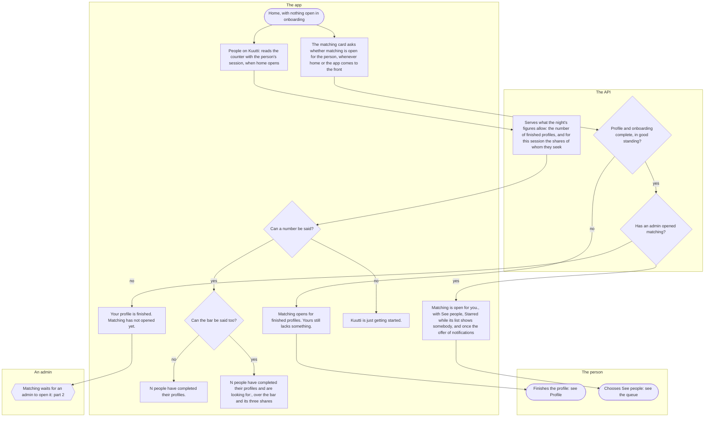
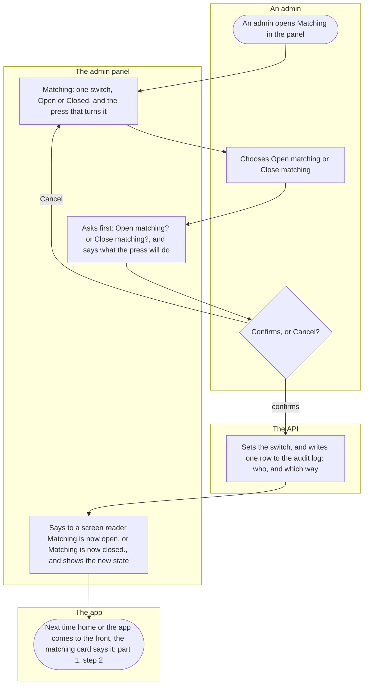
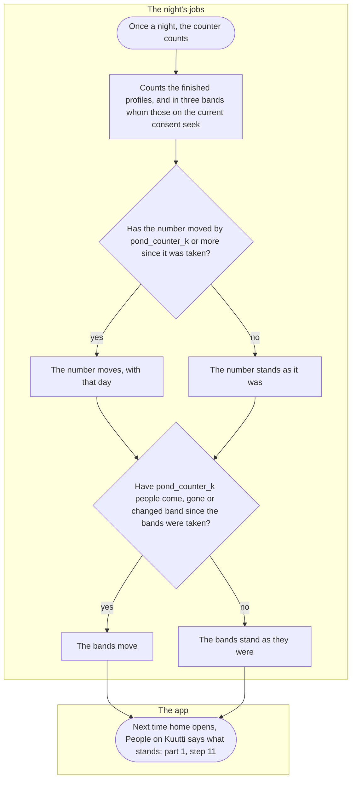

# People on Kuutti and the Matching switch

<!-- draws
apps/mobile/src/features/home/HomeScreen.tsx
apps/mobile/src/features/pond/GateCard.tsx
apps/mobile/src/features/pond/useGate.ts
apps/mobile/src/features/pond/PondCard.tsx
apps/mobile/src/features/pond/usePondCounter.ts
apps/mobile/src/features/pond/SeeksBar.tsx
apps/mobile/src/features/matching/RoundButton.tsx
apps/mobile/src/features/matching/StarsButton.tsx
apps/mobile/src/features/notifications/PushOffer.tsx
apps/admin/src/features/pond/MatchingSwitch.tsx
apps/api/src/pond/routes.ts
apps/api/src/pond/counter.ts
apps/api/src/pond/admin-routes.ts
apps/api/src/jobs/pool.ts
apps/api/src/jobs/pond-counter.ts
apps/api/src/jobs/nightly.ts
packages/schema/src/pond-counter.ts
packages/schema/src/gate.ts
apps/api/src/profile/completeness.ts
apps/api/src/pond/repo.ts
apps/mobile/src/features/matching/useStars.ts
-->

What home tells a person between a finished profile and the first people: whether matching is open for them, how many people have completed their profiles, and whom those people seek; and how an admin opens or closes matching for everybody at once. Everyone with a finished profile goes through it, up to their first "See people", and comes back to it whenever home opens.

## Part 1: what home shows

### Steps

1. The person has finished onboarding (see [Onboarding](onboarding.md)), or opens the app with nothing open there. Home shows "Kuutti", any notices first, then what there is to do: the matching card, "Your profile" and "Conversations"; and last the card "People on Kuutti", so that numbers nobody acts on come after the one thing to do.
2. The matching card asks the API whether matching is open for the person whenever home comes to the front and whenever the app comes back to the foreground, so a person whose photos were approved meanwhile, or for whom an admin opened matching with the app in a pocket, sees the new answer. What it knew stays on screen until the answer is there; with nothing yet it says "Loading…", and a read that fails says why, with Try again. Each of its sentences says Matching, so the card has no heading of its own.
3. Is the person complete? Only an account in good standing, active, with every answer of onboarding (the gender, whom they seek with the sensitive-answers consent of the current wording, the age window, the intent, and a home the list of places knows), the terms and the privacy summary in their current wording, and a finished profile, whose photos must be approved. It is read whenever asked and kept nowhere, so nothing about it waits for a count. A shadow-banned account reads like an active one, so the ban shows to nobody. No: 4. Yes: 6.
4. "Matching opens for finished profiles. Yours still lacks something." Most often the photos still wait for the check or for a moderator. No number is said, and nothing on the card can be tapped to move ahead.
5. The person finishes the profile: see [Profile](profile.md) and [Photos](photos.md). The card asks again when home next comes to the front, and says the new answer at once: nothing waits for the night. The same holds after whatever makes a person incomplete again, a photo refused or taken down, a consent withdrawn or a new wording of one: home sends them back to onboarding while a step there is open, and matching is open for them again the moment they are complete.
6. Has an admin opened matching? There is one switch, for the whole country (part 2). No: 7. Yes: 9.
7. "Your profile is finished. Matching has not opened yet." Nothing a person does opens it, and no count, share or night does.
8. Until an admin opens matching, asking again changes nothing the card says: part 2.
9. "Matching is open for you.", and under it "See people", the way to the queue; under that "Starred" while the Starred list shows somebody, a star on somebody it leaves out now not counting ([the queue](queue.md), part 4); and once, while this phone has not been asked, the offer of notifications, "Shall Kuutti tell you?", with "Allow notifications" and "No thanks" of equal weight: see [Notifications and notices](notifications.md). Either answer is kept on the phone, and the offer never comes back.
10. The person chooses "See people": see [the queue](queue.md).
11. "People on Kuutti", the last card on home: when home opens, the app reads the counter with the person's session. While it reads the card says "Loading…", and a read that fails says why, with Try again.
12. The API serves what the night's figures allow it to say (part 3), the same for everybody and naming nobody: the number of finished profiles, said only where at least `pond_counter_k` people stand behind it, a threshold the panel may raise above a floor in code but never lower. For the person's own session it adds the shares of whom those people seek; the public site reads the same number with no session and hears no shares.
13. A number may be said: 15. None, as while fewer than `pond_counter_k` people have finished: 14.
14. "Kuutti is just getting started." No number, and nothing says that a profile still being finished exists.
15. The bar is said only when each of its three bands holds at least `pond_counter_k` people; one band under it hides the whole bar, since two shares would give the third. Yes: 17. No: 16.
16. "N people have completed their profiles."
17. "N people have completed their profiles and are looking for:", and right under it one continuous bar in colours: those who seek men at one end, those who seek women at the other, those who seek both in the middle, with no gap or split between them. Under the bar, in its order, each band's share beside a swatch of its colour, "N % men", "N % everyone" and "N % women": the words and the order carry the meaning, never the colour alone, and a screen reader hears the three in one sentence. The shares move in steps, never by one, each at least one step and together a hundred. Whether somebody also seeks non-binary people moves no band, and somebody who seeks neither men nor women is in the number and in no band.

## Part 2: an admin opens or closes matching

### Steps

18. An admin signs in to the panel with their bank (see [Moderation in the admin panel](moderation.md)) and opens Matching. The menu shows it to admins alone, and the API refuses anybody else, a moderator too.
19. "Matching": the one switch, for the whole country, its state in words, "Open" or "Closed", with "Refresh" and the press that turns it, "Open matching" or "Close matching".
20. The admin chooses "Open matching" or "Close matching".
21. The panel asks first and says what the press will do. "Open matching?": "Everybody with a finished profile is told that matching is open, and reads their queue from the moment they open the app." "Close matching?": "Nobody new joins a queue from now on. Cards already queued stay for the day, and conversations go on. People with a finished profile are told that matching has not opened yet."
22. "Cancel": 19, and nothing is sent. The press again, to confirm: 23.
23. The API sets the switch and writes one row to the audit log: the admin, and that matching opened or closed, with no words. A press that finds the switch as it asks changes nothing and writes nothing. Nothing else opens or closes matching. A press that does not go through says "That did not go through. Nothing was changed."
24. "Matching is now open." or "Matching is now closed.", said to a screen reader, and the switch shows its new state.
25. Nobody is pushed: each person's matching card says it the next time home or the app comes to the front (part 1, step 2). Opened, a person with a finished profile reads "Matching is open for you." and See people. Closed, they read "Your profile is finished. Matching has not opened yet.", home offers no See people, and every conversation goes on.

## Part 3: the night's count

### Steps

26. Once a night, with the night's other jobs, the counter counts the people of Kuutti, at most once a Finnish calendar day whichever process asks.
27. It counts every live account in good standing, active or shadow-banned alike, whose profile is finished as the profile's own screen reads it: the name, the approved photos, the words, whom one seeks and the ages. Accounts on a break, suspended, banned or deleted are left out. Of those it counts in three bands whom they seek, men and not women, both, or women and not men, and only somebody whose sensitive-answers consent is of the current wording, the one that names these shares. Only the figures in force are kept, one set, with no history.
28. Has the number moved by `pond_counter_k` or more since it was last taken? Yes: 29. No: 30. Figures too small to have been said under any threshold are replaced at once.
29. The number moves, and carries that day: 31.
30. The number stands as it was, day and all: one person finishing or leaving changes nothing that is said.
31. Have at least `pond_counter_k` people come, gone or changed band since the bands were last taken, whether or not the number moved? The bands move on their own, so that a number that moved by `pond_counter_k` while the bands moved by one cannot say what that one person seeks. Yes: 32. No: 33.
32. The bands move: 34.
33. The bands stand as they were.
34. The next time home opens, "People on Kuutti" says what now stands: part 1, step 11.

## Where it lives

- Screens: [index.tsx](../../apps/mobile/app/index.tsx) (home), [HomeScreen.tsx](../../apps/mobile/src/features/home/HomeScreen.tsx) (what home shows, in its order); in the pond feature [GateCard.tsx](../../apps/mobile/src/features/pond/GateCard.tsx) and [useGate.ts](../../apps/mobile/src/features/pond/useGate.ts) (the matching card), [PondCard.tsx](../../apps/mobile/src/features/pond/PondCard.tsx), [usePondCounter.ts](../../apps/mobile/src/features/pond/usePondCounter.ts) and [SeeksBar.tsx](../../apps/mobile/src/features/pond/SeeksBar.tsx) (People on Kuutti), [client.ts](../../apps/mobile/src/features/pond/client.ts); the ways on from the open card, [RoundButton.tsx](../../apps/mobile/src/features/matching/RoundButton.tsx), [StarsButton.tsx](../../apps/mobile/src/features/matching/StarsButton.tsx) and [PushOffer.tsx](../../apps/mobile/src/features/notifications/PushOffer.tsx); the panel's [MatchingSwitch.tsx](../../apps/admin/src/features/pond/MatchingSwitch.tsx), with its place in the menu, admins only, in [app.tsx](../../apps/admin/src/app.tsx)
- API: `GET /gate` and `GET /ponds/counter` in the pond slice's [routes.ts](../../apps/api/src/pond/routes.ts), with [counter.ts](../../apps/api/src/pond/counter.ts) (what may be said, and the session's own shares); who is complete in [pool.ts](../../apps/api/src/jobs/pool.ts), handed to the route in [app.ts](../../apps/api/src/app.ts); `GET /admin/ponds` and `POST /admin/ponds/{id}/matching` in [admin-routes.ts](../../apps/api/src/pond/admin-routes.ts); the night's count [pond-counter.ts](../../apps/api/src/jobs/pond-counter.ts), run by [nightly.ts](../../apps/api/src/jobs/nightly.ts) in the order [boot.ts](../../apps/api/src/boot.ts) gives; when the number and the bands may be said and move in [packages/schema/src/pond-counter.ts](../../packages/schema/src/pond-counter.ts), the card's three answers in [packages/schema/src/gate.ts](../../packages/schema/src/gate.ts); the pond slice's [README](../../apps/api/src/pond/README.md)
- Spec: [opening.feature](../../features/pond/opening.feature), [counter.feature](../../features/pond/counter.feature)
- Maestro: [home-and-tech.yaml](../../apps/mobile/e2e/flows/home-and-tech.yaml), [round.yaml](../../apps/mobile/e2e/flows/round.yaml) (its start: from the open matching card to the queue), [onboarding.yaml](../../apps/mobile/e2e/flows/onboarding.yaml) (its end: home while the photos wait); the panel's Playwright flow [roles.spec.ts](../../apps/admin/e2e/roles.spec.ts) (who may open Matching)
- ADRs: [ADR-060](../adr/060-no-waiting-at-the-pond.md) §1 to §4 (the switch, an admin's act, who is complete, the three answers) and §8 (the counter stays); [ADR-061](../adr/061-one-home-no-ponds.md) §8 (one switch for the whole country); [ADR-013](../adr/013-waitlist-counter.md) §2 (who counts), §3 to §5 (one number, what may be said, the threshold's floor), §6 and §7 (when it moves, no history), §11 (the card), §12 to §14 (the bar), §18 to §20 (behind the session, no place named, the consent names the bar); [ADR-055](../adr/055-push.md) §9 (the offer once matching is open); [ADR-062](../adr/062-one-queue.md) §14 (See people); [ADR-064](../adr/064-a-star.md) §6 (Starred); [ADR-009](../adr/009-profile-and-card.md) §4 (a finished profile)
- Rules: the register's [Pond](../decisions.md#pond), [Profile](../decisions.md#profile) and [Notifications](../decisions.md#notifications) rows

## History

- 2026-09-27 (#54, PR #88): the waitlist counter: the person's own area on a card, the figures in words, nothing below `waitlist_k`, moving only in steps of it, counted once a night.
- 2026-09-28 (#94, PR #108): the pond's gate under the counter: let in, in line, or waiting for enough people who match, said in steps, counted at night and once when a person first asks; a change of area, or of gender or whom one seeks into a group that waits, leaves the place for the night to decide.
- 2026-10-08 (#143, PR #152): the home screen, with the two cards under the title and the way to the profile.
- 2026-10-09 (#147, PR #155): admission by whom a person competes for, not by the label they chose; the intent joins the pool, both ways.
- 2026-10-10 (#174, PR #212): the area's name in the person's language, and a second area with its own counter and gate.
- 2026-10-13 (#170, PR #277): a break keeps the place at the gate, and the counts leave the person out until the break ends.
- 2026-10-14 (#175, PR #284): a dance partner is in the pool of dance partners only.
- 2026-10-17 (#84, PR #345): a block takes two people out of each other's pool, and neither counts toward the other's figure.
- 2026-10-19 (#87, PR #373): deal-breakers take people out of each other's pool, both ways.
- 2026-10-21 (#379, PR #391): once matching is open, the card leads to today's round.
- 2026-10-25 (#102, PR #459): once matching is open, the card offers notifications once, "Shall Kuutti tell you?".
- 2026-10-30 (#507, PR #528): the area card's split by gender gives way to one bar of whom its finished profiles seek, said only when every band holds at least k people, and for the person's own area alone.
- 2026-10-31 (#500, PR #555): the gate and the line go: matching opens when an admin turns its switch on in the panel, and the matching card says one of three things, with no number, step or place.
- 2026-11-01 (#514, PR #556): the areas become one, the whole country, and a home is among what completes a person.
- 2026-11-01 (#500, PR #563): the home card has one heading, "People on Kuutti", and names no area; the panel's list of ponds becomes one switch, called Matching.
- 2026-11-03 (#502, PR #578): "See people" takes the place of the button to today's round, the way to the one queue.
- 2026-11-03 (#575, PR #582): "Starred" beside See people while the person has starred somebody.
- 2026-11-03 (#507, PR #585): the sensitive-answers consent names the bar, only answers given under that wording count in it, and the bar is counted in production too.
- 2026-11-05 (#581, PR #596): People on Kuutti says one number, the finished profiles, over one continuous bar in colours; the split by gender, the total and the profiles still being finished go.
- 2026-11-05 (#581, PR #602): home puts what there is to do first: the matching card under the notices, then Your profile and Conversations, and People on Kuutti last.
