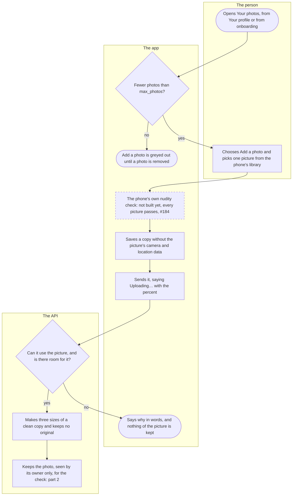
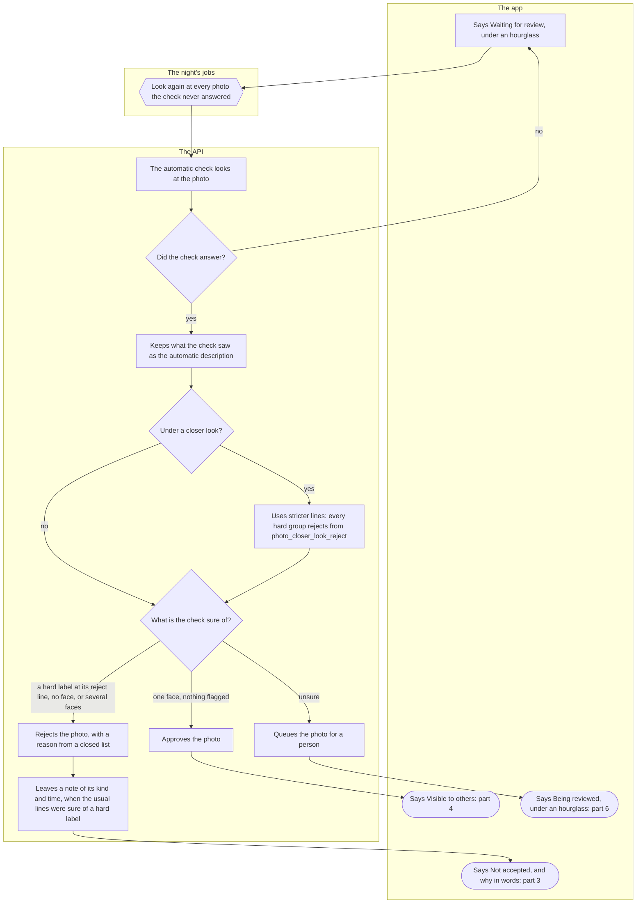
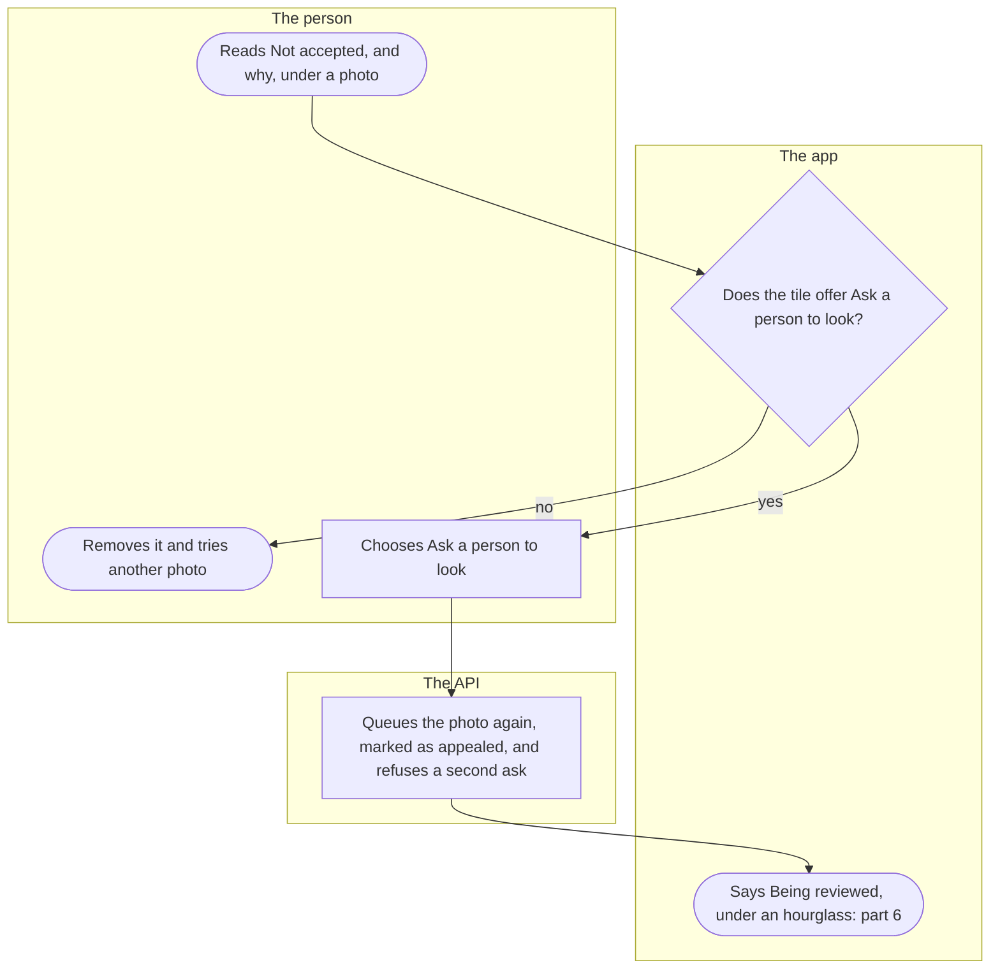
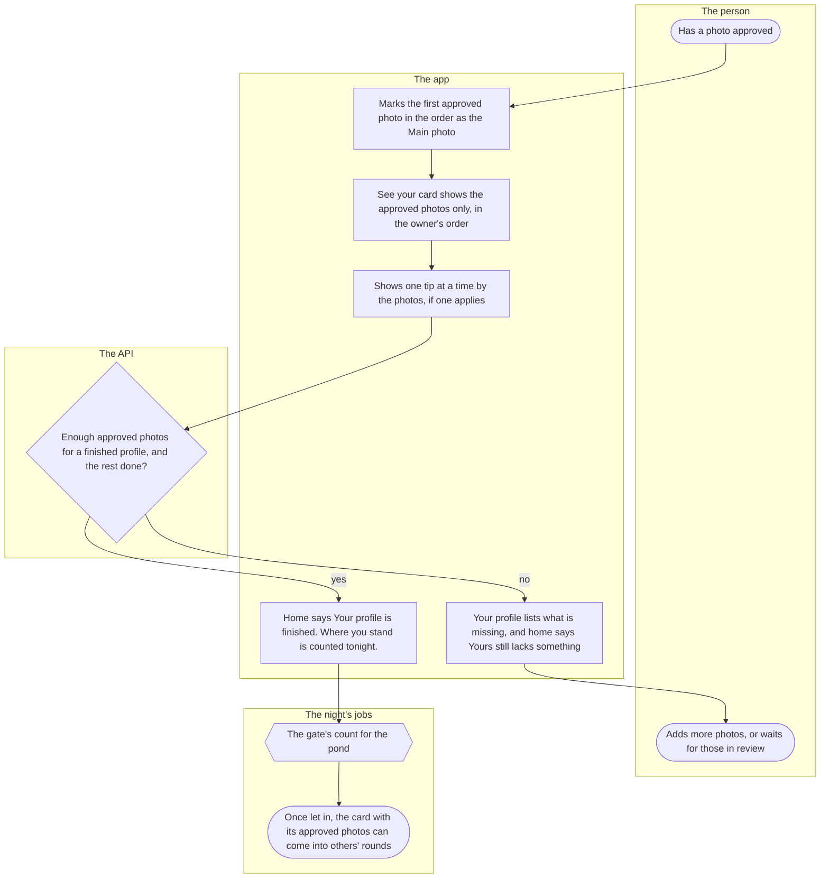
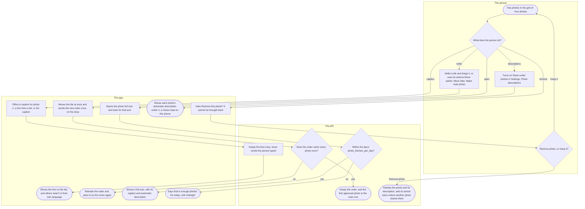
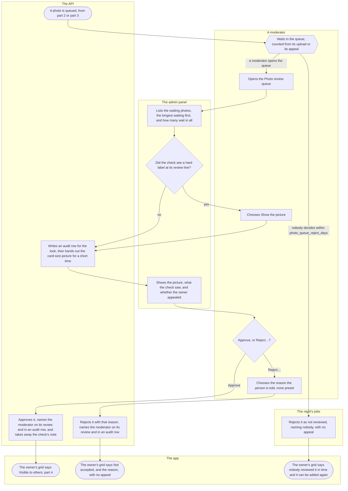

# Photos

How a person adds photos to their profile, what the automatic check and the moderators do with each one before anyone else sees it, and what an approved photo opens. Two people go through it: the owner of the photos, in the app, and a moderator, in the admin panel. Photos sent in a conversation are the chat's, in [chat.md](chat.md).

## Part 1: adding a photo

### Steps

1. The person opens "Your photos": from "Your profile", "Photos", or from onboarding's step "Two photos of you", "Add photos" (the onboarding flow says when that step is done). The screen says how many photos there are, of at most `max_photos`, and that a new photo is checked before anyone else sees it.
2. Does the person have fewer photos than `max_photos`? Every photo counts, a rejected one too. Yes: 4; no: 3.
3. "Add a photo" is greyed out; removing a photo (step 59) makes room. The flow ends here.
4. The person chooses "Add a photo" and picks one picture from the phone's photo library; the app offers no camera. The app says "Choosing a photo…", then "Preparing the photo…". A cancelled choice changes nothing; when the app may not open the photos, it says "Kuutti could not open your photos. Allow access in the phone's settings and try again."
5. Not built yet (#184): the phone's own nudity check, which would refuse a nude picture before anything is sent, with "This photo cannot be used." Until it lands, every picture passes.
6. The app saves a copy of the picture, no larger than the size it uploads, without the camera and location data the original carried.
7. The app sends the copy, saying "Uploading…" with the percent.
8. Can the API use the picture, and is there room for it? It must be a JPEG, PNG or WebP it can read and not too large, the account must have fewer than `max_photos` photos, and the API must not be busy with too many photos at once. Yes: 10; no: 9.
9. The app says why in words, such as "The photo is too large. Choose a smaller picture.", "You already have the maximum number of photos. Remove one to add another." or "Many photos are being processed right now. Try again in a moment." Nothing of the picture is kept. The flow ends here.
10. The API makes three sizes of a clean copy (a small one for the grid, the card's, and the full size), with none of the original's metadata, and keeps no original.
11. The API keeps the photo last in the person's order, seen by its owner only, and hands it to the automatic check at once: part 2.

## Part 2: the automatic check

### Steps

12. The automatic check (Amazon Rekognition) looks at the card-size copy: what it shows, the faces in it, and the settings and objects a description may name. The upload waits for it, about a second, so the app shows the outcome as soon as the upload ends.
13. Did the check answer? Yes: 16; no (it failed or could not be reached): 14.
14. The photo waits, seen by nobody else; the grid says "Waiting for review", the tile dimmed under an hourglass.
15. The night's jobs give every photo the check never answered one more look, from its stored card size: back to 12. Nothing ever becomes visible by waiting.
16. The API keeps the automatic description of what the check saw: how many people, indoors or outdoors, the setting, a smile, glasses or sunglasses, a beard or a moustache, an activity or an object, each only from `photo_description_confidence_min`, and never gender, age, emotion or looks. It is kept as a list of fixed items that each reader's app says in their own language, it decides nothing, and it goes with the photo. Where no automatic check is set up, as on a developer's machine, there is nothing to describe.
17. Is the person under a closer look? That is when the check has left `photo_closer_look_attempts` notes (step 23) within `photo_closer_look_window_days`; it lasts `photo_closer_look_days` from the last of them, and nobody is told. Yes: 18; no: 19.
18. Every hard group (nudity, violence, a disturbing picture, hate) rejects from `photo_closer_look_reject` instead of its usual line, where that is lower.
19. What is the check sure of? Each hard group has two lines: from `photo_moderation_nudity_review` a person is asked and from `photo_moderation_nudity_reject` the check rejects, and likewise the pairs for violence, disturbing and hate. A face counts from `photo_moderation_face_threshold`, and a label the check does not know asks a person from `photo_moderation_label_threshold`. Swimwear, a bare chest, alcohol, a middle finger and the like never hold a photo back. One face and nothing flagged: 20. A hard label at or above its reject line, no face at all, or more than one face: 22. Unsure (a hard label between its two lines, a label it does not know, or faces found but none sure): 25. Where no automatic check is set up, every photo is unsure.
20. The API approves the photo.
21. The grid says "Visible to others": part 4.
22. The API rejects the photo itself, with a reason from a closed list and never a label's name: nudity, violence or weapons, "other" for something disturbing or hateful, no person ("A profile photo has to show you.") or several people ("A profile photo shows you alone, so nobody else appears on Kuutti without asking.").
23. When the usual lines were sure of a hard label, the API leaves a note of its kind and time, nothing of the picture; what only the closer look rejected leaves none. The notes go after twelve months (the night drops older ones) and with the account, are never shown in the admin panel, and the person reads them in plain words in their data export. Nothing else follows from them: a ban stays a person's decision.
24. The grid says "Not accepted." and why, such as "Not accepted. Photos with nudity cannot be used on Kuutti.": part 3.
25. The API queues the photo for a person.
26. The grid says "Being reviewed", the tile dimmed under an hourglass; nobody else sees it: part 6.

## Part 3: asking a person to look

### Steps

27. The person reads "Not accepted." and why under a photo in "Your photos". A rejected photo stays in their list, seen by nobody else, until they remove it.
28. Does the tile offer "Ask a person to look"? Only under the check's own rejection, never over a nudity label at or above `photo_moderation_nudity_no_appeal` (so no moderator is sent a picture the check was that sure of), and only once; a moderator's rejection and the night's offer none. Yes: 30; no: 29.
29. The person removes the photo (step 59) and tries another. The flow ends here.
30. The person chooses "Ask a person to look".
31. The API puts the photo back in the queue, marked as appealed. A second ask is refused with "A person cannot be asked to look at this photo. Remove it and try another one."
32. The grid says "Being reviewed" under an hourglass: part 6. If a moderator approves it, the check's note on it (step 23) goes and counts toward no closer look.

## Part 4: what an approved photo opens

### Steps

33. A photo of the person is approved, by the check (step 20) or by a moderator (step 71). Only an approved photo is ever shown to another person in the app; a moderator sees the others in the queue (part 6).
34. In "Your photos", the first approved photo in the person's order is marked "Main photo", the first one others see. A photo in review or rejected is never the main one, wherever it stands.
35. "See your card" (the eye on "Your profile") shows the card as others would see it, with the approved photos only, in the person's order, each with its caption and automatic description.
36. "Your photos" shows one tip at a time by the photos, under "A tip for your photos", when one applies: the API reads it from what the check saw in the approved photos (sunglasses, a mirror selfie, a tight crop, poor light, a blur, other people, and on the main photo a lot of skin or a fish), each against its `photo_tip_` line in `matching_config`, and suggests more photos below `photo_tip_photos_suggested`. A tip is said once per main photo and remembered on the phone ("Got it"). It is advice only and never holds a photo back.
37. Does the profile have the approved photos a finished profile needs (a number fixed in the code, ADR-009 §4), and the rest done: a name, a bio, a ready line or two answered prompts, and onboarding's answers? Yes: 40; no: 38.
38. "Your profile" lists what is missing under "Before your card can be shown", the approved photos among it, and home says "Matching opens for finished profiles. Yours still lacks something."
39. The person adds more photos (part 1) or waits for those in review. The flow ends here.
40. Home says "Your profile is finished. Where you stand is counted tonight."
41. The night's count of the gate takes the profile in (ADR-015; see [The waitlist and the pond's gate](waitlist-and-gate.md)).
42. The gate lets the person in, or tells them their place in line. Once let in, their card, with its approved photos only, can come into others' rounds (see [The round](round.md)); the main photo is also their face in a conversation list ([chat.md](chat.md)). The flow ends here.

## Part 5: captions, order, full size and removing

### Steps

43. The person has photos in the grid of "Your photos".
44. What does the person do? Give a photo a caption: 45. Change the order: 48. Open a photo: 53. Show the automatic descriptions: 57. Remove a photo: 59.
45. "Add a caption", or the photo's present caption, opens "A caption for photo n": one line from a list ("Taken recently", "An old favourite", "Me in my element" and more), or "No caption"; the chosen line is marked in text.
46. The API keeps the line's key, never words the person typed, so there is nothing to check.
47. The tile shows the line; others read it under the photo on the card in their own language, and a screen reader says it with the photo. When it does not save, the app says "The caption could not be saved. Try again." The flow ends here.
48. The person holds a tile and drags it to its new place, or, with a screen reader or a switch, uses the tile's actions "Move earlier", "Move later" and "Make main photo", so a gesture is never the only way. Under reduced motion the tiles move without animation.
49. The app moves the tile at once and sends the new order once, on the drop.
50. Does the order name every photo once? Yes: 51; no, it was out of date: 52.
51. The API keeps the order. The main photo is the first approved one in it (step 34), so a photo in review moved to the front becomes the main one only once it is approved. The flow ends here.
52. The app reloads the order and says "The photo order was out of date, so it was reloaded. Try the move again." The flow ends here.
53. The person taps a photo; the app opens it full size and asks the API for that size.
54. Is the person within the day's `photo_fetches_per_day` for that size? Every size the app fetches counts, the person's own photos too, and the day turns at midnight in Finland (ADR-008). Yes: 55; no: 56.
55. The app shows the photo full size, with its caption, and with its automatic description when the setting asks; a screen reader hears the description after the caption in any case. "Back to your photos" returns to the grid. The flow ends here.
56. The app says "That is enough photos for today. They load again after midnight." The flow ends here.
57. In Settings, "Photo descriptions", the person turns on "Show under photos", and under "Tell me about" chooses what the descriptions say: people and setting, face, activity and objects. A person who uses a screen reader is told once, at the first launch with it on, where this setting is.
58. The app shows the automatic description under each photo, on the person's own photos and on cards. The choices stay on the phone and are never sent. The flow ends here.
59. The person chooses "Remove" on a tile, and the app asks "Remove this photo?": "It disappears from your profile at once and cannot be brought back."
60. "Remove photo" or "Keep it"? Remove photo: 61; keep it: back to 43.
61. The API deletes the photo with its automatic description, and its stored sizes unless another photo shares them; the photos after it close up the order. The flow ends here.

## Part 6: the moderator's queue

### Steps

62. A photo is queued: the check was unsure of it (step 25), or its owner asked a person to look (step 31). Photos sent in a conversation never come here ([chat.md](chat.md)).
63. It waits in the queue, counted from its upload or from its appeal, and nobody else sees it meanwhile. A moderator opens the queue: 64. Nobody decides it within `photo_queue_reject_days`: 76.
64. A moderator opens "Photo review queue" in the admin panel. The front page, "What waits", says how many photos wait and how old the oldest is, against `moderation_response_hours` ([moderation.md](moderation.md)).
65. The panel lists a page of waiting photos, the longest waiting first, and how many wait in all.
66. Did the check see a hard label at or above its review line in this photo? Yes: the panel hides the picture, "Hidden until you choose to look. The check saw something sensitive.", and fetches nothing: 67. No: 68.
67. The moderator chooses "Show the picture".
68. The API writes an audit row naming the moderator, then hands out the card-size picture through a link that works for fifteen minutes.
69. The panel shows the picture, when it was uploaded, the account and a link to "The person's page", where the sanctions are ([moderation.md](moderation.md), [report-and-block.md](report-and-block.md)), and under "What the automatic check saw" the faces found and the moderation labels with their confidence, or "Not checked automatically." An appealed photo says "The owner asked a person to look at the automatic rejection." The tips' signals, the description and the check's notes are not shown.
70. "Approve" or "Reject…"? Approve: 71; reject: 73. When another moderator, or the night, decided the photo first, the first decision stands and the panel says "The decision was not saved. Refresh and try again."
71. The API approves the photo, names the moderator on its review and in an audit row, and takes away the check's note on it, if it left one (step 23).
72. The owner's grid says "Visible to others" the next time they open "Your photos"; nothing tells them sooner: part 4.
73. The moderator chooses the "Reason the person is told" from the list: nudity, no person visible, several people, a child appears, violence or weapons, contact details, a handle or a link, or other. None is preset, and "Reject photo" stays unavailable until one is chosen.
74. The API rejects the photo with that reason and names the moderator on its review and in an audit row. A moderator's rejection leaves no note and offers no appeal.
75. The owner's grid says "Not accepted." with the reason in words, such as "Not accepted. Photos with children cannot be used on Kuutti.", the next time they open "Your photos". The flow ends here.
76. The night's jobs reject the photo as not reviewed, naming nobody, with no appeal and no audit row; the moderators get no warning before. `photo_queue_reject_days` at 0 switches this off.
77. The owner's grid says "Not accepted. Nobody reviewed this photo in time; you can add it again." The flow ends here.

## Where it lives

- Screens: [photos/index.tsx](../../apps/mobile/app/photos/index.tsx) (Your photos), [photos/[id].tsx](../../apps/mobile/app/photos/%5Bid%5D.tsx) (full size), [settings/photo-descriptions.tsx](../../apps/mobile/app/settings/photo-descriptions.tsx); the app's code in [features/media](../../apps/mobile/src/features/media/README.md): [PhotosScreen.tsx](../../apps/mobile/src/features/media/PhotosScreen.tsx), [usePhotos.ts](../../apps/mobile/src/features/media/usePhotos.ts), [pick.ts](../../apps/mobile/src/features/media/pick.ts), [localCheck.ts](../../apps/mobile/src/features/media/localCheck.ts), [useDragOrder.ts](../../apps/mobile/src/features/media/useDragOrder.ts), [CaptionDialog.tsx](../../apps/mobile/src/features/media/CaptionDialog.tsx), [tips.tsx](../../apps/mobile/src/features/media/tips.tsx), [PhotoZoomScreen.tsx](../../apps/mobile/src/features/media/PhotoZoomScreen.tsx); the setting and its hint in [PhotoDescriptionsScreen.tsx](../../apps/mobile/src/features/settings/PhotoDescriptionsScreen.tsx) and [ScreenReaderHint.tsx](../../apps/mobile/src/features/settings/ScreenReaderHint.tsx).
- API, the owner's routes in the [media slice](../../apps/api/src/media/README.md), [routes.ts](../../apps/api/src/media/routes.ts): `GET /photos`, `POST /photos`, `PUT /photos/order`, `PUT /photos/{id}/caption`, `POST /photos/{id}/appeal`, `DELETE /photos/{id}`, `GET /photos/{id}/{variant}`; the service [photos.ts](../../apps/api/src/media/photos.ts), the check [moderation.ts](../../apps/api/src/media/moderation.ts), the description [description.ts](../../apps/api/src/media/description.ts), the tips [tips.ts](../../apps/api/src/media/tips.ts), the notes and the closer look [safety/photo-check.ts](../../apps/api/src/safety/photo-check.ts), and what a finished profile needs [profile/completeness.ts](../../apps/api/src/profile/completeness.ts).
- API, the moderators' routes in [admin-routes.ts](../../apps/api/src/media/admin-routes.ts): `GET /admin/photos/queue`, `GET /admin/photos/{id}/card`, `POST /admin/photos/{id}/decision`.
- The night's jobs in [boot.ts](../../apps/api/src/boot.ts): `moderate-pending-photos`, `reject-unreviewed-photos`, `prune-photo-check-notes`.
- Admin panel: [PhotoQueue.tsx](../../apps/admin/src/features/media/PhotoQueue.tsx), at `/photos`.
- Spec: [moderation.feature](../../features/media/moderation.feature), [photo-check-notes.feature](../../features/safety/photo-check-notes.feature).
- Maestro: [photos-screen.yaml](../../apps/mobile/e2e/flows/photos-screen.yaml), [photo-descriptions.yaml](../../apps/mobile/e2e/flows/photo-descriptions.yaml), [photos-gate-and-hidden-field.yaml](../../apps/mobile/e2e/flows/photos-gate-and-hidden-field.yaml).
- ADRs: [ADR-005](../adr/005-media-pipeline-and-delivery.md), [ADR-006](../adr/006-photo-moderation.md), [ADR-008](../adr/008-exposure-budget-and-client-address.md), [ADR-009](../adr/009-profile-and-card.md), [ADR-015](../adr/015-pond-gate.md).
- Other flows: photos in a conversation in [chat.md](chat.md); the person's page, the front page and the sanctions in [moderation.md](moderation.md) and [report-and-block.md](report-and-block.md).

## History

- 2026-09-25 (#48, PR #57): photos are uploaded through the API, which makes three sizes of a clean copy and keeps no original; "Your photos" shows each photo with its state in words, opens one full size, and removes one.
- 2026-09-25 (#49, PR #60): the automatic check approves a photo or sends it to a moderator, and the admin panel's queue lets a moderator approve it, or reject it with a reason the owner reads.
- 2026-09-26 (#52, PR #63): every photo fetched counts against the day's `photo_fetches_per_day`, and a refusal says so.
- 2026-10-10 (#146, PR #169): a "Done" button takes the person back from "Your photos" to onboarding or home.
- 2026-10-11 (#56, PR #125): tips about the photos, from what the check saw, one at a time, on the profile.
- 2026-10-12 (#206, PR #255): the check rejects a photo with no face or with several people itself, and the owner reads why at once.
- 2026-10-12 (#253, PR #256): the check rejects what it is sure shows nudity, violence, something disturbing or hate, and asks a moderator only between the two lines.
- 2026-10-12 (#253, PR #258): "Ask a person to look", once, under the check's own rejection; the queue marks an appealed photo and hides a sensitive one until the moderator asks to see it.
- 2026-10-12 (#253, PR #259): the check's sure rejections leave a note, and enough notes in a while make the check stricter for a time.
- 2026-10-12 (#250, PR #266): the panel presets no reason for a rejection; the moderator chooses one.
- 2026-10-13 (#239, PR #268): the main photo is the first approved one in the order, not the first tile.
- 2026-10-13 (#179, PR #283): the order changes by dragging a tile, and the same moves are the tile's accessibility actions.
- 2026-10-14 (#287, PR #290): the tips move from the profile to "Your photos", by the photos.
- 2026-10-15 (#296, #297, PR #298): a caption from a list under each photo; a tip is said once per main photo.
- 2026-10-16 (#296, PR #301): the automatic description, heard with each photo and shown under it when the Photo descriptions setting asks, with a one-time hint for screen-reader users.
- 2026-10-16 (#306, PR #320): a photo in the queue links to the person's page in the panel.
- 2026-10-20 (#376, PR #377): a photo in review is dimmed under an hourglass, and the night rejects one nobody decided within `photo_queue_reject_days` as not reviewed.
