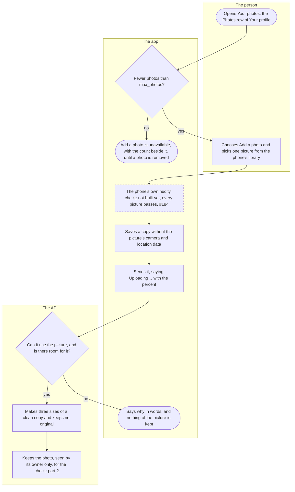
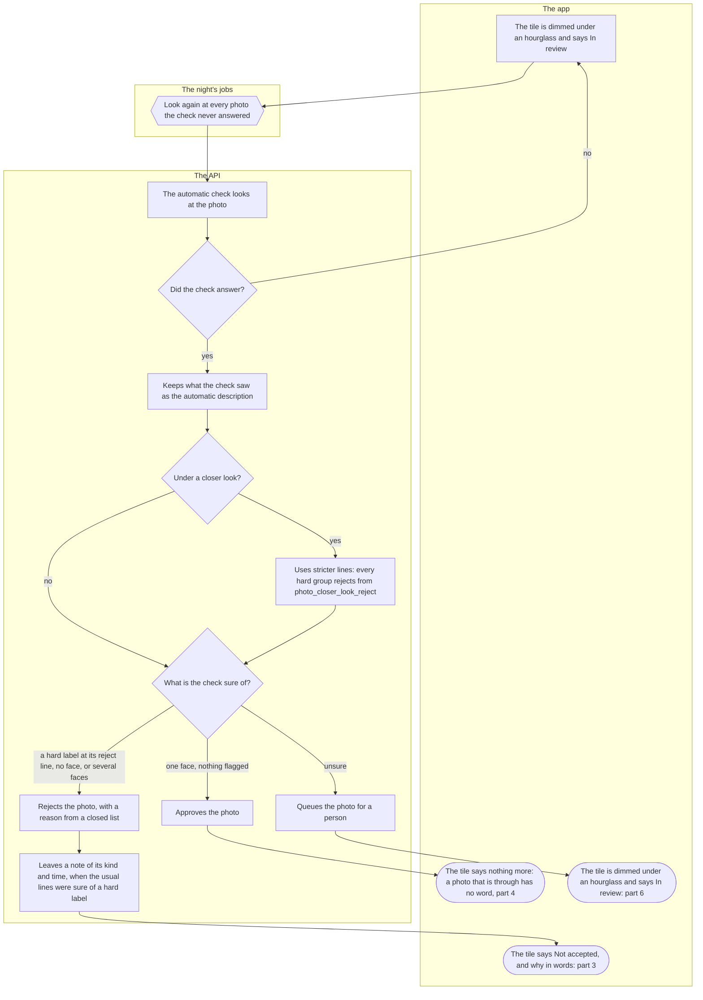
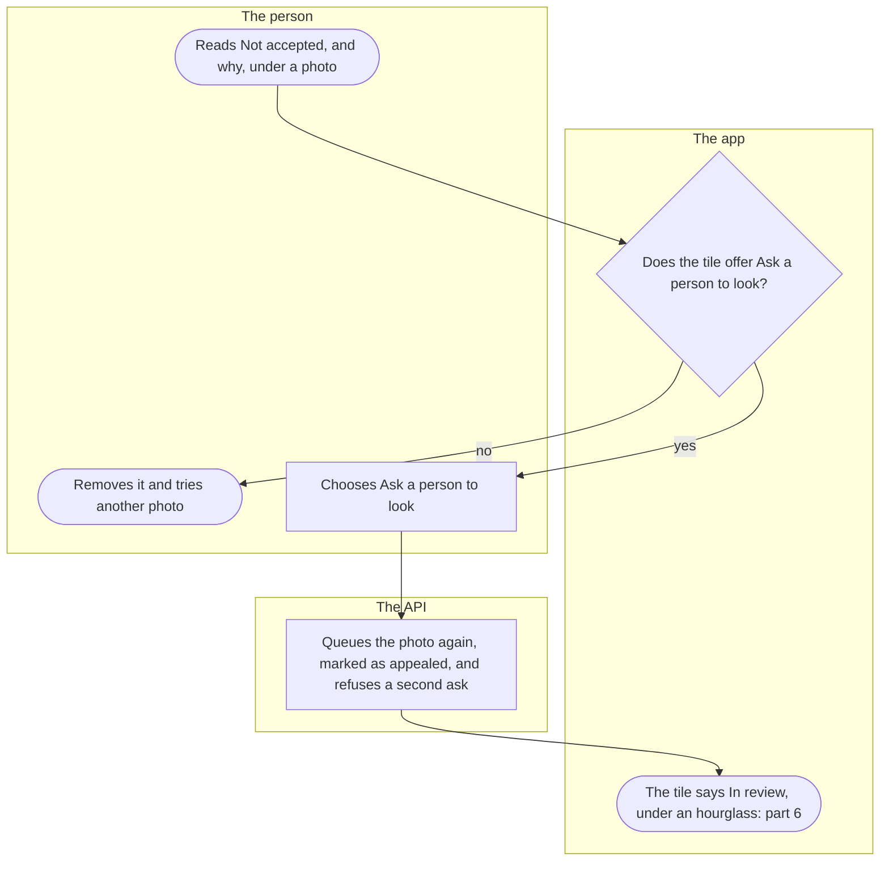
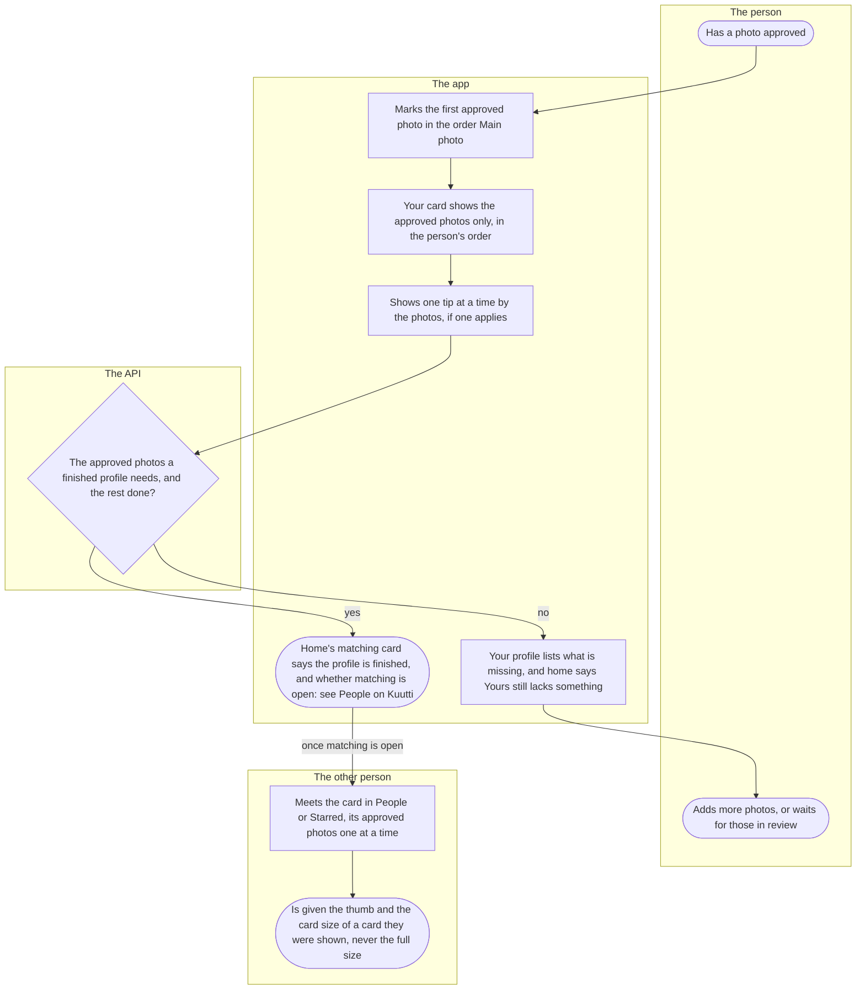
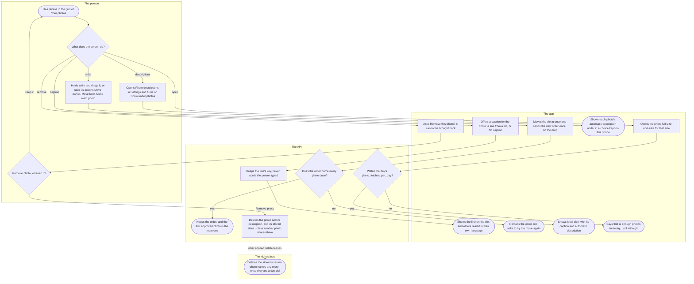
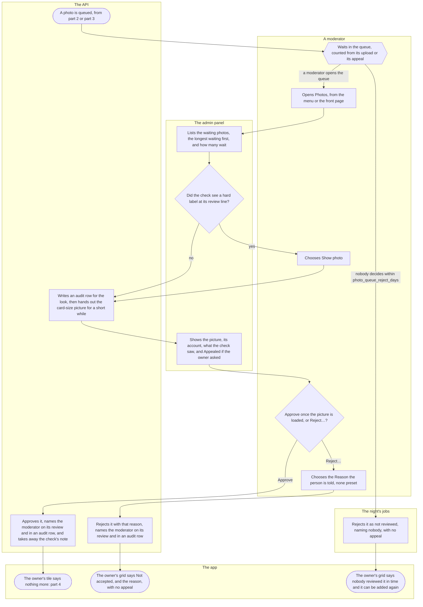
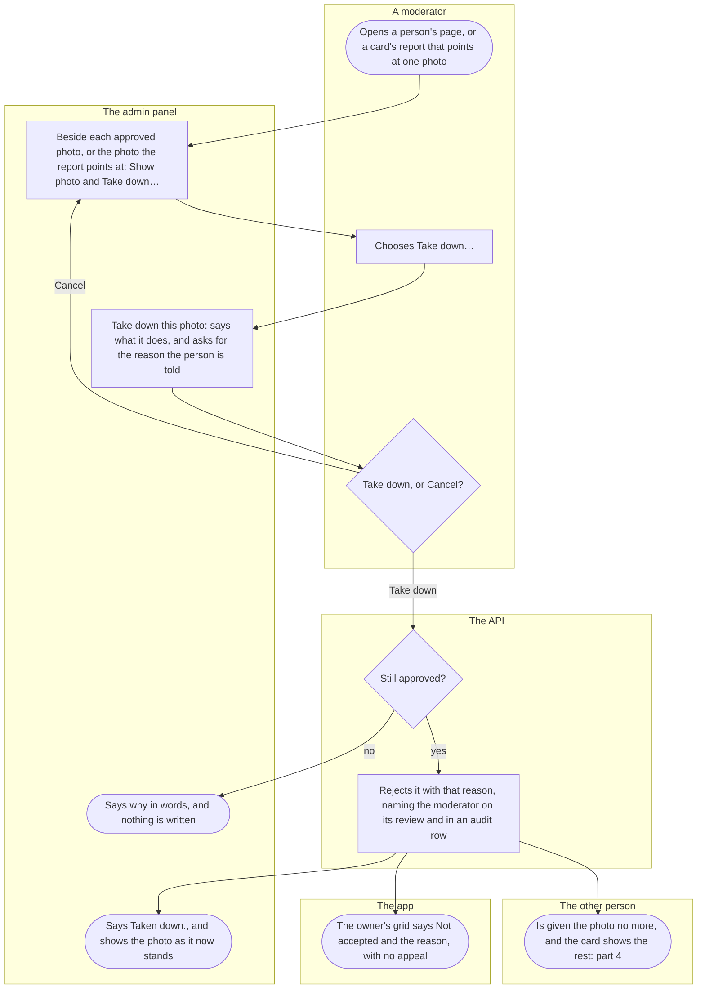

# Photos

<!-- draws
apps/mobile/app/photos/index.tsx
apps/mobile/app/photos/[id].tsx
apps/mobile/src/features/media/PhotosScreen.tsx
apps/mobile/src/features/media/usePhotos.ts
apps/mobile/src/features/media/pick.ts
apps/mobile/src/features/media/localCheck.ts
apps/mobile/src/features/media/useDragOrder.ts
apps/mobile/src/features/media/CaptionDialog.tsx
apps/mobile/src/features/media/tips.tsx
apps/mobile/src/features/media/PhotoZoomScreen.tsx
apps/mobile/src/features/settings/PhotoDescriptionChoices.tsx
apps/api/src/media/routes.ts
apps/api/src/media/photos.ts
apps/api/src/media/moderation.ts
apps/api/src/media/admin-routes.ts
apps/api/src/media/erasure.ts
apps/api/src/safety/photo-check.ts
apps/api/src/profile/completeness.ts
apps/admin/src/features/media/PhotoQueue.tsx
apps/admin/src/features/safety/TakeDown.tsx
-->

How a person adds photos to their profile, what the automatic check and the moderators do with each one before anyone else sees it, what an approved photo opens, and how a moderator takes one down later. Two people go through it: the owner of the photos, in the app, and a moderator, in the admin panel. Photos sent in a conversation are the chat's ([Chat](chat.md#part-2-a-photo)), and onboarding's photos step, the same screen under the step's own heading, is [Onboarding](onboarding.md#part-3-the-ages-the-home-photos-and-a-few-words)'s.

## Part 1: adding a photo

### Steps

1. The person opens "Your photos" from "Your profile", its "Photos" row, starred as "Needed before your card can be shown" ([Profile](profile.md#part-1-the-profile-and-a-section)). The screen says "Hold a photo and drag it to change the order. A new photo is checked before anyone else sees it." Below the limit the count of photos is not drawn: a screen reader hears it each time it changes, the one word that a photo landed. The arrow at the top, "Back to your profile", and "Done" at the end both go back; the screen has no back gesture, which the drag would start. Onboarding's step 7 is this screen with no arrow, its Continue the only way on.
2. Does the person have fewer photos than `max_photos`? Every photo counts, one not accepted too. Yes: 4. No: 3.
3. Above "Add a photo" stands how many photos there are, of at most `max_photos`, and the button is unavailable; removing a photo (step 59) makes room. The flow ends here.
4. The person chooses "Add a photo" and picks one picture from the phone's photo library; the app offers no camera, and says nothing until the upload starts. A cancelled choice changes nothing; when the app may not open the photos, it says "Kuutti could not open your photos. Allow access in the phone's settings and try again." Each notice of this screen closes with "OK".
5. Not built yet (#184): the phone's own nudity check, which would refuse a nude picture before anything is sent, with "This photo cannot be used." Until the native build carries it, every picture passes.
6. The app saves a copy of the picture, no larger than the size it uploads, without the camera and location data the original carried.
7. The app sends the copy, saying "Uploading…" with the percent.
8. Can the API use the picture, and is there room for it? It must be a JPEG, PNG or WebP it can read and not too large, the account must have fewer than `max_photos` photos, and the API must not be busy with too many photos at once. Yes: 10. No: 9.
9. The app says why in words, such as "The photo is too large. Choose a smaller picture.", "This file is not a photo Kuutti can use. Choose a JPEG, PNG or WebP picture.", "You already have the maximum number of photos. Remove one to add another." or "Many photos are being processed right now. Try again in a moment."; anything else, "That did not go through. Try again." Nothing of the picture is kept: what a failure left in storage the API removes, and what even that misses the night sweeps (step 62). The flow ends here.
10. The API makes three sizes of a clean copy (a small one for the grid, the card's, and the full size), with none of the original's metadata, and keeps no original.
11. The API keeps the photo last in the person's order, seen by its owner only, and hands it to the automatic check at once: part 2.

## Part 2: the automatic check

### Steps

12. The automatic check (Amazon Rekognition) looks at the card-size copy: what it shows, the faces in it, and the settings and objects a description may name. The upload waits for its answer, so the app shows the outcome as soon as the upload ends.
13. Did the check answer? Yes: 16. No (it failed or could not be reached): 14.
14. The photo waits, seen by nobody else; its tile is dimmed under an hourglass and says "In review".
15. The night's jobs give every photo the check never answered one more look, from its stored card size: back to 12. Nothing ever becomes visible by waiting.
16. The API keeps the automatic description of what the check saw: how many people, indoors or outdoors, the setting, a smile, glasses or sunglasses, a beard or a moustache, an activity or an object, each only from `photo_description_confidence_min`, and never gender, age, emotion or looks. It is kept as a list of fixed items that each reader's app says in their own language, it decides nothing, and it goes with the photo. Where no automatic check is set up, as on a developer's machine, there is nothing to describe.
17. Is the person under a closer look? That is when the check has left `photo_closer_look_attempts` notes (step 23) within `photo_closer_look_window_days`; it lasts `photo_closer_look_days` from the last of them, and nobody is told. Yes: 18. No: 19.
18. Every hard group (nudity, violence, a disturbing picture, hate) rejects from `photo_closer_look_reject` instead of its usual line, where that is lower.
19. What is the check sure of? Each hard group has two lines: from `photo_moderation_nudity_review` a person is asked and from `photo_moderation_nudity_reject` the check rejects, and likewise the pairs for violence, disturbing and hate. A face counts from `photo_moderation_face_threshold`, and a label the check does not know asks a person from `photo_moderation_label_threshold`. Swimwear, a bare chest, alcohol, a middle finger and the like never hold a photo back. One face and nothing flagged: 20. A hard label at or above its reject line, no face at all, or more than one face: 22. Unsure (a hard label between its two lines, a label it does not know, or faces found but none sure): 25. Where no automatic check is set up, every photo is unsure.
20. The API approves the photo.
21. The tile loses its hourglass and says nothing more: a photo that is through has no word of its own: part 4.
22. The API rejects the photo itself, with a reason from a closed list and never a label's name: nudity, violence or weapons, "other" for something disturbing or hateful, no person ("Not accepted. A profile photo has to show you.") or several people ("Not accepted. A profile photo shows you alone.").
23. When the usual lines were sure of a hard label, the API leaves a note of its kind and time, nothing of the picture; what only the closer look rejected leaves none. The night drops a note once it is older than the retention the code holds it to, and the notes go with the account; they are never shown in the admin panel, and the person reads them in plain words in their copy of their data. Nothing else follows from them: a ban stays a person's decision.
24. The tile says why, such as "Not accepted. Photos with nudity cannot be used on Kuutti.", or "Not accepted" where there is no reason to give: part 3.
25. The API queues the photo for a person.
26. The tile is dimmed under an hourglass and says "In review", the same words as while the check had not answered; nobody else sees it: part 6.

## Part 3: asking a person to look

### Steps

27. The person reads why under a photo in "Your photos", such as "Not accepted. A profile photo has to show you." A rejected photo stays in their list, seen by nobody else, until they remove it.
28. Does the tile offer "Ask a person to look"? Only under the check's own rejection, never over a nudity label at or above `photo_moderation_nudity_no_appeal` (so no moderator is sent a picture the check was that sure of), and only once; a moderator's rejection, a take-down and the night's rejection offer none. Yes: 30. No: 29.
29. The person removes the photo (step 59) and tries another. The flow ends here.
30. The person chooses "Ask a person to look".
31. The API puts the photo back in the queue, marked as appealed. A second ask is refused with "A person cannot be asked to look at this photo. Remove it and try another one."
32. The tile says "In review" under an hourglass again: part 6. If a moderator approves it, the check's note on it (step 23) goes and counts toward no closer look.

## Part 4: what an approved photo opens

### Steps

33. A photo of the person is approved, by the check (step 20) or by a moderator (step 72). Only an approved photo is ever given to another person in the app; a moderator sees the others in the queue (part 6).
34. In "Your photos", the first approved photo in the person's order is marked "Main photo", the one others see first. A photo in review or not accepted is never the main one, wherever it stands.
35. "See your card", the eye at the top of "Your profile", opens "Your card" with the approved photos only, in the person's order, the main one first: one at a time, tapped through on either half ("Previous photo", "Next photo"), each with its caption and, where the setting asks, its automatic description under it. The rest of the card is [Profile](profile.md#part-3-the-card-as-others-see-it)'s.
36. "Your photos" shows one tip at a time by the photos, under "A tip for your photos", when one applies: the API reads it from what the check saw in the approved photos (sunglasses, a mirror selfie, a tight crop, poor light, a blur, other people, and on the main photo a lot of skin or a fish), each against its `photo_tip_` line in `matching_config`, and suggests more photos below `photo_tip_photos_suggested`. A tip is said once per main photo and remembered on the phone, "Got it" or not. It is advice only and never holds a photo back.
37. Does the profile have the approved photos a finished profile needs, a number the code fixes ([ADR-009](../adr/009-profile-and-card.md) §4; how many onboarding's photos step asks for is under [Onboarding's Open](onboarding.md#open)), and the rest of it done: a name, a bio of enough characters, a ready line or two answered questions, whom one seeks and the age window? Yes: 40. No: 38.
38. "Your profile" lists what is missing under "Before your card can be shown", the approved photos among it, and so does "Your card" over the card; home's matching card says "Matching opens for finished profiles. Yours still lacks something."
39. The person adds more photos (part 1) or waits for those in review. The flow ends here.
40. Home's matching card asks again whenever home or the app comes to the front, so nothing waits for the night: "Your profile is finished. Matching has not opened yet." until an admin opens matching, then "Matching is open for you." with "See people" ([People on Kuutti](people-on-kuutti.md#part-1-what-home-shows)). "Your card" now says "This is what others see."
41. Once matching is open, the card, with its approved photos only, comes into the People of whoever it fits, both ways, and into Starred for whoever starred the person ([the queue](queue.md#part-2-a-card-and-its-decision)): the photos one at a time, the main one first, each asked for only when it first comes to the front. The main photo is also the person's face in a conversation list ([Chat](chat.md)), and a row of Starred shows the first approved photo the viewer was shown.
42. Another person is given the thumb and the card size of an approved photo on a card the server showed them, while its owner is active and no block stands between the two, each fetch counted against the day's `photo_fetches_per_day` for its size, and never the full size, which is the owner's alone ([ADR-056](../adr/056-attestation-later-no-screenshot-notice.md) §3). A photo taken down (part 7), refused or removed is given to nobody from then on, and the photos of an owner on a break, shadow-banned, suspended or banned are given to nobody meanwhile. The flow ends here.

## Part 5: captions, order, full size, descriptions and removing

### Steps

43. The person has photos in the grid of "Your photos". At the largest text sizes the tiles take the whole width, one under another.
44. What does the person do? Give a photo a caption: 45. Change the order: 48. Open a photo: 53. Show the automatic descriptions: 57. Remove a photo: 59.
45. "Add a caption", or the photo's present caption, opens "A caption for photo" and the photo's number: one line from a list ("Taken recently", "An old favourite", "Me in my element" and more), or "No caption"; the chosen line is marked in text.
46. The API keeps the line's key, never words the person typed, so there is nothing to check.
47. The tile shows the line; others read it under the photo on the card in their own language, and a screen reader says it with the photo. When it does not save, the app says "That did not go through. Try again." The flow ends here.
48. The person holds a tile and drags it to its new place, or, with a screen reader or a switch, uses the tile's actions "Move earlier", "Move later" and "Make main photo", so a gesture is never the only way. Under reduced motion the tiles move without animation.
49. The app moves the tile at once and sends the new order once, on the drop.
50. Does the order name every photo once? Yes: 51. No, it was out of date: 52.
51. The API keeps the order. The main photo is the first approved one in it (step 34), so a photo in review moved to the front becomes the main one only once it is approved. The flow ends here.
52. The app reloads the order and says "The photo order was out of date, so it was reloaded. Try the move again." The flow ends here.
53. The person taps a photo, heard as "Open photo" and its number; the app opens it full size and asks the API for that size, the one place the full size is asked for.
54. Is the person within the day's `photo_fetches_per_day` for that size? Every size the app fetches counts, the grid's thumbs too, and the day turns at midnight in Finland ([ADR-008](../adr/008-exposure-budget-and-client-address.md)). Yes: 55. No: 56.
55. The app shows the photo full size, with its caption, and with its automatic description when the setting asks; a screen reader hears the description after the caption in any case. "Back to your photos" returns to the grid. A photo that cannot be fetched for another reason says "The photo could not be shown." The flow ends here.
56. The app says "That is enough photos for today. They load again after midnight.", under the full size or as the grid's notice when the thumbs run out. The flow ends here.
57. In Settings, under "Appearance and language", the row "Photo descriptions" opens in place: "The description is automatic and can be wrong.", the switch "Show under photos", and under "Tell me about" three switches for what the descriptions say: "People and setting", "Face" and "Activity and objects". Closed, the row says "Shown under the photos" or "Not shown under the photos" ([Settings, consents and feedback](settings-and-feedback.md)). A person who uses a screen reader is told once, at the first launch with it on, that photos are read with a description, with "Got it" and "Open the setting", which opens Settings with this row open.
58. The app shows the automatic description under each photo, on the person's own photos and on cards. The choices stay on the phone and are never sent. The flow ends here.
59. The person chooses "Remove" on a tile, and the app asks "Remove this photo?": "It disappears from your profile at once and cannot be brought back."
60. "Remove photo" or "Keep it"? Remove photo: 61. Keep it: back to 43.
61. The API deletes the photo with its automatic description, and its stored sizes unless another photo shares them; the photos after it close up the order, and nobody is given it any more. A report that pointed at it reads "Photo removed" in the panel. The flow ends here.
62. Each night, last of the night's jobs, every stored size a day old or more that no photo names is deleted: what a delete that failed after the photo went, or an upload that broke off, left behind. A younger one may be an upload whose photo is not in yet, so it waits. The flow ends here.

## Part 6: the photo queue

### Steps

63. A photo is queued: the check was unsure of it (step 25), or its owner asked a person to look (step 31). Photos sent in a conversation never come here ([Chat](chat.md#part-2-a-photo)).
64. It waits in the queue, counted from its upload or from its appeal, and nobody else sees it meanwhile. A moderator opens the queue: 65. Nobody decides it within `photo_queue_reject_days`: 77.
65. A moderator opens "Photos" from the admin panel's menu, or from its card on the front page, "Overview", which says how many photos wait and how old the oldest is, "Late" past `moderation_response_hours` ([Moderation](moderation.md#part-5-the-other-screens)).
66. "Photos" lists a page of waiting photos, the longest waiting first, and how many wait in all, or "Nothing waiting"; "Refresh" reads it again.
67. Did the check see a hard label at or above its review line in this photo? Yes: the panel holds the picture back, "The check saw something sensitive.", over "Show photo", and fetches nothing: 68. No: 69.
68. The moderator chooses "Show photo".
69. The API writes an audit row naming the moderator, then hands out the card-size picture through a link that works for a short while.
70. The panel shows the picture; "Uploaded" and when; "Account" and its id, which is the link to the person's page, where the sanctions are ([Moderation](moderation.md#part-3-the-sanctions-and-what-each-does)); "Appealed" when the owner asked a person to look at the automatic rejection; and under "What the automatic check saw" the faces found ("No face found" when none) and the moderation labels with their confidence, or "Not checked automatically." The tips' signals, the description and the check's notes are not shown.
71. "Approve" or "Reject…"? Approve stays unavailable until the picture has loaded, including after "Show photo" for a sensitive picture. Approve: 72. Reject: 74. When another moderator, or the night, decided the photo first, the first decision stands and the panel says "The decision was not saved. Refresh and try again."
72. The API approves the photo, names the moderator on its review and in an audit row, and takes away the check's note on it, if it left one (step 23). The panel says "Approved" in the photo's place, and the count goes down.
73. The owner's tile loses its hourglass and its "In review" the next time they open "Your photos"; nothing tells them sooner, though home's matching card reads the new answer whenever home comes to the front: part 4.
74. The moderator chooses the "Reason the person is told" from the list: "Nudity", "No person visible", "Several people", "A child appears", "Violence or weapons", "Contact details, handle or link" or "Other". None is preset ("Choose a reason"), and "Reject photo" stays unavailable until one is chosen; "Cancel" goes back.
75. The API rejects the photo with that reason and names the moderator on its review and in an audit row. A moderator's rejection leaves no note and offers no appeal. The panel says "Rejected" in the photo's place.
76. The owner's grid says the reason in words, such as "Not accepted. Photos with children cannot be used on Kuutti.", the next time they open "Your photos". The flow ends here.
77. The night's jobs reject the photo as not reviewed, naming nobody, with no appeal and no audit row; the moderators get no warning before. `photo_queue_reject_days` at 0 switches this off.
78. The owner's grid says "Not accepted. Nobody reviewed this photo in time; you can add it again." The flow ends here.

## Part 7: taking down an approved photo

### Steps

79. A moderator opens a person's page, whose "Photos" lists every photo of the person with its state and when it was uploaded ([Moderation](moderation.md#part-5-the-other-screens)), or a report from a card that points at one of the card's photos, "The photo the reporter pointed at" ([Moderation](moderation.md#part-2-working-a-report); the report itself is [Report and block](report-and-block.md#part-1-blocking-and-reporting)'s). A photo sent in a conversation is never taken down, even the one a report points at: the report's page marks its line, "The reporter pointed at this photo", and the moderator acts on the person instead.
80. Beside each photo, "Show photo" fetches its card size, each look an audit row, about the photo on a person's page and about the report on a report's; beside an approved one stands "Take down…". A pointed photo its owner has removed since reads "Photo removed".
81. The moderator chooses "Take down…".
82. "Take down this photo": "Nobody else is given this photo from now on. The person keeps it in their own list with the reason you choose, and cannot appeal. Nothing is deleted, and it is not a sanction. Should they upload the same picture again, the automatic check looks at it, not a person." When it would leave fewer approved photos than a finished profile needs, the step adds that "until another is approved, nobody is shown their card and they read no queue." The "Reason the person is told" comes from the queue's list (step 74), none preset, and "Take down" stays unavailable until one is chosen.
83. "Take down" or "Cancel"? Cancel: 80. Take down: 84.
84. Is the photo still approved, and still there? Yes: 86. No: 85.
85. The panel says "The photo is no longer approved: it was taken down meanwhile. Reload the page to see it as it is." or "The photo is gone: its owner removed it meanwhile." Nothing is written. The flow ends here.
86. The API rejects the photo with that reason, keyed on its approved state, so of two decisions at once one is written, and names the moderator on its review and in an audit row. Nothing is deleted, and it is no sanction: the person's standing, their other photos and the check's notes stay as they are.
87. The panel says "Taken down." in the photos' own line and shows the photo as it now stands: a person's page is read again, which is another look in the audit log, and a report's page takes the new state from the answer and is not read again. The flow ends here for the moderator.
88. The owner's grid says the reason in words, such as "Not accepted. This photo does not fit Kuutti; try another one.", with no "Ask a person to look", the next time they open "Your photos"; nothing tells them sooner. The flow ends here.
89. From then on nobody else is given the photo, though a link handed out before works out its short while, and the card shows the person's other approved photos. Left with fewer approved photos than a finished profile needs, the person is shown to nobody and reads no queue until another photo is approved (step 37). The flow ends here.

## Where it lives

- Screens: [photos/index.tsx](../../apps/mobile/app/photos/index.tsx) (Your photos), [photos/[id].tsx](../../apps/mobile/app/photos/%5Bid%5D.tsx) (full size), [settings/index.tsx](../../apps/mobile/app/settings/index.tsx) (Settings, with the Photo descriptions row); the app's code in [features/media](../../apps/mobile/src/features/media/README.md): [PhotosScreen.tsx](../../apps/mobile/src/features/media/PhotosScreen.tsx), [usePhotos.ts](../../apps/mobile/src/features/media/usePhotos.ts), [pick.ts](../../apps/mobile/src/features/media/pick.ts), [localCheck.ts](../../apps/mobile/src/features/media/localCheck.ts), [useDragOrder.ts](../../apps/mobile/src/features/media/useDragOrder.ts), [CaptionDialog.tsx](../../apps/mobile/src/features/media/CaptionDialog.tsx), [tips.tsx](../../apps/mobile/src/features/media/tips.tsx), [PhotoZoomScreen.tsx](../../apps/mobile/src/features/media/PhotoZoomScreen.tsx); the setting in [PhotoDescriptionChoices.tsx](../../apps/mobile/src/features/settings/PhotoDescriptionChoices.tsx), a row of [SettingsScreen.tsx](../../apps/mobile/src/features/settings/SettingsScreen.tsx), and its hint in [ScreenReaderHint.tsx](../../apps/mobile/src/features/settings/ScreenReaderHint.tsx); the Photos row in [ProfileScreen.tsx](../../apps/mobile/src/features/profile/ProfileScreen.tsx); the card's photos in [ProfileCardView.tsx](../../apps/mobile/src/features/profile/ProfileCardView.tsx).
- API, the owner's routes in the [media slice](../../apps/api/src/media/README.md), [routes.ts](../../apps/api/src/media/routes.ts): `GET /photos`, `POST /photos`, `PUT /photos/order`, `PUT /photos/{id}/caption`, `POST /photos/{id}/appeal`, `DELETE /photos/{id}`, `GET /photos/{id}/{variant}`; the service [photos.ts](../../apps/api/src/media/photos.ts), the check [moderation.ts](../../apps/api/src/media/moderation.ts), the description [description.ts](../../apps/api/src/media/description.ts), the tips [tips.ts](../../apps/api/src/media/tips.ts), whose photos another person may be given in [repo.ts](../../apps/api/src/media/repo.ts) (`findVisiblePhoto`), the notes and the closer look [safety/photo-check.ts](../../apps/api/src/safety/photo-check.ts), and what a finished profile needs [profile/completeness.ts](../../apps/api/src/profile/completeness.ts).
- API, the moderators' routes in [admin-routes.ts](../../apps/api/src/media/admin-routes.ts): `GET /admin/photos/queue`, `GET /admin/photos/{id}/card`, `POST /admin/photos/{id}/decision` (approve, reject, take down); a card report's pointed photo through `GET /admin/reports/{id}/photo` in [report-admin-routes.ts](../../apps/api/src/safety/report-admin-routes.ts).
- The night's jobs in [boot.ts](../../apps/api/src/boot.ts): `moderate-pending-photos`, `reject-unreviewed-photos`, `prune-photo-check-notes`, and last `sweep-orphaned-objects`, in [media/erasure.ts](../../apps/api/src/media/erasure.ts).
- Admin panel: [PhotoQueue.tsx](../../apps/admin/src/features/media/PhotoQueue.tsx), at `/photos`; the take-down in [TakeDown.tsx](../../apps/admin/src/features/safety/TakeDown.tsx), beside a person's photos in [AccountPage.tsx](../../apps/admin/src/features/safety/AccountPage.tsx) and a card report's photo in [ReportPage.tsx](../../apps/admin/src/features/safety/ReportPage.tsx); the panel's Playwright flows [photos.spec.ts](../../apps/admin/e2e/photos.spec.ts) (the queue) and [sanctions.spec.ts](../../apps/admin/e2e/sanctions.spec.ts) (a take-down).
- Spec: [moderation.feature](../../features/media/moderation.feature) (the check, the queue, a take-down), [photo-check-notes.feature](../../features/safety/photo-check-notes.feature), [exposure.feature](../../features/safety/exposure.feature) (what another person is given), [erasure.feature](../../features/identity/erasure.feature) (the night's sweep).
- Maestro: [photos-screen.yaml](../../apps/mobile/e2e/flows/photos-screen.yaml), [photo-descriptions.yaml](../../apps/mobile/e2e/flows/photo-descriptions.yaml), [photos-gate-and-hidden-field.yaml](../../apps/mobile/e2e/flows/photos-gate-and-hidden-field.yaml), [card.yaml](../../apps/mobile/e2e/flows/card.yaml) (the photos on the card).
- ADRs: [ADR-005](../adr/005-media-pipeline-and-delivery.md) (the pipeline, three sizes, no original), [ADR-006](../adr/006-photo-moderation.md) (§2 the check's outcomes and a take-down, §7 the queue), [ADR-007](../adr/007-erasure-and-export.md) (the night's sweep, in its History), [ADR-008](../adr/008-exposure-budget-and-client-address.md) (the day's fetches, a card shown), [ADR-009](../adr/009-profile-and-card.md) §4 (a finished profile, the main photo, the tips), [ADR-056](../adr/056-attestation-later-no-screenshot-notice.md) §3 (never another's full size), [ADR-060](../adr/060-no-waiting-at-the-pond.md) (matching opens by an admin's switch), [ADR-062](../adr/062-one-queue.md) (People, the one queue).
- Rules: the register's [Photos](../decisions.md#photos), [Profile](../decisions.md#profile), [Limits](../decisions.md#limits) and [Safety](../decisions.md#safety) rows.
- Other flows: photos in a conversation in [Chat](chat.md); the card in [Profile](profile.md) and [the queue](queue.md); the person's page, the front page and the sanctions in [Moderation](moderation.md) and [Report and block](report-and-block.md).

## History

- 2026-09-25 (#48, PR #57): photos are uploaded through the API, which makes three sizes of a clean copy and keeps no original; "Your photos" shows each photo with its state in words, opens one full size, and removes one.
- 2026-09-25 (#49, PR #60): the automatic check approves a photo or sends it to a moderator, and the admin panel's queue lets a moderator approve it, or reject it with a reason the owner reads.
- 2026-09-26 (#52, PR #63): every photo fetched counts against the day's `photo_fetches_per_day`, and a refusal says so.
- 2026-10-10 (#146, PR #169): a "Done" button takes the person back from "Your photos" to onboarding or home.
- 2026-10-11 (#56, PR #125): tips about the photos, from what the check saw, one at a time, on the profile.
- 2026-10-12 (#206, PR #255): the check rejects a photo with no face or with several people itself, and the owner reads why at once.
- 2026-10-12 (#253, PR #256): the check rejects what it is sure shows nudity, violence, something disturbing or hate, and asks a moderator only between the two lines.
- 2026-10-12 (#253, PR #258): "Ask a person to look", once, under the check's own rejection; the queue marks an appealed photo and hides a sensitive one until the moderator asks to see it.
- 2026-10-12 (#253, PR #259): the check's sure rejections leave a note, and enough notes in a while make the check stricter for a time.
- 2026-10-12 (#250, PR #266): the panel presets no reason for a rejection; the moderator chooses one.
- 2026-10-13 (#239, PR #268): the main photo is the first approved one in the order, not the first tile.
- 2026-10-13 (#179, PR #283): the order changes by dragging a tile, and the same moves are the tile's accessibility actions.
- 2026-10-14 (#287, PR #290): the tips move from the profile to "Your photos", by the photos.
- 2026-10-15 (#296, #297, PR #298): a caption from a list under each photo; a tip is said once per main photo.
- 2026-10-16 (#296, PR #301): the automatic description, heard with each photo and shown under it when the Photo descriptions setting asks, with a one-time hint for screen-reader users.
- 2026-10-16 (#306, PR #320): a photo in the queue links to the person's page in the panel.
- 2026-10-20 (#376, PR #377): a photo in review is dimmed under an hourglass, and the night rejects one nobody decided within `photo_queue_reject_days` as not reviewed.
- 2026-10-25 (#86, PR #461): another person is never given a photo in the full size, only the thumb and the card size of a card they were shown.
- 2026-10-27 (#477, PR #479): a moderator takes down one approved photo from the person's page, through a step that says what it does and a reason the owner reads, with no appeal; nothing is deleted, and it is not a sanction.
- 2026-10-27 (#476, PR #481): a report can point at one photo, and a card's pointed photo is taken down beside it on the report's page while it is approved.
- 2026-10-29 (#513, PR #517): a card shows its approved photos one at a time in the card size, tapped through on either half, each asked for when it first comes to the front.
- 2026-10-30 (#511, PR #516): the Photo descriptions setting becomes a row of Settings that opens in place, and the screen reader's hint opens Settings with that row open.
- 2026-10-31 (#500, PR #555): the pond's gate goes: with the approved photos a finished profile needs, home says so at once and nothing is counted at night; matching opens by an admin's switch.
- 2026-11-03 (#502, PR #578): the approved photos are on the card others meet in People, the one queue, where they met it in the day's round.
- 2026-11-05 (#581, PR #598): a tile says its state only where it has one: "In review" alike for the check's wait and a person's, a refusal's reason, and nothing for a photo that is through; the count of photos is drawn only at the limit, and the tiles take the whole width at the largest text.
- 2026-11-07 (#636, PR #638): each night, the stored sizes no photo names any more are deleted once they are a day old.
- 2026-11-07 (#616, PR #641): "Your photos" opened from the profile has the arrow back at the top beside "Done" at the end, and the profile's Photos row is starred as needed for the card.
- 2026-11-13 (#657): approval waits for the picture to load; the nightly retry reaches every eligible pending photo once per run, including those behind failed checks.
