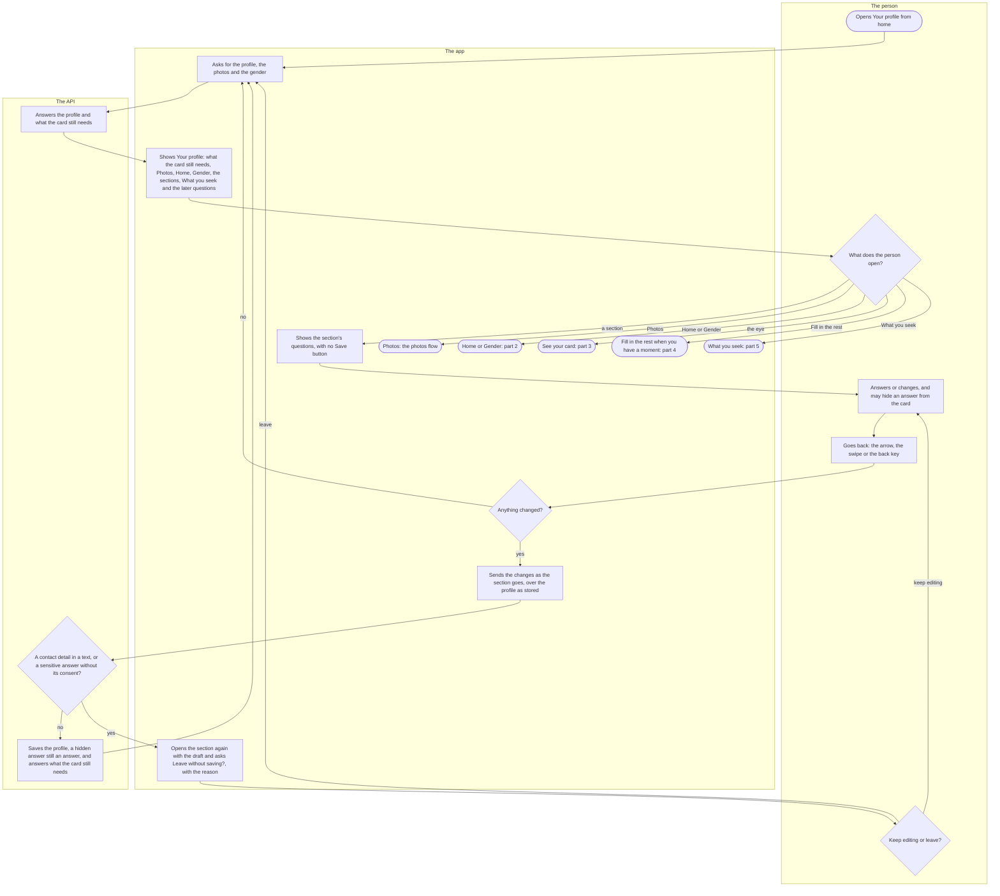
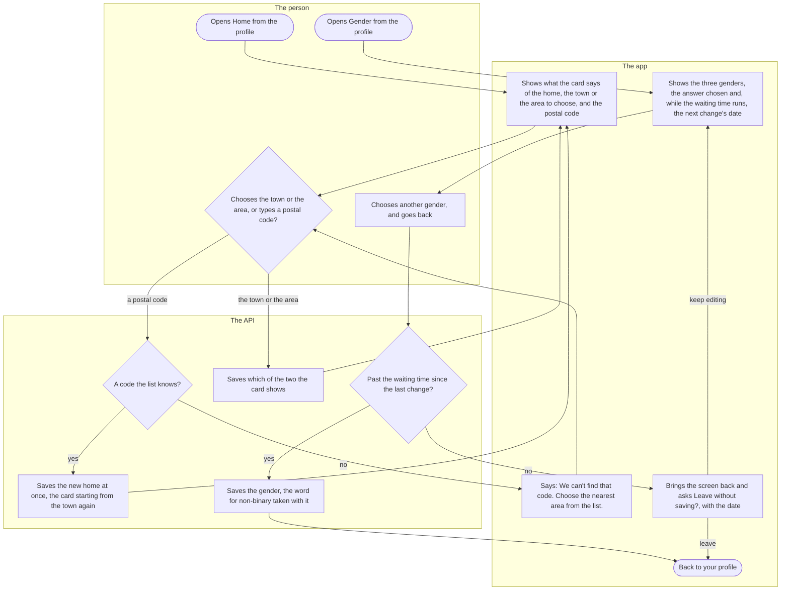
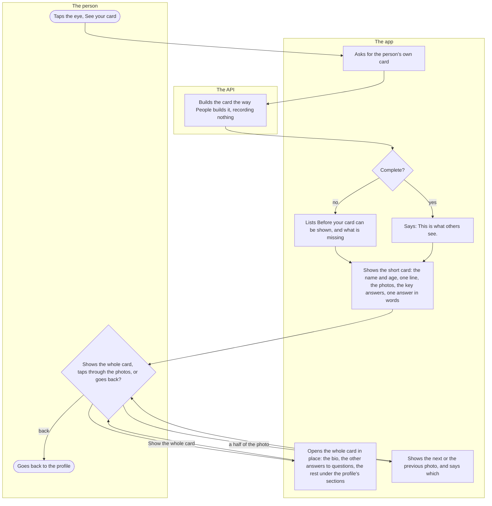
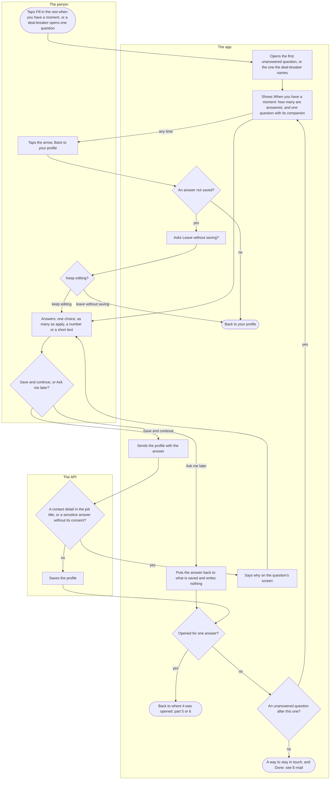
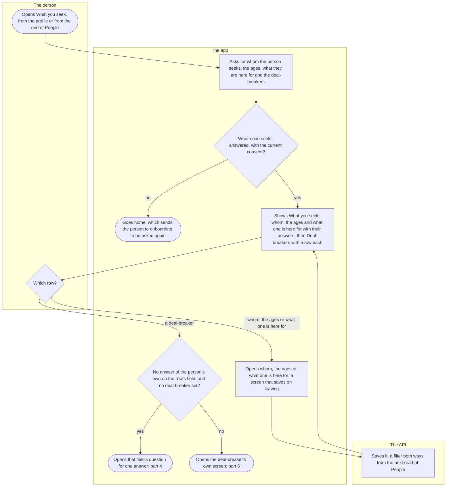
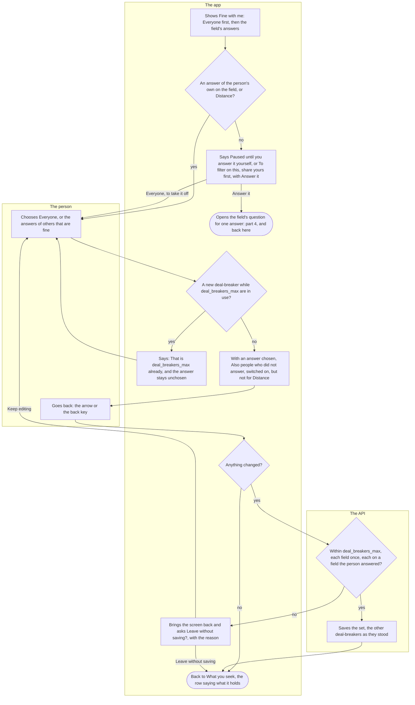
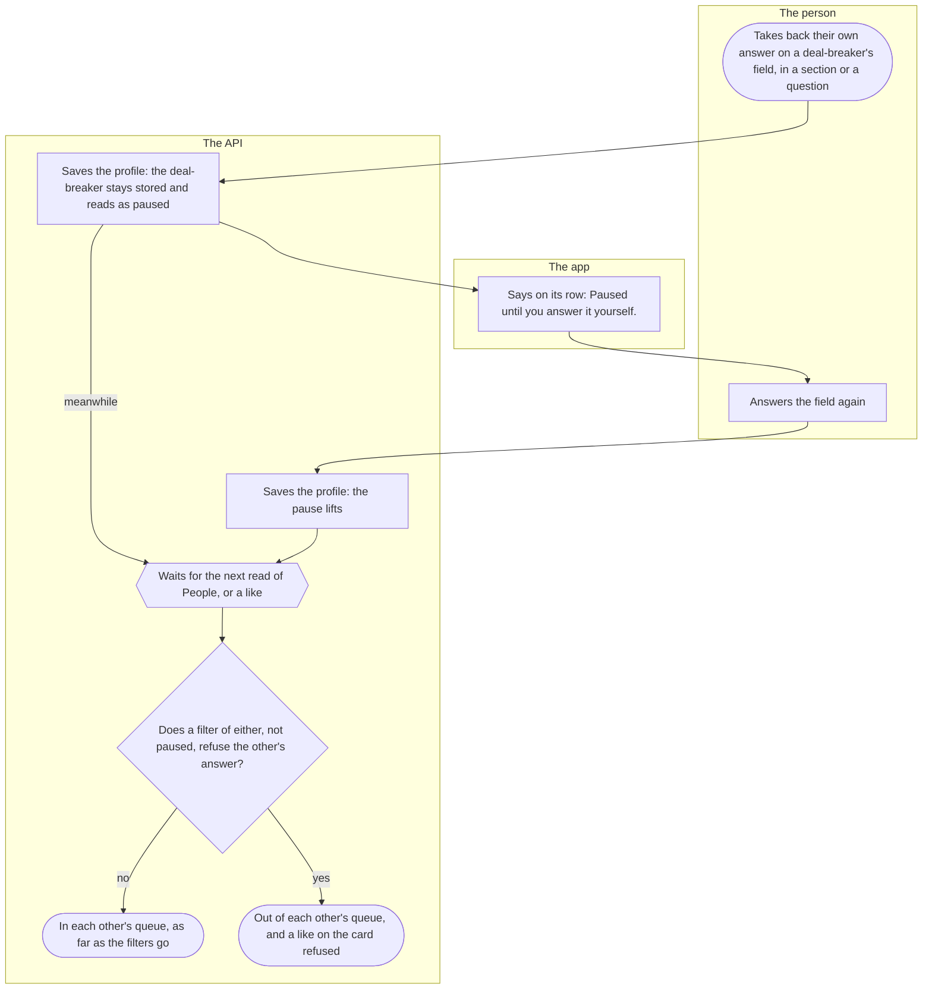

# The profile, the card and What you seek

<!-- draws
apps/mobile/app/profile/
apps/mobile/src/features/profile/ProfileScreen.tsx
apps/mobile/src/features/profile/sections.ts
apps/mobile/src/features/profile/SectionScreen.tsx
apps/mobile/src/features/profile/FieldEditor.tsx
apps/mobile/src/features/profile/useSaveOnLeave.ts
apps/mobile/src/features/profile/PlaceScreen.tsx
apps/mobile/src/features/profile/gender/GenderScreen.tsx
apps/mobile/src/features/profile/CardPreviewScreen.tsx
apps/mobile/src/features/profile/ProfileCardView.tsx
apps/mobile/src/features/profile/later/LaterFieldScreen.tsx
apps/mobile/src/features/profile/seek/SeekScreen.tsx
apps/mobile/src/features/profile/DealBreakerRows.tsx
apps/mobile/src/features/profile/DealBreakerFieldScreen.tsx
apps/api/src/profile/service.ts
apps/api/src/profile/card.ts
apps/api/src/pond/home.ts
apps/api/src/matching/deal-breakers.ts
apps/api/src/matching/pool.ts
packages/schema/src/profile-fields.ts
apps/api/src/profile/completeness.ts
apps/api/src/profile/text.ts
apps/api/src/matching/preferences.ts
apps/mobile/src/features/profile/PlaceEditor.tsx
apps/mobile/src/features/profile/seek/useSeeking.ts
apps/mobile/src/features/profile/seek/SeekWhomScreen.tsx
apps/mobile/src/features/profile/seek/SeekAgesScreen.tsx
-->

After onboarding, a person keeps their profile: they change its answers section by section, keep an answer off their card, set their home and their gender, look at their card as others will see it, answer the optional questions one at a time when they have a moment, and in What you seek change whom they seek, the ages, what they are here for and the deal-breakers that keep out people whose answers they cannot live with. The photos have their own flow, [Photos](photos.md), and the optional e-mail after the questions has [E-mail](email.md).

## Part 1: the profile and a section

### Steps

1. The person opens "Your profile" from the home screen.
2. The app asks the API for the profile, for the photos to count the approved ones, and for the gender. It asks again whenever the list is back in front, so what it shows follows what was saved.
3. The API answers the profile as saved and what it still lacks before the card can be shown to anybody: a name, enough approved photos, a bio, a ready line or answered questions, whom the person seeks and their age window.
4. The app shows "Your profile". At the top, only while something is missing, "Before your card can be shown" says what. Then rows across the whole width: "Photos", "Home" with the town or area the card shows, "Gender" with the answer, and the sections "The basics", "Questions", "Relationship and kids", "Work and education", "Lifestyle", "Hobbies" and "Beliefs", each with a check mark once done or how far it is filled; then "What you seek" and, only while a later question is unanswered, "Fill in the rest when you have a moment". "Photos" and "What you seek" are starred as what a card needs, with the footnote "Needed before your card can be shown", which a screen reader hears on each starred row. Nothing is edited on the list itself.
5. The person chooses what to open. A section: 6. "Photos": 15. "Home" or "Gender": 16. The eye at the top, "See your card": 17. "Fill in the rest when you have a moment": 18. "What you seek": 19.
6. The app shows the section's questions, each with its icon, and no Save button. In "The basics" the name is starred as what a card needs, and beside the bio, as beside "Questions", a line says that the card needs one of a long enough bio, a ready line or answered questions. The identity label shows in "The basics" only once it was given, to change or clear it. What one is here for is a section of its own, opened from What you seek (part 5). A party or a religion carries no note on its consent: Settings is the one place for it.
7. The person answers or changes: a choice is a button, and tapped again it is taken back; a question with several answers takes as many as apply, and an answer such as "None of them" stands alone and clears the others; the height has a stepper and "Clear the answer"; the name and the job title are short texts; the bio can be written, or a ready line picked in its place ("Or pick a line instead"); "Questions" are answered in the person's own words. A long list (the languages, the hobbies, the lines of work) has "Search", and "Another language" shows only for a search that finds nothing else. Once an answer a card carries is given, "Hide" beside its title keeps it off the card: "Hidden from your card.", or "Hidden from your card. Still used for matching." where matching reads it; "Show" puts it back ("Back on your card."). A soft answer (education, drinking, the attitude to drugs) says "Never on your card. Only used for matching."
8. The person goes back: the arrow "Back to your profile", the edge swipe or Android's back key. Leaving is never held up.
9. The app checks whether anything in the section changed. No: 2. Yes: 10.
10. The app sends the section's changes once, as the screen goes, put over the profile as it is stored, so two sections edited one after the other each keep their own change.
11. The API checks the save. A text the person typed for the card (the name, the bio, the job title, an answer to a question) is refused when it carries an e-mail address, a link, a phone number or a social media handle, which come after a match. A party or a religion is refused without the sensitive-answers consent, which is given at the seek step of onboarding and withdrawn only in Settings. Refused: 13. Otherwise: 12.
12. The API saves the profile and answers it with what the card still needs; the list reads it again (2). A hidden answer is still an answer: the pool and both people's deal-breakers read it as before, and only the card leaves it out.
13. The app opens the section again with the draft as the person left it and asks "Leave without saving?", with the reason: "Your text has an e-mail address, a link, a phone number or a social media handle. Those come after a match.", "This field needs your explicit consent first.", or for anything else "Saving did not work. Check the fields and try again." Nothing was stored.
14. The person chooses. "Keep editing": the section with the draft (7). "Leave without saving": the change is dropped, and the list shows what is stored (2).
15. "Photos" opens the photos screen: [Photos](photos.md).
16. "Home" or "Gender" opens its screen: part 2.
17. The eye, "See your card", opens the card: part 3.
18. "Fill in the rest when you have a moment" opens the later questions: part 4.
19. "What you seek" opens whom the person seeks, the ages, what they are here for and the deal-breakers: part 5.

## Part 2: home and gender

### Steps

20. The person opens "Home" from the profile; its row says the town or area the card shows.
21. The app says "Others see a town or your area by name, never the digits." Where the person's home keeps an area apart from its town, it asks "What should your card show?", with the town and the area to choose; otherwise it says "On your card: {place}". Under it stands "Postal code", with the areas whose codes start with the digits typed, each a button.
22. The person chooses the town or the area: 26. Or types a new postal code and taps its area: 23. A home can change as often as the person likes.
23. Does the list know the code? The app's list says so as the digits are typed, and the API asks again of the area tapped. No: 24. Yes: 25.
24. The app says "We can't find that code. Choose the nearest area from the list." Then 22.
25. The API saves the new home at once, "Saved." being heard, and the card starts from the town again. Kuutti keeps a place large enough by `home_min_inhabitants`, the postal area or a municipality, and never the digits, which go with the save. How far two people live is said in words on a card in [People](queue.md), and a distance deal-breaker reads it (part 6). Then 21.
26. The API saves which of the two the card shows. Then 21.
27. The person opens "Gender" from the profile; its row says the answer.
28. The app says "This is on your card. After a change, the next one is possible only after a waiting time." and shows the three genders with the answer chosen. While the waiting time since the last change runs (`change_cadence_days`), it says "You changed this recently. Next change possible: {date}.", and another gender stays unchosen. While non-binary is chosen and no word is stored, it offers "A word for it, if you like" ("The word is shown on your card and never used for matching."); a change away from non-binary says "This also takes away the word you chose for it."
29. The person chooses another gender and goes back; the screen saves on leaving.
30. Is the waiting time past since the last change? The API asks again, for a change made on another phone meanwhile. No: 32. Yes: 31.
31. The API saves the gender, which reaches everybody who can see the person; a change away from non-binary takes the word with it. Then 33.
32. The app brings the screen back and asks "Leave without saving?", with the date of the next change. "Keep editing": 28. "Leave without saving": 33.
33. The app goes back to "Your profile", which reads it again (part 1, step 2).

## Part 3: the card as others see it

### Steps

34. The person taps the eye at the top of "Your profile", "See your card".
35. The app asks the API for the person's own card.
36. The API builds the card the way People builds it for somebody else, and records nothing: the approved photos in the person's order, the name, the age in whole years from the bank's year and month of birth, the gender with the identity label after it when one was given, the town or area of the home, the bio or its ready line, the answers to questions, and the answers a card carries, less those the person hides. A soft answer or a setting never reaches a card, and "Field" stays off it for a person who chose "Hide me from people in my field". Before the first save there is no card, only what it lacks.
37. Is the profile complete? No: 38. Yes: 39.
38. Above the card, the app lists "Before your card can be shown" and what is missing (40).
39. The app says "This is what others see." (40)
40. The app shows the short card, as People shows it: the name with the age; one line with the gender, the identity label and the home, to which a card in People adds how far the person lives; the photos, the main one first; the key answers as chips, what one is here for and the fields a deal-breaker can be set on, each in the person's own words after its icon; and the first answer to a question, or the bio where there is none. A photo the API will not show is said under the card, never left as a silent gap. On somebody else's card, a hobby or a language both people gave is filled and in bold, heard as shared; the person's own preview has nobody to compare with.
41. The person chooses. "Show the whole card", there while the card holds more: 42. The right or the left half of the photo: 43. Back, "Back to your profile": 44.
42. The whole card opens in place under the short one: the bio, the other answers to questions, and the rest of the answers as chips under the profile's own section titles, a field and a work that read the same as one chip. "Show less" closes it. Then 41.
43. The next or the previous photo comes to the front, a bar per photo above them saying where, and a screen reader hears which photo it is. A photo is asked for only when it first comes to the front. Then 41.
44. The person goes back to the profile.

## Part 4: the later questions

### Steps

45. The person taps "Fill in the rest when you have a moment" on the profile, there only while a later question is unanswered; or a deal-breaker opens its field's question for one answer (part 5, step 73; part 6, step 78).
46. The app opens the first question of the fixed order that is still unanswered, or the one the deal-breaker names. The order: "Kids", "Kids in the future", "Smoking", "Languages", "Education", "Drinking", "Drugs, your attitude", "Hobbies", "Height", "Exercise", "Pets", "Field", "Work", "Parties you could vote for", "Religion", "Star sign".
47. The app shows "When you have a moment", how many are answered ("… of … answered"), on the first one "Every answer is on your card only when you give it.", and the question with its companion where it has one: "Other nicotine" with "Smoking", "Hide me from people in my field" with "Field", "Job title" with "Work". Where one of "Smoking" and "Other nicotine" is answered, only the other is asked; opened for one answer, both are. Once there are kids, the answers of "Kids in the future" read "Want more", "No more" and "Not sure anymore"; the answer stored is the same. "Religion" has "Non-religious" among its answers. "Parties you could vote for" and "Religion" carry no note on their consent: Settings is the one place for it. The person answers (48), or leaves by the arrow at any question (59).
48. The person answers: one choice; as many choices as apply, with no cap, where "None of them" or "No snus or pouches" stands alone and clears the others; a number with the stepper; or a short text. A long list (the languages, the hobbies, the lines of work) has "Search", the languages showing the most spoken first and "Another language" only for a search that finds nothing else. An answer a card carries has "Hide", as in part 1.
49. The person chooses. "Ask me later": 50. "Save and continue": 51.
50. The app puts the answer back to what is saved and writes nothing; the count stays as it was. Then 55.
51. The app sends the profile with the answer; "Saving…" is heard.
52. The API checks the save as in step 11: a contact detail in the job title, or a party or a religion without the sensitive-answers consent. Refused: 53. Otherwise: 54.
53. The app says why on the question's screen, in the words of step 13, and stays on it (48).
54. The API saves the profile. A field answered now can carry a deal-breaker (part 6), and a deal-breaker paused for want of this answer filters again (part 7).
55. Was the question opened for one answer, from a deal-breaker? Yes: 56. No: 57.
56. Either button goes back to where the question was opened, What you seek (part 5) or the deal-breaker's screen (part 6), which reads the answer again.
57. Is there an unanswered question after this one? Yes: 47. No: 58.
58. After the last question comes the optional e-mail, under "When you have a moment": "A way to stay in touch" ([E-mail](email.md)), and "Done", which offers the app lock once while that offer is due ([The app lock](app-lock.md)) and otherwise goes home.
59. At any question the person may tap the arrow, "Back to your profile", or for one answer "Back to your deal-breakers".
60. Is an answer not saved? No: 63. Yes: 61.
61. The app asks "Leave without saving?" The iOS swipe is off meanwhile, and a link from outside the app waits for the same answer.
62. The person chooses. "Keep editing": the question (48). "Leave without saving": the answer is dropped (63).
63. The app leaves the questions for "Your profile" in one step, wherever they were opened from; a question opened for one answer goes back to where it was opened.

## Part 5: What you seek

### Steps

64. The person opens "What you seek" from the profile, or from the end of People ([People](queue.md), part 5).
65. The app asks the API for whom the person seeks, the ages, what they are here for and the deal-breakers, and asks again whenever a screen hands back.
66. Has the person answered whom they seek, with the sensitive-answers consent of the current wording? Yes: 68. No, as for somebody who withdrew the consent in Settings, withdrew it on another phone, or met a new wording: 67.
67. The app goes home, which sends the person to onboarding, where they are asked again ([Onboarding](onboarding.md)).
68. The app shows "What you seek": "These work both ways: they decide whom you see and who sees you. Conversations you already have stay as they are." Then "Whom are you looking for?", "What ages?" and "What are you here for?", each with its answer, the first two starred as what a card needs. Then "Deal-breakers", with how many are in use of `deal_breakers_max` and an (i), "About deal-breakers", whose dialog says "Up to (`deal_breakers_max`). Only on what you answered yourself, and both ways: yours apply to others, theirs to you."; and a row per deal-breaker, "Relationship structure", "Kids", "Kids in the future", "Smoking", "Languages", "Height" and "Distance", each saying what it holds: "Everyone", the answers it accepts (the first few, then how many more), "Share yours first", or "Paused until you answer it yourself."
69. The person chooses a row. Whom, the ages or what one is here for: 70. A deal-breaker: 72.
70. Each opens a screen of its own that saves on leaving, as a section does (part 1, steps 8 to 14): "Whom are you looking for?" with the genders, at least one ("Keep at least one."), as often as the person likes; "What ages?" with "Youngest" and "Oldest"; and "What are you here for?", one answer that can change and never clears, with "This also decides who sees you: people who want the same thing." Whom one seeks is refused without the sensitive-answers consent of the current wording.
71. The API saves it. Like every filter, it works both ways from the next read of People (part 7). Then 68.
72. Does the row's field lack an answer of the person's own, with no deal-breaker set on it? "Distance" never does, since everybody has a home. Yes: 73. No: 74.
73. The row says "Share yours first" and opens that field's own question for one answer (part 4), or for "Relationship structure" the "Relationship and kids" section; either comes back here.
74. The row opens the deal-breaker's own screen: part 6.

## Part 6: a deal-breaker's screen

### Steps

75. The deal-breaker's screen, titled by its field, saves on leaving as What you seek's other screens do. Under "Fine with me" stand "Everyone" first, which is having none, then the field's answers as somebody else's: whole-width rows for a short list, chips with "Search" for the languages. "Another language" is never among them: two who chose it may share no language.
76. Does the person have an answer of their own on the field? "Distance" needs none. Yes: 79. No: 77.
77. Without the person's own answer a deal-breaker filters nothing. One already set says "Paused until you answer it yourself.", its answers drawn read-only; with none set, the screen says "To filter on this, share yours first." Either has "Answer it": 78. "Everyone" still takes a paused one off: 79.
78. "Answer it" opens the field's own question for one answer (part 4), or the section that holds it, and comes back here, where the answers can now be chosen.
79. The person chooses "Everyone", or the answers of others that are fine: as many as apply, or one for "Height" ("Taller than me", "My height or taller" or "Shorter than me", against the person's own height) and for "Distance" ("Nearby", "Close" or "Around", each taking the bands up to it; "Everyone" is the whole country). Taking back the last answer returns to "Everyone", and "Back to Everyone." is heard, so a deal-breaker never stands empty.
80. Is it a new deal-breaker, on a field with none stored, while `deal_breakers_max` are in use already? Yes: 81. No: 82. A person past a number the panel lowered may still change or remove what they hold.
81. The app says "That is (`deal_breakers_max`) already." and the answer stays unchosen (79).
82. With an answer chosen, "Also people who did not answer" shows, switched on for a new deal-breaker: it lets through people who left the field unanswered until the person switches it off. "Distance" has nobody who did not answer, and no switch.
83. The person goes back: the arrow "Back", or Android's back key.
84. Did anything change? No: 88. Yes: 85.
85. The API checks the whole set: at most `deal_breakers_max`, only a new field past it being refused; each field once; only answers the field has, one relation for the height and the bands up to one for the distance; and each on a field the person answered themselves, or a paused one sent back as it stood. Refused: 87. Otherwise: 86.
86. The API saves the set, the person's other deal-breakers as they stood; a relaxation of the field in People today stays until midnight. It works from the next read of People (part 7). Then 88.
87. The app brings the screen back and asks "Leave without saving?", with the reason: "To filter on this, share yours first." for a field the person no longer answers, otherwise "That did not go through. Try again." "Keep editing": 79. "Leave without saving": 88.
88. Back on What you seek, the row says what it holds.

## Part 7: what fits, on every read

### Steps

89. The person takes back their own answer on a field that carries one of their deal-breakers, in its section (part 1) or its question (part 4).
90. The API saves the profile. The deal-breaker is not deleted: it stays stored and reads as paused, so it filters nothing while the person's own answer is missing (94). Then 91.
91. On What you seek, its row says "Paused until you answer it yourself.", and its screen draws what stands read-only, with "Answer it" (part 6).
92. The person answers the field again.
93. The API saves the profile, and the deal-breaker is no longer paused.
94. Nothing waits for the night: both people's filters are asked on every read of People, on every like and on every read of Starred. A change of whom one seeks, the ages, what one is here for, a deal-breaker or the home works on the next read, narrowing and widening at once; a paused deal-breaker, meanwhile, filters nothing.
95. For the two people, the API asks each deal-breaker of both, not paused, against the other's own answer, a hidden one included: an answer passes when the holder accepts it (for the languages, any one in common; for the height, against the holder's own; for the distance, the band between the two homes), and no answer passes only while the holder's "Also people who did not answer" is on. Whom each seeks, the age windows and what each is here for are asked both ways too. Refused by either: 96. Otherwise: 97.
96. Neither is a card in the other's queue, whichever of the two holds the filter. A card already in today's log that no longer fits is left out while it does not fit, and a like on it is refused as a card no longer available; a pass or Later still works, so a like can always be taken back.
97. As far as the filters go, the two stay in each other's pool; a block and "Hide me from people in my field" still hold on their own. A queue that runs short can offer to relax a deal-breaker for that day alone: [People](queue.md), part 5.

## Open

- **The bank's mark on the card's age.** [ADR-009](../adr/009-profile-and-card.md) §6 has the card builder mark the age as verified by the bank, "the only verified thing on the card", and the card's contract still carries the mark ([card.ts](../../apps/api/src/profile/card.ts), [profile.ts](../../packages/schema/src/profile.ts)); the card the app draws says nothing of it, since every account is bank-verified ([ProfileCardView.tsx](../../apps/mobile/src/features/profile/ProfileCardView.tsx)). The register notes it under [Found on the way](../decisions.md#found-on-the-way). Steps 36 and 40 draw the age and neither way of the mark.

## Where it lives

- Screens: [profile/index.tsx](../../apps/mobile/app/profile/index.tsx), [profile/section/[id].tsx](../../apps/mobile/app/profile/section/%5Bid%5D.tsx), [profile/place.tsx](../../apps/mobile/app/profile/place.tsx), [profile/gender.tsx](../../apps/mobile/app/profile/gender.tsx), [profile/card.tsx](../../apps/mobile/app/profile/card.tsx), [profile/later/[field].tsx](../../apps/mobile/app/profile/later/%5Bfield%5D.tsx), [profile/seek/index.tsx](../../apps/mobile/app/profile/seek/index.tsx), [profile/seek/whom.tsx](../../apps/mobile/app/profile/seek/whom.tsx), [profile/seek/ages.tsx](../../apps/mobile/app/profile/seek/ages.tsx), [profile/deal-breakers/[field].tsx](../../apps/mobile/app/profile/deal-breakers/%5Bfield%5D.tsx)
- App: the profile slice ([README](../../apps/mobile/src/features/profile/README.md)), [ProfileScreen.tsx](../../apps/mobile/src/features/profile/ProfileScreen.tsx), [sections.ts](../../apps/mobile/src/features/profile/sections.ts), [SectionScreen.tsx](../../apps/mobile/src/features/profile/SectionScreen.tsx), [FieldEditor.tsx](../../apps/mobile/src/features/profile/FieldEditor.tsx), [BioEditor.tsx](../../apps/mobile/src/features/profile/BioEditor.tsx), [PromptsEditor.tsx](../../apps/mobile/src/features/profile/PromptsEditor.tsx), [NeededNote.tsx](../../apps/mobile/src/features/profile/NeededNote.tsx), [useProfile.ts](../../apps/mobile/src/features/profile/useProfile.ts), [useSaveOnLeave.ts](../../apps/mobile/src/features/profile/useSaveOnLeave.ts), [errorText.ts](../../apps/mobile/src/features/profile/errorText.ts), [ConfirmLeave.tsx](../../apps/mobile/src/features/profile/ConfirmLeave.tsx), [PlaceScreen.tsx](../../apps/mobile/src/features/profile/PlaceScreen.tsx), [PlaceEditor.tsx](../../apps/mobile/src/features/profile/PlaceEditor.tsx), [GenderScreen.tsx](../../apps/mobile/src/features/profile/gender/GenderScreen.tsx), [CardPreviewScreen.tsx](../../apps/mobile/src/features/profile/CardPreviewScreen.tsx), [ProfileCardView.tsx](../../apps/mobile/src/features/profile/ProfileCardView.tsx), [LaterFieldScreen.tsx](../../apps/mobile/src/features/profile/later/LaterFieldScreen.tsx), [SeekScreen.tsx](../../apps/mobile/src/features/profile/seek/SeekScreen.tsx), [SeekWhomScreen.tsx](../../apps/mobile/src/features/profile/seek/SeekWhomScreen.tsx), [SeekAgesScreen.tsx](../../apps/mobile/src/features/profile/seek/SeekAgesScreen.tsx), [useSeeking.ts](../../apps/mobile/src/features/profile/seek/useSeeking.ts), [DealBreakerRows.tsx](../../apps/mobile/src/features/profile/DealBreakerRows.tsx), [DealBreakerFieldScreen.tsx](../../apps/mobile/src/features/profile/DealBreakerFieldScreen.tsx)
- API: `GET` and `PUT /profile` and `GET /profile/card` in the profile slice, [routes.ts](../../apps/api/src/profile/routes.ts), [service.ts](../../apps/api/src/profile/service.ts), [text.ts](../../apps/api/src/profile/text.ts) (contact details), [completeness.ts](../../apps/api/src/profile/completeness.ts), [card.ts](../../apps/api/src/profile/card.ts); `PUT /account/home` in the pond slice, [routes.ts](../../apps/api/src/pond/routes.ts), [home.ts](../../apps/api/src/pond/home.ts); `GET /onboarding` and `PUT /account/gender` in the identity slice, [onboarding-routes.ts](../../apps/api/src/identity/onboarding-routes.ts), [onboarding.ts](../../apps/api/src/identity/onboarding.ts); `GET` and `PUT /preferences` and `GET` and `PUT /preferences/deal-breakers` in the matching slice, [routes.ts](../../apps/api/src/matching/routes.ts), [preferences.ts](../../apps/api/src/matching/preferences.ts), [deal-breakers.ts](../../apps/api/src/matching/deal-breakers.ts), [pool.ts](../../apps/api/src/matching/pool.ts); whether two fit now in the jobs' [round-builder.ts](../../apps/api/src/jobs/round-builder.ts)
- Registry and numbers: [profile-fields.ts](../../packages/schema/src/profile-fields.ts) (the fields, their roles, the later order and companions, the deal-breaker fields), [deal-breakers.ts](../../packages/schema/src/deal-breakers.ts); `deal_breakers_max`, `change_cadence_days` and `home_min_inhabitants` in `matching_config` ([seed.ts](../../packages/db/src/seed.ts))
- Spec: [preferences.feature](../../features/matching/preferences.feature), [filters.feature](../../features/matching/filters.feature), [home.feature](../../features/pond/home.feature)
- Maestro: [card.yaml](../../apps/mobile/e2e/flows/card.yaml), [profile-sections.yaml](../../apps/mobile/e2e/flows/profile-sections.yaml), [profile-contact-details.yaml](../../apps/mobile/e2e/flows/profile-contact-details.yaml), [photos-gate-and-hidden-field.yaml](../../apps/mobile/e2e/flows/photos-gate-and-hidden-field.yaml), [identity-label-on-card.yaml](../../apps/mobile/e2e/flows/identity-label-on-card.yaml), [place-change.yaml](../../apps/mobile/e2e/flows/place-change.yaml), [gender-change.yaml](../../apps/mobile/e2e/flows/gender-change.yaml), [later-fields-ask-later.yaml](../../apps/mobile/e2e/flows/later-fields-ask-later.yaml), [later-multi-choice-cap.yaml](../../apps/mobile/e2e/flows/later-multi-choice-cap.yaml), [later-answer-on-card.yaml](../../apps/mobile/e2e/flows/later-answer-on-card.yaml), [later-question-asks-before-leaving.yaml](../../apps/mobile/e2e/flows/later-question-asks-before-leaving.yaml), [politics-none-alone.yaml](../../apps/mobile/e2e/flows/politics-none-alone.yaml), [kids-labels.yaml](../../apps/mobile/e2e/flows/kids-labels.yaml), [what-you-seek.yaml](../../apps/mobile/e2e/flows/what-you-seek.yaml), [age-window-bounds.yaml](../../apps/mobile/e2e/flows/age-window-bounds.yaml), [deal-breakers-accepted.yaml](../../apps/mobile/e2e/flows/deal-breakers-accepted.yaml), [deal-breakers-own-answer.yaml](../../apps/mobile/e2e/flows/deal-breakers-own-answer.yaml), [deal-breaker-paused.yaml](../../apps/mobile/e2e/flows/deal-breaker-paused.yaml), [deal-breaker-height.yaml](../../apps/mobile/e2e/flows/deal-breaker-height.yaml), [deal-breaker-distance.yaml](../../apps/mobile/e2e/flows/deal-breaker-distance.yaml)
- ADRs: [ADR-009](../adr/009-profile-and-card.md) (the registry, the plain-text rule, completeness, the card, the deal-breakers), [ADR-019](../adr/019-profile-fields-and-roles.md) (the fields and their roles, a hidden answer, the sensitive-answers consent), [ADR-061](../adr/061-one-home-no-ponds.md) (the home, the distance deal-breaker), [ADR-060](../adr/060-no-waiting-at-the-pond.md) §9 (the gender's waiting time), [ADR-062](../adr/062-one-queue.md) §8 (every filter on the next read), [ADR-042](../adr/042-the-short-pool.md) §8 (who did not answer), [ADR-010](../adr/010-onboarding-and-consents.md) (whom one seeks, the ages and the consent, first asked in onboarding)
- Rules: the register's [Profile](../decisions.md#profile) and [Filters](../decisions.md#filters) rows.

## History

- 2026-09-26 (#47, PR #65): the profile screen, saved with a Save button, refusing contact details in the name, the bio and the prompts, saying what the card still needs, and opening the card as others see it.
- 2026-10-08 (#145, PR #153): the fields of the field sheet with their roles; the card shows the information fields and never a soft answer or a setting, and a party or a religion needs the sensitive-answers consent.
- 2026-10-09 (#148, PR #156): the later questions, one per screen, with "Ask me later", which writes nothing, and "Save and continue"; the last leads to the optional e-mail.
- 2026-10-09 (#149, PR #157): the deal-breakers, up to `deal_breakers_max`, only on a field the person answered themselves and paused while that answer is missing; reached from the profile and after the last question.
- 2026-10-09 (#150, PR #159): the card's shape: the gender with the identity label, the information fields under their labels, "Field" left off for a person who hides from their field.
- 2026-10-10 (#148, PR #169): "Fill in the rest" opens on the first unanswered question; the identity label shows on the profile only once given; leaving the profile with unsaved edits asks first.
- 2026-10-10 (#204, PR #207): one sensitive-answers consent, given at the seek step and withdrawn in Settings; the profile and the later questions lose their own consent switch.
- 2026-10-10 (#178, PR #209): "Field" and "Work" take several answers, up to three each.
- 2026-10-11 (#227, PR #229): the profile becomes a list of sections, each its own screen with no Save button, saved on going back.
- 2026-10-11 (#238, PR #240): going back from a section is never held: the save goes as the section goes, and a refusal brings the section back with the draft and the reason.
- 2026-10-13 (#239, PR #268): the list marks how far each part is filled and holds the photos and the deal-breakers; what the card still needs and "Fill in the rest" show only while there is something; the eye opens the card, which leads with the name and the age; "None of them" stands alone; "Answer it" on relationship structure opens its section; no consent note on the questions.
- 2026-10-13 (#239, PR #269): "Smoking" takes vaping, and "Other nicotine" is asked with it.
- 2026-10-13 (#239, PR #271): a ready line counts as a bio, and a question with several answers takes as many as apply.
- 2026-10-14 (#285, PR #286): the later questions and the deal-breakers get a back arrow, and leaving either with a change not saved asks first.
- 2026-10-17 (#250, PR #339): a section's save sends only its own changes over the profile as stored, so two sections edited one after the other keep both.
- 2026-10-19 (#87, PR #373): the deal-breakers take effect in the pool, from both sides, and a paused one filters nothing.
- 2026-10-21 (#149, PR #398): a paused deal-breaker sent back as it stands is kept, so the screen saves while one is paused.
- 2026-10-21 (#99, PR #401): a new deal-breaker lets through people who did not answer its field until the person switches "Also people who did not answer" off.
- 2026-10-22 (#418, PR #422): "Done" after the last question offers the app lock once before going home.
- 2026-10-29 (#513, PR #517): the card's photos come one at a time, tapped through on either half.
- 2026-10-30 (#509, PR #538): "Non-religious" joins the answers of "Religion".
- 2026-10-31 (#515, PR #544): an answer can be kept off the card with "Hide", and still counts for matching where matching reads it.
- 2026-10-31 (#508, PR #546): a deal-breaker on height, one relation to the person's own height.
- 2026-11-01 (#514, PR #556): Home on the profile: one postal code, the card showing a town or, by choice, the area's name; and a deal-breaker on distance.
- 2026-11-01 (#542, PR #561): What you seek, from the profile: whom, the ages, what one is here for and the deal-breakers in one list, each screen saved on leaving; and, for #552, Gender gets a row and a screen of its own.
- 2026-11-03 (#502, PR #578): whom one seeks, the ages, the intent, the deal-breakers and the home work both ways on the next read of People, no longer from the next night.
- 2026-11-03 (#551, PR #583): each deal-breaker is a row of What you seek with a screen of its own, Everyone first, saved on leaving.
- 2026-11-05 (#581, PR #598): the profile's rows run the whole width, with less explained; the deal-breakers' own list and the e-mail screen's way to it go; Your card says what it lacks above the card.
- 2026-11-07 (#616, PR #641): what a card needs is starred where it is edited; a later question asks only the half still open; a deal-breaker on the languages never takes "Another language".
- 2026-11-08 (#644, PR #647): the card in two depths, a short card and the whole card in place, its answers as chips, a shared one filled and in bold.
