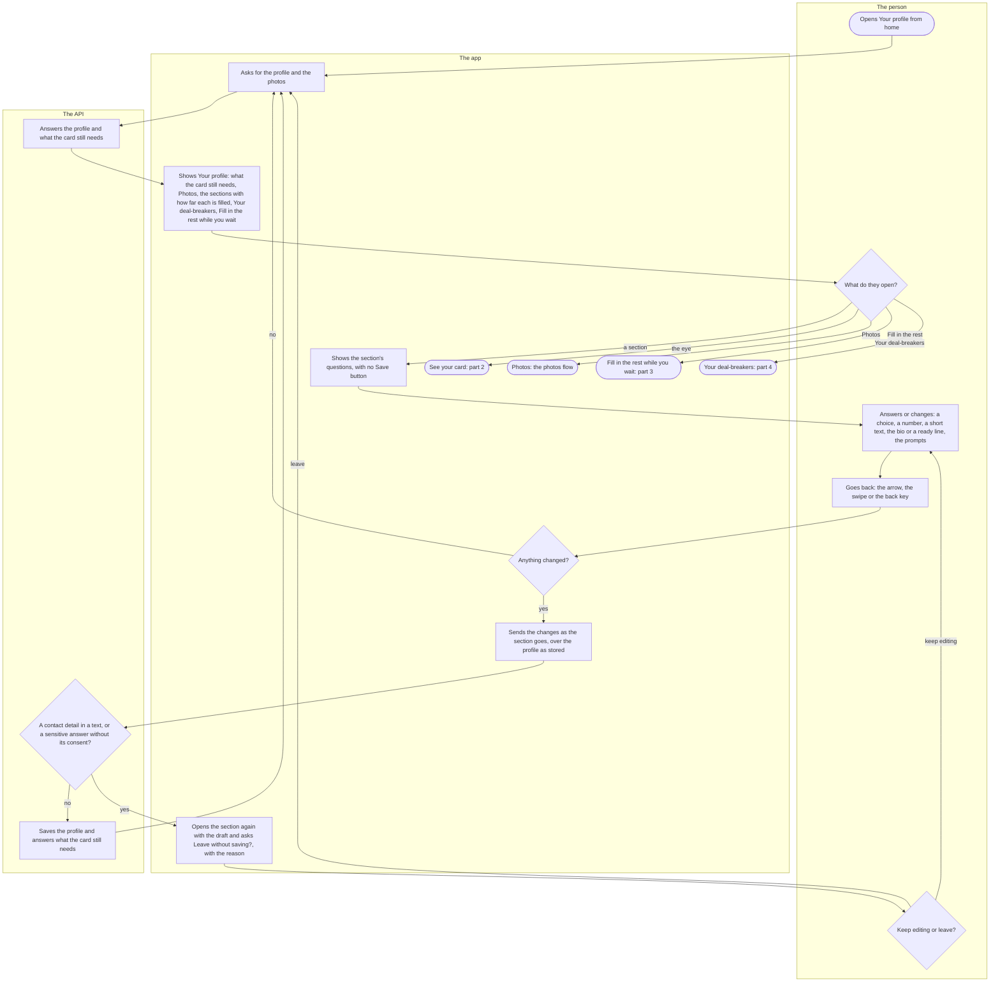
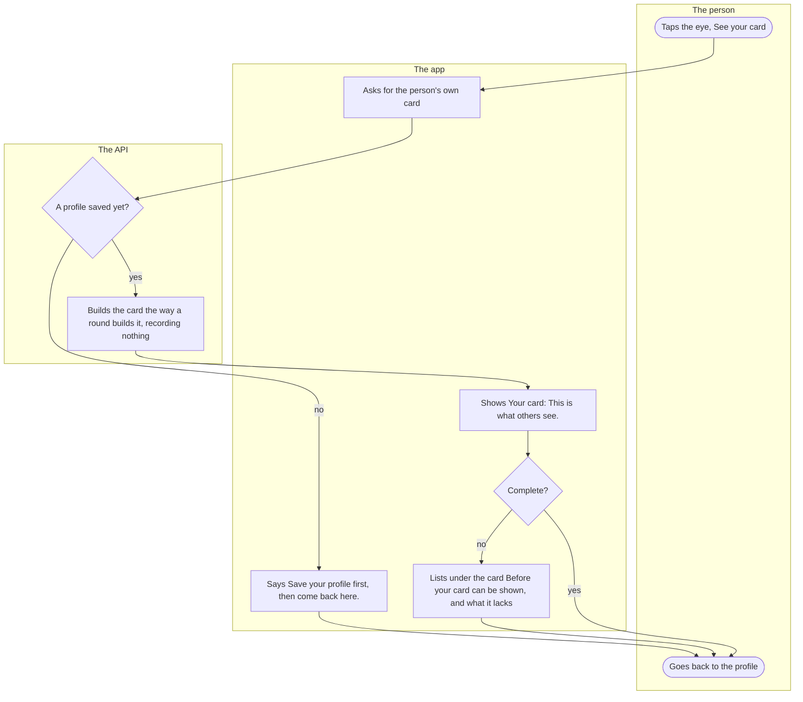
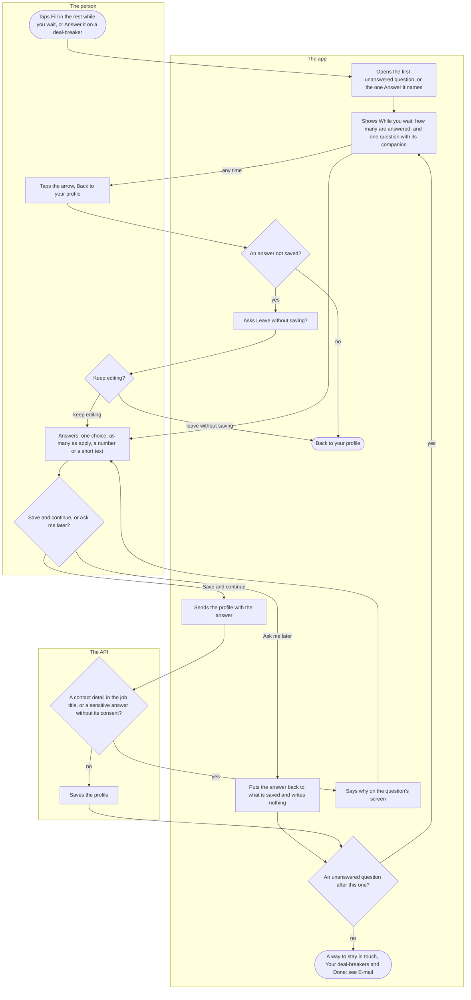
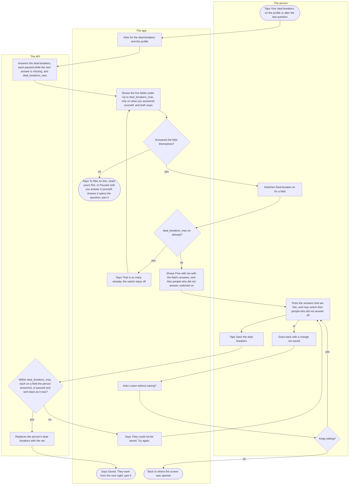
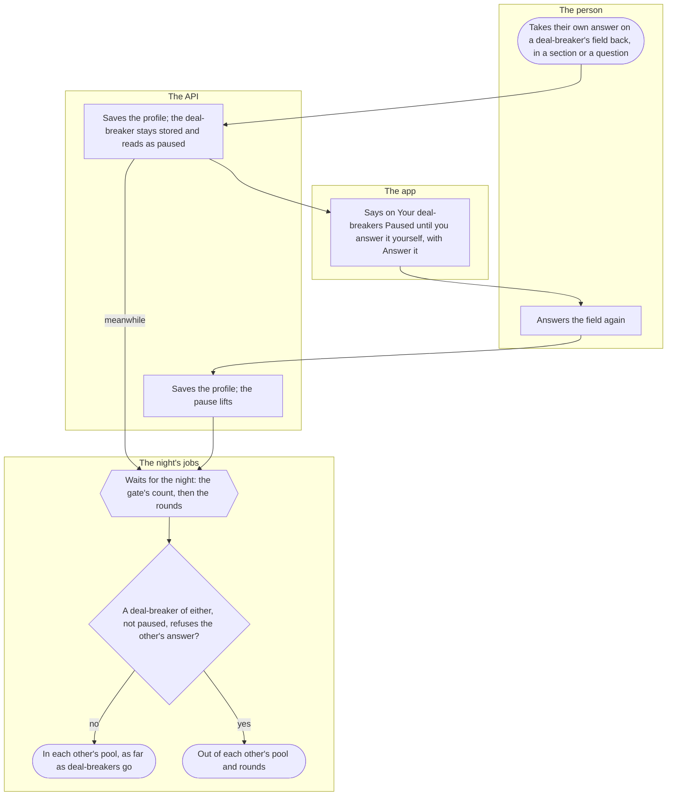

# The profile, the card and deal-breakers

After onboarding, a person keeps their profile: they change its answers section by section, look at their card as others will see it, answer the optional questions one at a time while they wait, and choose a few deal-breakers that keep out people whose answers they cannot live with. The photos have their own flow, [Photos](photos.md), and the optional e-mail at the end of the questions has [E-mail](email.md).

## Part 1: the profile and a section

### Steps

1. The person opens "Your profile" from the home screen.
2. The app asks the API for the profile, and for the photos to count the approved ones. It asks again whenever the list is back in front, so what it shows follows what was saved.
3. The API answers the profile as saved and what it still lacks before the card can be shown in anybody's round: a name, enough approved photos, a bio, a ready line or answered prompts, whom the person seeks and their age window.
4. The app shows "Your profile". At the top, only while something is missing, "Before your card can be shown" says what. Then "Photos" and the seven sections ("The basics", "Prompts", "Relationship and kids", "Work and education", "Lifestyle", "Hobbies", "Beliefs"), each with a check mark once done or how far it is filled, then "Your deal-breakers" and, only while one of the later questions is unanswered, "Fill in the rest while you wait". Nothing is edited on the list itself.
5. The person chooses what to open. A section: 6. The eye at the top, "See your card": 15. "Photos": 16. "Fill in the rest while you wait": 17. "Your deal-breakers": 18.
6. The app shows the section's questions, each with its icon, and no Save button. The identity label shows in "The basics" only once it was given in onboarding, to change or clear it.
7. The person answers or changes: a choice is a button, and tapped again it is taken back; a question with several answers takes as many as apply, and an answer such as "None of them" stands alone and clears the others; the height has a stepper and "Clear the answer"; the name and the job title are short texts; the bio can be written, or a ready line picked in its place ("Or pick a line instead"); the prompts are "Up to three questions, answered in your own words".
8. The person goes back: the arrow "Back to your profile", the edge swipe or Android's back key. Leaving is never held up.
9. The app checks whether anything in the section changed. No: 2. Yes: 10.
10. The app sends the section's changes once, as the screen goes, put over the profile as it is stored, so two sections edited one after the other each keep their own change.
11. The API checks the save. A text the person typed for the card (the name, the bio, the job title, a prompt answer) is refused when it carries an e-mail address, a link, a phone number or a social media handle, which come after a match. A party or a religion is refused without the sensitive-answers consent, which is given at the seek step of onboarding and withdrawn only in Settings. Refused: 13. Otherwise: 12.
12. The API saves the profile and answers it with what the card still needs; the list reads it again (2).
13. The app opens the section again with the draft as the person left it and asks "Leave without saving?", with the reason: "Your text has an e-mail address, a link, a phone number or a social media handle. Those come after a match.", "This field needs your explicit consent first.", or for anything else "Saving did not work. Check the fields and try again." Nothing was stored.
14. The person chooses. "Keep editing": the section with the draft (7). "Leave without saving": the change is dropped, and the list shows what is stored (2).
15. The eye, "See your card", opens the card: part 2.
16. "Photos" opens the photos screen: [Photos](photos.md).
17. "Fill in the rest while you wait" opens the later questions: part 3.
18. "Your deal-breakers" opens the deal-breakers: part 4.

## Part 2: the card as others see it

### Steps

19. The person taps the eye at the top of "Your profile", "See your card".
20. The app asks the API for the person's own card.
21. The API checks whether the person has saved a profile. No: 23. Yes: 22.
22. The API builds the card the way a round builds it for somebody else, and records nothing: the approved photos in the person's order, the name, the age in whole years from the bank's year and month of birth, the gender with the identity label after it when one was given, the area, the bio or its ready line, the prompts, and the fields that are information. A soft answer (education, drinking, the attitude to drugs) or a setting never reaches a card, and "Field" stays off it for a person who chose "Hide me from people in my field". On somebody else's card the hobbies and languages both people answered are marked "(you too)"; the person's own preview has nobody to compare with.
23. The app says "Save your profile first, then come back here." (27).
24. The app shows "Your card" and "This is what others see.": the first photo, the name with the age, the gender and the area, one prompt answer, the other photos, the bio or its ready line, the information fields under their labels (several answers joined by commas, the height in centimetres), then the rest of the prompts. A photo the API will not show is said under the card, never left as a silent gap.
25. The app checks whether the profile is complete. No: 26. Yes: 27.
26. Under the card the app lists "Before your card can be shown" and what is missing.
27. The person goes back to the profile ("Back to your profile").

## Part 3: the later questions

### Steps

28. The person taps "Fill in the rest while you wait" on the profile, shown only while one of the later questions is unanswered, or "Answer it" on a deal-breaker (part 4).
29. The app opens the first question of the fixed order that is still unanswered, or the one "Answer it" names. The order: "Kids", "Kids in the future", "Smoking", "Languages", "Education", "Drinking", "Drugs, your attitude", "Hobbies", "Height", "Exercise", "Pets", "Field", "Work", "Parties you could vote for", "Religion", "Star sign".
30. The app shows "While you wait", how many of the questions are answered ("… of … answered"), on the first one "One question at a time, each optional. Skip what you like; every answer is on your card only when you give it.", and the question with its companion where it has one: "Other nicotine" with "Smoking", "Hide me from people in my field" with "Field", "Job title" with "Work". Once there are kids, the answers of "Kids in the future" read "Want more", "No more" and "Not sure anymore"; the answer stored is the same. "Parties you could vote for" and "Religion" carry no note on their consent: Settings is the one place for it.
31. The person answers: one choice; as many choices as apply, with no cap, where "None of them" or "No snus or pouches" stands alone and clears the others; a number with the stepper; or a short text. A long list (the languages, the hobbies, the lines of work) has "Search", and the languages show the most spoken first.
32. The person chooses. "Ask me later": 33. "Save and continue": 34.
33. The app puts the answer back to what is saved and writes nothing; the count stays as it was (38).
34. The app sends the profile with the answer.
35. The API checks the save as in step 11: a contact detail in the job title, or a party or religion without the sensitive-answers consent. Refused: 36. Otherwise: 37.
36. The app says why on the question's screen, in the words of step 13, and stays on it (31).
37. The API saves the profile. A field answered now can carry a deal-breaker (part 4), and a deal-breaker paused for want of this answer filters again (part 5).
38. The app looks for an unanswered question after this one. Found: 30. None: 39.
39. After the last question comes the optional e-mail, "A way to stay in touch" ([E-mail](email.md)), under "That is everything. Thank you.", with "Your deal-breakers" (part 4) and "Done", which offers the app lock once while that offer is due, and otherwise goes home.
40. At any question the person may tap the arrow, "Back to your profile".
41. The app checks for an answer not saved. None: 44. One: 42.
42. The app asks "Leave without saving?": "Your changes are not saved yet." The iOS swipe is off meanwhile, and a link from outside the app waits for the same answer.
43. The person chooses. "Keep editing": the question (31). "Leave without saving": the answer is dropped (44).
44. The app leaves the questions for "Your profile" in one step, wherever they were opened from. A deal-breakers screen under them with changes of its own asks the same question first.

## Part 4: setting deal-breakers

### Steps

45. The person taps "Your deal-breakers" on the profile, or on the e-mail screen after the last of the later questions.
46. The app asks the API for the deal-breakers, and reads the person's own profile.
47. The API answers the person's deal-breakers, each marked paused while the person's own answer on its field is missing, and how many a person may have, `deal_breakers_max`.
48. The app shows "Deal-breakers": "Up to (`deal_breakers_max`). Only on what you answered yourself, and both ways: yours apply to others, theirs to you.", and the five fields a deal-breaker can be set on: "Relationship structure", "Kids", "Kids in the future", "Smoking" and "Languages".
49. For each field, the app checks whether the person answered it themselves. No: 50. Yes: 51.
50. The field has no switch and says "To filter on this, share yours first.", or, for a deal-breaker already on, "Paused until you answer it yourself." "Answer it" opens that field's own later question (part 3), or for "Relationship structure" the "Relationship and kids" section (part 1).
51. The person switches "Deal-breaker: (field)" on.
52. The app counts the deal-breakers already on. As many as `deal_breakers_max`: 53. Fewer: 54.
53. The app says "That is (`deal_breakers_max`) already." and the switch stays off (48).
54. The app shows "Fine with me" with the field's answers, and "Also people who did not answer", switched on: a new deal-breaker lets through people who left the field unanswered until the person switches that off.
55. The person picks the answers of others that are fine with them, and may switch "Also people who did not answer" off. A deal-breaker switched off goes at the next save.
56. The person taps "Save the deal-breakers". The button stays closed while a deal-breaker that is on has no answer that is fine, and the screen says "Pick at least one answer that is fine with you."
57. The API checks the whole set: at most `deal_breakers_max`, each field once, only answers the field has, and each on a field the person answered themselves, or a paused one sent back as it stood. Refused: 58. Otherwise: 59.
58. The app says "They could not be saved. Try again." Nothing changed (55).
59. The API replaces the person's deal-breakers with the set and answers it. Whom the person seeks and their age window, set in onboarding, stay as they are.
60. The app says "Saved." The deal-breakers work from the next night: part 5.
61. Instead of saving, the person goes back (the arrow or Android's back key) with a change not saved; a link from outside the app is held the same way.
62. The app asks "Leave without saving?": "Your changes are not saved yet."
63. The person chooses. "Keep editing": the screen as it was (55). "Leave without saving": 64.
64. The app drops the changes and goes back to where the screen was opened: the profile, or the e-mail screen after the questions.

## Part 5: deal-breakers at work

### Steps

65. The person takes back their own answer on a field that carries one of their deal-breakers, in its section (part 1) or its later question (part 3).
66. The API saves the profile. The deal-breaker is not deleted: it stays stored and reads as paused, so it filters nothing while the person's own answer is missing.
67. On "Your deal-breakers" the app says "Paused until you answer it yourself." with "Answer it", and the deal-breaker's switch and answers stay as they were.
68. The person answers the field again.
69. The API saves the profile, and the deal-breaker is no longer paused.
70. The deal-breakers take effect at night: the gate's count, then the round builder, which also builds a round at the day's first read when the night built none. Every saved deal-breaker (part 4) is read this way, and a paused one, meanwhile, filters nothing.
71. For every two people of the area, the night asks each deal-breaker of both, not paused, against the other's own answer. An answer passes when the holder accepts it (for the languages, any one of them in common); no answer passes only while the holder's "Also people who did not answer" is on. Refused by either: 72. Otherwise: 73.
72. Neither counts toward the other's figure at the gate, and neither is in the other's round, whichever of the two holds the deal-breaker.
73. As far as the deal-breakers go, the two stay in each other's pool; whom each seeks, the age windows, what each is here for and a block still hold on their own. A round that runs short can offer to relax a deal-breaker for that day alone; that is the round's flow.

## Where it lives

- Screens: [profile/index.tsx](../../apps/mobile/app/profile/index.tsx), [profile/section/[id].tsx](../../apps/mobile/app/profile/section/[id].tsx), [profile/card.tsx](../../apps/mobile/app/profile/card.tsx), [profile/later/[field].tsx](../../apps/mobile/app/profile/later/[field].tsx), [profile/deal-breakers.tsx](../../apps/mobile/app/profile/deal-breakers.tsx)
- App: the profile slice, [ProfileScreen.tsx](../../apps/mobile/src/features/profile/ProfileScreen.tsx), [sections.ts](../../apps/mobile/src/features/profile/sections.ts), [SectionScreen.tsx](../../apps/mobile/src/features/profile/SectionScreen.tsx), [FieldEditor.tsx](../../apps/mobile/src/features/profile/FieldEditor.tsx), [BioEditor.tsx](../../apps/mobile/src/features/profile/BioEditor.tsx), [PromptsEditor.tsx](../../apps/mobile/src/features/profile/PromptsEditor.tsx), [useProfile.ts](../../apps/mobile/src/features/profile/useProfile.ts), [errorText.ts](../../apps/mobile/src/features/profile/errorText.ts), [CardPreviewScreen.tsx](../../apps/mobile/src/features/profile/CardPreviewScreen.tsx), [ProfileCardView.tsx](../../apps/mobile/src/features/profile/ProfileCardView.tsx), [LaterFieldScreen.tsx](../../apps/mobile/src/features/profile/later/LaterFieldScreen.tsx), [DealBreakersScreen.tsx](../../apps/mobile/src/features/profile/DealBreakersScreen.tsx), [ConfirmLeave.tsx](../../apps/mobile/src/features/profile/ConfirmLeave.tsx)
- API: `GET` and `PUT /profile` and `GET /profile/card` in the profile slice, [routes.ts](../../apps/api/src/profile/routes.ts), [service.ts](../../apps/api/src/profile/service.ts), [text.ts](../../apps/api/src/profile/text.ts) (contact details), [completeness.ts](../../apps/api/src/profile/completeness.ts), [card.ts](../../apps/api/src/profile/card.ts); `GET` and `PUT /preferences/deal-breakers` in the matching slice, [routes.ts](../../apps/api/src/matching/routes.ts), [deal-breakers.ts](../../apps/api/src/matching/deal-breakers.ts), [pool.ts](../../apps/api/src/matching/pool.ts); the night's [pond-gate.ts](../../apps/api/src/jobs/pond-gate.ts) and [round-builder.ts](../../apps/api/src/jobs/round-builder.ts)
- Registry and numbers: [profile-fields.ts](../../packages/schema/src/profile-fields.ts) (the fields, their roles, the later order and companions, the deal-breaker fields), [deal-breakers.ts](../../packages/schema/src/deal-breakers.ts); `deal_breakers_max` in `matching_config` ([seed.ts](../../packages/db/src/seed.ts))
- Spec: [preferences.feature](../../features/matching/preferences.feature), [filters.feature](../../features/matching/filters.feature)
- Maestro: [card.yaml](../../apps/mobile/e2e/flows/card.yaml), [profile-sections.yaml](../../apps/mobile/e2e/flows/profile-sections.yaml), [profile-contact-details.yaml](../../apps/mobile/e2e/flows/profile-contact-details.yaml), [later-fields-ask-later.yaml](../../apps/mobile/e2e/flows/later-fields-ask-later.yaml), [later-multi-choice-cap.yaml](../../apps/mobile/e2e/flows/later-multi-choice-cap.yaml), [later-answer-on-card.yaml](../../apps/mobile/e2e/flows/later-answer-on-card.yaml), [politics-none-alone.yaml](../../apps/mobile/e2e/flows/politics-none-alone.yaml), [kids-labels.yaml](../../apps/mobile/e2e/flows/kids-labels.yaml), [deal-breakers-limit.yaml](../../apps/mobile/e2e/flows/deal-breakers-limit.yaml), [deal-breakers-own-answer.yaml](../../apps/mobile/e2e/flows/deal-breakers-own-answer.yaml), [deal-breaker-paused.yaml](../../apps/mobile/e2e/flows/deal-breaker-paused.yaml)
- ADRs: [ADR-009](../adr/009-profile-and-card.md) (the registry, the plain-text rule, completeness, the card, the deal-breakers), [ADR-019](../adr/019-profile-fields-and-roles.md) (the fields and their roles, the sensitive-answers consent), [ADR-042](../adr/042-the-short-pool.md) §8 (who did not answer), [ADR-015](../adr/015-pond-gate.md) (the gate's count), [ADR-035](../adr/035-the-round-builder-first-cut.md) (the round builder)

## History

- 2026-09-26 (#47, PR #65): the profile screen, saved with a Save button, refusing contact details in the name, the bio and the prompts, saying what the card still needs, and opening the card as others see it.
- 2026-10-08 (#145, PR #153): the fields of the field sheet with their roles; the card shows the information fields and never a soft answer or a setting, and a party or a religion needs the sensitive-answers consent.
- 2026-10-09 (#148, PR #156): the later questions, one per screen, with "Ask me later", which writes nothing, and "Save and continue"; the last leads to the optional e-mail.
- 2026-10-09 (#149, PR #157): the deal-breakers, up to `deal_breakers_max`, only on a field the person answered themselves and paused while that answer is missing; reached from the profile and after the last question.
- 2026-10-09 (#150, PR #159): the card's shape: the gender with the identity label, the information fields under their labels, "Field" left off for a person who hides from their field.
- 2026-10-10 (#148, PR #169): "Fill in the rest" opens on the first unanswered question; the identity label shows on the profile only once given; leaving the profile with unsaved edits asks first.
- 2026-10-10 (#204, PR #207): one sensitive-answers consent, given at the seek step and withdrawn in Settings; the profile and the later questions lose their own consent switch.
- 2026-10-10 (#178, PR #209): "Field" and "Work" take several answers, up to three each.
- 2026-10-11 (#227, PR #229): the profile becomes a list of sections, each its own screen with no Save button, saved on going back.
- 2026-10-11 (#238, PR #240): going back from a section is never held: the save goes as the section goes, and a refusal brings the section back with the draft and the reason.
- 2026-10-13 (#239, PR #268): the list marks how far each part is filled and holds the photos and the deal-breakers; what the card still needs and "Fill in the rest" show only while there is something; the eye opens the card, which leads with the name and the age; "None of them" stands alone; "Answer it" on relationship structure opens its section; no consent note on the questions.
- 2026-10-13 (#239, PR #269): "Smoking" takes vaping, and "Other nicotine" is asked with it.
- 2026-10-13 (#239, PR #271): a ready line counts as a bio, and a question with several answers takes as many as apply.
- 2026-10-14 (#285, PR #286): the later questions and the deal-breakers get a back arrow, and leaving either with a change not saved asks first.
- 2026-10-17 (#250, PR #339): a section's save sends only its own changes over the profile as stored, so two sections edited one after the other keep both.
- 2026-10-19 (#87, PR #373): the deal-breakers take effect in the pool, from both sides, and a paused one filters nothing.
- 2026-10-21 (#149, PR #398): a paused deal-breaker sent back as it stands is kept, so the screen saves while one is paused.
- 2026-10-21 (#99, PR #401): a new deal-breaker lets through people who did not answer its field until the person switches "Also people who did not answer" off.
- 2026-10-22 (#418, PR #422): "Done" after the last question offers the app lock once before going home.
