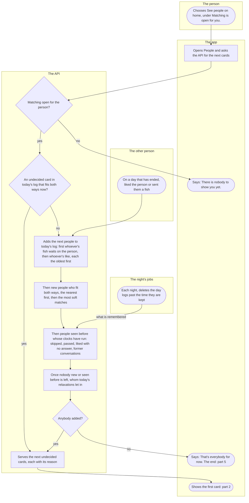
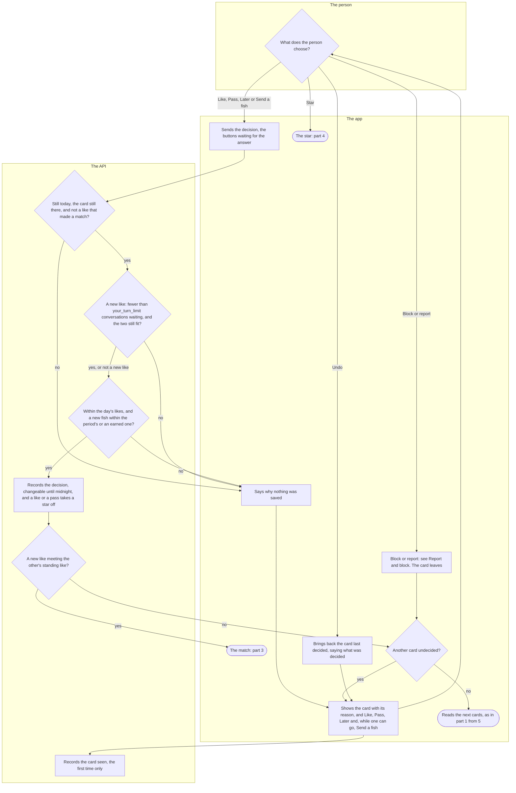
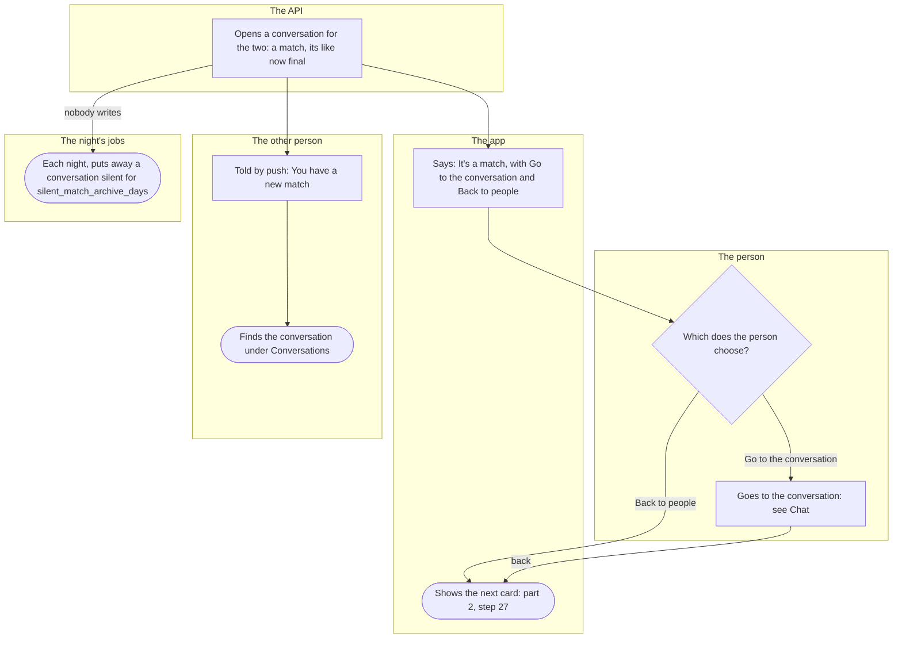
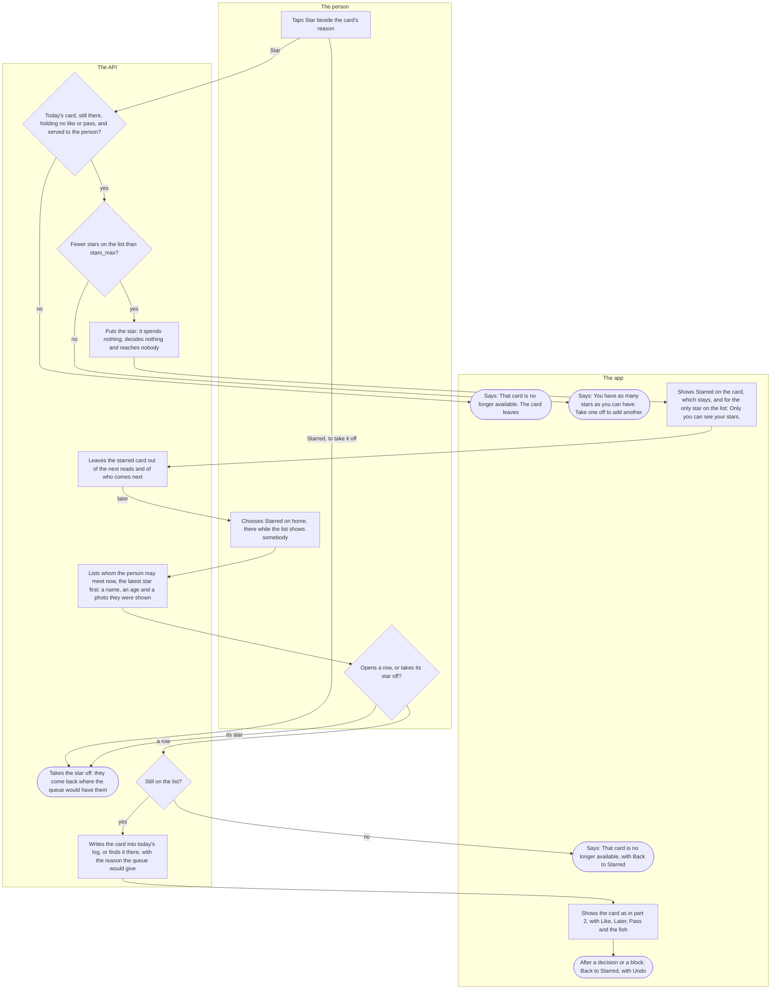
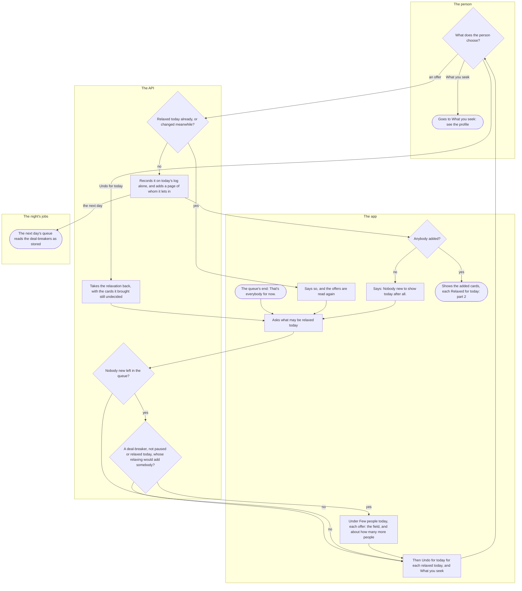

# People: the queue, likes, fish, the star and the match

<!-- draws
apps/mobile/app/round.tsx
apps/mobile/app/stars/
apps/mobile/src/features/matching/RoundButton.tsx
apps/mobile/src/features/matching/RoundScreen.tsx
apps/mobile/src/features/matching/useRound.ts
apps/mobile/src/features/matching/ShortPool.tsx
apps/mobile/src/features/matching/StarsButton.tsx
apps/mobile/src/features/matching/StarredScreen.tsx
apps/mobile/src/features/matching/useStars.ts
apps/mobile/src/features/settings/DecisionButtonChoices.tsx
apps/api/src/matching/round-routes.ts
apps/api/src/matching/rounds.ts
apps/api/src/matching/round-order.ts
apps/api/src/matching/pool.ts
apps/api/src/matching/star-routes.ts
apps/api/src/matching/stars.ts
apps/api/src/jobs/round-builder.ts
apps/api/src/jobs/stars.ts
apps/api/src/chat/archive.ts
apps/api/src/notifications/push.ts
apps/api/src/jobs/pool.ts
apps/api/src/profile/card.ts
apps/mobile/src/features/matching/faceButtons.tsx
-->

Once matching is open for a person, People shows them everybody who fits them, one card at a time, as far as they like: each card with the reason it is there, and Like, Pass, Later and the fish as buttons. This flow follows the queue from See people on the home screen, through each decision and the star, to a match that opens a conversation, the queue's end with its offer to relax a deal-breaker for the day, and what the night still does. How matching opens is [People on Kuutti](people-on-kuutti.md); the answers and filters a card is read against are [the profile](profile.md).

## Part 1: People reads the queue

### Steps

1. On the home screen, under "Matching is open for you.", the person chooses "See people". The button is there only once matching is open for them: [People on Kuutti](people-on-kuutti.md).
2. The app opens People and asks the API for the next cards. Nothing is built at night: the first read of the Finnish day opens the day's log of whom the queue holds, what was shown and what was decided. A queue left open past midnight is read anew, with no word, when it comes back in sight.
3. Is matching open for the person: an admin has opened it, and their profile and onboarding are complete, with the account active or shadow-banned? Nobody taking a break, suspended or banned has a queue. No: 4. Yes: 5. Somebody whose matching closed after today's log was opened reads what is left of it and then the queue's end (13); one whose profile stopped being complete meets the end at once. Home says why.
4. The app says "There is nobody to show you yet."
5. Is a card left in today's log that is undecided and fits both ways now? Both people's filters are asked on every read, never remembered: whom each seeks, the age windows, what each is here for, their deal-breakers, today's relaxations, a block either way, and "Hide me from people in my field". A card that does not fit now stays in the log, left out while it does not fit. A card starred and left undecided comes only through Starred (part 4), unless that person's like waits. Yes: 11. No: 6.
6. The API adds the next people to today's log. First everybody whose fish waits on the person, then everybody whose like waits (14), each the oldest first, however many, and never moved by fit or distance: a like of a day that has ended, within `like_expiry_days`, answered by no like or pass, and the two still in each other's pool. A like from somebody the person passed within the pass's clock, or has or had a conversation with within its clock, never comes. A shadow-banned person gets none of these places, and the likes wait for the lift.
7. Then, up to a page in all, new people: everybody complete and seen by others who fits both ways, not in today's log, not starred, not passed, liked or talked to within their clocks, whose like does not wait (they come in 6), and not held back by the inbox stop: somebody with `inbox_stop` likes waiting comes as nobody's new, seen-before or relaxed card until they have gone through enough of them to fall below it, while their own likes still arrive (6), and nothing tells anybody. The nearest band first, then the most soft matches (education, drinking, the attitude to drugs, from both sides), then an order fixed for the person and the day. Labelled "Matches your filters".
8. Then people seen before whose clocks have run, labelled "Seen before": skipped cards first, the oldest skip first; then people passed, after `pass_cooldown_days`, or `second_pass_cooldown_days` after a second pass; then people liked with no answer, after `liked_cooldown_days`; then former conversations, after `ended_cooldown_days` from the close or the archive; within each, the one shown longest ago first. A block never runs out. Seen means displayed or decided: somebody queued and never displayed is new again another day. What is remembered is what the kept logs hold (15).
9. Once nobody new or seen before is left, the people the day's relaxations let in (part 5), labelled "Relaxed for today: {field}".
10. Was anybody added? Yes: 11. No: 13. Nothing fills a queue that has run out.
11. The API serves the next undecided cards, at most a page, each with its reason and, for each of the person's own deal-breakers whose field the card's person does not answer or keeps off their card, "Doesn't say: {field}". Where the panel has set a ceiling of cards a day (`exposure_cards_per_day`, off at 0), past it the app says "You have seen many profiles today. New ones come after midnight."
12. The app shows the first card: part 2.
13. The app says "That's everybody for now.": the queue's end, part 5.
14. On a day that has ended, another person liked the person, or sent them a fish, from their own queue (part 2). That like waits for the person: 6.
15. Each night, the jobs delete the day logs older than the time they are kept, a constant of the code that covers the longest clock, their entries and relaxations with them. So a pass older than that is forgotten, and the next pass counts as a first.

## Part 2: a card and its decision

### Steps

16. The app shows one card: the first undecided one, or the one Undo brought back (29). Above it is its reason, "Liked you", "Sent you a fish", "Seen before", "Matches your filters" or "Relaxed for today: {field}", with the star beside it (part 4); "Doesn't say: {field}" for each of the person's deal-breakers its person does not answer; and on an undecided relaxed card "Undo for today: {field}" (part 5, step 70). Then the card as others see it ([the profile](profile.md), part 3): the name and the age with "Block or report" beside them; one line with the gender, the identity label, the town or area of the home and how far it is in words; the photos one at a time, a tap on the right half showing the next and on the left half the previous; the key answers as chips; the first answer to a question, or the bio; and "Show the whole card", which opens the rest in place. A photo the API will not show is said under the card ("The photo could not be shown."). At the bottom: how many of the day's likes are left, in words, "No likes left today. New ones tomorrow." at none; "Send a fish" on a card that answers nobody's like, while a fish can go today and a like is left or the card holds the person's like already, and always on the card that holds the fish; "Later"; and Pass and Like. They are placed as the person chose under Settings › Appearance and language › Like and Pass: for the right hand (Pass at the left, Like at the right), mirrored for the left, or one-handed, Undo, the star, the likes left, the fish, Later, Pass and Like in one column on that hand's side; Like and Pass carry Kuutti's own icons, "✕ and ○" or "A and B". Each keeps its word, shape and place, and no swipe does anything. Nothing loads beyond the cards the app holds. The card is reported seen (17), and the person chooses (18).
17. The app reports the card seen once it is on the screen, and not while a match stands in front of it; the API records the first report only. It decides nothing.
18. The person chooses. Like, Pass, Later or Send a fish: 19. Undo, offered once a decision has been made and never after a match: 29. Block or report: 30. Star: 31.
19. The app sends the decision; the buttons are dimmed until the answer comes, so nothing repeats. The same decision again changes nothing.
20. Is it still the card's day, is the card still there (nobody blocked, sanctioned or gone since), and is it not a change to a like that made a match? No: 23. Yes: 21.
21. Is it a new like, a like or a fish on a card that held no like? Then two more questions, in this order: does the person have fewer than `your_turn_limit` conversations on their turn (open, not archived, the last thing said in it from the other person, or a match where nothing is said yet), asked before anything is read of the other person so that the refusal says nothing of them; and do the two still fit both ways now? No: 23. Yes, or not a new like: 22. A pass or Later asks neither, so a like can always be taken back.
22. Is it within the day's likes and the period's fish? Any like counts against the day's `like_budget_balanced`, a like back on a "Liked you" or "Sent you a fish" card too, and a fish is a like. A new fish also counts against `fish_budget` in each period of `fish_window_days`, the periods counted from a Monday; past it, a fish the person's invitations earned is used by itself ([Inviting a friend](invitations.md)), and given back if the decision changes the same day. On a card that answers a like, a fish is just a like. A pass or Later is never counted. Within them: 24. Otherwise: 23.
23. Nothing is saved, and the app says why: "That day ended at midnight, so this was not saved.", and today's queue is read anew; "That card is no longer available.", and the card leaves, gone meanwhile or, for a new like, no longer fitting; "This like made a match, so it stays. You can still end the conversation under Conversations."; how many conversations are waiting, then "Answer or end one before you like anyone new.", and the card stays for a pass or Later; "You have used today's likes. New ones come after midnight; you can still pass."; "You cannot send a fish just now.", and the fish leaves the bar; or for anything else "That did not go through. Try again." Then 16.
24. The API records the decision. It can change until midnight in Finland, except a like that made a match. A like or a pass takes the person's star off that card's person; Later leaves it. A pass of somebody passed on an earlier day is a second pass, and holds `second_pass_cooldown_days`.
25. Is it a new like of somebody whose like of the person still stands, today's included and within `like_expiry_days`? No match is made while the person is shadow-banned, nor with a block between the two. Yes: 26. No: 27. A like that met nothing waits: it comes first in the other person's queue once its day has ended (part 1, step 6), and the person is never told what became of it.
26. The match: part 3.
27. Is another card the app holds undecided? Yes: 16. No: 28.
28. The app reads the next cards, as in part 1 from step 5; Undo stays for the last decision.
29. Undo, in the header (its icon alone at a large text size; one-handed, at the thumb), brings back the card last decided, with what was decided: "You liked this person. You can change that until midnight.", "You passed on this person. You can change that until midnight.", "You left this person for later. You can change that until midnight." or "You sent this person a fish. You can change that until midnight." The decision stands until another replaces it: 16.
30. Block or report, beside the name on the card: see [Report and block](report-and-block.md). It is not offered while a decision is on its way, so that a decision landing after the next card took its place can never bring the blocked person back. Once a block or a report has gone through, the card leaves the screen: 27.
31. The star: part 4.

## Part 3: the match

### Steps

32. The API opens a conversation for the two, in the decision's own transaction: a match. The like that made it is final, and changing it is refused (part 2, step 23). An earlier conversation of the two that stands archived is closed, so a pair has one conversation to write in. Then 33 for the person, 37 for the other person, and 39 while nobody writes.
33. The app says "It's a match", with "Go to the conversation" and "Back to people". Nothing offers the like back.
34. Which does the person choose? Go to the conversation: 35. Back to people: 36.
35. The conversation opens over People: see [Chat](chat.md). Coming back, People goes on (36). After reporting one of the conversation's photos, the conversation list takes the conversation's place, and Back from the list leads to People.
36. People shows the next card: part 2, step 27.
37. The other person, whose earlier like the match met, is told by push, "You have a new match", never by whom, unless it is the quiet hours or they switched matches off ([Notifications and notices](notifications.md)).
38. The other person finds the conversation under Conversations; a tap on the push opens the list.
39. Each night, a conversation silent for `silent_match_archive_days` is put away, as any conversation quiet that long is: it leaves the your-turn count (part 2, step 21), and the two stay out of each other's queues for `ended_cooldown_days` from then, as after an end. The next message brings it back ([Chat](chat.md)).

## Part 4: the star and Starred

### Steps

40. On a card that holds no like or pass, the person taps "Star", beside the card's reason (one-handed, at the thumb with Undo): its word with an outlined icon, and once on, "Starred" with a filled one. Star: 41. Tapped again, "Starred" takes the star off: 51. It is dimmed while a decision or a star is on its way.
41. Is it today's card, still there, holding no like or pass, and one the person was served? A day that has ended answers as in part 2, step 23. No: 42. Yes: 43.
42. The app says "That card is no longer available." and the card leaves: part 2, step 27.
43. Does the list show fewer people than `stars_max` (0 is off)? Those the list leaves out now do not count, and a person's stars stop at a ceiling of the contract whatever the panel sets. Yes: 45. No: 44.
44. The app says "You have as many stars as you can have. Take one off to add another." The card stays.
45. The API puts the star. It spends no like and reserves none, so a star with no likes left is allowed, and it decides nothing. Nobody is told of it, and nothing else reads it: it is in no count, no order of anybody's, no inbox rule and no research event.
46. The card stays, its toggle reading "Starred". When it is the only star the list shows, the app says "Only you can see your stars.", the one place that says so.
47. At the next read, a card starred and left undecided leaves the queue, and the starred person comes no more as an ordinary card, new or seen before, nor through a relaxation: they come through Starred. Somebody whose like or fish waits keeps coming as "Liked you" or "Sent you a fish" until the like expires, with the star on it. A like or a pass on the card takes the star off (part 2, step 24); Later leaves it.
48. Later, the person chooses "Starred" on the home screen, under "See people". The line is there only while the list shows somebody, by its word and no count.
49. The API lists the stars of the people the person may meet now: matching open, both people's filters as a read of the queue asks them, the other seen by others, and not held back by the inbox stop, asked so that the list never tells that somebody's pile is at it. Anybody else is left out with no word why, and comes back by themselves. The latest star first and in no other order, each row a name, an age and the main photo the person was shown. A star has no clock. With nobody on it, the app says "Nobody here right now."
50. The person opens a row: 52. Or takes its star off with the star beside it ("Take the star off: {name}"), without opening the card: 51.
51. The API takes the star off; the row goes, and the person comes back where the queue would have them. If it fails, the app says "That did not go through. Try again."
52. Does the list still show them? No: 53. Yes: 54.
53. The app says "That card is no longer available.", with "Back to Starred".
54. The API writes the card into today's log, or finds it there as it stands, so it is decided through the queue's own routes, every check of part 2 with it. Its reason is the one the queue would give: "Liked you" or "Sent you a fish" where a like waits; "Relaxed for today: {field}" for somebody who fits only through today's relaxations, so that a like on them can arrive; otherwise "Seen before".
55. The app shows the card under "Starred", as in part 2: Like, Later, Pass and the fish spend what they spend anywhere, Block or report is beside the name, and the star is there.
56. After a decision or a block, "Back to Starred" stands alone, with Undo still there for the decision; a like that makes a match says "It's a match", with "Go to the conversation" and "Back to Starred" (part 3).

## Part 5: the queue's end and the short pool

### Steps

57. The queue has ended (part 1, step 13): the app says "That's everybody for now.", with no count and nothing about tomorrow, which in a thin set could be false for weeks.
58. The app asks what may be relaxed today; asking relaxes nothing. It asks again after each tap.
59. Is the queue short: is nobody new left in it, counting nobody the inbox stop holds back? No: 62. Yes: 60.
60. Would relaxing one of the person's own deal-breakers, not paused and not relaxed today, add somebody today? Each is counted in each of its two ways, on top of whatever is relaxed already. No: 62. Yes: 61.
61. Under "Few people today", the offers stand in two groups: "Include today those who did not answer", while the deal-breaker leaves them out, and "Set aside for today", the only way for a distance deal-breaker. Each button names the field and says about how many more people it lets in, in the counter's steps of `pond_counter_k` ("A few more people" below one step), never a count of cards, and is heard whole: "Include those who did not answer: {field}" or "Set aside for today: {field}".
62. Below come "Undo for today: {field}" for each deal-breaker relaxed today, and one plain button, "What you seek", the same words for everybody, naming no row and no number, so that nobody in a thin set is told to widen.
63. The person chooses. An offer: 64. "Undo for today", here or on an undecided card it brought: 70. "What you seek": 71. Or nothing.
64. Was that deal-breaker relaxed today already, or did another phone relax or undo one since the offers were counted? Yes: 65. No: 66. A day that has ended is read anew, as in part 2, step 23.
65. The app says "You relaxed that one for today already." or "Your relaxations for today changed meanwhile. Look again and choose.", and the offers are read again: 58.
66. The API records the relaxation on today's log alone, and adds a page of whom it lets in after the last card, by the queue's own rules: new people first, then those seen before, never anybody cooling down, passed, already in the log, starred, kept apart by "Hide me from people in my field" or held back by the inbox stop. It loosens only the person's side: whoever comes in is somebody whose own filters let the person through. Nothing else is ever relaxed: whom one seeks, the age window, what one is here for and a block always hold. Then 67, and the next day 72.
67. Did it add anybody? No: 68. Yes: 69.
68. The app says "Nobody new to show today after all." The relaxation stays recorded for the day and can be undone in one tap, and whoever it lets in later that day still comes. Then 58.
69. The added cards come after the last, each labelled "Relaxed for today: {field}" and, while undecided, with "Undo for today: {field}": part 2. Once they are read, the queue goes on to the rest the relaxation lets in.
70. The API takes the relaxation back, with the cards it brought that are still undecided, which leave the screen; a card decided stays as decided. Then 58.
71. "What you seek" opens whom the person seeks, the ages, what they are here for and the deal-breakers: [the profile](profile.md), part 5. A change works on the next read: back on People, its end asks again (part 1, step 5).
72. The next day's queue reads the deal-breakers as stored. A like the person gave on a relaxed card still reaches its person: in that person's queue, the deal-breakers it came in under are set aside for the person alone.

## Where it lives

- Screens: [round.tsx](../../apps/mobile/app/round.tsx) (People) delegates to [RoundScreen.tsx](../../apps/mobile/src/features/matching/RoundScreen.tsx), with [useRound.ts](../../apps/mobile/src/features/matching/useRound.ts), [ShortPool.tsx](../../apps/mobile/src/features/matching/ShortPool.tsx), [faceButtons.tsx](../../apps/mobile/src/features/matching/faceButtons.tsx) and [client.ts](../../apps/mobile/src/features/matching/client.ts); [stars/index.tsx](../../apps/mobile/app/stars/index.tsx) delegates to [StarredScreen.tsx](../../apps/mobile/src/features/matching/StarredScreen.tsx) with [useStars.ts](../../apps/mobile/src/features/matching/useStars.ts), and [stars/[id].tsx](../../apps/mobile/app/stars/%5Bid%5D.tsx) to RoundScreen for one card; the ways in are [RoundButton.tsx](../../apps/mobile/src/features/matching/RoundButton.tsx) and [StarsButton.tsx](../../apps/mobile/src/features/matching/StarsButton.tsx) on the home screen's [GateCard.tsx](../../apps/mobile/src/features/pond/GateCard.tsx); the card and its Block or report are [ProfileCardView.tsx](../../apps/mobile/src/features/profile/ProfileCardView.tsx) and [SafetyActions.tsx](../../apps/mobile/src/features/safety/SafetyActions.tsx); the Like and Pass row of Settings is [DecisionButtonChoices.tsx](../../apps/mobile/src/features/settings/DecisionButtonChoices.tsx), kept on the phone by [decision-buttons.tsx](../../apps/mobile/src/lib/decision-buttons.tsx) of `src/lib`. Slice: [matching](../../apps/mobile/src/features/matching/README.md).
- API: `GET /rounds/today`, `POST /rounds/{day}/entries/{position}/seen`, `PUT /rounds/{day}/entries/{position}/decision`, `GET` and `POST /rounds/{day}/relaxations`, `DELETE /rounds/{day}/relaxations/{field}` in [round-routes.ts](../../apps/api/src/matching/round-routes.ts); `PUT /rounds/{day}/entries/{position}/star`, `GET /stars`, `POST /stars/{id}/open` and `DELETE /stars/{id}` in [star-routes.ts](../../apps/api/src/matching/star-routes.ts); the day's log, the read, the decision, the budgets, the match and the relaxations in [rounds.ts](../../apps/api/src/matching/rounds.ts); the star in [stars.ts](../../apps/api/src/matching/stars.ts); the pool both ways in [pool.ts](../../apps/api/src/matching/pool.ts); the order in [round-order.ts](../../apps/api/src/matching/round-order.ts); the conversation a match opens and whose turn it is in the chat slice's [conversations.ts](../../apps/api/src/chat/conversations.ts); the match's push in [push.ts](../../apps/api/src/notifications/push.ts). Slice: [matching](../../apps/api/src/matching/README.md).
- Jobs: who comes next, the clocks, the inbox stop, whether two fit now and the short pool's offers in [round-builder.ts](../../apps/api/src/jobs/round-builder.ts); the Starred list's reads in [stars.ts](../../apps/api/src/jobs/stars.ts); who is complete in [pool.ts](../../apps/api/src/jobs/pool.ts); the night's prune of old logs and the archive of silent conversations ([archive.ts](../../apps/api/src/chat/archive.ts)) in [boot.ts](../../apps/api/src/boot.ts), run by [nightly.ts](../../apps/api/src/jobs/nightly.ts); all wired in [app.ts](../../apps/api/src/app.ts).
- Spec: [rounds.feature](../../features/matching/rounds.feature), [decisions.feature](../../features/matching/decisions.feature), [fish.feature](../../features/matching/fish.feature), [earned.feature](../../features/matching/earned.feature), [matches.feature](../../features/matching/matches.feature), [short-pool.feature](../../features/matching/short-pool.feature), [stars.feature](../../features/matching/stars.feature), [filters.feature](../../features/matching/filters.feature), [your-turn.feature](../../features/chat/your-turn.feature), [push.feature](../../features/notifications/push.feature).
- Maestro: [round.yaml](../../apps/mobile/e2e/flows/round.yaml), [star.yaml](../../apps/mobile/e2e/flows/star.yaml), [short-pool.yaml](../../apps/mobile/e2e/flows/short-pool.yaml), [decision-buttons.yaml](../../apps/mobile/e2e/flows/decision-buttons.yaml).
- ADRs: [ADR-062](../adr/062-one-queue.md), [ADR-064](../adr/064-a-star.md), [ADR-034](../adr/034-the-round-record.md), [ADR-036](../adr/036-the-days-likes.md), [ADR-037](../adr/037-liked-you-in-the-round.md), [ADR-038](../adr/038-the-match.md), [ADR-039](../adr/039-the-fish.md), [ADR-042](../adr/042-the-short-pool.md), [ADR-044](../adr/044-invitations.md) §8, [ADR-055](../adr/055-push.md) §5, [ADR-060](../adr/060-no-waiting-at-the-pond.md), [ADR-061](../adr/061-one-home-no-ponds.md) §5 and §6, [ADR-030](../adr/030-reports-and-blocks.md) §11, [ADR-008](../adr/008-exposure-budget-and-client-address.md), [ADR-041](../adr/041-velocity.md).
- Rules: the register's [Round](../decisions.md#round), [Likes and fish](../decisions.md#likes-and-fish), [Match](../decisions.md#match), [Filters](../decisions.md#filters), [Chat](../decisions.md#chat) and [Limits](../decisions.md#limits) rows.

## History

- 2026-10-19 (#96, PR #372): the API keeps each person's round of the day, its cards in order with their reasons, each reported seen once and liked or passed until midnight; no screen yet.
- 2026-10-20 (#95, PR #381): the night builds each round after the gate's count, or the day's first look does: people in each other's pool both ways, the most soft matches first, up to `round_size`, with the cooldowns; the API only.
- 2026-10-20 (#98, PR #382): the day's likes are counted, `like_budget_balanced` for everybody; a like back is free and a pass is never counted.
- 2026-10-20 (#97, PR #383): the people whose like waits come first in the round, labelled Liked you, up to `liked_you_cap`, until answered or `like_expiry_days` have passed.
- 2026-10-20 (#100, PR #384): a like that meets a like is a match and opens a conversation; that like is final.
- 2026-10-20 (#378, PR #386): the fish, a like with a mark, `fish_budget` in any `fish_window_days`, first in the other person's round.
- 2026-10-21 (#97, PR #390): a person a moderator has hidden from others gets no Liked you or fish cards; the likes wait for the lift.
- 2026-10-21 (#379, PR #391): the round in the app, from the home screen: one card at a time, Pass, Like and Send a fish as buttons, Undo, the match leading to the conversation, Block or report on the card, and the end saying the next round comes tomorrow.
- 2026-10-21 (#99, PR #401): the short round: new people before those seen before, a deal-breaker relaxed for today and undone in one tap, and every card saying which deal-breakers its person did not answer.
- 2026-10-21 (#99, PR #402): a day's round is held to `round_size` through relaxing and undoing; an undo gives no room back.
- 2026-10-21 (#82, PR #399): Settings › Decision buttons places Pass and Like for either hand, or one-handed in a column with Undo.
- 2026-10-22 (#107, PR #417): past the day's likes or the window's fish, a like or fish the person's invitations earned is used by itself.
- 2026-10-25 (#102, PR #459): a push tells the person whose earlier like a new match met, never by whom; another said that the day's round was ready.
- 2026-10-28 (#491, PR #492): after reporting a photo of a conversation opened from a match, Back from the conversation list leads to the round again, not to the reported conversation.
- 2026-10-29 (#475, PR #496): Send a fish is offered only while a fish can go, and on the card that holds it; the periods of `fish_window_days` are counted from a Monday.
- 2026-10-29 (#513, PR #517): a card's photos come one at a time, tapped through on either half.
- 2026-10-30 (#511, PR #516): the decision buttons' setting opens in place in Settings' one list, under Appearance and language.
- 2026-10-30 (#524, PR #533): the round says in words how many of the day's likes are left.
- 2026-10-30 (#520, PR #536): Like and Pass can carry a game controller's marks, ✕ and ○ or A and B, chosen in the same setting.
- 2026-10-31 (#515, PR #544): a card names a deal-breaker's field its person keeps off their card as it names one not answered: "Doesn't say: {field}".
- 2026-10-31 (#500, PR #555): matching opens by an admin's switch for everybody whose profile is complete; no gate's count comes before the round.
- 2026-11-01 (#514, PR #556): one home for everybody: new people come the nearest first, and a card says the town or area and how far it is, in words.
- 2026-11-03 (#502, PR #578): one queue in place of the daily round: People, from See people, to the end of who fits; Later beside Like, Pass and the fish; the inbox stop and the your-turn limit; clocks for a pass, a second pass, a like with no answer and an ended conversation; both people's filters asked on every read and every like; no ceiling on cards; and the end leading into What you seek. Nothing is built at night, and the round's push goes.
- 2026-11-03 (#503, PR #579): a like back spends one of the day's likes, a fish needs one too, and earned likes go.
- 2026-11-03 (#575, PR #582): a star marks somebody for later without a like or a pass, with Starred on home and its list.
- 2026-11-08 (#644, PR #647): a card shows a short card first, with the whole card in place under it.
