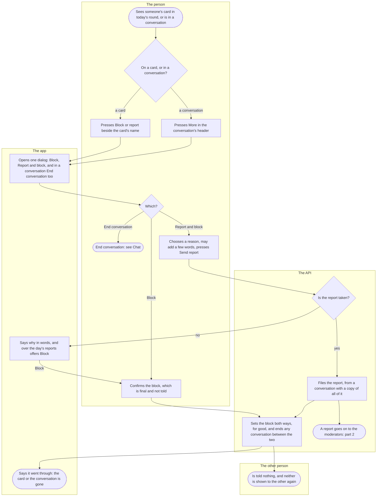
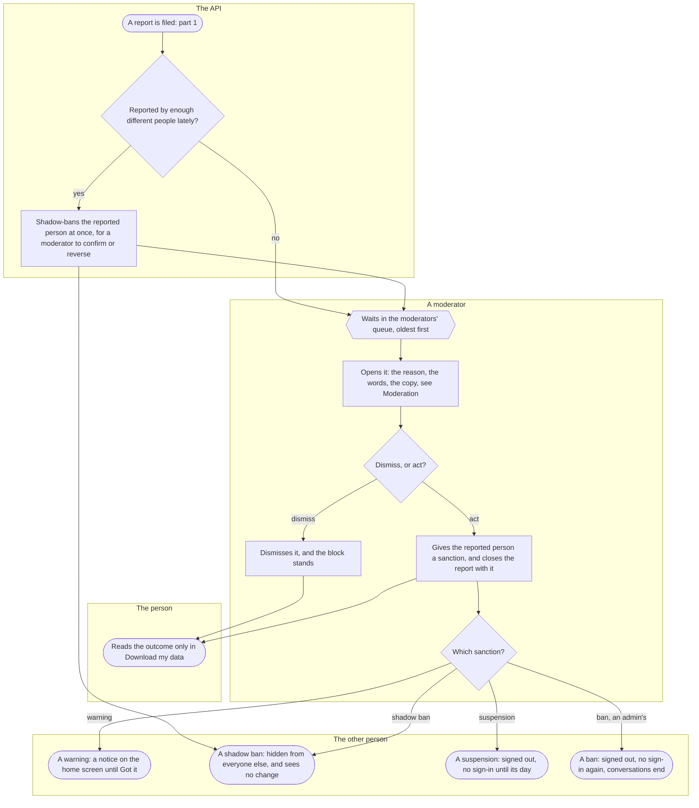

# Report and block

How a person stops seeing someone, and tells Kuutti about them, from a card in today's round or from a conversation; then what becomes of a report: the moderators' look, and what each outcome means for the person reported. Anyone who is shown a card or has a conversation can go through it; the person blocked or reported meets its end of it without being told.

## Part 1: blocking and reporting

### Steps

1. The person is looking at someone's card in [today's round](round.md), or is in a [conversation](chat.md).
2. On a card: 3. In a conversation: 4.
3. The person presses "Block or report", beside the card's name and far from Like and Pass; a screen reader reaches it from the name too. It is not there while a like or a pass on that card is still on its way.
4. The person presses More in the conversation's header. In a conversation that has ended, More offers Report and block alone, while the conversation can still be reported (see [Chat](chat.md), part 4).
5. One dialog, "Block or report" on a card, "Report, block or end" in a conversation: Block ("You will not see each other again. They are not told."), Report and block ("Tell the moderators what is wrong. This blocks them too. They are not told who reported them."), and in a conversation End conversation. Cancel closes it and forgets what was chosen and typed; a tap outside it, the corner's Close or the back gesture keep them.
6. End conversation: 7. Block: 8. Report and block: 9.
7. See [Chat](chat.md), part 4: it ends the conversation for both and blocks nobody.
8. "Block this person?": "You will not see each other here again, even if either of you deletes their account and comes back. A block cannot be undone. They are not told." From a conversation it says first that the conversation ends for both. The person presses Block: 13. A block has no daily limit. A failure: "The block did not go through. Try again."
9. "Report and block" says what it does first: from a conversation, "The moderators get a copy of this whole conversation, your own messages and photos included, and keep it for twelve months."; then that it also blocks them, for good, and, in a conversation that has not ended, ends it for both. Then "What is wrong?", six reasons: "Harassing, threatening or hateful", "A fake profile, or someone else's photos", "May be under 18", "Selling, advertising or asking for money", "Seems automated, or collects people's details", "Something else"; and "Anything the moderators should know (optional, up to 500 characters)". Send report is on once a reason is chosen.
10. The API refuses the report, writing nothing and blocking nobody, when it comes from a conversation that ended longer ago than `report_after_close_days` or whose other person has deleted their account, and when the person has filed `reports_per_day` reports today, counted on the Finnish calendar day: 11. A report of the same person that still waits answers as if filed and writes nothing more. Otherwise: 12.
11. Past the conversation's window: "This conversation can no longer be reported.", and More stops offering it. Over the day's reports: "That is enough reports for today. You can still block this person, but then you cannot report them later.", with Block under it: 8. In an ended conversation, which has nothing left to block: "That is enough reports for today. You can send more after midnight." A failure: "The report could not be sent. Try again.", with the reason and the words kept.
12. The API files the report with its reason and the person's words. From a conversation it first copies every message the conversation holds, both people's, their photos and any lines a shadow ban kept from the person, for the moderators; the copy and the photos it names are kept with the report for twelve months from filing, even if either person deletes their account. Then 13, in the same moment, and the report goes on to the moderators: 16.
13. The API sets the block from the person to the other, held both ways, for good, and for any later account of either; there is no list of blocks and no unblock. In the same moment every conversation between the two ends, and what either shared there with it. From a card, if the card's person or the photos it showed are gone meanwhile, the app says "This profile is no longer available." and the card leaves all the same.
14. On a card the dialog says "Blocked. You will not see each other again." or "Thank you. A moderator will look at it, and you will not see each other again."; Done, and the card leaves the round. From a conversation the person is back on the list, which says the same, and the conversation is no longer in it.
15. The other person is told nothing, and nothing they can open says it. From then on neither is shown to the other: the card leaves both people's rounds at once, and no like between them makes a match; a photo either of them was shown is no longer served; each leaves the other's pool, and the gate's count follows at the night's count. A conversation between them reads "Conversation ended" to them, as any end does, and they can still report it for `report_after_close_days` (see [Chat](chat.md), part 4).
16. A report goes on to the moderators: part 2.

## Part 2: the wait and the outcome

### Steps

17. A report has been filed, from a card or from a conversation.
18. The API counts the different people who reported this person within `auto_shadow_ban_reports_days`: one person's reports count once, through any account of theirs, and a report a moderator dismissed does not count. Being blocked counts for nothing. At `auto_shadow_ban_reports`: 19. Otherwise: 20.
19. The API shadow-bans the reported person at once, by nobody, for a moderator to confirm or reverse within `auto_shadow_ban_review_hours` (see [Moderation](moderation.md)). What it does to them is step 27.
20. The report waits in the moderators' queue, the oldest first, those about one person together, each with how both people have figured in reports before. The panel's front page holds the oldest against `moderation_response_hours`, the hours the association promises to answer within. A member of staff who is a party to a report, by any account of theirs, is never shown it. The night lets a report go twelve months after filing, decided or not, and its block stays.
21. A moderator opens the report: the reason, the reporter's words and, from a conversation, the copy, every line marked as the reporter's or the reported person's, a photo shown only on request. The moderator's own steps are [Moderation](moderation.md)'s.
22. Dismiss: 23. Act: 24.
23. The moderator dismisses it. Nothing changes for the reported person, and the block stands: 30.
24. The moderator gives the reported person a sanction, with a reason from the same list, chosen and not preset, and closes the report naming it; one sanction may close every report it answers. Any sanction can be lifted, and a second member of staff looks at it again. Then 25, and 30.
25. Warning: 26. Shadow ban: 27. Suspension: 28. Ban, which only an admin gives: 29.
26. A warning: the home screen shows it under Notices, "A warning from a moderator" and "Reason: {reason}. A warning by itself changes nothing in how you use the app.", until the person presses Got it. Nothing else changes.
27. A shadow ban: the person sees no change, and no screen tells them. Everyone else stops seeing them: their card leaves other people's rounds and pools, their photos are no longer served to others, the messages and contacts they send reach nobody, they never show as Online, and a like of theirs makes no match. Their conversations stay open. When it is lifted, what they wrote meanwhile appears.
28. A suspension: every phone of theirs is signed out at once, and the bank login says "This account is suspended. You can sign in again from:" and the day. Meanwhile nobody is shown their card or photos. Their conversations stay open and wait. The night lifts the suspension on its day.
29. A ban: every phone of theirs is signed out at once, and the bank login says "This person may not use Kuutti.", for this account and for any new one. Their conversations end, and the other people in them read "Conversation ended" (see [Chat](chat.md), part 4).
30. Nobody is told of the decision. The reporter reads it only in Settings, Your account, Download my data, among the reports they filed: "Waiting for a moderator", "A moderator looked at it and took no action" or "A moderator acted on it", never which action and never whom. The reported person never learns from any route that anybody reported them, or who.

## Where it lives

- Screens: [round.tsx](../../apps/mobile/app/round.tsx) and [chats/[id].tsx](../../apps/mobile/app/chats/[id].tsx); the card's door in [ProfileCardView.tsx](../../apps/mobile/src/features/profile/ProfileCardView.tsx), passed by [RoundScreen.tsx](../../apps/mobile/src/features/matching/RoundScreen.tsx); the conversation's More in [ConversationScreen.tsx](../../apps/mobile/src/features/chat/ConversationScreen.tsx), and what the list says after it in [ConversationsScreen.tsx](../../apps/mobile/src/features/chat/ConversationsScreen.tsx); the dialog in the safety feature ([README](../../apps/mobile/src/features/safety/README.md)) [SafetyActions.tsx](../../apps/mobile/src/features/safety/SafetyActions.tsx) and [client.ts](../../apps/mobile/src/features/safety/client.ts); a warning's notice in [Notices.tsx](../../apps/mobile/src/features/notifications/Notices.tsx); Download my data in [AccountActions.tsx](../../apps/mobile/src/features/identity/AccountActions.tsx)
- API: the safety slice ([README](../../apps/api/src/safety/README.md)): `POST /blocks`, `POST /reports`, `POST /conversations/{id}/block` and `POST /conversations/{id}/report` in [report-routes.ts](../../apps/api/src/safety/report-routes.ts), with [blocks.ts](../../apps/api/src/safety/blocks.ts) and [reports.ts](../../apps/api/src/safety/reports.ts); the automatic rule in [automatic.ts](../../apps/api/src/safety/automatic.ts); the moderators' `GET /admin/reports`, `GET /admin/reports/{id}`, `GET /admin/reports/{id}/copy/{seq}/photo` and `POST /admin/reports/{id}/decision` in [report-admin-routes.ts](../../apps/api/src/safety/report-admin-routes.ts) and [report-queue.ts](../../apps/api/src/safety/report-queue.ts); the sanctions in [sanctions.ts](../../apps/api/src/safety/sanctions.ts) and [sanction-routes.ts](../../apps/api/src/safety/sanction-routes.ts); a warning's notice through `GET /notices` in the notifications slice's [routes.ts](../../apps/api/src/notifications/routes.ts); the outcome in `GET /account/export`, the identity slice's [account-routes.ts](../../apps/api/src/identity/account-routes.ts)
- Admin: the queue and the report in [ReportQueue.tsx](../../apps/admin/src/features/safety/ReportQueue.tsx) and [ReportPage.tsx](../../apps/admin/src/features/safety/ReportPage.tsx), the automatic shadow bans in [AutomaticBans.tsx](../../apps/admin/src/features/safety/AutomaticBans.tsx) ([admin README](../../apps/admin/README.md))
- Spec: [reports.feature](../../features/safety/reports.feature), [blocks.feature](../../features/safety/blocks.feature), [report-queue.feature](../../features/safety/report-queue.feature), [report-decision.feature](../../features/safety/report-decision.feature), [sanctions.feature](../../features/safety/sanctions.feature), [automatic-shadow-bans.feature](../../features/safety/automatic-shadow-bans.feature); the conversation's side in [closing.feature](../../features/chat/closing.feature)
- Maestro: [chat-report.yaml](../../apps/mobile/e2e/flows/chat-report.yaml) (from a conversation, and from the ended side), [round.yaml](../../apps/mobile/e2e/flows/round.yaml) (from a card)
- ADRs: [ADR-030](../adr/030-reports-and-blocks.md) (§1 to §3 the block and where it holds, §4 to §6 the report and what each side learns, §8 what is kept, §11 the card's dialog, §12 from a conversation), [ADR-024](../adr/024-sanctions.md) (the sanctions and what each does), [ADR-033](../adr/033-automatic-shadow-bans.md) (the automatic rule), [ADR-032](../adr/032-notification-choices-and-notices.md) §3 (a warning's notice), [ADR-034](../adr/034-the-round-record.md) (the round leaves a blocked card out)

## History

- 2026-10-16 (#307, PR #315): sanctions: a warning, a shadow ban, a suspension until a day and a ban, each changing the person's use of the app as it does.
- 2026-10-17 (#84, PR #345): block, or report and block, from someone's card: one dialog, six reasons and a few words, a block that is final and told to nobody, and the day's reports.
- 2026-10-18 (#351, #84, PR #365): block, or report and block, from More in a conversation, with a copy of the whole conversation for the moderators; the conversation ends for both, and the person blocked can still report it for a while.
- 2026-10-19 (#176, PR #367): a warning shows the person a notice on the home screen until they mark it read.
- 2026-10-19 (#351, #84, PR #366): a block or a report reads to the other person exactly as an end does; the report's words follow whether the conversation has ended; a report refused for its window takes Report away.
- 2026-10-19 (#311, PR #369): reports wait in the moderators' queue, the oldest first, with both people's histories.
- 2026-10-19 (#312, PR #370): a moderator opens a report, reads its copy and dismisses it or acts on it with a sanction; the reporter's copy of their data says the outcome.
- 2026-10-19 (#105, PR #371): reports from enough different people shadow-ban the reported person at once, for a moderator to confirm or reverse.
- 2026-10-21 (#379, PR #391): Block or report on the card in today's round; the card leaves after Done.
