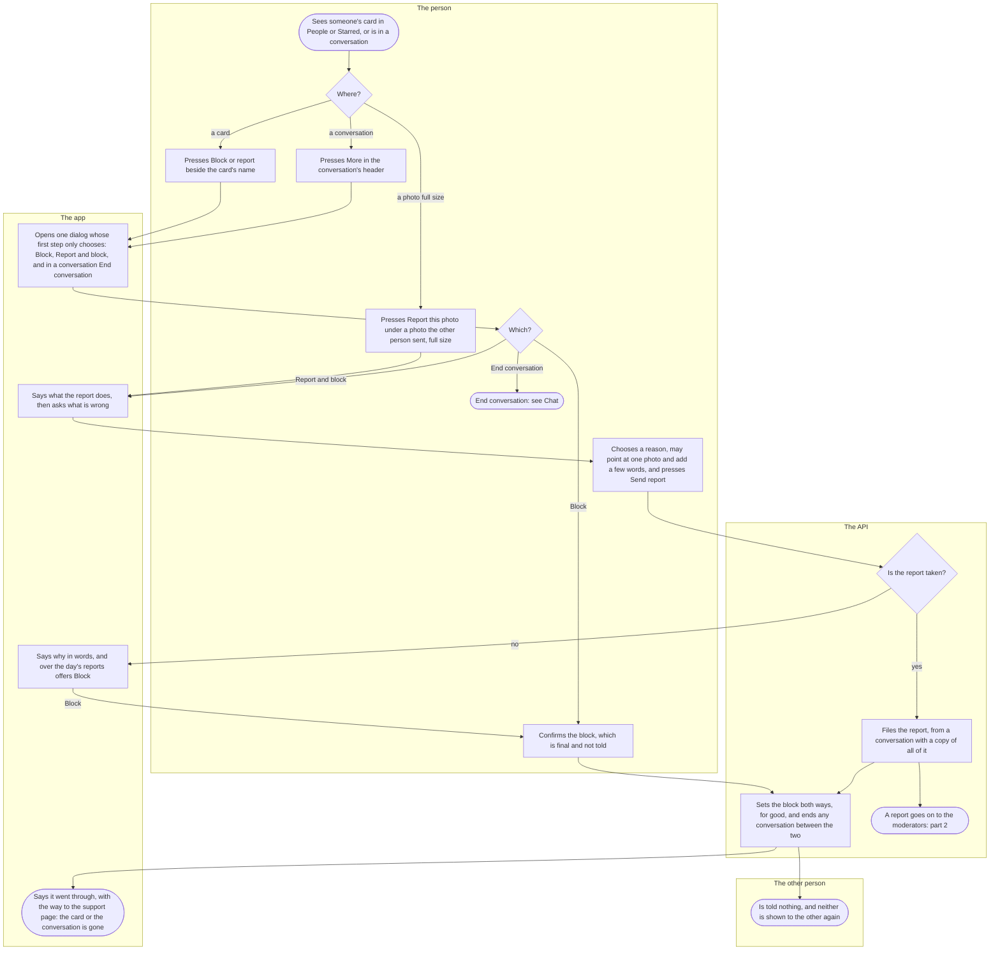
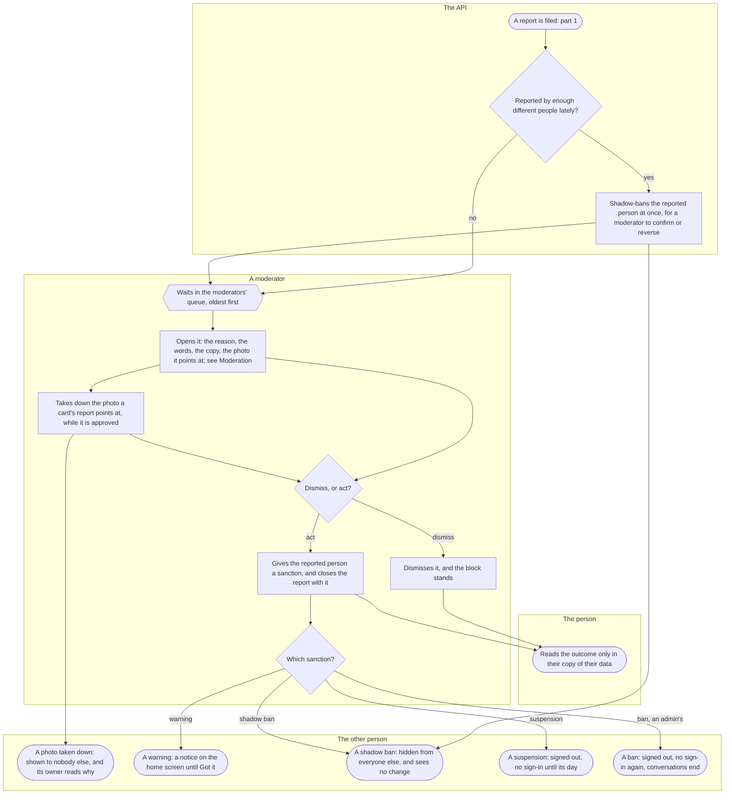

# Report and block

<!-- draws
apps/mobile/app/round.tsx
apps/mobile/app/stars/[id].tsx
apps/mobile/app/chats/[id].tsx
apps/mobile/app/chats/photo/[messageId].tsx
apps/mobile/app/settings/support.tsx
apps/mobile/src/features/safety/SafetyActions.tsx
apps/mobile/src/features/profile/ProfileCardView.tsx
apps/mobile/src/features/matching/RoundScreen.tsx
apps/mobile/src/features/chat/ChatPhotoScreen.tsx
apps/mobile/src/features/chat/ConversationsScreen.tsx
apps/mobile/src/features/chat/notice.ts
apps/api/src/safety/report-routes.ts
apps/api/src/safety/reports.ts
apps/api/src/safety/blocks.ts
apps/api/src/safety/automatic.ts
apps/api/src/safety/report-admin-routes.ts
apps/api/src/safety/sanctions.ts
apps/admin/src/features/safety/ReportQueue.tsx
apps/admin/src/features/safety/ReportPage.tsx
apps/admin/src/features/safety/TakeDown.tsx
-->

How a person stops seeing someone, and tells Kuutti about them, from a card in People or Starred, from a conversation or from a photo sent in one; then what becomes of a report: the moderators' look, and what each outcome means for the person reported. Anyone who is shown a card or has a conversation can go through it; the person blocked or reported meets its end of it without being told.

## Part 1: blocking and reporting

### Steps

1. The person is looking at someone's card in [People](queue.md), or at a starred person's card opened from Starred, or is in a [conversation](chat.md), perhaps with a photo the other person sent open full size.
2. On a card: 3. In a conversation: 4. Under a photo full size: 5.
3. The person presses "Block or report", beside the card's name at its top, above the photos and far from Like and Pass; a screen reader reaches it from the name too. It is not there while a decision on that card is still on its way.
4. The person presses More in the conversation's header. In a conversation that has ended, More offers Report and block alone, while the conversation can still be reported (see [Chat](chat.md), part 4).
5. Under a photo the other person sent, opened full size, the person presses "Report this photo", there while the conversation can still be reported. It opens the dialog at the report itself, with the photo set: 10.
6. One dialog, "Block or report" on a card, "Report, block or end" in a conversation, whose first step only chooses: Block, Report and block, and in a conversation End conversation, with nothing under them; each opens the step that says what it does before anything goes. Cancel closes it and forgets what was chosen and typed; a tap outside it, the corner's Close or the back gesture keep them.
7. End conversation: 8. Block: 9. Report and block: 10.
8. See [Chat](chat.md), part 4: it ends the conversation for both and blocks nobody.
9. "Block this person?": on a card, "You will not see each other here again, even if either of you deletes their account and comes back. A block cannot be undone. They are not told."; from a conversation, "The conversation ends for both of you, and you will not see each other here again, even if either of you deletes their account and comes back. A block cannot be undone. They are not told." The person presses Block: 15. A block has no daily limit. A failure: "The block did not go through. Try again."
10. "Report and block" says what it does first. From a photo: "The report points the moderators to this photo." From a conversation: "The moderators get a copy of this whole conversation, your own messages and photos included, and keep it for twelve months." Then, from a conversation that has not ended, "The conversation ends for both of you, and you will not see each other here again, even if either of you deletes their account and comes back. A block cannot be undone. They are not told who reported them."; from a card or an ended conversation, "You will not see each other here again, even if either of you deletes their account and comes back. A block cannot be undone. They are not told who reported them." Then "What is wrong?", six reasons: "Harassing, threatening or hateful", "A fake profile, or someone else's photos", "May be under 18", "Selling, advertising or asking for money", "Seems automated, or collects people's details", "Something else". On a card with photos, "Is it about one photo?": "Not one photo", chosen first, then each of the card's photos as the card showed it, nothing fetched anew. Last a note whose label, "Anything the moderators should know", says it is optional and how long it may be.
11. The person chooses a reason, and may choose a photo and write a few words; Send report is on once a reason is chosen.
12. The API refuses the report, writing nothing and blocking nobody, when it comes from a conversation that ended longer ago than `report_after_close_days` or whose other person has deleted their account, and when the person has filed `reports_per_day` reports today, counted on the Finnish calendar day: 13. A report of the same person that still waits answers as if filed and writes nothing more. The photo the report points at is asked last: one that is not a photo the other person sent in this conversation, or not a photo of the card the person was shown, is left out, and the answer is the same. Otherwise: 14.
13. Past the conversation's window: "This conversation can no longer be reported.", and More stops offering it. Over the day's reports: "That is enough reports for today. You can still block this person, but then you cannot report them later.", with Block under it: 9. In an ended conversation, which has nothing left to block: "That is enough for today. You can try again after midnight." A failure: "That did not go through. Try again.", with the reason, the photo and the words kept.
14. The API files the report with its reason, the photo it points at and the person's words. From a conversation it first copies every message the conversation holds, both people's, their photos and any lines a shadow ban kept from the person, for the moderators; the copy and the photos it names are kept with the report for twelve months from filing, even if either person deletes their account. Then 15, in the same moment, and the report goes on to the moderators: 18.
15. The API sets the block from the person to the other, held both ways, for good, and for any later account of either; there is no list of blocks and no unblock. In the same moment every conversation between the two ends, and what either shared there with it.
16. On a card the dialog says "Blocked." or "Thank you. A moderator will look at it.", with "Support when it's hard", the way to the support page, and Done, after which the card leaves People (on a starred person's card only the way back to Starred stays). If the card's person or the photos it showed are gone meanwhile, the dialog says "This profile is no longer available." instead, with no way to the support page, and the card leaves all the same. From a conversation or one of its photos the person is back on the list, which says the same words, with "Support when it's hard", and the conversation is no longer in it; from a conversation the match screen opened, Back from the list leads to People, not to the conversation. A conversation gone meanwhile: "That conversation is no longer available."
17. The other person is told nothing, and nothing they can open says it. From then on neither is shown to the other: not in People, not in Starred, and no like between them makes a match; a photo either of them was shown is no longer served. A conversation between them reads "Conversation ended" to them, as any end does, and they can still report it for `report_after_close_days` (see [Chat](chat.md), part 4).
18. A report goes on to the moderators: part 2.

## Part 2: the wait and the outcome

### Steps

19. A report has been filed, from a card, a conversation or a photo sent in one.
20. The API counts the different people who reported this person within `auto_shadow_ban_reports_days`: one person's reports count once, through any account of theirs, and a report a moderator dismissed does not count. Being blocked counts for nothing. At `auto_shadow_ban_reports`: 21. Otherwise: 22.
21. The API shadow-bans the reported person at once, by nobody, for a moderator to confirm or reverse within `auto_shadow_ban_review_hours` (see [Moderation](moderation.md)). What it does to them is step 31.
22. The report waits in the moderators' queue, the oldest first, those about one person together, each with how both people have figured in reports before. The panel's front page holds the oldest against `moderation_response_hours`, the hours the association promises to answer within. A member of staff who is a party to a report, by any account of theirs, is never shown it. The night lets a report go twelve months after filing, decided or not, and its block stays.
23. A moderator opens the report: the reason, the reporter's words and, from a conversation, the copy, every line marked as the reporter's or the reported person's, a photo shown only on request; the photo the report points at comes first, marked, and a card's is shown on request too. The moderator's own steps are [Moderation](moderation.md)'s.
24. While the photo a card's report points at is approved, the moderator may take it down, beside it, with a reason chosen on purpose: 29. A take-down is no sanction and decides nothing of the report, which still waits for 25. A photo sent in a conversation is never taken down.
25. Dismiss: 26. Act: 27.
26. The moderator dismisses it. Nothing changes for the reported person, and the block stands: 34.
27. The moderator gives the reported person a sanction, with a reason from the same list, chosen and not preset, and closes the report naming it; one sanction may close every report it answers. Any sanction can be lifted, and a second member of staff looks at it again. Then 28, and 34.
28. Warning: 30. Shadow ban: 31. Suspension: 32. Ban, which only an admin gives: 33.
29. A photo taken down: from then on nobody else is given it, and their card shows the rest. Its owner keeps it among their photos, "Not accepted" with the moderator's reason in words and no way to ask a person to look again ([Photos](photos.md)); nothing is deleted. A profile left with fewer approved photos than a finished one needs is shown to nobody until another is approved.
30. A warning: the home screen shows it under Notices, "A warning from a moderator" and "Reason: {reason}. A warning by itself changes nothing in how you use the app.", until the person presses Got it ([Notifications](notifications.md)). Nothing else changes.
31. A shadow ban: the person sees no change, and no screen tells them. Everyone else stops seeing them: their card leaves other people's People and Starred, their photos are no longer served to others, the messages and contacts they send reach nobody and push nobody, they never show as Online, their Read goes no further for the other side than where it stood when the ban began, and a like of theirs makes no match. Their conversations stay open. When it is lifted, what they wrote meanwhile appears, unless the conversation ended first.
32. A suspension: every phone of theirs is signed out at once, and the bank login says "This account is suspended. You can sign in again from:" and the day. Meanwhile nobody is shown their card or photos. Their conversations stay open and wait. The night lifts the suspension on its day.
33. A ban: every phone of theirs is signed out at once, and the bank login says "This person may not use Kuutti.", for this account and for any new one. Their conversations end, and the other people in them read "Conversation ended" (see [Chat](chat.md), part 4).
34. Nobody is told of the decision. The reporter reads it only in the copy of their data, Settings, A copy of your data, Download my data, among the reports they filed: "Waiting for a moderator", "A moderator looked at it and took no action" or "A moderator acted on it", never which action and never whom. The reported person never learns from any route that anybody reported them, or who.

## Where it lives

- Screens: [round.tsx](../../apps/mobile/app/round.tsx) (People), [stars/[id].tsx](../../apps/mobile/app/stars/%5Bid%5D.tsx) (a starred person's card), [chats/[id].tsx](../../apps/mobile/app/chats/%5Bid%5D.tsx) (a conversation), [chats/photo/[messageId].tsx](../../apps/mobile/app/chats/photo/%5BmessageId%5D.tsx) (a photo full size) and [settings/support.tsx](../../apps/mobile/app/settings/support.tsx) (Support when it's hard, in [SupportScreen.tsx](../../apps/mobile/src/features/settings/SupportScreen.tsx), reached by [SupportLink.tsx](../../apps/mobile/src/components/SupportLink.tsx)); the card's door in [ProfileCardView.tsx](../../apps/mobile/src/features/profile/ProfileCardView.tsx), passed by [RoundScreen.tsx](../../apps/mobile/src/features/matching/RoundScreen.tsx); the conversation's More in [ConversationScreen.tsx](../../apps/mobile/src/features/chat/ConversationScreen.tsx), Report this photo in [ChatPhotoScreen.tsx](../../apps/mobile/src/features/chat/ChatPhotoScreen.tsx), and what the list says after them in [ConversationsScreen.tsx](../../apps/mobile/src/features/chat/ConversationsScreen.tsx) and [notice.ts](../../apps/mobile/src/features/chat/notice.ts); the dialog in the safety feature ([README](../../apps/mobile/src/features/safety/README.md)) [SafetyActions.tsx](../../apps/mobile/src/features/safety/SafetyActions.tsx) and [client.ts](../../apps/mobile/src/features/safety/client.ts); a warning's notice in [Notices.tsx](../../apps/mobile/src/features/notifications/Notices.tsx); a photo taken down in [PhotosScreen.tsx](../../apps/mobile/src/features/media/PhotosScreen.tsx); Download my data in [AccountActions.tsx](../../apps/mobile/src/features/identity/AccountActions.tsx)
- API: the safety slice ([README](../../apps/api/src/safety/README.md)): `POST /blocks`, `POST /reports`, `POST /conversations/{id}/block` and `POST /conversations/{id}/report` in [report-routes.ts](../../apps/api/src/safety/report-routes.ts), with [blocks.ts](../../apps/api/src/safety/blocks.ts) and [reports.ts](../../apps/api/src/safety/reports.ts); the automatic rule in [automatic.ts](../../apps/api/src/safety/automatic.ts); the moderators' `GET /admin/reports`, `GET /admin/reports/{id}`, `GET /admin/reports/{id}/copy/{seq}/photo`, `GET /admin/reports/{id}/photo` and `POST /admin/reports/{id}/decision` in [report-admin-routes.ts](../../apps/api/src/safety/report-admin-routes.ts) and [report-queue.ts](../../apps/api/src/safety/report-queue.ts); a take-down through `POST /admin/photos/{id}/decision` in the media slice's [admin-routes.ts](../../apps/api/src/media/admin-routes.ts); the sanctions in [sanctions.ts](../../apps/api/src/safety/sanctions.ts) and [sanction-routes.ts](../../apps/api/src/safety/sanction-routes.ts); a warning's notice through `GET /notices` in the notifications slice's [routes.ts](../../apps/api/src/notifications/routes.ts); the outcome in `GET /account/export`, the identity slice's [account-routes.ts](../../apps/api/src/identity/account-routes.ts)
- Admin: the queue and the report in [ReportQueue.tsx](../../apps/admin/src/features/safety/ReportQueue.tsx) and [ReportPage.tsx](../../apps/admin/src/features/safety/ReportPage.tsx), the take-down in [TakeDown.tsx](../../apps/admin/src/features/safety/TakeDown.tsx), the automatic shadow bans in [AutomaticBans.tsx](../../apps/admin/src/features/safety/AutomaticBans.tsx) ([admin README](../../apps/admin/README.md)); the panel's Playwright flow of a report, [report.spec.ts](../../apps/admin/e2e/report.spec.ts)
- Spec: [reports.feature](../../features/safety/reports.feature), [blocks.feature](../../features/safety/blocks.feature), [report-queue.feature](../../features/safety/report-queue.feature), [report-decision.feature](../../features/safety/report-decision.feature), [sanctions.feature](../../features/safety/sanctions.feature), [automatic-shadow-bans.feature](../../features/safety/automatic-shadow-bans.feature); the take-down in [moderation.feature](../../features/media/moderation.feature); the conversation's side in [closing.feature](../../features/chat/closing.feature)
- Maestro: [chat-report.yaml](../../apps/mobile/e2e/flows/chat-report.yaml) (from a conversation, from a photo, and from the ended side), [round.yaml](../../apps/mobile/e2e/flows/round.yaml) (from a card)
- ADRs: [ADR-030](../adr/030-reports-and-blocks.md) (§1 to §3 the block and where it holds, §4 to §6 the report and what each side learns, §8 what is kept, §11 the card's dialog, §12 from a conversation, §13 the photo a report points at), [ADR-024](../adr/024-sanctions.md) (the sanctions and what each does), [ADR-033](../adr/033-automatic-shadow-bans.md) (the automatic rule), [ADR-006](../adr/006-photo-moderation.md) §2 (a take-down), [ADR-032](../adr/032-notification-choices-and-notices.md) §3 (a warning's notice), [ADR-062](../adr/062-one-queue.md) (People, the one queue, leaves a blocked person out)
- Rules: the register's [Safety](../decisions.md#safety), [Match](../decisions.md#match) and [Retention](../decisions.md#retention) rows

## History

- 2026-10-16 (#307, PR #315): sanctions: a warning, a shadow ban, a suspension until a day and a ban, each changing the person's use of the app as it does.
- 2026-10-17 (#84, PR #345): block, or report and block, from someone's card: one dialog, six reasons and a few words, a block that is final and told to nobody, and the day's reports.
- 2026-10-18 (#351, #84, PR #365): block, or report and block, from More in a conversation, with a copy of the whole conversation for the moderators; the conversation ends for both, and the person blocked can still report it for a while.
- 2026-10-19 (#176, PR #367): a warning shows the person a notice on the home screen until they mark it read.
- 2026-10-19 (#351, #84, PR #366): a block or a report reads to the other person exactly as an end does; the report's words follow whether the conversation has ended; a report refused for its window takes Report away.
- 2026-10-19 (#311, PR #369): reports wait in the moderators' queue, the oldest first, with both people's histories.
- 2026-10-19 (#312, PR #370): a moderator opens a report, reads its copy and dismisses it or acts on it with a sanction; the reporter's copy of their data says the outcome.
- 2026-10-19 (#105, PR #371): reports from enough different people shadow-ban the reported person at once, for a moderator to confirm or reverse.
- 2026-10-21 (#379, PR #391): Block or report on the card in today's round; the card leaves after Done.
- 2026-10-27 (#477, PR #479): a moderator can take down one approved photo of a person, with a reason: nobody else is shown it, and its owner reads why, with no way to ask again.
- 2026-10-27 (#476, PR #481): a report can point at the one photo it is about: Report this photo under a photo the other person sent, opened full size, and "Is it about one photo?" on a card; the moderators find it marked, a card's with the take-down beside it.
- 2026-10-28 (#491, PR #492): after a report from a photo of a conversation the match screen opened, Back from the list leads to People, not to the reported conversation.
- 2026-10-29 (#470, PR #498): a shadow ban also holds back the person's Read from the people they talk to.
- 2026-10-30 (#510, PR #531): where a block or a report goes through, the way to Support when it's hard: in the card dialog's last step, and under the list's words after a conversation.
- 2026-11-03 (#502, PR #578): Block or report sits on the card in People, the one queue that took the day's round's place.
- 2026-11-03 (#575, PR #582): a starred person's card, opened from Starred, carries Block or report too.
- 2026-11-05 (#581, PR #602): the dialog's first step only chooses, with nothing under its choices; a report says that they are not told who reported them; after a block or a report the dialog and the list say "Blocked." or "Thank you. A moderator will look at it." alone.
