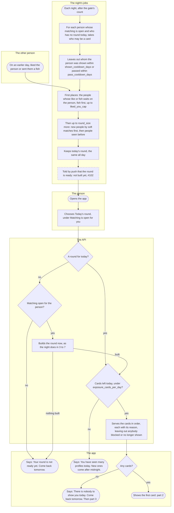
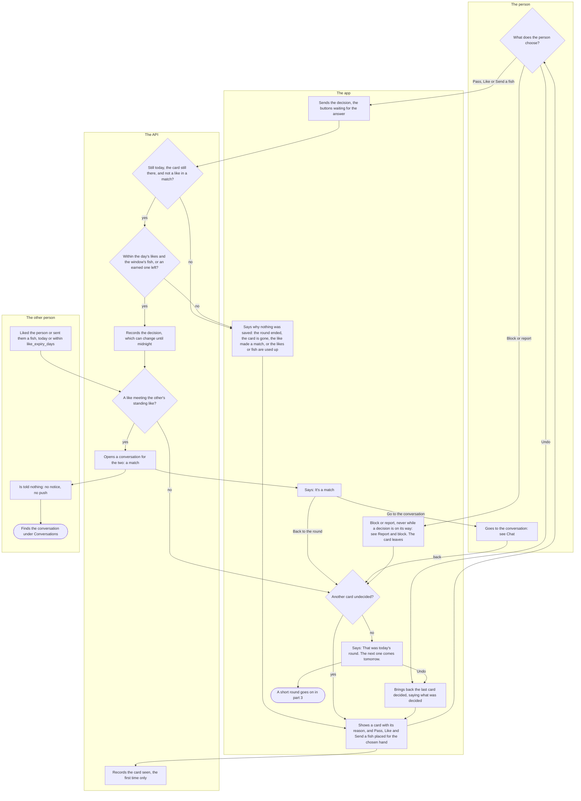
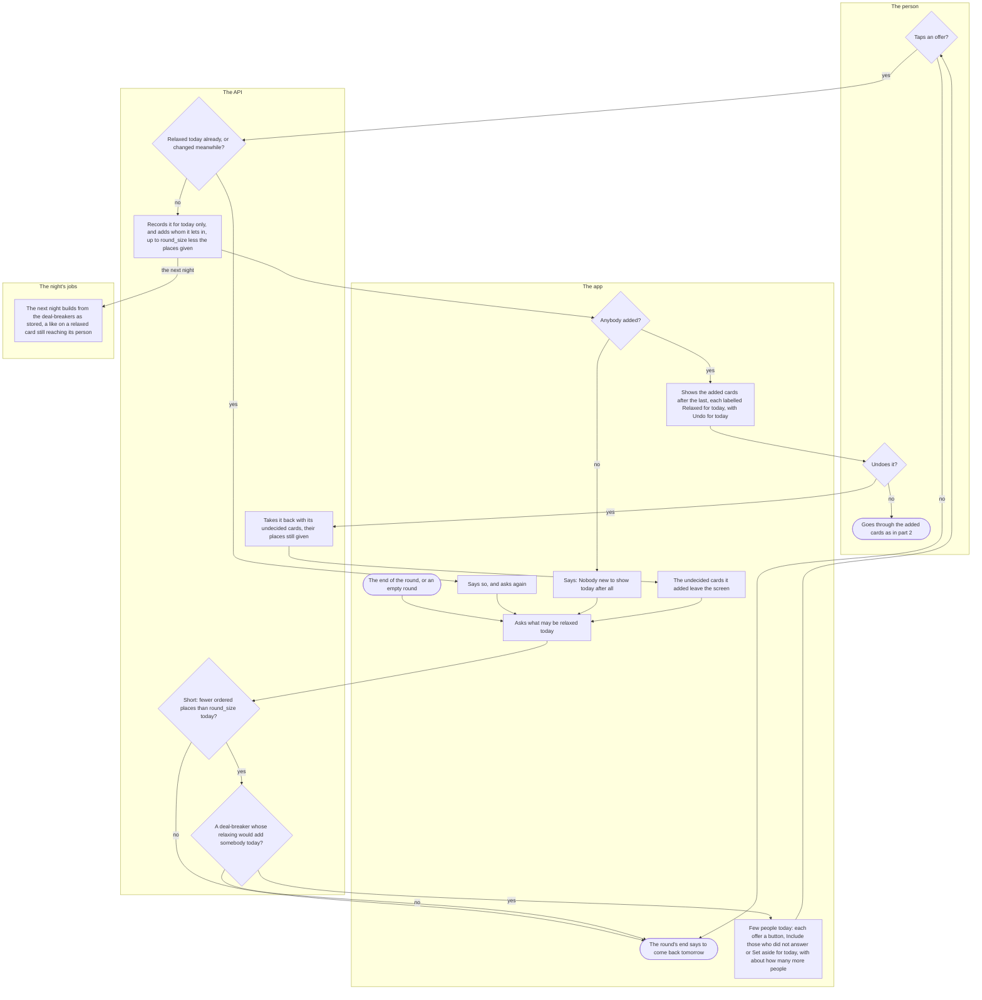

# The round, likes, fish and the match

Once matching is open for a person, Kuutti shows them one round a day: a handful of people, one card at a time, each with the reason it is there. This flow follows that round from the night that builds it, through each pass, like and fish, to a match that opens a conversation, and to the short round's offer to relax a deal-breaker for the day.

## Part 1: the round is built

### Steps

1. On an earlier day, another person liked the person, or sent them a fish, from their own round (part 2). That like waits for the person: 5.
2. Each night, after the gate's count has let people in and opened matching, the night's jobs build the day's rounds.
3. For each person whose matching is open and who has no round for the day yet (nobody taking a break, suspended or banned gets one), the jobs take who may be a card: people of the same area who were let in and are seen by others, and who are in each other's pool both ways. Each is among whom the other seeks, inside the other's age window, here for something that fits what the other is here for, and passes the other's deal-breakers, with no block either way. Two people kept apart by "Hide me from people in my field", or with a conversation between them of any kind, are never each other's cards.
4. The jobs leave out whom the person was shown within `shown_cooldown_days`, or passed within `pass_cooldown_days`. Only rounds the person opened count: a round never opened showed nobody.
5. The first places go to the people whose like or fish waits on the person (1): given on a day that has ended, within `like_expiry_days`, and not answered yet. Fish come first, then likes, each the oldest first, up to `liked_you_cap`, labelled "Sent you a fish" or "Liked you", and each must still be somebody the person may meet (3). A like from somebody the person passed within `pass_cooldown_days` never comes; one beyond the cap waits for a later round, and its sender is no ordinary card meanwhile. A person a moderator has hidden from others gets none of these places, and the likes wait for the lift.
6. Then up to `round_size` more: people never shown before come first, those whose answers on education, drinking and the attitude to drugs are closest from both sides first, equal ones in an order of the day's own, labelled "Matches your filters". While room is left, people of earlier rounds past both cooldowns come back, labelled "Seen before": those left undecided or liked first, then those passed, each the one shown longest ago first. Fewer people make a shorter round and nobody an empty one: nothing fills it.
7. The round is kept for the day, the same for every look at it, whoever built it.
8. Told by push that the round is ready: not built yet, #102. Today nothing tells the person; they find the round when they open the app.
9. The person opens the app.
10. On the home screen, under "Matching is open for you.", the person chooses Today's round.
11. Is there a round for today? Yes: 14. No: 12.
12. Is matching open for the person? No: 16. Yes: 13.
13. The API builds the person's round now, as the night does in 3 to 7. This covers matching that opened during the day, a profile finished after the night, the hours before the night's jobs, and a build that failed at night. Built: 14. Nothing built: 16.
14. Are any of the day's `exposure_cards_per_day` cards left? No: 17. Yes: 15.
15. The API serves the round's cards in order, each with its reason, and for each of the person's own deal-breakers whose field the card's person did not answer, "Did not answer: {field}". Anybody blocked either way, or no longer shown to others since the round was built, is left out.
16. The app says "Your round is not ready yet. Come back tomorrow."
17. The app says "You have seen many profiles today. New ones come after midnight."
18. Does the round have any cards? No: 19. Yes: 20.
19. The app says "There is nobody to show you today. Come back tomorrow." An empty round is a short one: part 3 may offer more.
20. The app shows the first card: part 2.

Not in production yet: neither the night (2) nor the first look (13) builds a round in production until the maintainer has set how long rounds are kept (#95), so there every person meets 16.

## Part 2: going through the round

### Steps

21. The app shows one card: the first undecided one, or the one Undo brought back (38). Above it is its reason ("Liked you", "Sent you a fish", "Seen before", "Matches your filters", or "Relaxed for today: {field}") and "Did not answer: {field}" for each of the person's deal-breakers its person left unanswered; then the card as others see it, with Block or report beside the name. At the bottom are Pass, Like and, on a card that answers nobody's like, Send a fish, placed as the person chose under Settings › Appearance and language › Decision buttons: for the right hand (Pass at the left, Like at the right), mirrored for the left hand, or one-handed, with Undo, Send a fish, Pass and Like in one column on that hand's side. Each keeps its own word, shape and icon wherever it sits, and no swipe does anything. Nothing loads beyond the round.
22. The app reports the card seen once it is on the screen; the API records the first report only. It decides nothing.
23. The person chooses. Pass, Like or Send a fish: 24. Block or report: 39. Undo, offered once a decision has been made and never after a match: 38.
24. The app sends the decision; the buttons are dimmed until the answer comes, so nothing repeats.
25. Is it still the round's day, is the card still there (nobody blocked, hidden or gone since), and is it not a change to a like that made a match? No: 27. Yes: 26. The same decision again changes nothing.
26. A pass is never counted, and a like back on a "Liked you" or "Sent you a fish" card is free. Any other like, a fish included, counts against the day's `like_budget_balanced`, and a fish also against `fish_budget` in any `fish_window_days`. Within them, or past them with a like or fish the person's invitations earned (used by itself, and given back if the decision changes the same day): 28. Otherwise: 27.
27. Nothing is saved, and the app says why: "That round ended at midnight, so this was not saved.", and today's round is read anew; "That card is no longer available.", and the card leaves; "This like made a match, so it stays. You can still end the conversation under Conversations."; "You have used today's likes. New ones come after midnight; you can still pass."; or "You cannot send a fish just now, but you can still like. The earliest day for the next one: {date}". Then 21.
28. The API records the decision. It can change until midnight, except a like that made a match.
29. Is it a like, or a fish, of somebody whose like of the person still stands (30)? Yes: 31. No: 36. A like that met nothing waits: it comes first in the other person's next round (part 1, step 5), and the person is never told what became of it. No match is made while the person is hidden from others by a moderator, and their like then reaches nobody; nor with a block between the two.
30. The other person liked the person, or sent them a fish, today or within `like_expiry_days`.
31. The API opens a conversation for the two: a match. The like that made it is final.
32. The other person is told nothing: no notice in the app and no push. Whether a match should be told is open in [ADR-038](../adr/038-the-match.md), with no issue yet; #102's pushes are the round, a message and being let in.
33. The other person finds the conversation under Conversations the next time they look there.
34. The app says "It's a match" and "You both liked each other, so a conversation is open for you two under Conversations.", with Go to the conversation and Back to the round.
35. Go to the conversation opens it: see [Chat](chat.md). Coming back, the round goes on: 36.
36. Is another card undecided? Yes: 21. No: 37.
37. The app says "That was today's round. The next one comes tomorrow.", with no count and no countdown, and nothing loads more. Undo is still there for the last decision (38). A finished round left open past midnight is read anew when it comes back in sight: "Yesterday's round ended at midnight. This is today's." Then 40.
38. Undo brings back the card last decided, with what was decided ("You liked this person. You can change that until midnight.", or passed on, or sent a fish). The decision stands until another replaces it: 21.
39. Block or report, beside the name on the card: see [Report and block](report-and-block.md). It is not offered while a decision is on its way, so that a decision landing after the next card took its place can never bring the blocked person back. Once a block or a report has gone through, the card leaves the screen: 36.
40. The round's end goes on in part 3, where a short round may offer more.

## Part 3: the short round

### Steps

41. The round has ended (part 2, step 40), or it was empty (part 1, step 19).
42. The app asks what may be relaxed today.
43. Is the round short: did it give fewer ordered places than `round_size` today? The "Liked you" and "Sent you a fish" places do not count, and a place an undo took back stays given. No: 45. Yes: 44.
44. Would relaxing one of the person's own deal-breakers, not paused and not relaxed today, add somebody today? Each is counted on top of whatever is relaxed already. No: 45. Yes: 46.
45. Nothing more is offered, and the round's end says to come back tomorrow.
46. The app says "Few people today" and "Your deal-breakers leave few people today. You can relax one for today only: tomorrow's round follows them as you set them, and one tap undoes it.", then each offer as a button: "Include those who did not answer: {field}" (while the deal-breaker leaves them out) or "Set aside for today: {field}", each with "About n more people", how much it widens the person's pool, in steps of `waitlist_k`, never a count of cards. Asking relaxes nothing.
47. Does the person tap an offer? No: 45. Yes: 48.
48. Was that deal-breaker relaxed today already, or did another phone relax or undo one since the offers were counted? Yes: 49. No: 50. A round whose day has ended is read anew, as in 27.
49. The app says "You relaxed that one for today already." or "Your relaxations for today changed meanwhile. Look again and choose.", and asks again: 42.
50. The API records the relaxation on today's round only, and adds whom it lets in after the round's last place, as many as the room left (`round_size` less the ordered places given today): new people first, then those seen before, never anybody cooling down, passed, already in the round, kept apart by "Hide me from people in my field", or whose like waits on the person. It loosens only the person's own side: whoever comes in is somebody whose own filters let the person through. Nothing else is ever relaxed: whom one seeks, the age window, what one is here for, the area and a block always hold. Then 51, and the next night 57.
51. Did it add anybody? No: 52. Yes: 53.
52. The app says "Nobody new to show today after all." The relaxation stands and can be undone. Then 42.
53. The added cards come after the last, each labelled "Relaxed for today: {field}" and, while undecided, with "Undo for today: {field}". If serving them used up the day's cards, the app says "You have seen many profiles today. New ones come after midnight."
54. Does the person undo the relaxation, from an undecided card or from the list at the round's end? No: 58. Yes: 55.
55. The API takes the relaxation back, with the cards it brought that are still undecided; a card decided stays as decided. Their places stay given, so an undo is a change of mind, not room for others.
56. The undecided cards it added leave the screen. Then 42.
57. The next night builds the round from the deal-breakers as stored. A like the person gave on a relaxed card still reaches its person: in that person's round, the deal-breakers the card came in under are set aside for the person alone.
58. The person goes through the added cards as in part 2.

## Where it lives

- Screens: [round.tsx](../../apps/mobile/app/round.tsx) delegates to [RoundScreen.tsx](../../apps/mobile/src/features/matching/RoundScreen.tsx), with [useRound.ts](../../apps/mobile/src/features/matching/useRound.ts), [ShortPool.tsx](../../apps/mobile/src/features/matching/ShortPool.tsx) and [client.ts](../../apps/mobile/src/features/matching/client.ts); the way in is [RoundButton.tsx](../../apps/mobile/src/features/matching/RoundButton.tsx) on the home screen's [GateCard.tsx](../../apps/mobile/src/features/pond/GateCard.tsx); the card and its Block or report are [ProfileCardView.tsx](../../apps/mobile/src/features/profile/ProfileCardView.tsx) and [SafetyActions.tsx](../../apps/mobile/src/features/safety/SafetyActions.tsx); the setting is [decision-buttons.tsx](../../apps/mobile/app/settings/decision-buttons.tsx), [DecisionButtonsScreen.tsx](../../apps/mobile/src/features/settings/DecisionButtonsScreen.tsx) and [decision-buttons.tsx](../../apps/mobile/src/lib/decision-buttons.tsx) of `src/lib`. Slice: [matching](../../apps/mobile/src/features/matching/README.md).
- API: `GET /rounds/today`, `POST /rounds/{day}/entries/{position}/seen`, `PUT /rounds/{day}/entries/{position}/decision`, `GET` and `POST /rounds/{day}/relaxations`, `DELETE /rounds/{day}/relaxations/{field}` in [round-routes.ts](../../apps/api/src/matching/round-routes.ts); the record, the decision, the budgets, the match and the relaxations in [rounds.ts](../../apps/api/src/matching/rounds.ts); the pool both ways and a relaxation's loosening in [pool.ts](../../apps/api/src/matching/pool.ts); the order in [round-order.ts](../../apps/api/src/matching/round-order.ts). Slice: [matching](../../apps/api/src/matching/README.md).
- Jobs: the builder, at night and at the first look, and the short round's offers in [round-builder.ts](../../apps/api/src/jobs/round-builder.ts); run after the gate's count by [boot.ts](../../apps/api/src/boot.ts) through [nightly.ts](../../apps/api/src/jobs/nightly.ts); the first look's build and the hold in production wired in [app.ts](../../apps/api/src/app.ts).
- Spec: [rounds.feature](../../features/matching/rounds.feature), [decisions.feature](../../features/matching/decisions.feature), [fish.feature](../../features/matching/fish.feature), [earned.feature](../../features/matching/earned.feature), [matches.feature](../../features/matching/matches.feature), [short-pool.feature](../../features/matching/short-pool.feature), [filters.feature](../../features/matching/filters.feature).
- Maestro: [round.yaml](../../apps/mobile/e2e/flows/round.yaml), [decision-buttons.yaml](../../apps/mobile/e2e/flows/decision-buttons.yaml).
- ADRs: [ADR-034](../adr/034-the-round-record.md), [ADR-035](../adr/035-the-round-builder-first-cut.md), [ADR-036](../adr/036-the-days-likes.md), [ADR-037](../adr/037-liked-you-in-the-round.md), [ADR-038](../adr/038-the-match.md), [ADR-039](../adr/039-the-fish.md), [ADR-042](../adr/042-the-short-pool.md), [ADR-030](../adr/030-reports-and-blocks.md) §11, [ADR-044](../adr/044-invitations.md) §8, [ADR-008](../adr/008-exposure-budget-and-client-address.md), [ADR-015](../adr/015-pond-gate.md).

## History

- 2026-10-19 (#96, PR #372): the API keeps each person's round of the day, its cards in order with their reasons, each reported seen once and liked or passed until midnight; no screen yet.
- 2026-10-20 (#95, PR #381): the night builds each round after the gate's count, or the day's first look does: people in each other's pool both ways, the most soft matches first, up to `round_size`, with the cooldowns; the API only.
- 2026-10-20 (#98, PR #382): the day's likes are counted, `like_budget_balanced` for everybody; a like back is free and a pass is never counted.
- 2026-10-20 (#97, PR #383): the people whose like waits come first in the round, labelled Liked you, up to `liked_you_cap`, until answered or `like_expiry_days` have passed.
- 2026-10-20 (#100, PR #384): a like that meets a like is a match and opens a conversation; that like is final.
- 2026-10-20 (#378, PR #386): the fish, a like with a mark, `fish_budget` in any `fish_window_days`, first in the other person's round.
- 2026-10-21 (#97, PR #390): a person a moderator has hidden from others gets no Liked you or fish cards; the likes wait for the lift.
- 2026-10-21 (#379, PR #391): the round in the app, from the home screen: one card at a time, Pass, Like and Send a fish as buttons, Undo, the match leading to the conversation, Block or report on the card, and the end saying the next round comes tomorrow.
- 2026-10-21 (#99, PR #401): the short round: new people before those seen before, a deal-breaker relaxed for today and undone in one tap, and every card saying which deal-breakers its person did not answer.
- 2026-10-21 (#99, PR #402): a day's round is held to `round_size` through relaxing and undoing; an undo gives no room back.
- 2026-10-21 (#82, PR #399): Settings › Decision buttons places Pass and Like for either hand, or one-handed in a column with Undo.
- 2026-10-22 (#107, PR #417): past the day's likes or the window's fish, a like or fish the person's invitations earned is used by itself.
