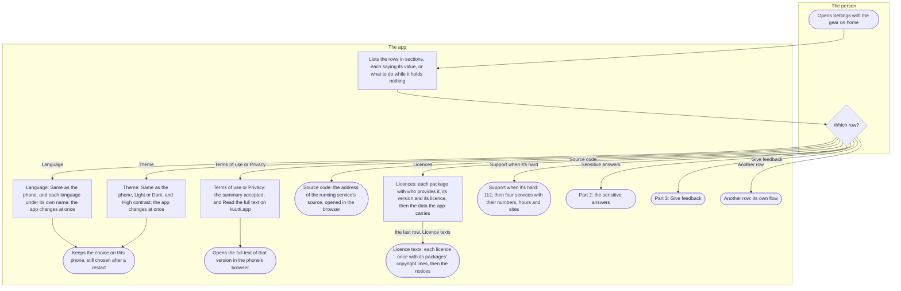
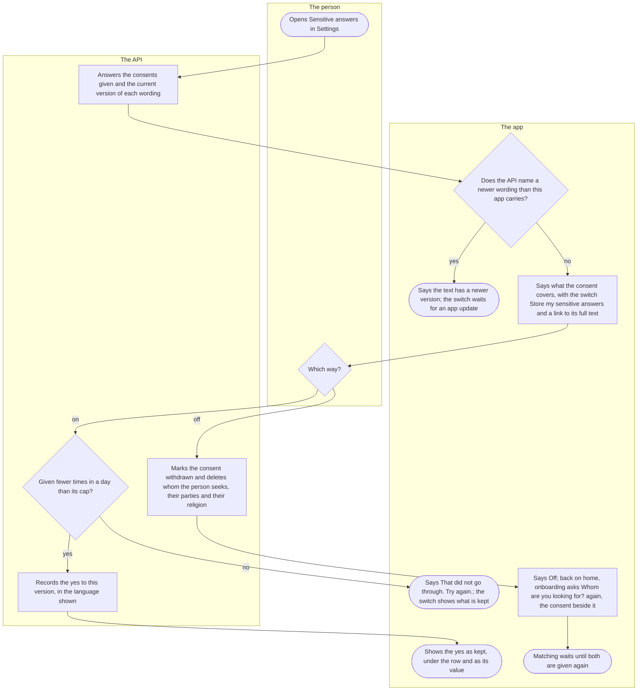
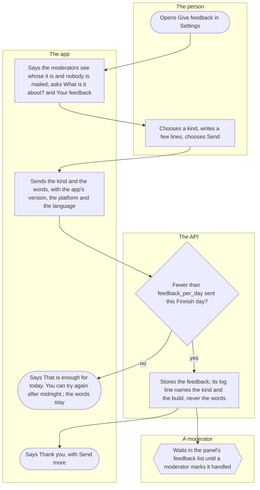

# Settings, consents and feedback

<!-- draws
apps/mobile/app/settings/index.tsx
apps/mobile/app/settings/support.tsx
apps/mobile/app/settings/licenses/
apps/mobile/src/features/settings/SettingsScreen.tsx
apps/mobile/src/features/settings/open-rows.ts
apps/mobile/src/features/settings/LanguageChoices.tsx
apps/mobile/src/features/settings/ThemeChoices.tsx
apps/mobile/src/features/settings/LegalSummary.tsx
apps/mobile/src/features/settings/SourcePanel.tsx
apps/mobile/src/features/settings/LicensesScreen.tsx
apps/mobile/src/features/settings/LicenseTextsScreen.tsx
apps/mobile/src/features/settings/SupportScreen.tsx
apps/mobile/src/features/settings/support-lines.ts
apps/mobile/src/features/settings/FeedbackForm.tsx
apps/mobile/src/features/identity/ConsentSwitches.tsx
apps/mobile/src/features/identity/LegalTextLink.tsx
apps/api/src/identity/onboarding-routes.ts
apps/api/src/identity/onboarding.ts
apps/api/src/safety/feedback-routes.ts
apps/api/src/safety/feedback.ts
apps/admin/src/features/safety/FeedbackList.tsx
-->

How a person finds their way around Settings: the language and the look of the app, the legal texts they accepted, the source code and the licences, where to turn when it is hard, the sensitive-answers consent they can give and take back, and a few lines of feedback to the moderators. It is for every person with the app; the rows with a flow of their own are linked from part 1. Nothing in Settings asks about research until there is a researcher.

## Part 1: the Settings list

### Steps

1. The person opens Settings with the gear at the top of home, "Settings" to a screen reader. Outside production a wrench beside it opens "Tech config", which this flow leaves out.
2. The app lists the rows in six sections, the account last: "Appearance and language" (Language, Theme, Photo descriptions, Like and Pass); "Notifications and contacts" (E-mail, Ways to reach you); "Privacy and security" (Lock, Sensitive answers); "Community" (Support when it's hard); "About Kuutti" (Version, Terms of use, Privacy, Source code, Licences); and "Account" (Logging out, Your account). Four more rows stand in the list, Notifications, Invitations, Give feedback and the one that holds "Download my data", whose places the records give otherwise (see Open). A row's second line is its value (the language, the theme, On or Off, the address, the contacts kept) or, while it holds nothing, what to do, such as "Add your e-mail"; a row with no value, the legal texts and Licences among them, has no second line, and Version shows the build's version and opens nothing. A mark stands beside a setting that does not do what it says: an address not confirmed, a consent for a wording newer than the app, notifications the phone refuses. A row opens what it holds under itself, with a chevron pointing down, and closes it again, one row at a time; Support when it's hard and Licences open screens of their own, with a chevron pointing right (for Give feedback, see Open). While the app runs the list opens with the row last left open, for the same session; a cold start, or a sign-in after a logout, finds every row closed. The rows that need an account show only while the phone is signed in, and Lock only on a phone, never in the web preview. A row whose panel holds something not saved says "Not saved", marked, and leaving the list then asks "Leave without saving?", with "Keep editing" and "Leave without saving".
3. The person chooses a row. Language: 4. Theme: 5. Terms of use or Privacy: 7. Source code: 9. Licences: 10. Support when it's hard: 12. Sensitive answers: 13. Give feedback: 14. Any other: 15.
4. Language offers "Same as the phone", the default, then each language under its own name, the chosen one marked "✓", never by colour alone: English and Suomi in the store's build, and outside production Svenska too and Stadi, a made-up language over Finnish, which shows Stadin slangi where a text has one and the Finnish text elsewhere. For Stadi, what the server writes, a push or an e-mail, is in Finnish. The app changes its language at once, this row included.
5. Theme offers "Same as the phone", the default, "Light" and "Dark", the chosen one marked "✓", and the "High contrast" switch, a second set of colours for either, whose words turn it too. The app changes at once.
6. The app keeps the choice on this phone only, never on the server, as it keeps the phone's other small choices, Photo descriptions and Like and Pass. The choice is still there after the app is closed and opened again, and so is the session: no bank login again. The consents and the notification choices are kept by the API instead, so every phone of the person's reads the same.
7. Terms of use or Privacy opens the summary the person accepted, as the app carries it and never machine-translated, and under it "Read the full text on kuutti.app (version …)". There is no switch: the terms and the privacy summary end only with the account, and a new version is asked of everybody again ([Onboarding](onboarding.md#part-1-arriving-the-consents-and-a-friends-code)).
8. The link opens the full text of that very version on the public website, in the phone's browser; the site's Finnish text is the one that binds.
9. Source code says "Kuutti is free software under the AGPL-3.0 licence, published at:" and the address of the running service's source, which the API names as the row opens; the address opens in the browser. While the API cannot say it, the words stand alone. It is there for everybody, signed in or not.
10. Licences opens a screen of its own, "Licences of the packages": the packages whose code ships in this build, in families under headings a screen reader can jump between, each a row that opens nothing, with its name and then who provides it, its version and its licence, or its version and licence alone where it names nobody. Under "Data" stands "Postal areas": where the list of places the app carries comes from, on what terms and what Kuutti changed, in Finnish or English. The last row, "Licence texts", opens 11.
11. "Licence texts" shows each licence text once, under "Licence 1", "Licence 2" and on, with "Packages" under it naming each package and its copyright lines, then each "Notice" with the packages that ship it, all in English as written and every paragraph selectable. A package with no licence file of its own says from where upstream the lines and the text come.
12. "Support when it's hard" opens a page of its own, signed in or not: "You don't have to carry everything alone. Here you'll find people who listen. If a line is busy, try again in a moment.", the button "In immediate danger, call 112", then four services one under another, MIELI Crisis Helpline, Nollalinja, Victim Support Finland and Tukinainen, each with its logo, what it is for, its hours, the number to call and its website (in Swedish, MIELI's Swedish line first and its main line beside it), and last "These services are not part of Kuutti. Kuutti doesn't see who opens this page or who you call." The page asks nothing of the API, and no crash report names it. A link, "Support when it's hard", leads to it also where a block or a report goes through ([Report and block](report-and-block.md#part-1-blocking-and-reporting)) and in an ended conversation ([Chat](chat.md#part-4-ending-a-conversation)).
13. Sensitive answers: part 2.
14. Give feedback: part 3.
15. The other rows. Photo descriptions: [Photos](photos.md). Like and Pass: [People](queue.md#part-2-a-card-and-its-decision). Notifications: [Notifications and notices](notifications.md#part-2-the-switches). E-mail: [E-mail and its confirmation](email.md). Ways to reach you: [Chat](chat.md#part-3-sharing-a-contact). Lock: [The app lock](app-lock.md). Download my data: [Downloading one's data](erasure-and-export.md#part-2-downloading-ones-data). Invitations: [Inviting a friend](invitations.md#part-1-making-and-sharing-an-invitation). Logging out: [Signing in](sign-in.md#part-2-sessions-and-logging-out). Your account: [Found them](found-them.md), [Taking a break](break.md) and [Deleting the account](erasure-and-export.md#part-1-deleting-the-account).

## Part 2: the sensitive answers

### Steps

16. The person opens the row "Sensitive answers" in Settings, there while they are signed in, whose value says "On", "Off", or, marked, "Update the app to change it". Research has no row: nothing is asked about research until there is a researcher, and a yes given before that stays, still writes its events and can no longer be withdrawn in the app ([ADR-010](../adr/010-onboarding-and-consents.md) §19).
17. The API answers the consents the person has given and the current version of each wording, as the list comes to the front and as the row opens.
18. The app compares the version the API names with the one built into it. Different, since the API has moved on: 19. The same: 20.
19. The row says "This text has a newer version than the one built into this app. Update the app to continue." and the switch is drawn but cannot be turned: a yes is given only to a text this app has shown.
20. The row says "Whom you seek, the parties you could vote for and your religion. Switching this off removes those answers and pauses matching; your profile stays, and you are asked whom you seek again before matching resumes.", then the switch "Store my sensitive answers", whose words turn it too, and "Read the full text on kuutti.app (version …)". The wording the person agreed to at the seek step says that whom they seek is stored to match them and, counted together with everyone else's answers, for the shares on the home screen, and that their own answer is never shown to anyone ([Onboarding](onboarding.md#part-2-the-name-the-gender-whom-one-seeks-and-the-intent)). If the consents cannot be read, the row says why, the connection, the server or an app older than the server, with the way out that fits.
21. The person turns the switch. On: 22. Off: 25.
22. The API counts how many times this consent was given in the day just past, counted back from now: each yes is a row kept as proof, so the changes are capped, at a number kept in code. Under the cap: 24. At it: 23.
23. The app says "That did not go through. Try again." under the switch, and the switch shows what the API holds. The same words follow whenever a change does not go through, either way.
24. The API records the yes for the version this app carries, in the language it was shown in, Stadi as Finnish. Turned on again after a withdrawal, it leaves whom the person seeks still to be answered: home asks it, as in step 27.
25. The API marks the sensitive-answers consent withdrawn and, in the same step, deletes whom the person seeks and the parties and the religion on their profile. The age window, the deal-breakers and the rest of the profile stay. The withdrawn row stays as the proof of what was agreed and when, until the account goes. Then 27.
26. The switch shows the yes as the API keeps it, and the row's value says On.
27. The switch and the row say Off. When the person goes back to home, home reads where onboarding stands again and sends them to "Whom are you looking for?", with the switch "I consent to Kuutti storing whom I seek" beside it; Continue waits for both ([Onboarding](onboarding.md#part-2-the-name-the-gender-whom-one-seeks-and-the-intent)). The age window is not asked again, and nothing is asked about research. The profile's What you seek sends the person to the same step while the consent is gone ([the profile](profile.md#part-5-what-you-seek)). Whom one seeks may be answered again at once: no wait applies to it.
28. Until whom they seek is given again with the consent, the person is in nobody's People and has none of their own, since home sends them to onboarding first; the profile stays as it was.

## Part 3: feedback

### Steps

29. The person opens "Give feedback" in Settings, there while they are signed in (where it sits: see Open).
30. The app says "The moderators see that it came from your account; nobody else does. Nobody is mailed." and asks "What is it about?": "A bug", "An idea", "A complaint" or "Praise", the chosen one marked "✓", never by colour alone. Below it, the field "Your feedback". "Send" stays disabled until a kind is chosen and something is written. Words typed and not sent mark the row "Not saved", and leaving Settings then asks first.
31. The person chooses a kind, writes a few lines, up to a length the contract sets, and chooses "Send", which says "Sending…".
32. The app sends the kind and the words, trimmed, with the app's version, the platform (iOS, Android, or web for the preview) and the language it shows, which it reads by itself. If sending fails for any reason but the day's cap, it says "That did not go through. Try again." and keeps the kind and the words.
33. The API counts the person's feedback of the Finnish day, in the same statement that would store the new one. Fewer than `feedback_per_day`: 35. Otherwise: 34.
34. The app says "That is enough for today. You can try again after midnight." and keeps the kind and the words.
35. The API stores the feedback with the person's account. Its log line names the kind, the build and the account, never the words. Only for somebody who said yes to research before it stopped being asked does a research event carry the kind alone, never the words.
36. The app says "Thank you", heard too, with "Send more", which opens the empty form again. No answer comes back in the app.
37. The feedback waits in the moderation panel's feedback list, a bug first and praise last, the oldest first within a kind, with its words, the build, the platform, the language and the sender's account, until a moderator marks it handled ([Moderation](moderation.md)). The person's data export lists their feedback and whether a moderator has handled it, and it goes with the account.

## Open

- **Where Give feedback sits.** [ADR-023](../adr/023-feedback-from-the-app.md) §5 makes it a row under Account in Settings with a screen of its own, and so does the register's row "Feedback from the app is a form under Account in Settings" ([Other](../decisions.md#other)); the code makes it a row of the section "Community" that opens in place ([SettingsScreen.tsx](../../apps/mobile/src/features/settings/SettingsScreen.tsx), [FeedbackForm.tsx](../../apps/mobile/src/features/settings/FeedbackForm.tsx), since #511, PR #516). The register has no note on it under Found on the way. Steps 2, 29 and 30 say neither.
- **Where Download my data sits.** The code gives it a row of its own, "A copy of your data", in the section "Privacy and security" ([SettingsScreen.tsx](../../apps/mobile/src/features/settings/SettingsScreen.tsx), since PR #516); [ADR-022](../adr/022-taking-a-break.md) §6, as amended on 2026-10-14, still puts it behind the "Your account" row, in a Settings of four sections, and [ADR-007](../adr/007-erasure-and-export.md) §5 on home's account card. The six sections step 2 names are those of the code and of the register's row "Settings is one list in six sections" ([Other](../decisions.md#other)), the maintainer's of 04/11/2026. The register has no note on it under Found on the way. Step 2 places Download my data neither way, nor does [Deleting the account and downloading one's data](erasure-and-export.md), which names it under its own Open.
- **The cap on a consent's changes.** The code counts each kind of consent apart, the sensitive answers too, over a rolling day ([repo.ts](../../apps/api/src/identity/repo.ts), `recordConsent`); [ADR-010](../adr/010-onboarding-and-consents.md) §4 names a cap of changes a day for the research opt-in alone. The register holds the note under [Found on the way](../decisions.md#found-on-the-way), its Limits row on how often a person may change a consent. Step 22 draws the code's cap, which the record does not deny.
- **Where Notifications and Invitations sit.** Their own records place them under Account and the code elsewhere, as the Open of [Notifications and notices](notifications.md) and of [Inviting a friend](invitations.md) say; step 2 places neither.

## Where it lives

- Screens: [settings/index.tsx](../../apps/mobile/app/settings/index.tsx) (the list), [settings/support.tsx](../../apps/mobile/app/settings/support.tsx), [settings/licenses/](../../apps/mobile/app/settings/licenses); the settings slice's [SettingsScreen.tsx](../../apps/mobile/src/features/settings/SettingsScreen.tsx) (the rows, their values and marks), [open-rows.ts](../../apps/mobile/src/features/settings/open-rows.ts) (one row open, remembered while the app runs), [LanguageChoices.tsx](../../apps/mobile/src/features/settings/LanguageChoices.tsx), [ThemeChoices.tsx](../../apps/mobile/src/features/settings/ThemeChoices.tsx), [LegalSummary.tsx](../../apps/mobile/src/features/settings/LegalSummary.tsx), [SourcePanel.tsx](../../apps/mobile/src/features/settings/SourcePanel.tsx) with [SourceOffer.tsx](../../apps/mobile/src/features/settings/SourceOffer.tsx), [LicensesScreen.tsx](../../apps/mobile/src/features/settings/LicensesScreen.tsx), [LicenseTextsScreen.tsx](../../apps/mobile/src/features/settings/LicenseTextsScreen.tsx), [SupportScreen.tsx](../../apps/mobile/src/features/settings/SupportScreen.tsx) with [support-lines.ts](../../apps/mobile/src/features/settings/support-lines.ts), [FeedbackForm.tsx](../../apps/mobile/src/features/settings/FeedbackForm.tsx); the identity slice's [ConsentSwitches.tsx](../../apps/mobile/src/features/identity/ConsentSwitches.tsx) and [LegalTextLink.tsx](../../apps/mobile/src/features/identity/LegalTextLink.tsx); the way to the support page from elsewhere, [SupportLink.tsx](../../apps/mobile/src/components/SupportLink.tsx); what the phone keeps, [preferences.ts](../../apps/mobile/src/lib/preferences.ts), and the languages offered, [locale.tsx](../../apps/mobile/src/lib/locale.tsx)
- Admin: the feedback list, [FeedbackList.tsx](../../apps/admin/src/features/safety/FeedbackList.tsx)
- API: `GET /consents`, `POST /consents` and `DELETE /consents/{kind}` in the identity slice ([onboarding-routes.ts](../../apps/api/src/identity/onboarding-routes.ts), [onboarding.ts](../../apps/api/src/identity/onboarding.ts)); `POST /feedback`, and the panel's `GET /admin/feedback` and `POST /admin/feedback/{id}/handled`, in the safety slice ([feedback-routes.ts](../../apps/api/src/safety/feedback-routes.ts), [feedback.ts](../../apps/api/src/safety/feedback.ts)); the source's address from `GET /health` ([health/index.ts](../../apps/api/src/health/index.ts))
- Config: `feedback_per_day` in `matching_config` (defaults in [seed.ts](../../packages/db/src/seed.ts))
- Spec: [onboarding.feature](../../features/identity/onboarding.feature) (the sensitive-answers consent withdrawn; no research row in Settings), [feedback.feature](../../features/safety/feedback.feature)
- Maestro: [sensitive-answers-withdrawal.yaml](../../apps/mobile/e2e/flows/sensitive-answers-withdrawal.yaml), [language.yaml](../../apps/mobile/e2e/flows/language.yaml), [settings-survive-relaunch.yaml](../../apps/mobile/e2e/flows/settings-survive-relaunch.yaml) (the theme, the language and the rows closed after a restart), [give-feedback.yaml](../../apps/mobile/e2e/flows/give-feedback.yaml); the shared steps [open-settings-row.yaml](../../apps/mobile/e2e/common/open-settings-row.yaml) and [close-settings-row.yaml](../../apps/mobile/e2e/common/close-settings-row.yaml). The research switch's flow went with its row (#545), and no flow took its place: that Settings names no research is the onboarding spec's scenario, run by the screen's own tests; no flow opens the legal texts, the source code, the licences or the support page from Settings
- ADRs: [ADR-010](../adr/010-onboarding-and-consents.md) §4 (a consent bound to its version) and §19 (nothing asked about research), [ADR-011](../adr/011-research-events.md), [ADR-019](../adr/019-profile-fields-and-roles.md) §4 (the sensitive-answers consent), [ADR-013](../adr/013-waitlist-counter.md) §20 (the consent names the shares on home), [ADR-023](../adr/023-feedback-from-the-app.md)
- Rules: the register's [Other](../decisions.md#other) rows (Settings, the languages, the legal texts, feedback), its [Profile](../decisions.md#profile) and [Research](../decisions.md#research) rows (the sensitive answers, research not asked), its [Safety](../decisions.md#safety) row on the page of support, and its [Limits](../decisions.md#limits) rows

## History

- 2026-09-26 (#46, PR #65): the research opt-in becomes a consent of its own, given to the version of the text the app shows, with a switch to withdraw it that waits for an app update when the wording has moved on.
- 2026-10-08 (#143, PR #152): Settings arrives: the theme and high contrast (the phone's by default) and the language (the phone's by default), kept across a restart; log out here or everywhere; the source code.
- 2026-10-08 (#146, PR #154): the sensitive-answers consent, given on the seek screen, gets its own switch; withdrawing it takes whom one seeks, the parties and the religion with it, and onboarding asks whom one seeks again.
- 2026-10-10 (#146, PR #169): home reads where onboarding stands each time it comes back to the front, so a consent withdrawn in Settings asks whom one seeks at once rather than at the next launch.
- 2026-10-10 (#204, PR #207): the sensitive-answers consent is held once: given on the seek step, withdrawn only in Settings, whose line says what withdrawing does.
- 2026-10-10 (#204, PR #214): after the sensitive-answers consent is withdrawn, only whom one seeks is asked again; the age window stays.
- 2026-10-14 (#287, PR #290): Settings in sections, each row a screen of its own that says what is chosen: the two consents with On, Off or an update needed, the terms and the privacy summary with their version, and the version, the source code and the licences in every build.
- 2026-10-15 (#171, PR #295): Give feedback: a kind, a few lines, Send and the thanks, within `feedback_per_day`; the moderators read it in their panel.
- 2026-10-17 (#208, PR #343): under every legal text, the version becomes a link to the full text of that version on kuutti.app.
- 2026-10-20 (#376, PR #377): the sections in the order Appearance and language, Account, Legal, About Kuutti, a row's second line only where it is its value, and the licences in families.
- 2026-10-22 (#416, PR #419): each package in Licences opens its copyright lines and licence text.
- 2026-10-22 (#418, PR #422): the research question moves before the bank login and leaves onboarding, Settings keeping its switch; the Lock row joins Account.
- 2026-10-30 (#511, PR #516): Settings becomes one list in sections, the account last, whose rows open what they hold under themselves, one at a time, a row's value saying what is chosen and a mark beside a setting that does not do what it says; the theme and the language say Same as the phone; leaving with something not saved asks first.
- 2026-10-30 (#510, PR #531): Support when it's hard, a page of where to turn, in Settings for everybody, signed in or not, with links to it where a block or a report goes through and in an ended conversation.
- 2026-10-30 (#521, PR #534): Stadi, a made-up language over Finnish, joins the languages outside production.
- 2026-10-31 (#512, PR #540): Licences lists each package with who provides it, its version and its licence, opening nothing, and the licence texts and notices stand behind one last row.
- 2026-10-31 (#500, PR #555): whom one seeks, asked again after the sensitive-answers consent is withdrawn, no longer waits for `change_cadence_days`.
- 2026-11-01 (#514, PR #556): Licences also names the data the app carries, the postal areas, with where they come from and on what terms.
- 2026-11-03 (#507, PR #585): the sensitive-answers consent's new wording says that whom one seeks is also counted, with everyone else's answers, for the shares on the home screen, and it is asked of everybody again.
- 2026-11-04 (#545, PR #595): the Research row leaves Settings: nothing is asked about research until there is a researcher, and a yes given before can no longer be withdrawn in the app.
