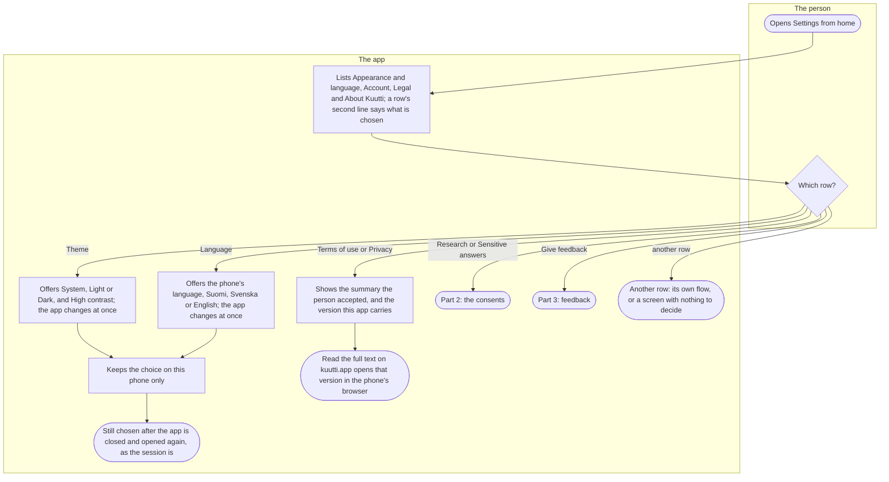
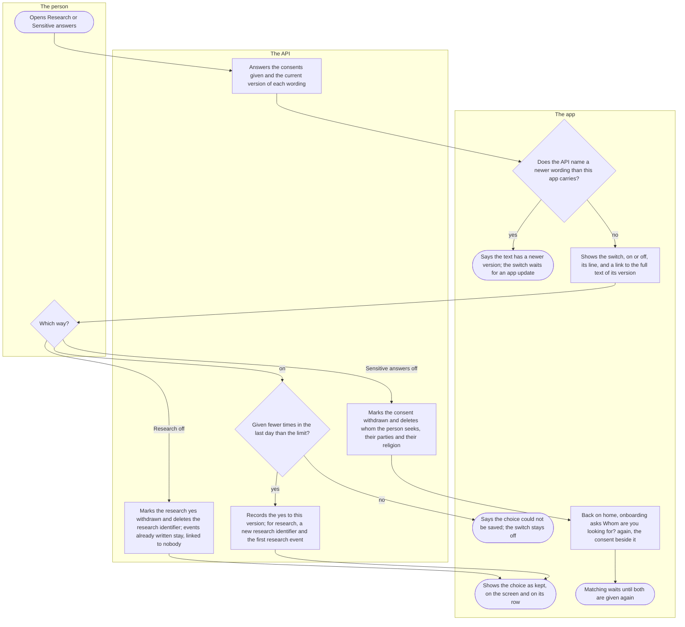
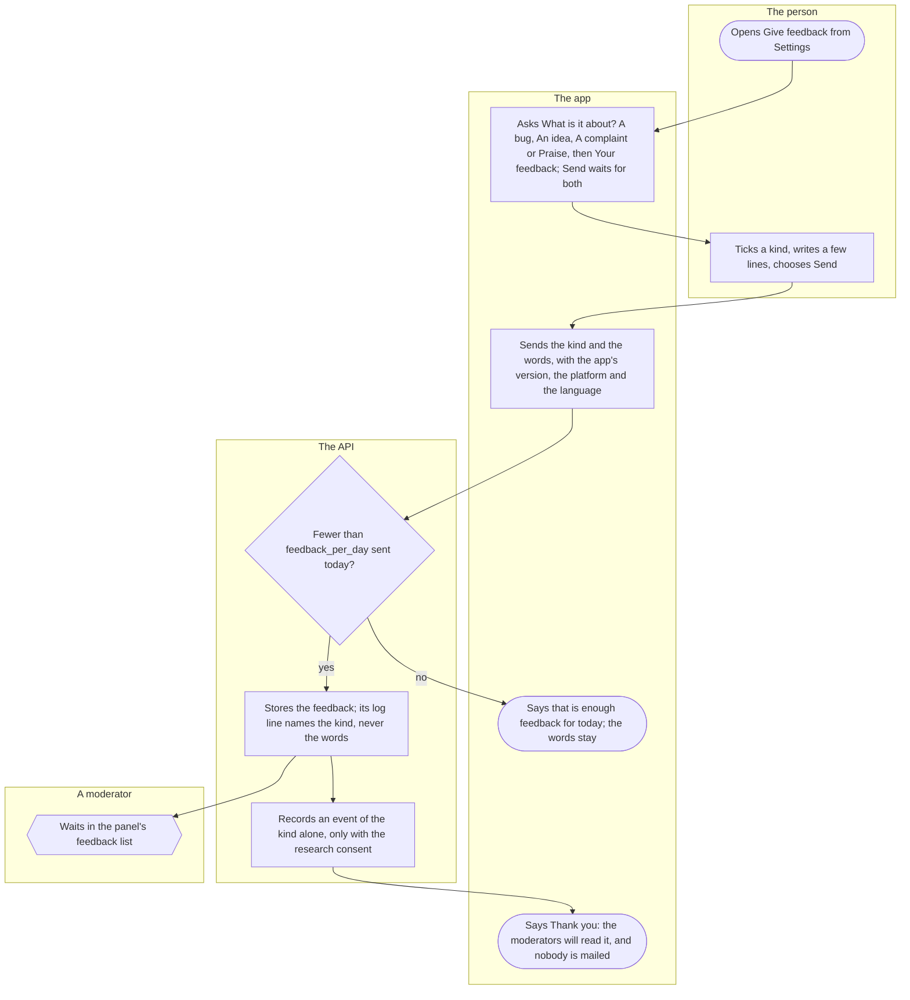

# Settings, consents and feedback

How a person finds their way around Settings: the look and the language of the app, the legal texts they accepted, the two consents they can give and take back (research, and the sensitive answers), and a few lines of feedback to the moderators. It is for every person with the app; the rows with a flow of their own are linked from part 1.

## Part 1: the Settings list

### Steps

1. The person opens Settings with the gear at the top of home.
2. The app lists four sections: Appearance and language (Theme, Language, Photo descriptions, Decision buttons), Account (This device, Lock, E-mail, Your contacts, Notifications, Invitations, Give feedback, Your account), Legal (Research, Sensitive answers, Terms of use, Privacy) and About Kuutti (Version, Source code, Licences). A row's second line is its value, never a description: the theme, the language, On or Off for a consent (read from the API each time the list comes back to the front), the version of a legal text, the build. Rows that need an account show only while the phone is signed in, and Lock only on a phone, not in the web preview.
3. The person chooses a row. Theme: 4; Language: 5; Terms of use or Privacy: 8; Research or Sensitive answers: 10; Give feedback: 11; any other: 12.
4. Theme offers System (the phone's, the default), Light and Dark, the chosen one ticked in words, and a High contrast switch, a second set of colours for either. The app changes at once.
5. Language offers the phone's language (the default), Suomi, Svenska and English, each under its own name and ticked in words. The app changes its language at once, this screen included.
6. The app keeps the choice on this phone only, never on the server, with the phone's other small choices (High contrast, Photo descriptions, Decision buttons).
7. The choices are still there after the app is closed and opened again, and so is the session: no bank login again. The consents and the notification choices are kept by the API instead, so every phone of the person's reads the same.
8. Terms of use or Privacy shows the summary the person accepted, as the app carries it and never machine-translated, with the version under it. There is no switch: the terms and the privacy summary end only with the account, and a new version is asked of everybody again ([Onboarding](onboarding.md)).
9. "Read the full text on kuutti.app (version …)" opens the full text of that very version on the public website in the phone's browser; the site's Finnish text is the one that binds.
10. Research and Sensitive answers each have a screen of their own: part 2.
11. Give feedback: part 3.
12. The other rows. Photo descriptions: [Photos](photos.md). Decision buttons: [The round, likes, fish and the match](round.md). Lock: [The app lock](app-lock.md). E-mail: [E-mail and its confirmation](email.md). Your contacts: [Chat](chat.md). Notifications: [Notifications and notices](notifications.md). Invitations: [Inviting a friend](invitations.md). Your account: [Deleting the account and downloading one's data](erasure-and-export.md), [Taking a break](break.md) and [Found them](found-them.md). This device has Log out and Log out everywhere ([Signing in](sign-in.md)). Version names the build and its commit, and opens nothing. Source code offers the running service's source under the AGPL-3.0 licence, opened in the browser, to everybody. Licences lists the packages the build is made of, in families, each opening its copyright lines and licence text in English as written.

## Part 2: the consents

### Steps

13. The person opens Research or Sensitive answers, under Legal.
14. The API answers the consents the person has given and the current version of each wording.
15. The app compares the version the API names with the one built into it. Different (the API has moved on): 16; the same: 17.
16. The app says "This text has a newer version than the one built into this app. Update the app to continue." and the switch cannot be turned: a yes is given only to a text this app has shown. The row says "Update the app to change it".
17. The app shows the switch, on or off, with its line, and "Read the full text on kuutti.app (version …)" under it: "Take part in research" ("Anonymised events about how you use Kuutti, under a separate research identifier. You can change this at any time.") or "Store my sensitive answers" ("Whom you seek, the parties you could vote for and your religion. Switching this off removes those answers and pauses matching; your profile stays, and you are asked whom you seek again before matching resumes."). The switch turns by its words too. If the consents cannot be read, the app says so and offers to try again.
18. The person turns the switch. On: 19; Research off: 22; Sensitive answers off: 23.
19. The API counts how many times this consent was given in the last day: each yes is a record kept as proof, so the changes are capped. Under the cap: 21; at it: 20.
20. The app says "The research choice could not be saved. Try again." (for the sensitive answers, their own words), and the switch stays off. The same words follow whenever the API does not take a change, either way.
21. The API records the yes for the version this app carries, in the language it was shown in. For research, in the same step, it makes the person a new research identifier, never the one from before, and writes the first research event: whole days since registration, and whether the account is active. Research events are written by the API alone; the app sends none. Sensitive answers switched on here leave whom the person seeks still to be answered: home asks it, as in step 25.
22. The API marks the research yes withdrawn and, in the same step, deletes the research identifier. The events already written stay, under an identifier that nothing leads back to the person. The withdrawn record stays as the proof of what was agreed and when.
23. The API marks the sensitive-answers consent withdrawn and, in the same step, deletes whom the person seeks and the parties and the religion on their profile. The age window and the rest of the profile stay.
24. The switch shows the choice as the API keeps it, and the row in the Settings list says On or Off.
25. When the person goes back to home, home reads where onboarding stands again and sends them to "Whom are you looking for?", nothing chosen, with "I consent to Kuutti storing whom I seek" beside it; Continue waits for both. The age window is not asked again, and nothing is asked about research ([Onboarding](onboarding.md)).
26. Until whom they seek is given again with the consent, matching waits for them; the profile stays as it was. If the person had changed whom they seek before, the new answer counts as a change and waits for `change_cadence_days` from that change, even the same answer as before.

## Part 3: feedback

### Steps

27. The person opens Give feedback, under Account in Settings.
28. The app says "A few lines to the moderators: what went wrong, what you would like, what bothers you, or what works. Sent with the app's version, the platform and your language, nothing else. Nobody is mailed." and asks "What is it about?": A bug, An idea, A complaint or Praise, the chosen one ticked in words, never by colour alone. Below it, the field "Your feedback". Send stays dimmed until a kind is chosen and something is written.
29. The person ticks a kind, writes a few lines (up to a length the contract sets) and chooses Send.
30. The app sends the kind and the words, trimmed, with the app's version, the platform (iOS, Android, or web for the preview) and the language it shows, which it reads by itself. If sending fails for any reason but the day's cap, it says "Sending did not work. Try again." and keeps the kind and the words.
31. The API counts the person's feedback of the Finnish day, in the same statement that would store the new one. Fewer than `feedback_per_day`: 33; otherwise: 32.
32. The app says "That is enough feedback for today. You can send more after midnight." and keeps the kind and the words.
33. The API stores the feedback with the person's account. Its log line names the kind, the build and the account, never the words.
34. If the person has the research consent, the API records an event of the kind alone, never the words; without it, nothing.
35. The app says "Thank you" and "The moderators will read it. Nobody is mailed.", with Send more, which opens the empty form again. No answer comes back in the app.
36. The feedback waits in the moderation panel's list, a bug first and praise last, the oldest first within a kind, with its words, the build, the platform, the language and the account, until a moderator marks it handled ([Moderation](moderation.md)). The person's data export lists their feedback and whether a moderator has handled it, and it goes with the account.

## Where it lives

- Screens: [settings/index.tsx](../../apps/mobile/app/settings/index.tsx), [settings/theme.tsx](../../apps/mobile/app/settings/theme.tsx), [settings/language.tsx](../../apps/mobile/app/settings/language.tsx), [settings/legal/[kind].tsx](../../apps/mobile/app/settings/legal/%5Bkind%5D.tsx), [settings/consent/[kind].tsx](../../apps/mobile/app/settings/consent/%5Bkind%5D.tsx), [settings/feedback.tsx](../../apps/mobile/app/settings/feedback.tsx), [settings/device.tsx](../../apps/mobile/app/settings/device.tsx), [settings/source.tsx](../../apps/mobile/app/settings/source.tsx), [settings/licenses/](../../apps/mobile/app/settings/licenses); the settings slice's [SettingsScreen.tsx](../../apps/mobile/src/features/settings/SettingsScreen.tsx), [ThemeScreen.tsx](../../apps/mobile/src/features/settings/ThemeScreen.tsx), [LanguageScreen.tsx](../../apps/mobile/src/features/settings/LanguageScreen.tsx), [LegalScreen.tsx](../../apps/mobile/src/features/settings/LegalScreen.tsx), [ConsentScreen.tsx](../../apps/mobile/src/features/settings/ConsentScreen.tsx), [FeedbackScreen.tsx](../../apps/mobile/src/features/settings/FeedbackScreen.tsx), [DeviceScreen.tsx](../../apps/mobile/src/features/settings/DeviceScreen.tsx), [SourceScreen.tsx](../../apps/mobile/src/features/settings/SourceScreen.tsx), [LicensesScreen.tsx](../../apps/mobile/src/features/settings/LicensesScreen.tsx), [PackageLicenseScreen.tsx](../../apps/mobile/src/features/settings/PackageLicenseScreen.tsx); the identity slice's [ConsentSwitches.tsx](../../apps/mobile/src/features/identity/ConsentSwitches.tsx) and [LegalTextLink.tsx](../../apps/mobile/src/features/identity/LegalTextLink.tsx); what the phone keeps, [preferences.ts](../../apps/mobile/src/lib/preferences.ts)
- API: `GET /consents`, `POST /consents` and `DELETE /consents/{kind}` in the identity slice ([onboarding-routes.ts](../../apps/api/src/identity/onboarding-routes.ts), [onboarding.ts](../../apps/api/src/identity/onboarding.ts)); the research identifier and events in the research slice ([track.ts](../../apps/api/src/research/track.ts), [README](../../apps/api/src/research/README.md)); `POST /feedback`, and the panel's `GET /admin/feedback` and `POST /admin/feedback/{id}/handled`, in the safety slice ([feedback-routes.ts](../../apps/api/src/safety/feedback-routes.ts), [feedback.ts](../../apps/api/src/safety/feedback.ts))
- Config: `feedback_per_day`, `change_cadence_days` in `matching_config` (defaults in [seed.ts](../../packages/db/src/seed.ts))
- Spec: [onboarding.feature](../../features/identity/onboarding.feature) (the research opt-in and its withdrawal, the seek consent withdrawn), [feedback.feature](../../features/safety/feedback.feature)
- Maestro: [research-switch.yaml](../../apps/mobile/e2e/flows/research-switch.yaml), [sensitive-answers-withdrawal.yaml](../../apps/mobile/e2e/flows/sensitive-answers-withdrawal.yaml), [language.yaml](../../apps/mobile/e2e/flows/language.yaml), [settings-survive-relaunch.yaml](../../apps/mobile/e2e/flows/settings-survive-relaunch.yaml), [give-feedback.yaml](../../apps/mobile/e2e/flows/give-feedback.yaml)
- ADRs: [ADR-010](../adr/010-onboarding-and-consents.md), [ADR-011](../adr/011-research-events.md), [ADR-019](../adr/019-profile-fields-and-roles.md) §4, [ADR-023](../adr/023-feedback-from-the-app.md)

## History

- 2026-09-26 (#46, PR #65): the research opt-in becomes a consent of its own, given to the version of the text the app shows, with a switch to withdraw it that waits for an app update when the wording has moved on.
- 2026-10-08 (#143, PR #152): Settings arrives: the theme and high contrast (the phone's by default) and the language (the phone's by default), kept across a restart; log out here or everywhere; the source code.
- 2026-10-08 (#146, PR #154): the sensitive-answers consent, given on the seek screen, gets its own switch; withdrawing it takes whom one seeks, the parties and the religion with it, and onboarding asks whom one seeks again.
- 2026-10-10 (#146, PR #169): home reads where onboarding stands each time it comes back to the front, so a consent withdrawn in Settings asks whom one seeks at once rather than at the next launch.
- 2026-10-10 (#204, PR #207): the sensitive-answers consent is held once: given on the seek step, withdrawn only in Settings, whose line says what withdrawing does.
- 2026-10-10 (#204, PR #214): after the sensitive-answers consent is withdrawn, only whom one seeks is asked again; the age window stays.
- 2026-10-14 (#287, PR #290): Settings in sections, each row a screen of its own that says what is chosen: the two consents with On, Off or an update needed, the terms and the privacy summary with their version, and the version, the source code and the licences in every build.
- 2026-10-15 (#171, PR #295): Give feedback: a kind, a few lines, Send and the thanks, within `feedback_per_day`; the moderators read it in their panel.
- 2026-10-17 (#208, PR #343): under every legal text, the version becomes a link to the full text of that version on kuutti.app.
- 2026-10-20 (#376, PR #377): the sections in the order Appearance and language, Account, Legal, About Kuutti, a row's second line only where it is its value, and the licences in families.
- 2026-10-22 (#416, PR #419): each package in Licences opens its copyright lines and licence text.
- 2026-10-22 (#418, PR #422): the research question moves before the bank login and leaves onboarding, Settings keeping its switch; the Lock row joins Account.
