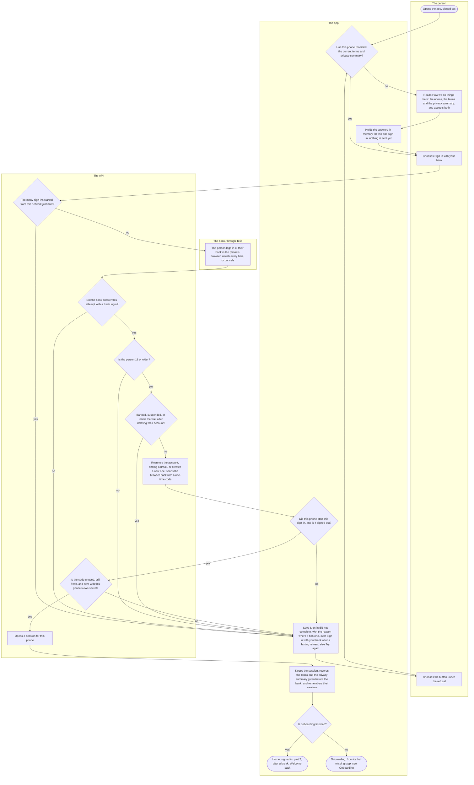
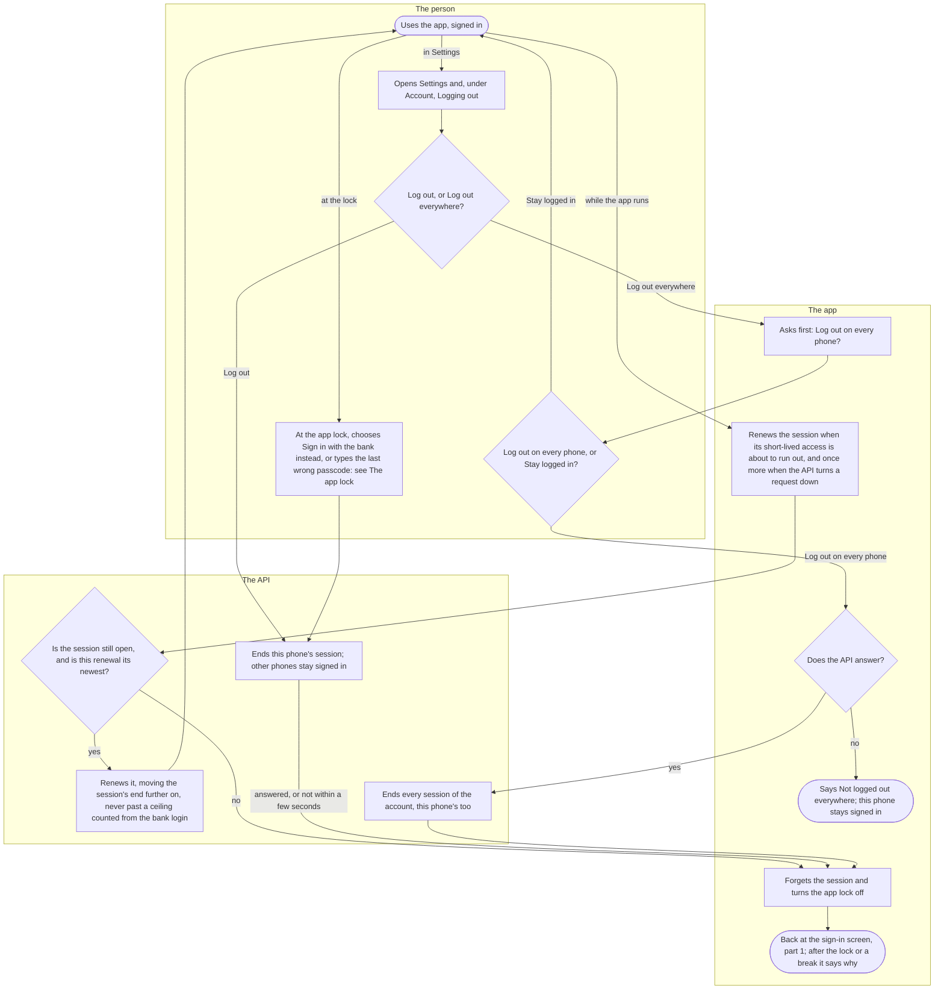

# Signing in

<!-- draws
apps/mobile/app/index.tsx
apps/mobile/app/auth.tsx
apps/mobile/src/features/home/HomeRoute.tsx
apps/mobile/src/features/home/HomeScreen.tsx
apps/mobile/src/features/identity/SignInScreen.tsx
apps/mobile/src/features/identity/BeforeSignIn.tsx
apps/mobile/src/features/identity/agreements.ts
apps/mobile/src/features/identity/verifier.ts
apps/mobile/src/features/identity/session.tsx
apps/mobile/src/features/identity/SignedOutToStart.tsx
apps/mobile/src/features/identity/onboarding/useOnboardingGate.ts
apps/mobile/src/features/settings/SettingsScreen.tsx
apps/mobile/src/features/settings/DeviceActions.tsx
apps/api/src/identity/routes.ts
apps/api/src/identity/login.ts
apps/api/src/identity/registration.ts
apps/api/src/identity/codes.ts
apps/api/src/identity/sessions.ts
apps/api/src/identity/onboarding-routes.ts
-->

How a person gets into Kuutti and out again: the screens before the bank, the bank login itself, who the bank login lets in and who not, and how a session on a phone ends. Everyone who uses the app goes through it, at their first sign-in and on every new phone.

## Part 1: signing in

### Steps

1. The person opens the app with no session on this phone. While the app reads whether it holds one, the screen says "Loading…".
2. The app checks whether this phone has recorded the versions of the terms and the privacy summary that this build carries, at an earlier sign-in or on onboarding's welcome step. Yes: 5, the sign-in screen, "Sign in" with its one button. No: 3; the screens before the bank stand in its place. A new phone, or an update that changed a wording, shows them again.
3. "How we do things here": the two norms, "Everybody here has shown a bank ID. Be the person you are." and "No contact details before a match."; then "Read both. You accept exactly this version of each text; if one changes, we ask you again.", outside Finnish "The Finnish text is the one that counts; this is a translation.", and the terms and the privacy summary, each with its version as a link to the full text. One button, "I'm in, and I accept both". The bank cannot be reached before it. Nothing is asked about research until there is a researcher.
4. There is no account yet, so the app holds the answers in memory and sends nothing. They belong to the next bank attempt only: leaving the app before the bank opens, a refusal, a second attempt, or the attempt's time running out drops them, and whoever signs in next answers again. The sign-in screen comes back with its button.
5. The person chooses "Sign in with your bank". The app opens the API in the phone's own browser, never inside the app, with the fingerprint of a secret it keeps for this attempt and the app's language for the bank's chooser.
6. The API counts the sign-ins started from this network just now. Too many: 19, "Too many sign-ins were started just now. Wait a minute and try again." The same refusal comes, rarely, when so many sign-ins are under way across Kuutti that none can make room; before that, the oldest attempts the bank has not answered end to make it. Otherwise the API remembers the attempt and sends the browser on to Telia's bank chooser: 7.
7. The person chooses their bank and logs in there. Kuutti asks for the bank every time, so a bank login left open in the browser, perhaps by somebody else, is never reused. Or the person cancels at the bank.
8. The bank's answer comes back to the API, which answers each attempt once. Cancelled: 19, "Nothing was saved." An attempt the API does not know, has answered already or has seen expire, a failure of the bank's service, or a bank login older than this attempt: 19, with the card's title alone. Otherwise: 9. From the personal identity code the API takes the year and month of birth and a code that cannot be turned back into the person, and keeps nothing else of it.
9. Under 18: 19, "Kuutti is for adults. You are welcome once you are 18." Nothing is stored. Otherwise: 10.
10. The API looks the person up by that code. Banned: 19, "This person may not use Kuutti." Suspended: 19, "This account is suspended. You can sign in again from:" and the day, or "This account is suspended for now." when there is no end day. Deleted their own account and still inside the wait before a new one: 19, "You deleted your account recently. The earliest day for a new one:" and the day. Each of these refusals is counted on the person. Otherwise: 11.
11. A person with an account resumes it, and an account on a break comes off the break. A person the bank has never brought here, or whose last account was deleted longer ago than the wait, gets a new account with nothing restored. The browser goes back to the app with a one-time code.
12. The app takes the code only if this phone started a sign-in a short while ago and is not signed in. A link this phone did not ask for, such as a code somebody else sent as a link, is refused and the session is left as it was: 19, "This sign-in link was not requested from this phone." Otherwise: 13, while the screen says "Signing you in…".
13. The API takes the code once, while it is fresh, and only with the secret this phone kept for the attempt, so a code another app read off the link is worth nothing. Used, expired, unknown or not this phone's: 19, with the card's title alone. Too many requests from this network: 19, as in step 6. Otherwise: 14.
14. The API opens a session for this phone: a short-lived access and a renewal that only this phone holds.
15. The app keeps the session in the phone's secure store, which is never backed up or moved to another phone. If the person accepted step 3 for this attempt, the app records the terms, then the privacy summary, before anything else. Once both are recorded, the phone remembers their versions, so its next sign-in skips the screens before the bank (step 2). A record that fails is asked again on onboarding's welcome step. "Signing you in…" stands until the next screen takes over.
16. The app goes home, which asks the API where onboarding stands, saying "Loading…" meanwhile. Finished: 17. Not finished: 18. A new account never is.
17. Home, signed in: part 2. After the sign-in that ended a break, it says once: "Welcome back. Your profile is visible again."
18. Onboarding opens at its first missing step: see [Onboarding](onboarding.md). It opens on the welcome step, which asks the norms and both texts again, when the terms or the privacy summary are missing: a wording changed after the phone recorded it, a second person signing in on a shared phone, a record that failed, or answers lost when Android ended the app while the bank was open.
19. The sign-in screen says "Sign-in did not complete". A refusal with a fact of its own says it under the title, in the words given at each step; a link gone stale or a failure on the way has the title alone. The answers held for this attempt are dropped. The button under it says "Sign in with your bank" after a refusal that rests on the person (under 18, banned, suspended, or inside the wait after a deletion), since another try only repeats it, and "Try again" after any other.
20. The person chooses the button: 2. Either button opens the bank again, but on a phone that has not recorded the terms and the privacy summary it shows the screens before the bank first, never the bank straight away.

## Part 2: sessions and logging out

### Steps

21. The person uses the app, signed in on this phone. Closing and reopening the app keeps the session: there is no bank login at every start.
22. Before a request, when the session's short-lived access is about to run out, the app renews the session, and once more whenever the API turns a request down: that one renewal decides whether the session is over. A renewal that fails for another reason, the API unwell or no network, keeps the session for the next try.
23. Is the session still open, and is this renewal its newest? Yes: 24. No: 34, and every such renewal is answered the same. A session is over after Log out everywhere on another phone, a ban or a suspension, a break taken on another phone, the account deleted, the phone left unused until the session's end, or the ceiling counted from the bank login, however often the phone is used. Any earlier renewal of the session presented again, however many renewals back it is, is taken for a copy: the API ends the session for every phone that holds it.
24. The API renews the session and moves its end further on, never past that ceiling, so a phone in use stays signed in and nothing shows: 21.
25. The person opens "Settings", the gear on home, and under "Account" the row "Logging out", which opens in place: "Log out", and "Log out everywhere" with "For a lost or lent phone."
26. "Log out": 28. "Log out everywhere", the way back from a lost phone: 29.
27. At the app lock the person chooses "Sign in with the bank instead", or types the last wrong passcode: see [The app lock](app-lock.md). It signs this phone out as Log out does: 28.
28. The API ends this phone's session, and the person's other phones stay signed in. The app waits a few seconds at most and signs the phone out whatever the answer; when the API did not take the logout, the phone also drops its token for notifications, so that nothing is pushed to it for a session the API may still hold: 34.
29. The app asks first: "Log out on every phone?", "Every phone, this one too, needs your bank to log in again."
30. "Stay logged in": 21, and nothing changes. "Log out on every phone": 31.
31. The app asks the API to end every session. No answer, or a failure at the API: 32. An answer that every session is ended, or that this one was over already: 33.
32. "Not logged out everywhere. Check your connection and try again." This phone stays signed in.
33. The API ends every session of the account, this phone's too. Each other phone finds out at its next request (step 23).
34. The app forgets the session on this phone, and the app lock with it: any sign-out turns the lock off.
35. The app goes back to the sign-in screen, step 1, from whatever screen was open. Right after the lock signed this phone out it says "Signed out by the lock" and "Nothing on your account changed. The lock is off until you turn it on again in Settings."; right after a break began on this phone, "Your account is on a break". Reopening the app does not bring the session back.

## Where it lives

- Screens: [index.tsx](../../apps/mobile/app/index.tsx) (the sign-in when signed out, home when signed in), [auth.tsx](../../apps/mobile/app/auth.tsx) (the return from the bank); [HomeRoute.tsx](../../apps/mobile/src/features/home/HomeRoute.tsx), [HomeScreen.tsx](../../apps/mobile/src/features/home/HomeScreen.tsx) (Welcome back); in the identity feature [SignInScreen.tsx](../../apps/mobile/src/features/identity/SignInScreen.tsx) (the refusals and the button's words), [BeforeSignIn.tsx](../../apps/mobile/src/features/identity/BeforeSignIn.tsx), [agreements.ts](../../apps/mobile/src/features/identity/agreements.ts), [verifier.ts](../../apps/mobile/src/features/identity/verifier.ts), [session.tsx](../../apps/mobile/src/features/identity/session.tsx), [SignedOutToStart.tsx](../../apps/mobile/src/features/identity/SignedOutToStart.tsx), [useOnboardingGate.ts](../../apps/mobile/src/features/identity/onboarding/useOnboardingGate.ts); Settings' row Logging out in [SettingsScreen.tsx](../../apps/mobile/src/features/settings/SettingsScreen.tsx) and [DeviceActions.tsx](../../apps/mobile/src/features/settings/DeviceActions.tsx); the stored session and its renewal in [lib/session.ts](../../apps/mobile/src/lib/session.ts) and [lib/api.ts](../../apps/mobile/src/lib/api.ts)
- API: `GET /auth/start`, `GET /auth/callback`, `POST /auth/exchange`, `POST /auth/refresh`, `POST /auth/logout`, `POST /auth/logout-all` in the identity slice's [routes.ts](../../apps/api/src/identity/routes.ts), with [login.ts](../../apps/api/src/identity/login.ts), [registration.ts](../../apps/api/src/identity/registration.ts) (who is let in), [codes.ts](../../apps/api/src/identity/codes.ts) and [sessions.ts](../../apps/api/src/identity/sessions.ts) (the renewal, its end and its ceiling, an earlier renewal presented again); the session check in [auth-middleware.ts](../../apps/api/src/lib/auth-middleware.ts); the answers before the bank through `POST /consents` in [onboarding-routes.ts](../../apps/api/src/identity/onboarding-routes.ts); the bank's dialect in the kit [`@kuutti-ry/tunnistus-oidc`](https://github.com/kuutti-ry/tunnistus-oidc), its own repository, described in [telia.md](../vendors/telia.md)
- Spec: [bank-login.feature](../../features/identity/bank-login.feature), [re-registration.feature](../../features/identity/re-registration.feature), [sessions.feature](../../features/identity/sessions.feature), and the screens before the bank in [onboarding.feature](../../features/identity/onboarding.feature)
- Maestro: [sign-in-refusals.yaml](../../apps/mobile/e2e/flows/sign-in-refusals.yaml), [sign-in-links.yaml](../../apps/mobile/e2e/flows/sign-in-links.yaml), [log-out-everywhere.yaml](../../apps/mobile/e2e/flows/log-out-everywhere.yaml), [settings-survive-relaunch.yaml](../../apps/mobile/e2e/flows/settings-survive-relaunch.yaml), [terms-asked-again.yaml](../../apps/mobile/e2e/flows/terms-asked-again.yaml); the shared steps [bank-login.yaml](../../apps/mobile/e2e/common/bank-login.yaml), [before-sign-in.yaml](../../apps/mobile/e2e/common/before-sign-in.yaml), [sign-in.yaml](../../apps/mobile/e2e/common/sign-in.yaml) and [sign-out.yaml](../../apps/mobile/e2e/common/sign-out.yaml)
- ADRs: [ADR-010](../adr/010-onboarding-and-consents.md) §15 (the screens before the bank) and §19 (nothing asked about research), [ADR-016](../adr/016-fresh-bank-login.md) (the bank every time), [ADR-017](../adr/017-tunnistus-oidc-package.md) (the bank's dialect), [ADR-022](../adr/022-taking-a-break.md) (a break ends at the next sign-in), [ADR-024](../adr/024-sanctions.md) §4 and §5 (a sanction ends the sessions; the suspension's day), [ADR-026](../adr/026-limits-per-person-and-sign-in-doors.md) §4 and §6 (too many sign-ins; the oldest attempts making room), [ADR-027](../adr/027-sign-in-code-bound-to-the-device.md) (the code bound to the phone), [ADR-045](../adr/045-app-lock.md) §2 and §6 (a sign-out turns the lock off; the lock's way out), [ADR-058](../adr/058-sessions-end-after-ninety-idle-days.md) (the session's end and its ceiling), [ADR-059](../adr/059-refresh-token-carries-its-session.md) (an earlier renewal presented again)
- Rules: the register's [Sign-in and identity](../decisions.md#sign-in-and-identity), [Safety](../decisions.md#safety) (a sanction signs every phone out; the suspension's day), [Break and erasure](../decisions.md#break-and-erasure) (the wait after a deletion) and [Limits](../decisions.md#limits) (the sign-in starts) rows

## History

- 2026-09-22 (#33, PR #40): the bank login: under 18 refused, a banned or suspended person and one inside the wait after deleting their account refused, a known person back in their account, a newcomer given one, and a one-time code back to the app.
- 2026-09-23 (#35, PR #42): a session per phone, renewed in the background, ended by logging out or logging out everywhere.
- 2026-09-23 (#36, PR #43): the sign-in screen, the return from the bank into the app, every refusal said in the app, and a return link this phone did not ask for refused.
- 2026-09-23 (#32, PR #45): cancelling at the bank comes back as its own refusal.
- 2026-10-07 (#32, #33, PR #130): the bank is asked every time, and a bank login older than the attempt is refused.
- 2026-10-08 (#143, #36, PR #152): Log out and Log out everywhere move to the Settings screen.
- 2026-10-10 (#146, PR #169): a session that ends while a screen is open takes the app back to the sign-in.
- 2026-10-10 (#35, PR #187): the session stays on the phone that signed in; a phone restored from a backup signs in with the bank.
- 2026-10-13 (#170, PR #277): the sign-in after a break ends it and home says welcome back; the sign-in screen says when a break has begun.
- 2026-10-14 (#287, PR #290): Log out and Log out everywhere move to a screen of their own, Settings › This device.
- 2026-10-16 (#307, PR #315): a suspension's refusal names the day it ends.
- 2026-10-16 (#41, PR #325): too many sign-ins started from one network are refused, with a minute's wait.
- 2026-10-17 (#186, PR #327): the one-time code works only with the secret of the phone that started the sign-in.
- 2026-10-22 (#418, PR #422): the norms, the terms, the privacy summary and the research question move before the bank login, and a phone that recorded them skips them; the sign-in screen says when the app lock signed the phone out.
- 2026-10-28 (#472, PR #489): each renewal moves a session's end further on, never past a ceiling counted from the bank login, so a phone in use stays signed in and one left unused goes to the bank again.
- 2026-10-29 (#490, PR #494): any earlier renewal of a session presented again ends the session for every phone that holds it, however many renewals back it is.
- 2026-10-30 (#511, PR #516): Log out and Log out everywhere move into Settings' one list, under the row Logging out that opens in place; Log out everywhere asks first, and says when it did not go through.
- 2026-10-30 (#466, PR #535): after a refusal that rests on the person (under 18, banned, suspended, inside the wait after a deletion) the button says Sign in with your bank, not Try again.
- 2026-11-04 (#545, PR #595): the research question leaves the screens before the bank: nothing is asked about research until there is a researcher.
