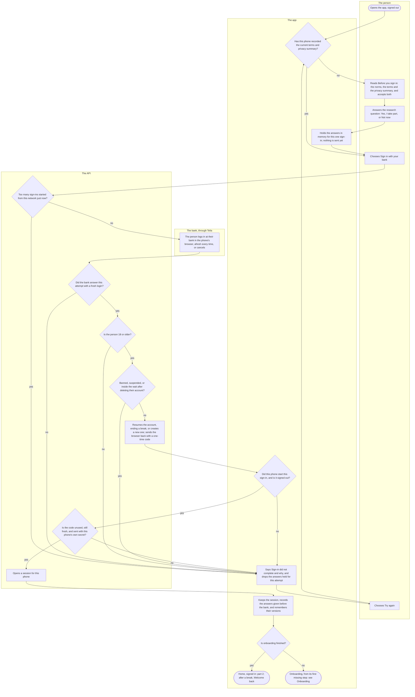
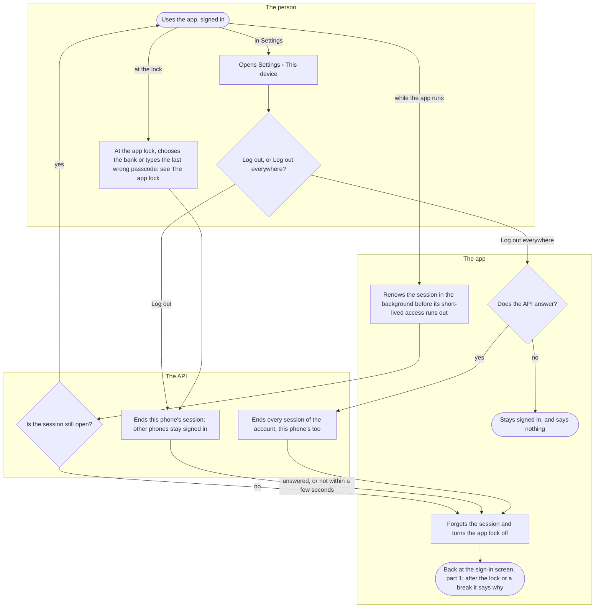

# Signing in

How a person gets into Kuutti and out again: the screens before the bank, the bank login itself, who the bank login lets in and who not, and how a session on a phone ends. Everyone who uses the app goes through it, at their first sign-in and on every new phone.

## Part 1: signing in

### Steps

1. The person opens the app with no session on this phone. The first screen is the sign-in: "Kuutti verifies every account through a Finnish bank. Your bank confirms who you are; Kuutti keeps only your year and month of birth and a code that cannot be turned back into you."
2. The app checks whether this phone has recorded the versions of the terms and the privacy summary that this build carries, at an earlier sign-in or on onboarding's welcome step. Yes: 6, straight to the bank's button. No: 3; "Before you sign in" stands where the button would be. A new phone, or an update that changed a wording, shows the screens again.
3. "How we do things here": the four norms, the terms and the privacy summary, each with its version as a link to the full text, and outside Finnish the line that the Finnish text is the one that counts. One button, "I'm in, and I accept both". The bank cannot be reached before it.
4. "Help us learn how matching works": the research card with its version, then "Yes, I take part" or "Not now", neither chosen beforehand nor drawn stronger. Either answer goes on to the bank; Not now records nothing and withdraws nothing.
5. There is no account yet, so the app holds the answers in memory and sends nothing. They belong to the next bank attempt only: leaving the app before the bank opens, a refusal, a second attempt, or the attempt's time running out drops them, and whoever signs in next answers again. The sign-in screen comes back with its button.
6. The person chooses "Sign in with your bank". The app opens the API in the phone's own browser, never inside the app, with the fingerprint of a secret it keeps for this attempt and the app's language for the bank's chooser.
7. The API counts the sign-ins started from this network just now, and those under way at once. Too many: 20, "Too many sign-ins were started just now. Wait a minute and try again." Otherwise it remembers the attempt and sends the browser on to Telia's bank chooser: 8.
8. The person chooses their bank and logs in there. Kuutti asks for the bank every time, so a bank login left open in the browser, perhaps by somebody else, is never reused. Or the person cancels at the bank.
9. The bank's answer comes back to the API, which answers each attempt once. Cancelled: 20, "You cancelled the sign-in at your bank. Nothing was saved." An attempt the API does not know, has answered already or has seen expire: 20, "That sign-in attempt is unknown or has expired. Start again." The bank's service failed, or its login is older than this attempt: 20, "The identification service did not complete the sign-in. Try again in a moment." Otherwise: 10. From the personal identity code the API takes the year and month of birth and a code that cannot be turned back into the person, and keeps nothing else of it.
10. Under 18: 20, "Kuutti is for adults. You are welcome once you are 18." Nothing is stored. Otherwise: 11.
11. The API looks the person up by that code. Banned: 20, "This person may not use Kuutti." Suspended: 20, "This account is suspended. You can sign in again from:" and the day, or "This account is suspended for now." when there is no end day. Deleted their own account and still inside the wait before a new one: 20, "You deleted your account recently. The earliest day for a new one:" and the day. Each of these refusals is counted on the person. Otherwise: 12.
12. A person with an account resumes it, and an account on a break comes off the break. A person the bank has never brought here, or whose last account was deleted longer ago than the wait, gets a new account with nothing restored. The browser goes back to the app with a one-time code.
13. The app takes the code only if this phone started a sign-in a short while ago and is not signed in. A link this phone did not ask for, such as a code somebody else sent as a link, is refused and the session is left as it was: 20, "This sign-in link was not requested from this phone. Start the sign-in here, with the button." Otherwise: 14, while the screen says "Signing you in…".
14. The API takes the code once, while it is fresh, and only with the secret this phone kept for the attempt, so a code another app read off the link is worth nothing. Used, expired, unknown or not this phone's: 20, "That sign-in link was already used or has expired. Start again." Too many requests from this network: 20, as in step 7. Otherwise: 15.
15. The API opens a session for this phone: a short-lived access and a renewal that only this phone holds.
16. The app keeps the session in the phone's secure store, which is never backed up or moved to another phone. If the person answered steps 3 and 4 for this attempt, the app records the answers now, before anything else: the terms, then the privacy summary, then research on a yes. Once the terms and the privacy summary are recorded, the phone remembers their versions, so its next sign-in skips the screens before the bank (step 2). A record that fails is asked again on onboarding's welcome step, and a research yes that fails is Settings' switch to give.
17. The app asks the API whether onboarding is finished. Yes: 18. No: 19. A new account never is.
18. Home, signed in: part 2. After the sign-in that ended a break, it says once: "Welcome back. Your profile is visible again."
19. Onboarding opens at its first missing step: see [Onboarding](onboarding.md). It opens on the welcome step, which asks the norms and both texts again, when the terms or the privacy summary are missing: a wording changed after the phone recorded it, a second person signing in on a shared phone, a record that failed, or answers lost when Android ended the app while the bank was open.
20. The sign-in screen says "Sign-in did not complete" and why, in the words given at each step; anything else is "Something went wrong. Try again." The answers held for this attempt are dropped, and the button now says "Try again".
21. The person chooses "Try again": 2. A phone that has not recorded the terms and the privacy summary shows the screens before the bank again, never the bank straight away.

## Part 2: sessions and logging out

### Steps

22. The person uses the app, signed in on this phone. Closing and reopening the app keeps the session: there is no bank login at every start.
23. While the app runs, it renews the session in the background before its short-lived access runs out, and once more whenever the API turns a request down: that one renewal decides whether the session is over.
24. Still open: 22, and nothing shows. Over: 32. A session is over after Log out everywhere on another phone, a ban or a suspension, a break taken on another phone, the account deleted, a renewal presented a second time (a copy, so the API ends the session), or a renewal past its lifetime.
25. The person opens Settings and, under Account, This device.
26. "Log out": 28. "Log out everywhere", the way back from a lost phone: 29.
27. At the app lock the person chooses "Sign in with the bank instead", or types the last wrong passcode: see [The app lock](app-lock.md). It signs this phone out as Log out does: 28.
28. The API ends this phone's session, and the person's other phones stay signed in. The app waits a few seconds at most and, without an answer, signs the phone out anyway: 32.
29. The app asks the API to end every session. No answer, or a failure at the API: 30. An answer: 31.
30. The phone stays signed in, and the screen says nothing.
31. The API ends every session of the account, this phone's too. Each other phone finds out at its next request (step 24).
32. The app forgets the session on this phone, and the app lock with it: any sign-out turns the lock off.
33. The app goes back to the sign-in screen, step 1, from whatever screen was open. Right after the lock signed this phone out it says "Signed out by the lock"; right after a break began on this phone, "Your account is on a break". Reopening the app does not bring the session back.

## Where it lives

- Screens: [index.tsx](../../apps/mobile/app/index.tsx) (the sign-in when signed out, home when signed in), [auth.tsx](../../apps/mobile/app/auth.tsx) (the return from the bank), [settings/device.tsx](../../apps/mobile/app/settings/device.tsx) (This device); in the identity feature [SignInScreen.tsx](../../apps/mobile/src/features/identity/SignInScreen.tsx), [BeforeSignIn.tsx](../../apps/mobile/src/features/identity/BeforeSignIn.tsx), [agreements.ts](../../apps/mobile/src/features/identity/agreements.ts), [session.tsx](../../apps/mobile/src/features/identity/session.tsx), [SignedOutToStart.tsx](../../apps/mobile/src/features/identity/SignedOutToStart.tsx), [useOnboardingGate.ts](../../apps/mobile/src/features/identity/onboarding/useOnboardingGate.ts); [HomeRoute.tsx](../../apps/mobile/src/features/home/HomeRoute.tsx), [DeviceScreen.tsx](../../apps/mobile/src/features/settings/DeviceScreen.tsx); the stored session and its renewal in [lib/session.ts](../../apps/mobile/src/lib/session.ts) and [lib/api.ts](../../apps/mobile/src/lib/api.ts)
- API: `GET /auth/start`, `GET /auth/callback`, `POST /auth/exchange`, `POST /auth/refresh`, `POST /auth/logout`, `POST /auth/logout-all` in the identity slice's [routes.ts](../../apps/api/src/identity/routes.ts), with [login.ts](../../apps/api/src/identity/login.ts), [registration.ts](../../apps/api/src/identity/registration.ts) (who is let in), [sessions.ts](../../apps/api/src/identity/sessions.ts) and [codes.ts](../../apps/api/src/identity/codes.ts); the session check in [auth-middleware.ts](../../apps/api/src/lib/auth-middleware.ts); the answers before the bank through `POST /consents` in [onboarding-routes.ts](../../apps/api/src/identity/onboarding-routes.ts); the bank's dialect in [@kuutti-ry/tunnistus-oidc](https://github.com/kuutti-ry/tunnistus-oidc), its own repository
- Spec: [bank-login.feature](../../features/identity/bank-login.feature), [re-registration.feature](../../features/identity/re-registration.feature), [sessions.feature](../../features/identity/sessions.feature)
- Maestro: [sign-in-refusals.yaml](../../apps/mobile/e2e/flows/sign-in-refusals.yaml), [sign-in-links.yaml](../../apps/mobile/e2e/flows/sign-in-links.yaml), [log-out-everywhere.yaml](../../apps/mobile/e2e/flows/log-out-everywhere.yaml), [settings-survive-relaunch.yaml](../../apps/mobile/e2e/flows/settings-survive-relaunch.yaml), [terms-asked-again.yaml](../../apps/mobile/e2e/flows/terms-asked-again.yaml); the shared steps [bank-login.yaml](../../apps/mobile/e2e/common/bank-login.yaml) and [before-sign-in.yaml](../../apps/mobile/e2e/common/before-sign-in.yaml)
- ADRs: [ADR-010](../adr/010-onboarding-and-consents.md) §15 (the screens before the bank), [ADR-016](../adr/016-fresh-bank-login.md) (the bank every time), [ADR-017](../adr/017-tunnistus-oidc-package.md) (the bank's dialect), [ADR-022](../adr/022-taking-a-break.md) (a break ends at the next sign-in), [ADR-024](../adr/024-sanctions.md) §4 and §5 (a sanction ends the sessions; the suspension's day), [ADR-026](../adr/026-limits-per-person-and-sign-in-doors.md) §4 (too many sign-ins), [ADR-027](../adr/027-sign-in-code-bound-to-the-device.md) (the code bound to the phone), [ADR-045](../adr/045-app-lock.md) §2 and §6 (a sign-out turns the lock off; the lock's way out)

## History

- 2026-09-22 (#33, PR #40): the bank login: under 18 refused, a banned or suspended person and one inside the wait after deleting their account refused, a known person back in their account, a newcomer given one, and a one-time code back to the app.
- 2026-09-23 (#35, PR #42): a session per phone, renewed in the background, ended by logging out or logging out everywhere.
- 2026-09-23 (#36, PR #43): the sign-in screen, the return from the bank into the app, every refusal said in the app, and a return link this phone did not ask for refused.
- 2026-09-23 (#32, PR #45): cancelling at the bank comes back as its own refusal.
- 2026-10-07 (#32, #33, PR #130): the bank is asked every time, and a bank login older than the attempt is refused.
- 2026-10-08 (#143, #36, PR #152): Log out and Log out everywhere move to the Settings screen.
- 2026-10-10 (#146, PR #169): a session that ends while a screen is open takes the app back to the sign-in.
- 2026-10-10 (#35, PR #187): the session stays on the phone that signed in; a phone restored from a backup signs in with the bank.
- 2026-10-13 (#170, PR #277): the sign-in after a break ends it and home says welcome back; the sign-in screen says when a break has begun.
- 2026-10-14 (#287, PR #290): Log out and Log out everywhere move to a screen of their own, Settings › This device.
- 2026-10-16 (#307, PR #315): a suspension's refusal names the day it ends.
- 2026-10-16 (#41, PR #325): too many sign-ins started from one network are refused, with a minute's wait.
- 2026-10-17 (#186, PR #327): the one-time code works only with the secret of the phone that started the sign-in.
- 2026-10-22 (#418, PR #422): the norms, the terms, the privacy summary and the research question move before the bank login, and a phone that recorded them skips them; the sign-in screen says when the app lock signed the phone out.
