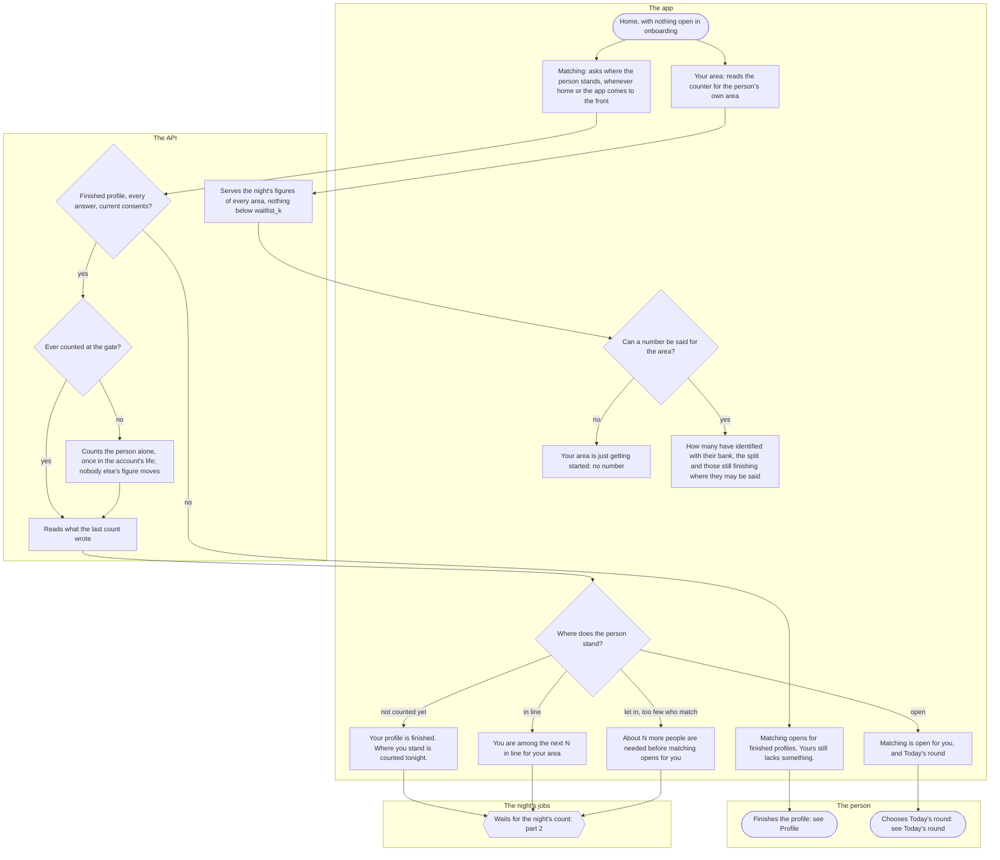
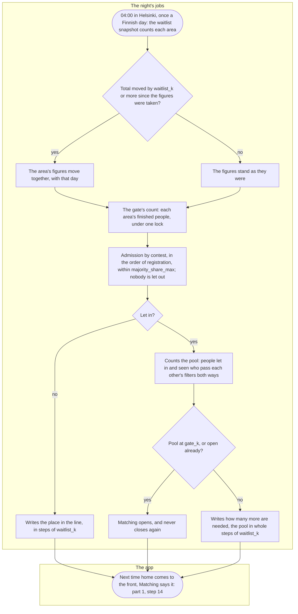
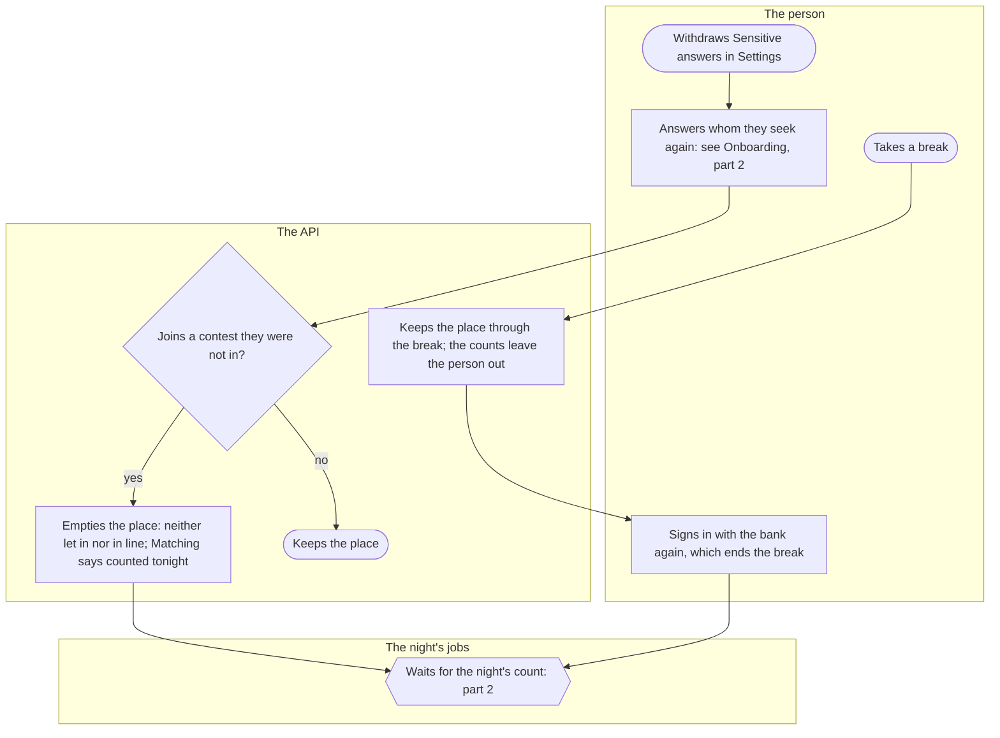

# The waitlist and the pond's gate

Where a person stands between a finished profile and their first round, and what home tells them about it: how full their area is, whether they wait in line, how many more people who match are needed, and when matching opens. Everyone with a finished profile goes through it once, and comes back to it when they answer whom they seek again.

## Part 1: what home shows

### Steps

1. The person has finished onboarding (see [Onboarding](onboarding.md)), or opens the app with nothing open there. Home shows "Kuutti", any notices first, then two cards, "Your area" and "Matching", then "Your profile" and the conversations.
2. "Your area": the area's name, in the person's language, on a line of its own. When home opens, the app reads the public counter, the same figures the waitlist site shows, and picks the person's own area.
3. The API serves, for every area, what the night's figures allow it to say (part 2, steps 21 to 24). Anybody may ask, and the answer names nobody.
4. At least `waitlist_k` people counted in the area when its figures last moved: 6. Fewer, or no figures yet: 5.
5. "Your area is just getting started. Numbers are shown only when at least {k} people are here.", k being `waitlist_k`.
6. "{N} people have identified with their bank". Under it "{N} women, {N} men, {N} non-binary" only when each of the three is at least `waitlist_k` and the people who declared no gender are none or at least `waitlist_k`; "{N} people are still finishing their profile." only when they and the rest are each none or at least `waitlist_k`; and "The numbers change only when at least {k} people have joined or left, so that one person joining or leaving does not show.", k being `waitlist_k` again.
7. "Matching": the app asks the API where the person stands whenever home comes to the front and whenever the app comes back to the foreground, so a person who added photos on another screen, or whose count ran in the night, sees the new answer. What it knew stays on screen until the answer is there.
8. Is the person counted at all? Only an account in good standing, active, with an area, every answer of onboarding (the gender, whom they seek with the sensitive-answers consent, the age window, the intent), the terms and the privacy summary in their current wording, and a finished profile, whose photos must be approved. A shadow-banned account is counted like an active one, so the ban shows to nobody. No: 9. Yes: 11.
9. "Matching opens for finished profiles. Yours still lacks something." Most often the photos still wait for the check or for a moderator.
10. The person finishes the profile: see [Profile](profile.md). Home asks again when it next comes to the front.
11. Has the person ever been counted at the gate? No: 12. Yes: 13.
12. The API counts the person alone, once in the account's life, so nobody waits for the night to learn where they stand for the first time. Nobody else's place or figure is written, so asking moves nothing for anybody else. The person is let in at once only when that needs nobody else's admission. One who would wait gets a place behind everybody of their contest who registered before them and is not let in. One who could be let in only together with others, or who asks while another count is running, is told that the night will say. One let in has their pool counted from the people already let in, and matching opens at once if it reaches `gate_k`.
13. The API reads what the last count wrote for the person, read in today's step of `waitlist_k`. A place emptied since (part 3), or left behind in another area, says nothing until the night.
14. Not counted yet: 15. In line: 16. Let in, with too few who match: 17. Open: 18.
15. "Your profile is finished. Where you stand is counted tonight."
16. "You are among the next {N} in line for your area.", where N is the place rounded up to the end of its step of `waitlist_k`, with "People are let in so that no group becomes much larger than the other. Those who wait are let in in the order they registered: nobody who waits passes you, and nothing can be bought." and "Numbers here are said in steps of {k}, so that they do not follow each person who comes or goes.", k being `waitlist_k`. Nothing on the card can be tapped to move ahead.
17. "About {N} more people are needed before matching opens for you.", where N is `gate_k` less the pool as it was last said, and at least one, with "They are people in your area who are what you seek, and who seek somebody like you." and the line about steps.
18. "Matching is open for you.", and the button "Today's round".
19. The person chooses "Today's round": see [Today's round](round.md).
20. Until the night's count, asking again changes nothing the card says: part 2.

## Part 2: the night's count

### Steps

21. At 04:00 Helsinki time the API runs the night's jobs one after the other; suspensions whose day has come end first, so a person let back in is counted the same night. The waitlist snapshot counts, at most once a Finnish calendar day, every area's people: accounts with an area and in good standing, whether newly registered, active or shadow-banned, by declared gender, and how many of them are still finishing, that is not yet active or with a profile not finished. People on a break, suspended, banned or deleted are not counted.
22. Has the area's total moved by `waitlist_k` or more since its figures were last taken? Yes: 23. No: 24.
23. All the area's figures move together and carry that day. Figures too small to have been said under any threshold are replaced at once.
24. The figures stand as they were, day and all: one person coming or going changes nothing that is said. Only the figures in force are kept, one set per area, with no history.
25. The gate's count runs next, under one lock, over the people of each area who are counted (step 8); a person on a break, suspended or banned is left out and their place left as it was. First, the place of an account that is gone is removed, and a place in an area the person has left is emptied.
26. Admission. A person competes for every gender they seek but their own; somebody who seeks only their own gender competes for nobody and is let in at once. A contest has room while the competitors already let in are no more than the people of that gender let in who seek another gender than their own, or more but within the ratio `majority_share_max` allows. In the order of registration, whoever has room in every contest they are in is let in, and the line is read again from its head, so a newcomer who is competed for opens the way for those who waited. Nobody let in is ever let out when the area drifts, and no rule names a gender.
27. Let in: 29. Still waiting: 28.
28. The count writes the place in the line among those who compete alike, said as the end of its step of `waitlist_k`: everybody among the first `waitlist_k` in line is told they are among the next `waitlist_k`.
29. The pool: the people of the same area who are let in and seen, with whom the person passes each other's filters both ways. Each one's gender is among those the other seeks, each one's age is inside the other's window, their intents fit (the same, or one of them open to either; a dance partner meets dance partners only), neither has blocked the other, and neither one's deal-breakers rule the other out. A shadow-banned person has a place of their own and is in nobody's pool.
30. The pool at `gate_k` or more, or matching opened before: 31. Otherwise: 32.
31. Matching opens for the person, and it does not close when the area drifts: a pool that shrinks later makes shorter rounds. The night's round builder runs after the count: see [Today's round](round.md).
32. The count writes the pool as it is said: rounded down to whole steps of `waitlist_k`, and moving only once the pool is a whole step away from what was said, so a pool going back and forth across a step does not show each crossing. Counting twice changes nothing, not even a date.
33. The next time home comes to the front, "Matching" says the new place: part 1, step 14.

## Part 3: what moves a person back, and a break

### Steps

34. The person withdraws "Sensitive answers" in Settings. Whom they seek goes with it, with the politics and religion of the profile; the age window stays, and so does their place at the gate. They are no longer counted (step 8), and home sends them to onboarding.
35. Onboarding asks whom they seek again, with the consent: see [Onboarding](onboarding.md), part 2.
36. Does the answer bring the person into a contest they were not in? After a withdrawal there was no answer to compare with, so any answer that seeks a gender other than their own does, the same answer as before too: 37. Seeking only their own gender: 38.
37. The API empties the place in the same step that stores the answer: neither let in nor in line, and an open gate closes with it, until the night's count decides anew; what was said of the pool stays, so the next figure follows from it. Asking does not count the person again, so "Matching" says "counted tonight". The API empties a place the same way on any change of area, and on a change of gender or of whom one seeks that joins a contest; the app asks the area and the gender once, in onboarding, and has no screen to change them later. A change that joins no contest takes nothing back: one more gender sought, one's own gender added, another window of ages. Then 41.
38. The place stays as it was.
39. The person takes a break.
40. The API keeps the place through the break, so asking later does not count the person anew; the counter and the gate's count leave the person out and write nothing for them. Then 42.
41. The night's count decides: part 2. After a break, the person comes back to the place it gives them.
42. The person signs in with the bank again, which ends the break: see [Signing in](sign-in.md). Then 41.

## Where it lives

- Screens: [index.tsx](../../apps/mobile/app/index.tsx) (home), [HomeScreen.tsx](../../apps/mobile/src/features/home/HomeScreen.tsx), [useOnboardingGate.ts](../../apps/mobile/src/features/identity/onboarding/useOnboardingGate.ts); in the pond feature [WaitlistCard.tsx](../../apps/mobile/src/features/pond/WaitlistCard.tsx), [useWaitlist.ts](../../apps/mobile/src/features/pond/useWaitlist.ts), [GateCard.tsx](../../apps/mobile/src/features/pond/GateCard.tsx), [useGate.ts](../../apps/mobile/src/features/pond/useGate.ts), [client.ts](../../apps/mobile/src/features/pond/client.ts), [names.ts](../../apps/mobile/src/features/pond/names.ts); the way to the round, [RoundButton.tsx](../../apps/mobile/src/features/matching/RoundButton.tsx)
- API: `GET /waitlist` (no session) and `GET /gate` in the pond slice's [routes.ts](../../apps/api/src/pond/routes.ts), with [waitlist.ts](../../apps/api/src/pond/waitlist.ts), [gate.ts](../../apps/api/src/pond/gate.ts) (admission, the steps, emptying a place on a change) and [repo.ts](../../apps/api/src/pond/repo.ts) (a change of area empties the place); the gate's reader handed to the route in [app.ts](../../apps/api/src/app.ts); the night's jobs [waitlist-snapshot.ts](../../apps/api/src/jobs/waitlist-snapshot.ts) and [pond-gate.ts](../../apps/api/src/jobs/pond-gate.ts) (the count, and the first ask), run by [nightly.ts](../../apps/api/src/jobs/nightly.ts) in the order [boot.ts](../../apps/api/src/boot.ts) gives; the pool in the matching slice's [pool.ts](../../apps/api/src/matching/pool.ts); the change of whom one seeks in [preferences.ts](../../apps/api/src/matching/preferences.ts) and of gender in [onboarding.ts](../../apps/api/src/identity/onboarding.ts); what the counter may say in [packages/schema/src/waitlist.ts](../../packages/schema/src/waitlist.ts), the gate's answer in [packages/schema/src/gate.ts](../../packages/schema/src/gate.ts); the pond slice's [README](../../apps/api/src/pond/README.md)
- Spec: [waitlist.feature](../../features/pond/waitlist.feature), [gate.feature](../../features/pond/gate.feature)
- Maestro: [home-and-tech.yaml](../../apps/mobile/e2e/flows/home-and-tech.yaml), [round.yaml](../../apps/mobile/e2e/flows/round.yaml) (its start: from the open gate to the round), [onboarding.yaml](../../apps/mobile/e2e/flows/onboarding.yaml) (its end: home while the photos wait)
- ADRs: [ADR-013](../adr/013-waitlist-counter.md) (the counter: who counts, what may be said, when it moves); [ADR-015](../adr/015-pond-gate.md) §1 (the pool both ways), §3 (who is counted), §4 and §10 (admission by contest), §5 (nobody let out, no gate closes), §6 (said in steps), §7 (the first ask), §8 and §9 (what empties a place), §12 (a break), §13 (a dance partner), §14 (blocks), §15 (deal-breakers); [ADR-022](../adr/022-taking-a-break.md) (a break); [ADR-009](../adr/009-profile-and-card.md) §4 (a finished profile)

## History

- 2026-09-27 (#54, PR #88): the waitlist counter: the person's own area on a card, the figures in words, nothing below `waitlist_k`, moving only in steps of it, counted once a night.
- 2026-09-28 (#94, PR #108): the pond's gate under the counter: let in, in line, or waiting for enough people who match, said in steps, counted at night and once when a person first asks; a change of area, or of gender or whom one seeks into a group that waits, leaves the place for the night to decide.
- 2026-10-08 (#143, PR #152): the home screen, with the two cards under the title and the way to the profile.
- 2026-10-09 (#147, PR #155): admission by whom a person competes for, not by the label they chose; the intent joins the pool, both ways.
- 2026-10-10 (#174, PR #212): the area's name in the person's language, and a second area with its own counter and gate.
- 2026-10-13 (#170, PR #277): a break keeps the place at the gate, and the counts leave the person out until the break ends.
- 2026-10-14 (#175, PR #284): a dance partner is in the pool of dance partners only.
- 2026-10-17 (#84, PR #345): a block takes two people out of each other's pool, and neither counts toward the other's figure.
- 2026-10-19 (#87, PR #373): deal-breakers take people out of each other's pool, both ways.
- 2026-10-21 (#379, PR #391): once matching is open, the card leads to today's round.
